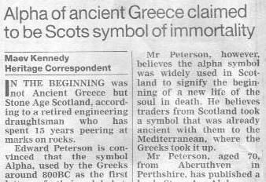
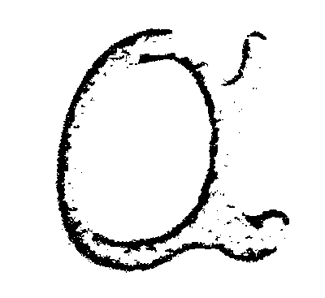
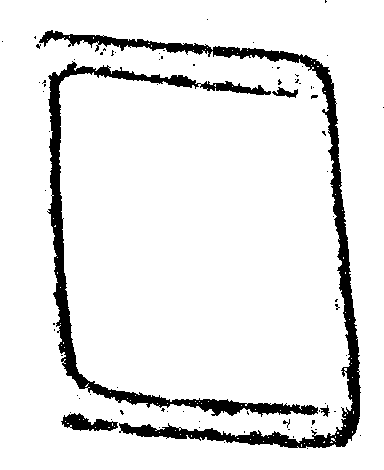
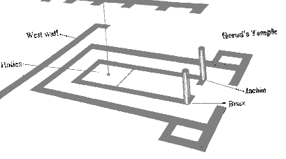
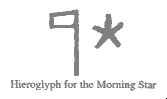
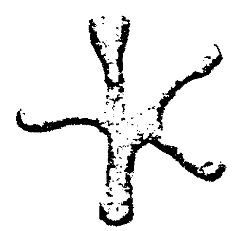
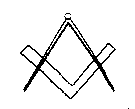

## The Manchester Umbrella Decoded

*by Prof. Oleg Pöhl*

### Acknowledgement

My heartfelt thanks to your editor, Dr Lanzavecchia, for permitting me to share with you this strange voyage of discovery. For many years, I have searched for connections between the forgotten science of ancient Egypt and the many startling discoveries unfolding in the laboratories of today. Never did I think that an obscure souvenir parasol would lead me on a trail which came eventually to link the lost secrets of the Pharoahs with Dolly the sheep, and the arcane notation of a lost computer language.

### a – The First Clue

It is many years now since I last dabbled in your language APL, and I had long forgotten the old umbrella which my son gave me on his return from the Manchester convention. Then one morning I read this in the Guardian newspaper, which my son sends me from time to time to keep me warm in the winter:

{ width="338" height="232" }<code>Guardian Newspaper 
March 1999</code>

Something stirred deep in my memories, and I began to visualise again the markings on the Manchester parasol. I became quite certain that there were three symbols, repeated four times, and that the first of them could so easily be a crude representation of that early Pictish alpha.

Frantic indeed was my search, and great my jubilation on discovering again my lost treasure, which not only confirmed my initial conjecture but would quickly lead me to even greater riches.

{ width="160" height="147" } Here we have again that Manchester alpha, re-photographed and image-enhanced by the finest modern technology, but still retaining that inexplicable sacredness of an 8,000 year old totem. It was adopted by the Nazarenes as their ‘fish’ symbol some 50 years before Christ was born. Indeed, “Nasrani” remains in use today as the Arabic word for a shoal of small fish as well as for ‘Christian’. In the New Testament it occurs many times, as in Ihsoun ton Nazwraion \[John 18,5\] and has been in constant use by Christians since the persecutions of ancient Rome.

### The Second Clue

{ width="160" height="196" }I believe that this is known to your readers as \{quad\}, but in spite of the unfortunate distortion caused by stretching of the fabric, it is clearly a plan of Solomon’s Temple, central to the mysterious discoveries of the Knights Templar and by implication to all the strange rites of modern freemasonry.

Compare it for a moment with the known layout of the Temple, as copied precisely in the construction of Rosslyn chapel in the mid fifteenth century:

{ width="412" height="230" } Plan from "The Hiram Key"  
Knight & Lomas  
Arrow, 1997, page 423

The proportions of the APL `⎕` \{quad\} match the proportions of the Temple so perfectly that this surely can be no co-incidence? We shall return to Rosslyn in a moment, for it is here that the strangest part of the mystery unfolds. But first to the central, third symbol on the parasol:

### Power and the Dawn Star

{ width="167" height="99" } Now I *knew* that I had stumbled on something truly mind-shattering. The Sumerian symbol for the ‘dawn star’ is a FIVE POINTED star – used by the Egyptians from around 4000BC to symbolise the rebirth of the King as Osiris and his journey to the stars.

This is one of the most ancient symbols known to man, having come to Sumer from the ancient civilisations which were drowned by the great catastrophe sometime between 10,000 and 8,000BC \[*Heaven’s Mirror*, Graham Hancock, 1998\]. The computer languages of the world use only one symbol – the six-pointed star – for multiplication, and yet here on the Manchester Umbrella I find:

{ width="400" height="389" }

The revelation came upon me like a great light breaking out in a darkened room – your APL language alone uses the 5-pointed star as the symbol not for multiply, but for ‘Power’. Surely this also can be no co-incidence?

From here it a is short step to note that the ‘triple tau’ (King, Priest, Prophet) can easily be rendered in APL as Lefttack+Righttack+Downtack, and that one of the only symbols allowed in a variable name other than A-Z is `∆` – the pyramid – the symbol traditionally employed by APL programmers as the preface to their most sacred (global) variables.

### The Link with Freemasonry

{ width="135" height="109" } I quickly realised that there existed many more odd ‘co-incidences’, for example the original statement separator \{diamond\} was formed by overstriking `^` \{and\} and `∨` \{or\} to produce something identical to the badge of freemasonry (the square and compasses). So – why was \{diamond\} never implemented by mainframe APLs on IBM machines ... surely this can only have been *because it was considered too sacred to be used.*

### The Final Secret Revealed

I communicated these ideas to my son, and within days I received the following communication by electronic mail:

The likely repository of the secrets of the last true King of Egypt is the 'chapel' of Rosslyn in Scotland. This is where they were secreted after the Templar William St Clair hid the excavated remains of Solomon's temple back in 1370 after the Templars were banned by the Catholic church. So far, so uninteresting.

What else just happened recently near Rosslyn?? That's right .... DOLLY THE SHEEP.

Simple really - the kings of Egypt attained everlasting life by cloning. At the death of the old king, the new king was duly drugged up to the eyeballs, his sperm collected (means uncertain) and used to start the next king. His sister was naturally used to carry the child, giving rise to incorrect stories of incest. Actually it was just a simple clone job - the sister was necessary to avoid problems of rejection of the implanted foetus.

So ... the secret is out. The method was carried out of Egypt by Moses, holed up in the Ark of the covenant for a few thousand years, rescued by the Templars, hidden in Rosslyn Chapel and finally revealed to the Ministry of Agriculture who used it with immediate effect to create Dolly. Oddly enough, the experiment has not yet been successfully repeated!

The final proof (as if any were needed) ...

The usurpers who ran the lower kingdom of Egypt in the ‘First Intermediate Period’ were known as “The Shepherd Kings” and the sacred words which are told to a master of freemasonry on initiation are ....

*“Ma’at-neb-men-aa Ma’at-ba-aa”*

  Prof Oleg Pöhl  
  1st April 1999

*Prof. Pöhl may be contacted via [Vector production](mailto:100331.644@compuserve.com) \[Ed\].*

***

{ width="0" height="0" }
