**Note:** This article contains figures which may take some time to download (the largest are 190K files). Since the details in the pictures are important we did not feel we should compress them further. *Ed*

## Fast Fourier Transforms, Diffraction Patterns, and J

*by Ned W. Allis (allisn@lafayette.edu), Jeffrey P. Dumont (dumontj@lafayette.edu),  
Flynn J. Heiss (flynnheiss@yahoo.com), Clifford A. Reiter (reiterc@lafayette.edu)*

The fast Fourier transform package available for J is very useful for simulating diffraction patterns. Here we use it to replicate a classic optical transform and explore its power in creating diffraction patterns of fractal images and chaotic attractors. These types of images are already visually stimulating, and we found that the diffraction patterns could also yield remarkable images. We will define some J functions which are helpful for viewing the results of the J Fourier transform package.

The diffraction patterns of crystals have been the focus of research since the discovery of x-ray diffraction in 1912. Diffraction patterns and their relationship to Fourier transforms are discussed in detail in [\[6\]](#ref6). Renewed interest in diffraction patterns has arisen due to the discovery of quasicrystals which exhibit classically forbidden symmetry in their diffraction patterns. Senechal gives a good introduction to quasicrystals [\[11\]](#ref11).

## The Fast Fourier Script in J:

The fast Fourier transform package can be obtained from the J website [\[4\]](#ref4). Our J examples assume that the `fftw` add-on has been installed and the `fftw.ijs` script has been loaded. The package is based on the code written originally by Frigo and Johnson [\[2\]](#ref2). The script includes both the forward and reverse transforms as predefined functions `fftw` and `ifftw`. A detailed description of the mathematics involved can be found at [\[2\]](#ref2), but here we offer a basic explanation. The `fftw` function defined in the script takes a complex-valued array *X* of any dimension *d* as its right hand argument and returns another <i>d</i>-dimensional complex-valued array *Y* according to the following definition: 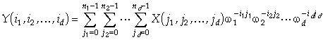 ,  
where 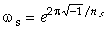, for all 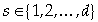.  
The reverse transform is computed using:  
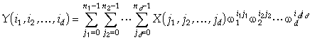.  
Notice that the only difference between the forward and the reverse transforms is the minus signs within the exponents. We now give a simple example of the use of the `fftw` function.

```
   load'c:\j403\system\packages\fftw\fftw.ijs'
   ]m=:2 2$1 2 1j1 3j1
  1   2
1j1 3j1
   fftw m
  7j2 _3
_1j_2  1
```

Computations using `fftw`, although rapid, can be very memory intensive. Most of the input arrays we work with are approximately 1000 by 1000 pixels. The following function

```
   ts=.6!:2 ,7!:2@:]
```

measures time and space usage. In Table 1, we list the time and memory that it took to perform an fftw operation on our 400 MHz PC. We note that the transform is significantly faster on arrays whose size is a power of 2, although the transform on a slightly larger array uses the same amount of memory. It also seems that the limit on our system of fftw on square matrices is 2047 by 2047.

<table border="0" cellpadding="0" cellspacing="4" width="80%">
<tr>
<td><b>Size</b></td>
<td><b>Time</b></td>
<td><b>Memory</b></td>
</tr>
<tr>
<td>64 by 64</td>
<td>0.016 sec</td>
<td>1.42   megs</td>
</tr>
<tr>
<td>128 by 128</td>
<td>0.062 sec</td>
<td>5.65   megs</td>
</tr>
<tr>
<td>256 by 256</td>
<td>0.390 sec</td>
<td>22.55   megs</td>
</tr>
<tr>
<td>512 by 512</td>
<td>1.578 sec</td>
<td>90.19   megs</td>
</tr>
<tr>
<td>513 by 513</td>
<td>3.141 sec</td>
<td>90.19   megs</td>
</tr>
<tr>
<td>1024 by 1024</td>
<td>9.531 sec</td>
<td>360.725 megs</td>
</tr>
<tr>
<td>1920 by 1920</td>
<td>30.74   sec</td>
<td>721.435 megs</td>
</tr>
<tr>
<td>2047 by 2047</td>
<td>51.656 sec</td>
<td>721.435 megs</td>
</tr>
<caption align="bottom"><b>Table 1: Time and memory involved in <tt>fftw</tt> computations</b></caption>
</table>

## Diffraction Patterns

As a first application of `fftw` we replicate one of the experiments in the Atlas of Optical Transforms [\[3\]](#ref3). The input, seen in Figure 1, consists of three circular apertures arranged horizontally, and can be found on the left side of plate 10 in the Atlas of Optical Transforms. The corresponding diffraction pattern can be found in the same position on the right side of plate 10. To recreate that input, we use

```
   a=:100 100$0
   b=:_100 _100{.66 66{.255*25>+/"1*:,"0/~i:15
   B=:_700 _700{.500 500{.(a,.a,.a) ([,],[)b,.b,.b
```

Here, `a` gives a 100 by 100 array of `0`’s, `b` gives a circular region of `255`’s embedded in a 100 by 100 array of zeros, and `B` gives us the desired array displayed in Figure 1.

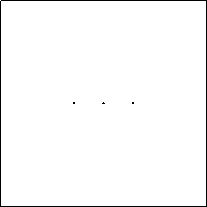  
**Figure 1: Three apertures**

We then compute the magnitude of the complex-valued Fourier transform. Next we use the `dis` function to make these values discrete in order to create an 8-bit greyscale bitmap.

```
   max=:>./@,@]
   min=:<./@,@]
   maxout=:0.9999&*@[
   dis=:[:<.(maxout*]-min)%max-min
```

Here we demonstrate the use of this function:

```
   x=:(1+i.20)%19r5p1
   Sin=:1&o.
   data=:(Sin x)%x
   10 dis data
9 9 9 9 9 9 8 8 7 7 6 6 5 4 4 3 2 1 0 0
```

Applying the `dis` function to the magnitude of our transform, we write out the bitmap using `writebmp8` as defined in `raster3.ijs` [\[10\]](#ref10) using a greyscale palette, `g256`.

```
   tr=:256 dis |fftw B
   g256=:3#"0 i.256
   (g256;tr) writebmp8 'figure2.bmp'
```

Figure 2 almost gives us the expected diffraction pattern. It turns out that the corners of our images look similar to what we should see as the centre and vice versa.

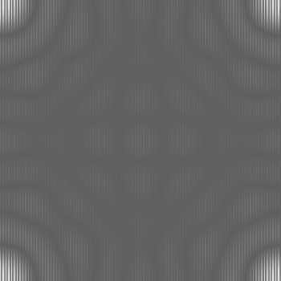  
<b>Figure 2: The magnitude of the Fourier transform of Figure 1<br>
as given by the <tt>fftw</tt> function with <tt>dis</tt></b>

Thus, we use the following functions to re-centre our image.

```
   hr=: <.@-:@# |. ]
   HR=:hr"1@:hr
```

The function `hr` rotates an array half way along its length while `HR` applies hr to both axes of a matrix. Applying `HR` to the data shown in Figure 2 yields Figure 3, which closely resembles the expected diffraction pattern found in the Atlas of Optical Transforms; while this image seems distressingly black, it actually shows slightly more contrast than the image in the atlas. In fact, we can see an extra ring.

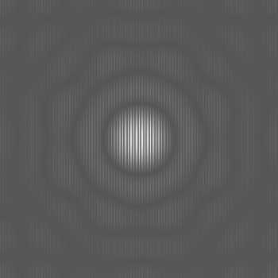  
**Figure 3: Figure 2 as recentered by the `HR` function**

At this point, we maximise the contrast to better understand the diffraction pattern. This leads us to the use of the following function from [\[8\]](#ref8):

```
   cile=:$@] $ ((/:@/:@] <.@:* (%#)),)
```

Here we demonstrate the use of the `cile` function:

```
   10 cile data
9 9 8 8 7 7 6 6 5 5 4 4 3 3 2 2 1 1 0 0
```

Notice the difference between the outputs of the `cile` and `dis` functions applied on the same data. The output of the cile function distributes the data into groups of 2 while the `dis` function has an abundance of 9s but only one 2. Using this function on the output of the Fourier transform, `HR 256 cile |fftw B`, provides us a detailed look at the fringes in the diffraction pattern (see Figure 4).

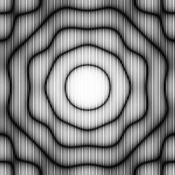  
**Figure 4: The magnitude of the Fourier transform of Figure 1 as  
given by the `cile` function and recentered according to the `HR` function**

## Transforms of Sierpinski Fractals

Other visually attractive diffraction patterns are created by using Sierpinski fractals as input. We created both the Sierpinski triangle and carpet with the following function given in [\[7\]](#ref7).

```
   ggl=:+./"1@([(+./@(+./)@(</~@i.
      @[*.*."1/~@]))"2>@>@{@(#<@(<"1@])))
```

Figure 5 displays a Sierpinski triangle on the left created with

```
   st=:2 ggl (n#3)#:i.2^n=.9
```

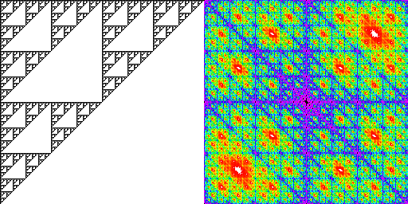  
**Figure 5: A Sierpinski triangle and the magnitude of its transform**

Its Fourier transform is located on the right side in Figure 5. Here we maximise contrast with the `cile` function. The palette is black at one end, white at the other end, and blends between red and magenta in the middle. Note that the Fourier transform, like the input array, displays self-similarity, a common feature of fractals. Figure 6 displays a Sierpinski carpet on the left created by

```
   sc=:2 ggl (n#3)#:i.3^n=.5
```

and shows its Fourier transform on the right, which also displays fractal-like qualities.

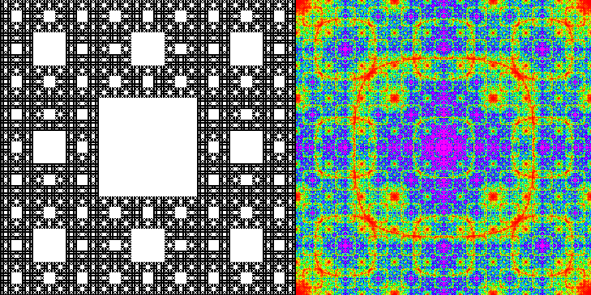  
**Figure 6: A Sierpinski carpet and the magnitude of its transform**

To give an example of a 3-dimensional Fourier transform, we create a Menger Sponge as follows.

```
   ms=:3 ggl (n#3)#:i.3^n=.4
```

We then take the Fourier transform of the sponge and display each plane of both the Menger Sponge and the transform in an animation which may be found at [\[9\]](#ref9).

## Transforms of Chaotic Attractors

We will see that chaotic attractors and their diffraction patterns may be visually appealing. We start with an attractor with rotational symmetry. Such images have diffraction patterns that also contain rotational symmetry which is either equal to or twice that of the original image. For example, the left side of Figure 7 displays a chaotic attractor with 5-fold rotational symmetry, which was created by the methods discussed in [\[5\]](#ref5). Its transform, located on the right, has 10-fold symmetry, arising from the centrosymmetric property of the Fourier transform [\[11\]](#ref11) combined with the original symmetry type carried over by the transform.

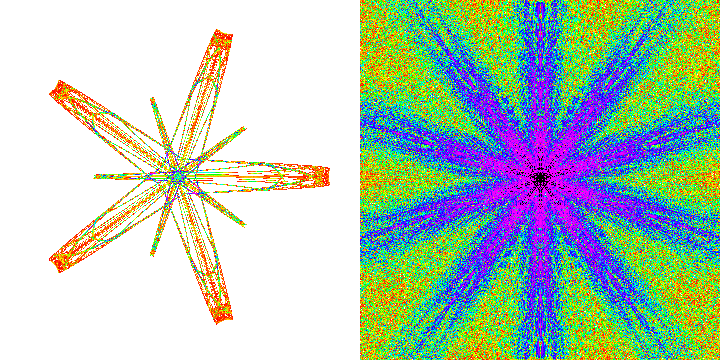  
**Figure 7: A chaotic attractor with dihedral 5-fold symmetry  
and the magnitude of its transform**

In search of quasicrystal-like chaotic attractors, we also tried taking transforms of chaotic attractors with almost forbidden symmetry created with techniques discussed in [\[1\]](#ref8). Figure 8 gives an example of a chaotic attractor with almost pentagonal local symmetry and its transform, which consists of points on a square lattice. These points are so focused that they need to be enlarged. We use the following J function to make them more visible.

```
   tess=:4 4&((>./@,);._3
```

This results in a 7-fold magnification of the lattice points on the right side of Figure 8.

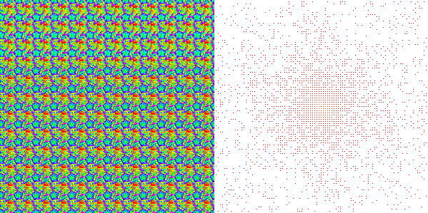  
**Figure 8: A chaotic attractor with forbidden symmetry  
and the magnitude of its transform**

**Acknowledgement**: This work was supported in part by NSF grant DMS-9805507. The chaotic attractor in Figure 7 was joint work with a co-author from [\[5\]](#ref5).

## References

<ol>
<a name="ref1"> <li>Dumont, J. and Reiter C. <i>Chaotic Attractors near Forbidden Symmetry</i>, Chaos Solitons and Fractals, to appear
<a name="ref2"> <li>Frigo, M. and Johnson, S. <i>FFTW Homepage</i>, <a href="http://www.fftw.org">http://www.fftw.org</a> 
<a name="ref3"> <li>Harburn, G. , Taylor, C. A. and Welberry, T. R. <i>Atlas of Optical Transforms</i>, G. Bells &amp; Sons, Ltd, (1972) 
<a name="ref4"> <li>J Software, <a href="http://www.jsoftware.com">http://www.jsoftware.com</a>
<a name="ref5"> <li>Jones, K. and Reiter, C. A. <i>Chaotic Attractors with Cyclic Symmetry Revisited</i>, Computers and Graphics, to appear
<a name="ref6"> <li>Lipson, S. G. , Lipson H. and Tannhauser D. S., <i>Optical Physics</i>, Cambridge University Press, (1995)
<a name="ref7"> <li>Reiter, C. A. <i>Sierpinski Fractals and GCDs</i>, Computers and Graphics, 18 (1994) 885–891
<a name="ref8"> <li>Reiter, C. A. <i>Fractals, Visualization, and J</i>, Iverson Software, (1995) 
<a name="ref9"> <li>Reiter, C. A. <a href="http://www.lafayette.edu/~reiterc/fft/">http://www.lafayette.edu/~reiterc/fft/</a>
<a name="ref10"> <li>Reiter, C. A. <a href="http://www.lafayette.edu/~reiterc/j/">Reiter, C. A. http://www.lafayette.edu/~reiterc/j</a>
<a name="ref11"> <li>Senechal, M. <i>Quasicrystals and Geometry</i>, Cambridge University Press, (1995)
</li></a></li></a></li></a></li></a></li></a></li></a></li></a></li></a></li></a></li></a></li></a></ol>

> Ned W. Allis  
> Lafayette College, Box 8210  
> Easton, Pa 18042, U.S.A.

> Jeffrey P. Dumont  
> Lafayette College, Box 7756  
> Easton, Pa 18042, U.S.A.

> Flynn J. Heiss  
> 57 Main Street  
> Geneseo, NY 14454, U.S.A.

> Clifford A. Reiter  
> Department of Mathematics, Lafayette College  
> Easton, Pa 18042, U.S.A.

***
