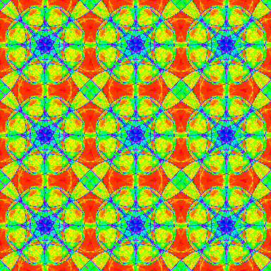
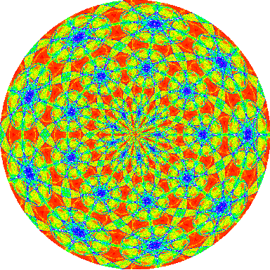
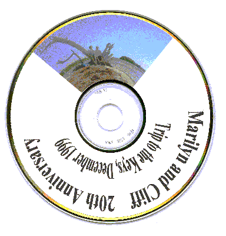

*by Cliff Reiter ([reiterc@lafayette.edu](mailto:reiterc@lafayette.edu))*
{ .byline }

## Prologue

The title of this note gives away the fact that the utility described here can be useful. If I had instead used the title “Mapping Rectangles to Annular Sectors” and claimed that was exciting and useful, you would have thought that I was joking. My goal in this note is to convince you that I am not joking—not entirely.

I recently have mapped rectangular images onto a segment portion of an annulus. While I would not have described it that way at the time, this has come up in three contexts in the past couple years. The first was when some students and I took images with repetitive symmetry and created circular images that resulted from wrapping the pattern around the origin [\[1\]](#ref1). An example of that is given below. Second, as I started archiving materials on CD-R discs, I found that having an image on the CD label was handy and it was especially nice when sending a CD to other people. Wrapping text around the CD label can also be striking. Third, I created a design for printing on a flying sport disc. The design included text running around the outside of a hyperbolic pattern. I plan to say more about that in a subsequent note.

My solutions to the first two problems worked, but they were tied to the particular applications. I decided that I should think about a general utility that would work in a broad context that would include all three of these cases.

## The Annular Insertion Utility

The appendix gives the definition of the conjunction `AnIns` which is our utility. Its definition is fairly straightforward; it is a couple dozen lines long. How `AnIns` works will be briefly described in the appendix. It is also defined in the script *anins.ijs* that is available for downloading from [\[3\]](#ref3).

Here we will focus on the syntax and application of `AnIns`. The conjunction has two arguments that are used to define the annular region and the derived function has two arguments that are the target and insertion arrays.

Consider the following example.

```
   load 'anins'

   (15 15$0) 0.5 1 AnIns 1r2p1 0 (10+i.5 8)
0 0 0 0 0 0 0 10  0  0  0  0  0  0  0
0 0 0 0 0 0 0 18 19 19 12  0  0  0  0
0 0 0 0 0 0 0 26 27 28 20 21  0  0  0
0 0 0 0 0 0 0 34 35 36 29 30 22  0  0
0 0 0 0 0 0 0  0  0 45 38 30 23 15  0
0 0 0 0 0 0 0  0  0  0 46 39 31 24  0
0 0 0 0 0 0 0  0  0  0  0 40 32 24  0
0 0 0 0 0 0 0  0  0  0  0 41 33 25 17
0 0 0 0 0 0 0  0  0  0  0  0  0  0  0
0 0 0 0 0 0 0  0  0  0  0  0  0  0  0
0 0 0 0 0 0 0  0  0  0  0  0  0  0  0
0 0 0 0 0 0 0  0  0  0  0  0  0  0  0
0 0 0 0 0 0 0  0  0  0  0  0  0  0  0
0 0 0 0 0 0 0  0  0  0  0  0  0  0  0
0 0 0 0 0 0 0  0  0  0  0  0  0  0  0
```

In that example, the derived function had the 15 by 15 matrix of zeros as its target array and the insertion array given by `10+i.5 8` as its right argument. Not every entry from the insertion array appeared, and some appeared more than once. That is a result of the natural distortion occurring in this type of insertion.

The left conjunction argument specifies the radial range as a fraction of the maximal inscribed radius. Thus `0.5 1` indicated that the insert was to go from one-half the maximal radius up to the maximal radius. The right argument `1r2p1 0` specifies that the angles should go from p/2 radians (90 degrees) to 0 as the insert is placed clockwise.

The argument matrices may be raw `"a."` data. For example, the following inserts a three-fourths radius semicircle of the letter `"M"` in a character array of digits.

```
   (15 15$'01234') 0 0.75 AnIns 0 _1p1 (10 10$'M')
012340123401234
012340123401234
012340123401234
012340123401234
012340123401234
012340123401234
012340123401234
01MMMMMMMMMMM34
01MMMMMMMMMMM34
012MMMMMMMMM234
012MMMMMMMMM234
0123MMMMMMM1234
012340MMM401234
012340123401234
012340123401234
```

In general, the target and insert arrays must have the same type, but they can be higher dimensional arrays. For example, they might be arrays of RGB triples. However, the target array is assumed to be square in the sense that its first two axes have the same length—and hence the inscribed radius is the same horizontally and vertically.

The radial fractions should be between 0 and 1. A reversal of the order of those fractions results in a radial reversal of the inserted region.

The angles should be specified in radians between -p and p. Reversal of those angles results in the reversal of the clockwise/counterclockwise sense of the insertion. Clockwise motion maintains the usual left to right order of the insertion image and hence the angles specified in our examples will usually be decreasing.

  
**Figure 1. A Chaotic Attractor with Repetitive Symmetry**

## Application to Symmetric Fractals

The image *nearp4m.bmp* is shown in Figure 1. It is a chaotic attractor from [\[2\]](#ref2). We will use a function from the script *raster4.ijs* in order to read the bitmap into J. Both the image and the script are available from [\[3\]](#ref3) with the materials for [\[2\]](#ref2). We assume that the image and script have been placed in a subdirectory *fvj2* of the main J directory. Use a path appropriate for where you placed those files. The result of reading the file is a boxed list giving the palette for the image and the matrix of indices into the palette. We see below that the image has 256 colors, color index 0 is white, and the image is 750 by 750.

```
   load 'fvj2\raster4'
   'p b'=: readbmp8 'fvj2\nearp4m.bmp'
   $p
256 3
   0{p
255 255 255
   $b
750 750
```

  
**Figure 2. The Chaotic Attractor Mapped onto a Circle**

Next we create a white 1000 by 1000 array and replicate the image from Figure 1 three times as our insertion array. We then apply AnIns on the full disk.

That is, the radius is from 0 to 1 and the angle from p to -p.

```
   blank=: 1000 1000$0
   insert=: b,.b,.b
   result=: blank 0 1 AnIns 1p1 _1p1 insert
   (p;result) writebmp8 'figure2.bmp'
```

The result was written as a bitmap using writebmp8. It appears in Figure 2.

The application of AnIns on a 1000 by 1000 image is not trivial. J4.04 required about 32 seconds and 10M on a 733MHz PC (J4.03 required 80 seconds and 13M—so J4.04 offers an impressive gain in speed).

## Application to CD Labels

Creating CD labels using `AnIns` is easy too, although there are usually a few more details to consider. Here we will aim to create a CD label for the CD containing several dozen digital images from a trip. The image *keys.bmp* is available from [\[3\]](#ref3) with materials for [\[2\]](#ref2). Assuming *raster4.ijs* is loaded and the image is in the *fvj2* directory, we can read the image as follows. Also, since this is a 24-bit image, the result is a 3-dimensional array. Thus we make our blank array a three dimensional array.

```
   $insert=: readbmp24 'fvj2\keys.bmp'
300 450 3
   blank=: 1000 1000 3$255
```

Since the width of a CD label is 4.5 inches and its center hole has width 1.625 inches, we should let the radius run from 0.36111 to 1 in order to lie on the CD label. We will insert the *keys.bmp* image into an angular quarter of the label.

```
   1.625%4.5
0.361111
   temp=: blank 0.361111 1 AnIns 1p1 1r2p1 insert
   temp writebmp24 'temp.bmp'
```

We also want to put some text onto our image. Since the insertion needs to be an array representing a 24 bit image, the text needs to be rendered and saved in a suitable format. Here we find it convenient to use a utility from the script *dwin.ijs* from [\[2\]](#ref2) and available at [\[3\]](#ref3) to open a graphics window. Then, we place some text in the window using standard J graphics commands.

```
   load 'fvj2\dwin'
   WINSHAPE=: 600 100
   dwin 'keys'
   glfont '"Times New Roman" 400 bold'
   gltextxy 10 990
   gltext 'Marilyn and Cliff    20th Anniversary'
   gltextxy 10 490
   gltext '    Trip to the Keys, December 1999'
   glshow ''
   glfile 'keystext.bmp'
   glsavebmp 1200 200
```

Now we load the file with text and insert it.

```
   text=: readbmp24 'keystext.bmp'
   temp2=: temp 0.361111 1 AnIns 1r4p1 _3r4p1 text
   temp2 writebmp24 'keys_cd_label.bmp'
```

Now the file *keys\_cd\_label.bmp* contains our CD label. One detail remains: we need to print the label so that it is the correct size and it falls on the correct place on a sheet of blank CD labels. This may be accomplished in a Word Processor or other program that allows images to be sized and margins to be set. We print on Avery 5824 labels which requires a 4.5 inch image with a top margin of 0.5 inches and a left margin of 2 inches. We recommend a trial printing on scrap paper although the label created here printed perfectly the first time. Figure 3 shows the label on a CD.

  
**Figure 3. A CD Label with an Image and Text**

## Postlogue

We have seen that the utility AnIns can be used to wrap images onto an annulus. This allowed us to create an interesting complex image with circular symmetry and we also used this to insert an image and text into circular sectors on a CD label.

We kept our examples brief, but consider the following possibilities. The two lines of text in Figure 3 would look better if different font sizes had been used. That can be accomplished by inserting one `glfont` command in our text construction. Also, the distortion of images is less noticeable when using smaller sectors. Using multiple images can be attractive. Our examples always began with a blank target array. How could you add text to the image from Figure 2 used as the target image? How could you create a blank circular window in the image center? What would the image look like if you repeated the image from Figure 2 and inserted it onto a CD label?

## Appendix

The following is a conjunction for annular insertion. It is defined in *anins.ijs* which is available on the web at [\[3\]](#ref3). The conjunction is based on the following approach. The “while-loop” runs through each scan line of the resulting array `z`. The pixel coordinates of each scan line in the result array are converted to semi-normal coordinates by `j.&i2s`. That is, the pixel coordinates are scaled to a coordinate system with lower left `_1 _1` and upper right `1 1`. The local function np converts pixel coordinates into normalized polar coordinates. That is, radii and angles given as fractions of the positions in the region defined by the annular sector. Only results which lie between 0 and 1 in both those coordinates correspond to the insertion region and the scan line is amended to suitably change such pixels.

```
   AnIns=: 2 : 0

:
imsz=.#x.
'r0 r1'=.m.
'a0 a1'=.n.
i2s=.<:@(*&(2%imsz-1))        NB. image coord to seminormal
nr=.(%r0-r1)"_ * 10&o. - r1"_      NB. normalized radius
na=.(%a1-a0)"_ * 12&o. - a0"_      NB. normaized angle
np=.(nr,na)@+@j.&i2s  f.           NB. normalized polar
i=.0
z=.i.0,imsz,2}.$x.
while. i<imsz do.
  npc=.(i.imsz) np i
  q=.*./ |: (0&<: *. <:&1)npc
  od=.i{x.
  if. 0<+/q do.
    id=. (<"1 <. 0.5+(<:2{.$y.)*"1 q#npc){y.
    z=.z,id(q#i.imsz)}od
  else.
    z=.z,od
  end.
  i=.>:i
end.
z
)
```

## References

<ol>
 <li><a name="ref1">Nathan C. Carter, Stephen M. Grimes, and Clifford A. Reiter, Frieze and Wallpaper Chaotic Attractors with a Polar Spin, <i>Computers &amp; Graphics</i>, <b>22</b> 6 (1998) 765-779.
 <li><a name="ref2">Clifford A. Reiter, <i>Fractals, Visualization and J, Second Edition</i>, Jsoftware, Toronto, 2000.
 <li><a name="ref3">Clifford A. Reiter, J materials, <i><a href="http://www.lafayette.edu/~reiterc/j/index.html">http://www.lafayette.edu/~reiterc/j/index.html</a></i>.
</a></li></a></li></a></li></ol>

***
