*\[Please note this paper contains equations shown as pictures, as it is not yet possible to include them as text. Ed.\]*

## Hyperbolic Symmetry is a Breeze

*by Cliff Reiter ([reiterc@lafayette.edu](mailto:reiterc@lafayette.edu))*

## Prologue

During the past couple semesters I have enjoyed an occasional practice with Lafayette’s Ultimate (Frisbee[<sup>1</sup>](#note1)) Club. An annual club tradition is the creation of a design that is hot stamped onto discs that are used for fund raising, practice, and games. The students create designs that are attractive to college students (since they need to sell them) and often their designs give interesting insights into college age values. I have not been involved in designing the club’s discs. However, I am extremely jealous. I wanted to create a design for a disc. Many people, including me, find hyperbolic designs are quite interesting. Indeed, Escher was stunned and delighted when he saw some of Coxeter’s hyperbolic tilings and this led to his beautiful Circle Limit III woodcut. See [\[7\]](#ref7) or [\[11\]](#ref11) for the image, [\[5\]](#ref5) for a mathematical discussion of the image, and [\[11\]](#ref11) for discussion of the symmetry in Escher’s drawings.

This note is the story of a hyperbolic J disc design. We will see that creating hyperbolic symmetry is a breeze. Basically we construct a polygon, which happens to be in the shape of a J. We then multiply the polygon by a bunch of hyperbolic matrices and display the results in a graphics window. Creating images with hyperbolic symmetry really is that easy. However, the story here is more interesting. We want to use a two-colour design. Thus we need to separate “levels”. This requires careful order of operations and attention to numeric precision. Furthermore, the company that does the hot stamping requires the colours to be separated at least 1/32 of an inch, but hyperbolic tilings get small and intertwined near the edge. Hence, we used some image processing techniques to keep the colours apart. Lastly, we wanted to add some text around the edge. That was easy using our annular insertion utility `AnIns` that is described in [\[10\]](#ref10) and available from [\[9\]](#ref1).

## Hyperbolic Symmetry

There are two convenient models for hyperbolic geometry. These are the Poincare model in which the hyperbolic plane appears in the unit disk and the Weierstrass model which is on the surface of the upper half hyperboloid 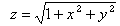. Plotting images in the Poincare model is easiest, while the symmetries are easiest to describe in the Weierstrass model. Fortunately, it is easy to convert between these models. We can convert points in the Weierstrass model to the Poincare model by the projection *W2P* which is given by the following:

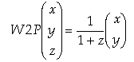 .

The inverse is:

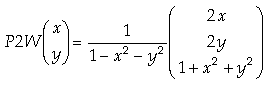 .

It is straightforward to implement these in J.

```
   W2P=:(}: % >:@{:)"1
   W2P 2 _2 3
0.5 _0.5
   P2W=:( ](-.@] %~ +:@[ , >:@]) (+/)@:*:)"1
   P2W 0.5 _0.5
2 _2 3
```

In [\[1\]](#ref1) and [\[8\]](#ref8) hyperbolic symmetries are used to create probabilistic iterated function systems, and our implementation of the symmetries is similar to the ones appearing there. However, we will be applying the symmetries to polygons, so our graphics construction is quite different.

It is known that there is a tiling of the hyperbolic plane with <i>p</i>-sided polygons meeting *q* at a vertex if and only if (<i>p-</i>2)(<i>q-</i>2) > 4, see [\[4\]](#ref4). The “edges” of these tilings are arcs and it looks like the polygons are getting smaller near the edge, but in the hyperbolic sense, the tiling is legitimate. The symmetries of the tiling are generated by reflections through the sides. All of them can be described in terms of the following reflections; see [\[1\]](#ref1), [\[3\]](#ref3), or [\[6\]](#ref6) for further description of the geometry.

- The reflection *A* across one edge of the <i>p</i>-sided polygon;
- The reflection *B* across the <i>x</i>-axis; and
- The reflection *C* across a line from the origin to a vertex of the polygon.

The transformations are represented with matrices *A*, *B*, and *C* (acting on the Weierstrass model) as follows:

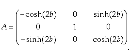 , where 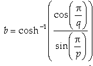 ,

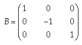 and 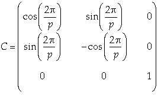.

It is useful to define two more matrices, *S=CB*, which gives a counter-clockwise rotation by 2p/<i>p</i> around the origin, and <i>T</i>=<i>AC,</i> which gives a counter-clockwise rotation by 2p/<i>q</i> around a vertex of the central polygon of the tiling.

These symmetries can be implemented in J. We give *p* as the left argument and *q* as the right argument.

```
   load 'trig'
   A=: 4 : 0
b=.arccosh (cos 1p1%y.)%sin 1p1%x.
((-@cosh,0:,sinh),(0:,1:,0:),:-@sinh,0:,cosh)2*b
)
   B=: (1 _1 1*=i.3)"_
   C=: 4 : 0
(((cos , sin),: sin , -@cos),0 0 1"_ ) 2p1%x.
)
   mp=: +/ . *
   S=: C mp B
   T=: A mp C
   ABCST=: A,B,C,S,:T
```

Here we construct the matrices associated with <i>p</i>=5 and <i>q</i>=6.

```
   'a b c s t'=: 5 ABCST 6
   s
0.309017 _0.951057 0
0.951057  0.309017 0
       0         0 1
   t
 _1.03262  _3.17809  3.1885
 0.951057 _0.309017       0
_0.985302  _3.03245 3.34164
```

There are three classical families of discrete symmetry groups of the hyperbolic plane but we are interested in the family involving just rotations. It is generated by *S* and *T*. The above matrices `s` and `t` are from the case when there are 5-fold and 6-fold rotations.

## Creating a J

We think of a J as a tee shaped polygon atop two semicircles. We pick a convenient scale (where the semicircles are about the origin) and then transform the J into a polygon in the Poincare disk. We begin by recentering the polygon (subtracting the average of the minimum and the maximum in each coordinate) and then dividing by the maximum norm.

```
   $cj=: |:2 1 o./ 2r200p1 * -i. 101
101 2
   $J=:2 0,2 8,_1 8,_1 10,6 10,6 8,4 8,4 0,(4*cj),|.2*cj
210 2
   (<./,:>./)J
_4 _4
 6 10
   norm=: +/&.(*:"_)"1
   J=: (%>./@:norm) J-"1]1 3
   (<./,:>./) J
_0.581238 _0.813733
 0.581238  0.813733
```

Since we will apply many transformations, we actually want to start with a smaller version to avoid overlap. We scale the J-polygon by 0.29 and add 0.24 0.23 to each coordinate using the following affine transformation.

\]af=: 0.29 0 0,0 0.29 0,:0.24 0.23 1 0.29 0 0 0 0.29 0 0.24 0.23 1 $aJ=: \}:"1 (J,.1)mp af 210 2

The next three commands use utilities from script *dwin.ijs* to plot the polygon `aJ`. The script is available at [\[9\]](#ref9). We use `dwin` to open a graphics window and `dpoly` to draw the polygon.

```
   load 'fvj2\dwin'
   _1 _1 1 1 dwin 'J'
   0 0 0 dpoly J
```

The result is shown in Figure 1.

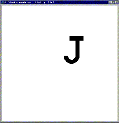{ width="238" height="245" }  
<b>Figure 1. A J-Polygon</b>

## Making Levels

Now we turn to making the hyperbolic transformations we need, taking increasing care to organize them into “levels”. First, the function `clean` multiplies the absolute value times signum (which is zero very near 0). This makes entries very close to zero equal to zero, reducing roundoff error. Then `S1` is the matrix powers of `s`; that is, these give the five 5-fold rotations about the origin (including the identity). Note we speak of the transformations as though they are in the Poincare disk, even though they are really in three space. Second, `S2` is a rotation about the other point, followed by symmetric rotation around the origin. It is constructed using `mpt` which gives a table of all possible matrix products. This yields 25 transformations (it turns out they are all new, although that is not obvious). Next, we get `S3` by applying the same technique. However, this time we will get duplicates unless we remove the matrices from the previous levels via `(S1,S2)-.~` as seen below.

```
   clean=: * * |
   mpt=: mp"2 _"_ 2
   $S1=: clean s mp^:(i.5) s
5 3 3
   $S2=: clean ,/S1 mpt t mpt S1
25 3 3
   $S3=: (S1,S2)-.~clean,/S1 mpt t mpt S2
100 3 3
```

In our disk design, one hot stamp die will be used for the colour used for levels 1 and 3. Hence we open a graphics window (using *dwin.ijs* again) and plot the result of applying those transformations to the polygon `aJ`. We must be careful to switch back and forth between the Poincare and Weierstrass models at the correct times using `W2P` and `P2W`.

```
   wd 'reset;'
   WINSHAPE=: 1000 1000
   (1.25*_1 _1 1 1) dwin 'lev13'
   0 0 0 dpoly W2P S1 mp"2 1"2 _ P2W aJ
   0 0 0 dpoly W2P S3 mp"2 1"2 _ P2W aJ
```

Can you count that the number of polygons is correct? If you haven’t made this plot yourself, you can peek ahead to Figure 2.

If we are trying to create an image with hyperbolic symmetry, we are essentially done. You could add a plot of level 2 (and 4 and 5) and have a very nice image. This is a good time for readers who want to create their own hyperbolic images to try their hand with polygons of their own choosing and different hyperbolic symmetries (other than the <i>p</i>=5, <i>q</i>=6 we used).

Next we save the image as a bitmap.

```
   glfile 'lev13.bmp'
   glsavebmp 1000 1000
```

For our application, we need registration marks (crossing lines) in each corner for the printer to use to align the two colours. This was accomplished as follows and then the file *lev13r.bmp* was saved using commands like those above. It contains the level 1 and 3 polygons and the registration marks. The file created that way is shown in Figure 2.

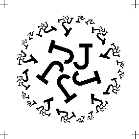{ width="284" height="284" }  
**Figure 2. Levels 1 and 3 with Registration Marks**

```
   ]corn=: 1.175*(#:i.4){_1 1
_1.175 _1.175
_1.175  1.175
 1.175 _1.175
 1.175  1.175
   ha=: 0.075*_1 0,:1 0
   va=: 1|."1 ha
   0 0 0 dline  corn+"1"1 2 ha
   0 0 0 dline  corn+"1"1 2 va
```

Next we continue to two further levels in much the same manner. However, for `S4` we additionally use nub `~`. to remove duplicate entries at the same level. For `S5` we need to use both nub and remove with larger tolerance `(~.!.1e_14` and `-.!.1e_14)` in order to compensate for increased roundoff error.

```
   $S4=: ~.(S1,S2,S3)-.~clean,/S1 mpt t mpt S3
375 3 3
   S1234=: S1,S2,S3,S4
   $S5=: ~.!.1e_11 S1234 -.!.1e_11~clean,/S1 mpt t mpt S4
1400 3 3
```

The result of plotting levels 2, 4, and 5 is created in a manner like that above; however, we used a variant of `aJ` with fewer vertices for level 5 to keep the graphics buffer from overflowing. We also added the registration marks and then saved the result as the file *lev245r.bmp*.

## Image Processing a Gap

If we used the *lev13r.bmp* and *lev245r.bmp* images to create the actual dies, the resulting images would be too close together in some places. You can test that by plotting levels 1-5 together. We can handle this by first “fattening” the polygons shown in Figure 2 (aiming for something like 1/32 of an inch expansion). We can accomplish this using minus 3 cut (which is a very handy facility for image processing). Then we can replace the image from *lev245r.bmp* by only keeping the points that don’t meet the fattened polygons. It is convenient to change the images to 8 bit graphics and use functions from *raster4.ijs* (a script for use with [\[8\]](#ref8) available from [\[9\]](#ref9) for the image file reading and writing. The details are fairly brief, and the impact subtle, but important. Further commentary appears after the computation below.

```
   load 'fvj2\raster4'
   lev13=: 0={."1 readbmp24 'lev13.bmp'
   plev13=: 1008 1008{._1004 _1004{.lev13
   onein=:1&e.@:,
   flev13=:9 9 onein;._3 plev13
   wb=:255,:0 0 0
   (wb;flev13)writebmp8 'flev13.bmp'
   lev245=:0={."1 readbmp24 'lev245r.bmp'
   die2=:lev245*-.flev13
   (wb;die2)writebmp8 'die2.bmp'
```

Note the entries of `lev13` are 0 or 1 depending on whether the corresponding pixel is white or black. The array `plev13` adds blank padding around the edges. Figure 3 shows `flev13` which are the fattened polygons obtained by seeking ones in a 9 by 9 tessellation of the padded array.

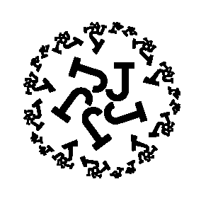{ width="284" height="284" }  
**Figure 3. Fattened Level 1 and 3**

Notice `die2` is the parts of levels 2, 4 and 5 that are not part of the fattened polygons. We save the image as an 8-bit image for convenience even though it only has the white and black palette (`wb`).

## Adding Text

Our last step is to add text along the outer rim in the same colour as levels 1 and 3. First we put the text into a rectangular bitmap.

```
   wd 'reset;'
   WINSHAPE=: 4510 100
   dwin 'textrect'
   glfont '"Comic Sans MS" 960 bold'
   glrgb 0 0 0
   gltextcolor ''
   gltextxy 1 990
   text=: 'Hyperbolic Symmetry is a Breeze with ... etc'
   glshow ''
   glfile 'txtr.bmp'
   glsavebmp 4510 100
```

That creates a 4510 by 100 pixel image with the desired text. We put it onto the rim of the image from levels 1 and 3 using `AnIns` from *anins.ijs* as described in [\[10\]](#ref10) and shown below.

```
   txtr=: 0={."1 readbmp24 'txtr.bmp'
   lev13r=: 0={."1 readbmp24 'lev13r.bmp'
   die1=: lev13r (100 111%125) AnIns 1p1 _1p1 txtr
   (wb;die1) writebmp8 'die1.bmp'
```

## A Colour Image

Lastly, the colour image can be created with the following commands. The palette is white (for background), blue (for die 1), green (for die 2) and black (for the registration marks).

```
   pal=: 255,0 0 255,0 255 0,:0
   (pal;die1+2*die2)writebmp8 'hy_fly_di.bmp'
```

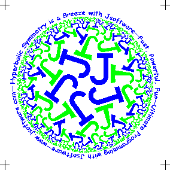{ width="284" height="284" }  
**Figure 4. The Disc Design**

Figure 4 shows the resulting image. Can you see the separation of `die1` from `die2`?

The image from Figure 4 can then be transferred onto a flying disc. Figure 5 shows Ken Iverson at Kiln farm trying out his prototype of a flying disc with this image (photo by Jana Michaud).

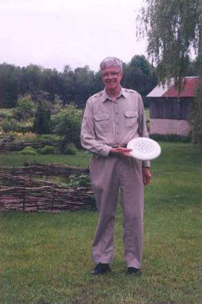{ width="293" height="441" }  
**Figure 5. Ken Iverson with a Flying Disc at Kiln Farm**

## References

<ol>
<a name="ref1"> <li>B. Adcock, K. C. Jones, C. A. Reiter, and L. M. Vislocky, Iterated Function Systems with Hyperbolic Symmetry, <i>Computers &amp; Graphics</i>, <b>24</b> (2000) 791-796.
<a name="ref2"> <li>N. Carter, S. Grimes, and C. Reiter, Frieze and Wallpaper Chaotic Attractors with a Polar Spin, <i>Computers &amp; Graphics</i>, <b>22</b> 6 (1998) 765-779.
<a name="ref3"> <li>K.W. Chung, H.S. Chan and B.N.Wang, Hyperbolic symmetries from dynamics. <i>Computers &amp; Mathematics With Applications</i>, 1996, <b>31</b>, 33-47.
<a name="ref4"> <li>H.S.M.Coxeter, <i>Generators and Relations for Discrete Groups,</i> <i>4th ed.</i> Springer-Verlag, 1980.
<a name="ref5"> <li>H.S.M.Coxeter, The Trigonometry of Escher's Woodcut “Circle Limit III”, <i>The Mathematical Intelligencer</i>, 18 4 (1996) 42-46 and at <i><a href="http://www.ams.org/new-in-math/circle_limit_iii.pdf">http://www.ams.org/new-in-math/circle_limit_iii.pdf</a></i>.
<a name="ref6"> <li>D. Dunham, Hyperbolic symmetry. <i>Computers &amp; Mathematics With Applications</i>, 1986, <b>12B</b>, 139-153<i>. </i>
<a name="ref7"> <li>M. C. Escher, Woodcut Circle Limit III, <i><a href="http://www.ams.org/new-in-math/escher-fig1.html">http://www.ams.org/new-in-math/escher-fig1.html</a></i>.
<a name="ref8"> <li>C. A. Reiter, <i>Fractals, Visualization and J, 2nd Edition</i>, Jsoftware, Toronto, 2000.
<a name="ref9"> <li>C. A. Reiter, J materials, <i><a href="http://www.lafayette.edu/~reiterc/j/index.html">http://www.lafayette.edu/~reiterc/j/index.html</a></i>.
<a name="ref10"> <li>C. A. Reiter, <a href="trad/v172/cdlabel.htm">CD Labels and More</a>, <i>Vector Vol.17 No.2</i> 98-105.
<a name="ref11"> <li>D. Schattschneider, <i>M.C. Escher: Visions of Symmetry</i>. W.H. Freeman and Company, 1990.
</li></a></li></a></li></a></li></a></li></a></li></a></li></a></li></a></li></a></li></a></li></a></ol>

***

<b>Footnote</b>  
<a id="note1"></a><sup>1</sup> Frisbee is a trademark of Wham-o mfg. co. The official disc of the Ultimate Players Association is a Discraft 175g Sport Disc.

***
