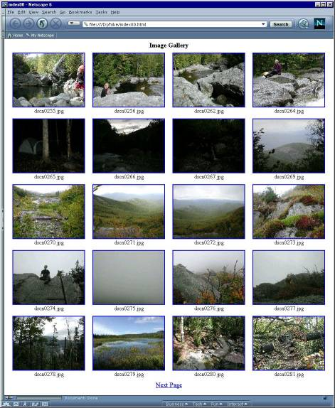
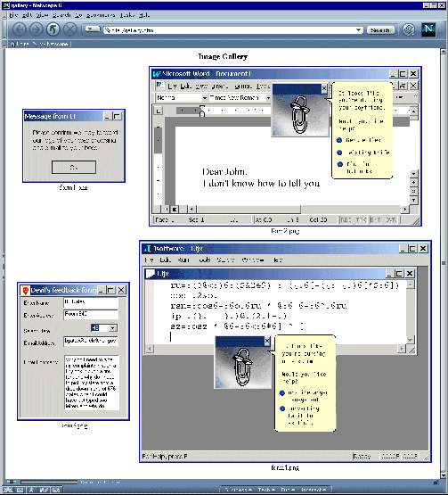
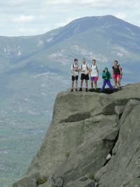
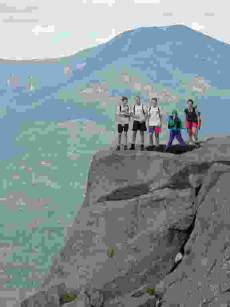

*\[Vector Production: We have only used low-resolution versions of the figures in the body of the paper for speed of loading; to see the originals click on the pictures. The J scripts are downloadable as [picscrpt.zip](picscrpt.zip) (7K).\]*

## Web Image Galleries Made Routine

*by Clifford A. Reiter ([reiterc@lafayette.edu](mailto:reiterc@lafayette.edu))*

When contemplating the creation of lots of Adirondack hiking web pages, the ability to easily create image galleries was an essential consideration. Part of the goal of those web pages was to create so many hiking galleries that the sheer magnitude of the collection was meant to make viewers smile in bewonderment. If a typical hike has 50 good pictures and we create the corresponding 50 thumbnails and we have ten Adirondack hikes per year for ten years then that will be 10,000 hiking pictures. The “Take a Hike with Cliff” web pages [\[5\]](#ref5) don’t have 10,000 hiking pictures yet, but there are thousands of images there. Most of those were created using early versions of the scripts discussed here.

This note gives an introduction to the “image” addon. The addon contains facilities for accessing 24-bit images and creating html galleries; it also contains a lab which introduces the addon facilities. The access to images in various formats means the ability to convert between three dimensional J arrays of RGB triples and files in some conventional format, such as JPEG.

Making web galleries routine means doing most of the work under program control. Even if you don’t have massive collections of hiking pictures to organize, the J html gallery building tools can be handy for a lot of boring, but nice, projects: for sharing pictures from department picnics, of students giving talks at maths conferences, and of family vacations. We begin by creating an example web gallery and then regress to more basic utilities.

## Creating A Gallery In One Line

First we need to download and install the image addon from [\[1\]](#ref1). The html building script that comes with that addon is loaded as follows.

```
   load 'addons\image\html_gallery6'
```

The directory `'\hike\'` contains a working copy of the images for the gallery created below (I save a backup of the original images). A web-linked sequence of image gallery pages showing all the images in that directory is created via the following J expression.

```
   6 4 mk_html_gallery_seq 200 175 images_in '\hike\'
```

There were 73 jpeg images in the directory. Running the above line resulted in 73 thumbnail images being created and four linked html gallery pages being created. The first gallery page is shown in Figure 1. Notice that the path name had a closing back-slash. While there is much more to say, the resulting galleries are quite useful.

[{ width="471" height="574" }](fig01.jpg)  
**Figure 1. A Web Gallery Page Created With One Line.**

It took about three minutes to create the above gallery sequence on a 750 MHz PC. Each source image is a 2048 by 1536 by 24 bit jpeg image which is typically slightly larger than 1MB. As uncompressed data, the image collection amounts to around 70 MB. Galleries of web-size images are processed much more quickly. For example, creating a similar gallery for 73 web images with an average size of 35k only took 14 seconds.

## What Did I Get With One Line?

The above line that created the image gallery has two main parts. The function `images_in` results in a list of all the images in the specified path. The conjunction `mk_html_gallery_seq` creates html galleries containing those images.

The result of the function `images_in` is a boxed list of all the files with *jpeg*, *jpg*, *png*, *tga*, or *bmp* filename extensions in the specified directory. The filenames are in grade-up order (alphabetic except for lower versus upper case and special symbols); also, filenames beginning with “`th_`” are excluded since this is our default prefix used for thumbnails. If we only wanted the jpeg files in the directory, we could use the function `jpegs_in` instead of `images_in`. There are similar functions for the other file formats. All these are based on the adverb `im_in`. Users needing to match other patterns should look at that adverb and the similar adverb `files_in`.

Note that `mk_html_gallery_seq` is a conjunction. The left conjunction argument specifies the page layout; in the example it was `6 4`. The right conjunction argument is the thumbnail bounds; in the example it was `200 175`. The right argument of the resulting function is the list of images to include in the gallery. There is an optional left argument specifying the names of the gallery pages to be used, in which case the left conjunction argument only specifies the number of columns to use in the thumbnail array.

The command created four html “index” image galleries named *index00.html* through *index03.html*. The one line expression included `6 4` on the left; that is a request for each page to use a 6 row by 4 column table of thumbnail images. Fewer rows are used if that balances the pages better. Here we had 73 images total and if 24 images were placed on most pages, then the fourth page would have just one image. Instead, once it was determined that four pages were required, the number of image rows was adjusted to five. The result is that each of the first three html pages has a 5 by 4 array of thumbnails while the fourth has 13 images arranged in four rows. The first html gallery page is titled “gallery” and the subsequent ones are titled with their pathless filenames.

The thumbnails displayed in each gallery maintain the aspect ratio of the original images and are the maximal size fitting into a 200 by 175 pixel window subject to that constraint. Most of my 24-bit images are landscape with a 4 to 3 aspect ratio. However, there usually are a few portrait images. Using 200 by 150 as the thumbnail size bound would make the portrait images noticeably smaller than the landscape images. Using 200 by 200 as the thumbnail bounds makes all the thumbnails the same size, but would leave a lot of white space near rows with portrait thumbnails. Using 200 by 175 is a happy compromise.

Clicking on a thumbnail image brings up the full size version of the image. Each image has a caption that is a centred, short (pathless) filename. The “alt” information associated with each thumbnail is the size, in kilobytes, of the full size image. Height and width information about each thumbnail is included so that browsers can quickly render the web page layout.

## What Did I Miss In One Line?

Several things really should be changed in order to get a hiking gallery suitable for public posting. In our example, the digital camera was also used to create some *\*.mov* animations. These are not of a supported image format and hence they are not included in the file list created by the `images_in` function. Since there are only a few of them, they are easily included by using software or a screen capture to obtain a frame. Save the frame as an image and allow a thumbnail to be created from the frame. Then edit the html file to change the reference to the frame to a reference to the animation. That is, handle special links interior to the thumbnail gallery by creating a dummy image whose thumbnail can serve as a guide to the special link.

Second, a few of the images were taken in a portrait orientation. They need to be rotated 90 degrees. This is easily accomplished. For example, our function for rotating an image file clockwise by 90 degrees, `rot_cw_90`, is given below. Notice that the main processing line is designed to rotate either 2 or 3-dimensional arrays and they may either be raw binary or numeric arrays.

```
   rot_cw_90=: 3 : 0"1
z=.raw_read_image y.
z=.(1 0&((0 1)})@i.@$@$ |: ]) |. z
z write_image y.
)
```

```
   (1 0&((0 1)})@i.@$@$ |: ]) |. i. 4 2
6 4 2 0
7 5 3 1

   <"1 (1 0&((0 1)})@i.@$@$ |: ]) |. i. 4 2 3
+--------+--------+-------+-----+
|18 19 20|12 13 14|6 7 8  |0 1 2|
+--------+--------+-------+-----+
|21 22 23|15 16 17|9 10 11|3 4 5|
+--------+--------+-------+-----+
```

Compression issues arise when dealing with jpeg images since writing a file in jpeg format loses information. We will say more about jpeg quality settings later. However, an easy way to maintain the full quality of the original image is to archive the original. This can be done using the `and_archive` adverb which puts a copy of the original image in a subdirectory named “archive”. The following command would rotate and archive an image and thumbnail.

```
   rot_cw_90 and_archive '\hike\dscn0284.jpg'
832391
```

Rotating multiple images is relatively straightforward as we will illustrate in the next section.

The choice of 4 columns of images that are 200 pixels wide might not be optimal for viewing. The time consuming portion of creating the html galleries is creating the thumbnails. Thus, there are facilities for avoiding the recreation of thumbnails. Namely, we can use `update_html_gallery_seq` instead of `mk_html_gallery_seq` or simply use “`0`” for the thumbnail size bounds. That is, the following command will run in a flash.

```
   6 3 update_html_gallery_seq images_in '\hike\'
5
```

The result would be five linked gallery pages. All the width, height and image size information was updated. The rotated image is now properly shown with its portrait orientation. However, the thumbnail has the size of the original thumbnail rotated, 150 by 200, not the 131 by 175 size thumbnail that would have been produced to fit into a 200 by 175 size window.

Note that we could also have constructed a single huge gallery page using the following.

```
   3 mk_html_gallery 200 175 images_in '\hike\'
```

That gallery page maker, `mk_html_gallery`, is the actual core html page maker. There are global variables that allow for html code to be inserted before and after the table that gives the image gallery created by that conjunction. The default prolog gives the default gallery heading and the default postlog is empty.

```
   ht_table_prolog
<font size = 4><B><center>Image Gallery</center></B>
```

```
   ht_table_postlog
```

The conjunction `mk_html_gallery_seq` manipulates the definitions of `prolog` and `postlog` in order to create the gallery sequence. These facilities allow the creation of templates for different styles of web image galleries.

If the html gallery is primarily used for browsing an image directory, the filenames are handy information and the galleries are useful as they are. Of course, usually we will edit the captions: changing the filenames into descriptions of the images. That is the fun part of making a web page and the intention of this script is to make it easy to get to the fun part.

## The Complications Of Reality

Here is an outline of a process that illustrates dealing with even more realistic complicating details. Suppose the directory `'\hike'` contains my working directory of a fresh set of digital hiking images. I keep a sample script with the following steps. However, each gallery creation seems to have its own particular features, so I tend to change the path name and run a line at a time from the script.

- I would obtain a sample frame from each movie and add it as a jpeg image to the directory.

- I would name the path.

    ```
       path=:'\hike\'
    ```

- I would make all the filenames in the directory lower case. I find this convenient for gradeup alphabetization and it helps me avoid case errors when uploading files to our web server.

    ```
       dir_to_lc path
    ```

- I would get the list of images, checking the first couple of filenames.

    ```
       2{.im=:images_in path
    +------------------+------------------+
    |\hike\dscn0255.jpg|\hike\dscn0256.jpg|
    +------------------+------------------+
    ```

- I would make one large gallery (not a sequence) of all the images with large thumbnails and 3 or 4 columns, depending on whether I was working on my notebook or desktop computer.

    ```
       4 mk_html_gallery 400 350 im
    ```

- I would review the gallery and decide which images needed to be rotated 90 degrees and I would create a list of those files. Often that can be done by direct selection from `im`. Sometimes I rebuild the names as below. This process is repeated for other rotation angles if necessary. Note the filename rebuilding uses `nfmt`, which is defined in the script, to give file type numeric formatting. The left argument gives the number of digits; the default is three.

    ```
       nfmt=: 3&$: :({&'0123456789'@:(([ # 10"_) #: ]))
    ```

    ```
       ]nf=:4 nfmt 255 263 264
    0255
    0263
    0264
    ```

    ```
       2{.to_rot=:(path,'dscn')&,@(,&'.jpg')"(1) nf
    \hike\dscn0255.jpg
    \hike\dscn0263.jpg
    ```

- I would then rotate and archive the images.

    ```
       rot_cw_90 and_archive to_rot
    ```

- I would update the html gallery without recreating thumbnails (and subsequently hit refresh on the browser).

    ```
       4 mk_html_gallery 0 im
    ```

- I would then select the images I want on the public web pages. Probably less than half of the total number of images. I would create a list of their names leaving out the path either by modifying a selection from `im` or by direct construction.

    ```
       nf=: 4 nfmt 87 89 100 101 120 122
       sfn=: ('dscn')&,@(,&'.jpg')"1 nf
    ```

- I would name and create a directory for the web images.

    ```
       pathw=:path,'www\'
       1!:5 <pathw         NB. create directory
    ```

- I would pick simplified names for the web size images (2048 by 1536 is too big) in the web directory.

    ```
       2{.wim=:(pathw,'w'),"1 ] 4}."1 sfn
    \hike\www\w0255.jpg
    \hike\www\w0264.jpg
    ```

- I would create the web size images (these jpeg files are about ten times smaller than the originals).

    ```
       1024 1024 mk_th_image"1 (path,"1 sfn);"1 wim
    ```

- Finally, I can make my web gallery files in a line, with the thumbnail shapes I prefer.

    ```
       10 3 mk_html_gallery_seq 320 280 wim
    ```

- I then edit the link to the movies and I can have the fun of adding captions to my web hiking images.

Admittedly there is some work involved in selecting which files to rotate and which files to include in the web version, but the other steps are essentially automated in the sense that they can be run unmodified from the sample script.

## Beneath The Thumbnails

Much of the html file creation depends upon being able to find the size of an image and creating the thumbnails. Much of what remains is formatting. The image size information is usually a fairly simple decoding of select portions of the information in the file. Thus, in some sense, the only computational content in the gallery creation is the creation of the thumbnails.

The `mk_th_image` function basically reads the image source file, applies the function `resize_image` to the image array and writes the resulting array to the thumbnail file. The function `resize_image`, shown below, resizes an array so that the aspect ratio of the first two axes remains the same, but so that those axes fit into the width and height specified by the left argument.

```
   resize_image=: 4 : 0
szi=.2{.$y.
szo=.<.szi*<./(|.x.)%szi
sc2=.] #~ [: <.&.(+/\) #@] # [ % #@]
b=.y. sc2~ {.szo
b sc2"2~ {:szo
)
```

Here are some examples of resizing an array with the shape of a 200 pixel wide by 100 pixel high image. Each of the results preserves that aspect ratio.

```
   $100 100 resize_image i. 100 200 3
50 100 3
```

```
   $100 400 resize_image i. 100 200 3
50 100 3
```

```
   $400 100 resize_image i. 100 200 3
100 200 3
```

Within the function `resize_image` the desired resulting height and width, `sco`, are computed. They are used as arguments to the local function `sc2` which replicates the given data enough times (often 0 when making thumbnails) to result in the desired length.

```
   sc2=.] #~ [: <.&.(+/\) #@] # [ % #@]
```

```
   10 sc2 2 33 114 255 11 15
2 33 33 114 114 255 11 11 15 15
```

```
   4 sc2 2 33 114 255 11 15
33 114 11 15
```

## What If You Don’t Like My Thumbnails? (or, The Basic HTML Utilities)

While the html utilities were constructed with the idea of using similar sized thumbnails in the image gallery, there are times when that would not be desirable. For example, we would probably not want to change the relative size of the images in a gallery of windows forms captured from the same screen. See Figure 2 for an image gallery of screen captures. Thus, for various tasks, we may want to use more basic html building utilities. The details of each definition are in the script. Here is a summary chain of the main functions used to build the html galleries.

[{ width="503" height="555" }](fig02.gif)  
**Figure 2. Screen Captures Shown without Resizing**

- `mk_html_gallery_seq` modifies the `prolog` and `postlog` and makes a sequence of calls to:
- `mk_html_gallery` which organizes input image file list, and writes the result of a call to:
- `html_fmt_gallery` which adds header and tail formatting to:
- `ht_table_fmt_images` which adds html table formatting to the table row formats obtained by:
- `ht_tr_fmt_images` which adds html row formatting to the html table data formats obtained by:
- `ht_td_fmt_image` which adds captions and formatting to the href format of an image and its thumbnail obtained by:
- `ht_href_fmt_image` which adds the href details to the html image created by:
- `ht_fmt_image` which is illustrated by the following.

```
   400 300 10000 ht_fmt_image 'temp.jpg'

```

So there are just seven levels of minor details from formatting an image to formatting a gallery sequence.

Returning to our example, if `im` is a boxed list of the four images shown in Figure 2, and if we want to create a 2-column gallery without making thumbnails, then we can do the following. Note that we treat the images as their own thumbnails; we can use a 0 on the right to indicate thumbnails should not be created; and we give a named result file *gallery.html*.

```
   'gallery.html' 2 mk_html_gallery 0 ,.~ im
```

Thus, we actually can accomplish our task with our high level functions. Nonetheless, the more basic html utilities can be useful in other contexts.

## The Basic File Utilities

The core image reading and writing utilities along with image size utilities are contained in the script *addons\\image\\image1.ijs*. Users not needing the html utilities can access a fairly clean set of basic image utilities by using that script. The 24-bit versions of *jpeg*, *png*, *bmp* and *tga* image files are supported. Image data may either be read as raw data or as integer data.

For example, `B=:raw_read_jpeg 'filename'` would result in `B` being a height by width by 3 array of raw binary data assuming `'filename'` was the name of a jpeg image file. Similarly, `B=:read_jpeg 'filename'` would yield an integer array with shape height by width by 3. Each rank one cell has length 3 and those cells specify the red, green and blue values of the corresponding pixel. The analogous functions, such as `raw_read_png`, are defined to handle the other image formats. If the filename includes an extension *\*.jpg*, *\*.jpeg*, *\*.png*, *\*.bmp* or *\*.tga* then `raw_read_image` automatically reads the file in the corresponding format. Likewise, `read_image` works in the same manner but results in an integer array. Raw or integer arrays `B` may be written using any of the desired formats with calls such as `B write_bmp 'filename'` . If the filename has a supported extension, then `B write_image 'filename'` works fine. Png files have optional flags indicating whether to maximize compression or to run fast. See the script for details. Jpeg files have optional quality and progressive scan options. The options can be controlled globally or by using an optional left argument. For example, `85 1 B write_jpeg 'filename'` specifies that `B` be written as a progressive jpeg image with jpeg quality 85. The default settings are nonprogressive and quality 75. High quality settings give better quality images, but are larger. Here we illustrate manipulation of a hiking image and the impact of several choices for the jpeg quality setting upon the image size.

First we read an image as raw data. It is a digital photograph from the top of East Dix. This is where my wife suggested we review our life insurance needs.

```
   image_wh path,'dscn0155.jpg'
2048 1536
```

```
   $B=:raw_read_image path,'dscn0155.jpg'
1536 2048 3
```

We trim away the left and right sides of the image.

```
   $c=.448}."2] _448}."2 B
1536 1152 3
```

Now we resize it to fit inside a 768 by 768 window.

```
   $d=.768 768 resize_image c
768 576 3
```

Next we write the data with several choices of jpeg quality. Notice the file size gets much smaller as the quality decreases. You should try this with an image of your own.

```
   95 d write_jpeg path,'edix95.jpg'
199395
```

```
   85 d write_jpeg path,'edix85.jpg'
102424
```

```
   75 d write_jpeg path,'edix75.jpg'
71205
```

```
   50 d write_jpeg path,'edix50.jpg'
44167
```

```
   20 d write_jpeg path,'edix20.jpg'
22529
```

```
   10 d write_jpeg path,'edix10.jpg'
13410
```

```
    5 d write_jpeg path,'edix05.jpg'
9475
```

In practice, quality 75 is often a good compromise between quality and size for nice quality web images. To maintain high quality without much concern for size, a setting such as 95 might be used. That would be appropriate for archiving images that might be printed someday. Casual viewers are unlikely to notice the difference between quality 75 and quality 95. However, a careful observer will notice the difference. Even a casual viewer would probably find quality 50 noticeably lacking. Lower qualities are humorous, but not usually considered appropriate for storing an image. Figure 3 shows the quality 95 and 5 versions of the image.

[{ width="230" height="307" }](fig03a.jpg)  [{ width="230" height="307" }](fig03b.jpg)  
**Figure 3. Images with JPEG Qualtiy 95 and 5**

The script *image1* contains functions for converting between *\*.jpeg* and *\*.bmp* and between *\*.png* and *\*.bmp*. For example,

```
   (jq,prog) bmp_to_jpeg 'file.bmp';'file.jpg'
```

would convert the specified *file.bmp* into the *file.jpg* using jpeg quality `jq` and using `prog` (0 or 1) to specify whether to use a progressive jpeg format. An inverse, `jpeg_to_bmp` is also defined as follows.

```
   jpeg_to_bmp=: 3 : 0
inout=.'bmp'&ch_ext d_fn_ck y.
conv_jpeg_to_bmp inout
fsize {:inout
)
```

The function `'bmp'&ch_ext` changes the extension of a given file to *bmp* and that function is applied, if needed, by the adverb `d_fn_ck` which does default filename checking. Thus, if only the input file jpeg name is given, then the output would have the same name with *bmp* extension. Also notice that the function further calls `conv_jpeg_to_bmp` which is the conversion function that directly calls a dll.

```
conv_jpeg_to_bmp =: (jpeg_dll,' jpeg_to_bmp n *c *c')&cd
```

Thus, many of the functions in the image scripts are built indirectly upon dll calls that convert images between jpeg and bmp, or between png and bmp.

## Where Did This Come From?

The image utilities are based upon a few directly defined functions and some dll’s used for file conversion. The *bmp* and *tga* files are read and written using updated 24-bit versions of the bitmap utilities from the scripts associated with [\[4\]](#ref4). The jpeg utilities are based upon Intel Jpeg Library [\[2\]](#ref2). The library uses the Intel provided *ijl15.dll*. Examples in the documentation for the Intel library compared their library calls with those of the Independent Jpeg Group’s. Those examples were modified and used to create *j\_jpeg1.dll* which is the dll called by J. That gives support for image conversion between jpeg and bmp and jpeg image size information. However, in combination with the *\*.bmp* utilities, jpeg images may be read and written. The png conversion utilities were based upon Miano’s examples [\[3\]](#ref3). Modified versions were used to create *j\_png1.dll*.

These simple file conversion utilities make it easy to work with images in J and make html image galleries routine.

## References

<ol>
<a name="ref1"> <li>Image Addon, Jsoftware, see download, addons, at <a href="http://www.jsoftware.com">http://www.jsoftware.com</a>.
<a name="ref2"> <li>Intel Jpeg Library (IJL), <i>ijl15.dll</i>, see <i><a href="http://support.intel.com/support/performancetools/libraries/ijl/index.htm">http://support.intel.com/support/performancetools/libraries/ijl/index.htm</a></i>
<a name="ref3"> <li>John M. Miano, <i>Compressed Image File Formats</i>, Addison-Wesley-Longman, 1999.
<a name="ref4"> <li>C. A. Reiter, <i>Fractals, Visualization and J, 2nd ed.</i>, Jsoftware, Inc., Toronto, 2000
<a name="ref5"> <li>C. A. Reiter, Take a Hike with Cliff, <i><a href="http://www.lafayette.edu/~reiterc/hikes/index.html">http://www.lafayette.edu/~reiterc/hikes/index.html</a></i>.
</li></a></li></a></li></a></li></a></li></a></ol>

Clifford A. Reiter Department of Mathematics Lafayette College Easton, PA 18042 USA

***
