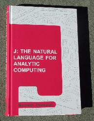

*book by Norman Thomson; review by Cliff Reiter*
{ .byline }

 Norman Thomson’s book, *J: the Natural Language for Analytic Computing*, which we will abbreviate *JtNL*, is the first J book to be published independently from the language developers. The beautiful title makes Thomson’s zeal for J clear. The publisher, Research Studies Press Ltd., Baldock, Hertfordshire, England (RSP) targets specialist areas. The editor states in his foreword that “Norman Thomson has prepared a text for the J community, which I am confident will be appreciated by the J community.” I think the editor’s words are true.

In the simplest terms, *JtNL* is a J language book. Its organization is heavily influenced by parts of speech: verbs, nouns, adverbs and conjunctions. *JtNL* touches on most aspects of the J language, introducing primitive features and common phrases. It could also be viewed as a less formal, alternate dictionary [\[2\]](#ref2) organized around parts of speech. However, the book is deeper than either of those views: it flows forward in an organized manner and includes a number of topics that illustrate solving larger problems.

The reviewer is the author of [\[5\]](#ref5), which is a book designed to teach mathematical visualization using J. Thus, readers should understand that I have my own ingrained preferences on how to introduce J. I would not have chosen to organize an introduction to J like *JtNL*. Still, in reading the book I found myself learning a lot and admiring the ways in which Thomson made his organization work.

The cover of *JtNL* has a sharp magenta abstract design with a collage of J expressions and J results scattered in the background. It has a solid feel, a professional appearance, and it contains approximately 300 pages. *JtNL* is divided into four parts: 1. Basic J, 2. Advanced J, 3. Data Processing with J, and 4. Mathematics with J. These parts are divided into a total of 29 chapters with each chapter containing several sections. In general, I found the book more interesting as it progressed, but even the beginning was thought provoking.

Space doesn’t allow the mention of each section and only the barest mention of most chapters; however, each section illustrates the rich ideas of J and hence there is a lot packed into the book. Nonetheless, I will try to give a sense of the flow of the book along with a few examples.

## Basic J

The first section of the first chapter discusses language in general, both natural and formal. It goes on to describe word formation in J along with the primary parts of speech: nouns, verbs, adverbs and conjunctions. The case is made that verbs are the powerhouse of the language and the rich rules for composition of verbs forms the heart of J. Thus, Chapter 1 is: *In the beginning...verbs*. The first example discusses the common mathematical notion of “plus or minus”. Thomson notes this is almost always really means plus joined to minus in the sense that the list of both the sum and the difference is desired. After noting the meaning of comma to join together data pieces, he notes that `(+,-)` expresses the notion of plus joined to minus in J. He gives examples of the use of that fork both without and with naming it. Choosing to introduce a fork as the first example of J seems brave, but Thomson’s example clearly illustrates the power of J to clarify ordinary thinking. The classic fork for computing averages, `(+/ % #)`, is often used to motivate tacit constructions and it appears as his next example. The first chapter goes on to briefly introduce the *hook*, *at*, *atop*, *cap* and long *trains*. The heart of J appears in the first chapter.

Chapter 2 is *...and then nouns*. Character data, lists, and boxed arrays in general get discussed. Frames and cells and rank are described and the order of execution of verb-noun phrases is made clear. Empty arrays are explained. The second chapter, like the others, finishes with a very useful chapter summary and exercises. The summary in Chapter 2 lists (among several other things) the primitive verbs introduced or extended in the chapter:

> `i.` integers  
> `$` shape of (monadic), shape (dyadic)  
> `{` from (dyadic)  
> `#` tally (monadic), copy (dyadic)  
> `<` box  
> `>` open  
> `;` raze (monadic), link (dyadic)

We see that even though this chapter focused on nouns, experience with the language’s primitive verbs is evolving. Indeed, while the general organization is at first around parts of speech, each section is a coherent exposition and together the sections move toward a high quality understanding of J.

Chapter 3 is *Extensions to verbs and adverbs*. It discusses the eight adverbs and what they do. On a first reading, it was probably the chapter that was most jarring organizationally. Nonetheless, the illustrations and examples are quite clear. And if I ever want to read up an adverb, I know where I can look. Conjunctions are not so easy. Chapter 4, *Basic conjunctions and composition*, is a deeper treatment than appeared in the first chapter. Chapter 5, *More on conjunctions and composition*, is in the same spirit. It includes a nice section: *Two traps for the unwary!* These traps are forgetting to use `@` or `@:` when applying compositions and the second is forgetting parentheses when constructing complex tacit verbs. This isn’t a magic wand which allows readers to avoid all errors in defining tacit functions, but it is good, timely advice to a reader studying the book.

Chapter 6, *Dictionary and foreign conjunction*, contains terse listings and is thereby similar to the on-line vocabulary; however, it is organized by parts of speech. There was a lengthy recent Jforum discussion of “what IS *cap*?”; in light of the discussion, it is not surprising to see *cap* listed in the section: *Other symbols*. Some basic useful foreign conjunctions are illustrated and scripts and locales are mentioned, but the treatment is very brief and only generalities are discussed.

## Advanced J

The second part of the book, *Advanced J*, begins with Chapter 7, *Control Words*. But the chapter might be better titled “explicit definition”. Explicitly defined functions, adverbs and conjunctions appear. I did not see any mention of `4 :` type definitions of dyads. Also, all of the explicitly defined adverbs and conjunctions use `x.` and `y.` for the adverb/conjunction arguments. The use of `u.` `v.` `m.` `n.` for adverb and conjunction verb and noun arguments appears to be missing and the richness of using conjunctions with both the conjunction arguments and the derived arguments available is thereby shortchanged. Also, automatic conversion to tacit via `13 :` and the like is not mentioned. Indeed, it seems like the automatic conversion of adverbs via `12 :` would be a good reason to mention `x.` as the adverb argument. The chapter ends with illustrations of using control words `if.` `while.` and `try.` and a listing of the other control words is given.

The next chapter is on gerunds; agenda, recursion and gerund inserts are clearly illustrated. Gerunds, and user defined adverbs and conjunctions are often used throughout the remainder of the book. This is consistent with my earlier observation that the material is introduced in an evolving fashion. Formatting data, executing strings and files and input/output in general are discussed in Chapter 9. Full chapters (10-12) on each of the conjunctions: dot, power, and rank appear. These include many nice, thoughtful illustrations. For example, dot where the left argument is not an insert is discussed (this is one of the first reasons that I ever looked at J [\[4\]](#ref4)). The examples with power include gerunds and many phrases that experienced users would expect to see appear in these chapters. The discussion of rank includes the illustration of using two applications of rank, one where the left and right ranks are different. On page 119 we see the description and example: “This is a convenient way of, for example, joining each item in one list with all items in another:”

```
   lets=.2 2$'abcd'
   nos=.3 3$'123456789'
   lets,"1"1 _ nos
ab123
ab456
ab789
cd123
cd456
cd789
```

This construction is of a type that users are likely to face from time-to-time, but finding a working phrase might be a struggle for a new user. It isn’t that *JtNL* explains all the important phrases, its strength is that it exercises them at a level that a learner needs. These chapters of *JtNL* on individual conjunctions are relatively easy reading for these important, multi-layered facilities.

## Data Processing in J

This third section recognizes the expressiveness of J in effecting data processing. Chapter 13, *Selection*, explicates using *from*, `{`, and complex *copy*, `#`, to make selections. The use with rank and boxed arguments is suitably included. Chapter 14, *Data Structuring*, is devoted to functions such as: rotate, reverse, transpose. Chapter 15, *Ranking and Ordering*, illustrates grade up/down, sorting, and ranking via grade atop grade (an powerful phrase). Chapter 16, *Searching, finding and updating*, contains a fine discussion of partially modifying data under boxing. That discussion ends with an example of using gerund arguments to amend.

```
   USA=.'Florida';'California';'Alaska'
   MASCA=.[`(<:@#@])`] }
   'o' MASCA &> USA
Florido
Califonio
Alasko
```

A typographic error appears in the result *JtNL* shows for the last phrase. The result of `'o' MASCA &.> USA` is shown in *JtNL* where the phrase was `'o' MASCA &> USA` as shown above. This is typical of the typographic errors in *JtNL*. They appear, readers will notice them, but they seem not to be very disruptive.

Chapter 17, *Joining Data* appears; here several useful facilities are explained; multiple assignment (p153) is done in an old style which is not supported in current versions of J. Chapter 18, *Partitioning*, is primarily on cut. I love cut and am glad to see lots of simple, clear illustrations of its power. Not every detail needed to define cut is given, but this discussion covers substantial ground and this chapter is easier reading than the dictionary. *Raze-in* is also illustrated in this chapter. Here are some of the pretty examples of computing structured binary patterns that appear there.

```
   e. i. 4
1 0 0 0
0 1 0 0
0 0 1 0
0 0 0 1
```

```
   (e. 0 1 1 0);(e. 0 1 2 1 0);(e. 0 0 1 1 1)
+-------+---------+---------+
|1 0 0 1|1 0 0 0 1|1 1 0 0 0|
|0 1 1 0|0 1 0 1 0|1 1 0 0 0|
|0 1 1 0|0 0 1 0 0|0 0 1 1 1|
|1 0 0 1|0 1 0 1 0|0 0 1 1 1|
|       |1 0 0 0 1|0 0 1 1 1|
+-------+---------+---------+
```

Chapter 19, *Opposites*, discusses topics such as obverse, inverse, adverse and identity verbs. Chapter 20, *Some programming principles* appears. It discusses various approaches to selected problems. Mostly this amounts to putting together several tacit definitions to accomplish some task. In the *J Introduction and Dictionary* [\[1, p4\]](#ref1) or the electronic *J Dictionary* [\[2, Intro., pt. 3\]](#ref2), `by` and `over` are used as “black boxes” as illustrated by the following from *JtNL*.

```
   over=.({.;}.)@":@,
   by=.' '&;@,.@[,.]
   'abc' by 1 2 3 4 over i.3 4
+-+---------+
| |1 2  3  4|
+-+---------+
|a|0 1  2  3|
|b|4 5  6  7|
|c|8 9 10 11|
+-+---------+
```

A section in Chapter 20 of *JtNL* describes how *by* and *over* work, which removes the mystery of the black box. A worthy exercise for a growing learner.

## Maths in J

The last part of the book discusses mathematics with J. New primitives appear and modest applications are developed in the nine chapters that appear here. Thus the introduction to J continues. However, these chapters are much more topical. Chapter 21, *Complex numbers* introduces primitives and basic applications, such as computing roots of unity and transformations of the plane. Chapter 22, *Numbers bases and Polynomials*, describes polynomial evaluation, changing bases and applications such as clock time. Chapter 23, *Series*, includes geometric series and mortgage payments. No discussion of the Taylor series primitives is given. Chapter 24, *Calculus and the D adverb*, introduces some of the variants of `D.` along with a discussion of partial derivatives. A section on Newton-Raphson’s method for approximating roots appears there. How easy it is:

```
   Newton=. 1 : ']-x.%x.D.1' (^:_)("0)
   f2=.2&o.-(*^)
   f2 Newton 1
0.517757
```

Notice Newton- Raphson is a single, easy to explain line; but it uses a mixture of an explicit adverb embedded in a tacit definition. It has a function argument — limits are computed — the rank is good. Powerful stuff from one line.

Chapter 25, *Numerical analysis*, consists of best fitting data, root approximation and numerical integration. Here the function for Simpson integration uses a specific global function, `fn`, as integrand. It seems like a missed opportunity to use an adverb; strangely, a defined conjunction is used for an intermediate step in the construction, but the globally defined integrand remains `fn`.

*JtNL* primarily uses local assignments, even for the many multi-line definitions appearing in Chapter 25. Of course global and local assignments are equivalent for direct interactive definitions and one could argue the one line functions should just be typed directly, but local assignments are not what one generally wants in scripts, so I am left wondering if *JtNL* is really supposing the multi-line definitions should be keyboarded with each use and not stored in a script. My guess is this chapter is based upon very early J writings and was not brought up to date. It is too bad, since each of these examples could have been as sweet as Newton-Raphson’s method was in the previous chapter.

Chapter 26, *Randomness*, describes roll and deal and some useful utilities for random sampling. Chapter 27, *Permutations and Combinations* introduces nub, nubsieve, atomic permute, and cyclic primitive. Work with permutation groups appears. Chapter 28, *Groups and Symmetries*, takes a more abstract look at groups, primarily cyclic and dihedral groups. Chapter 29, *Logic*, discusses logical operations and testing tautologies.

The book has two appendices; the first gives solutions to the exercises and the second is a summary of the J phrases used throughout the book. This overlaps the chapter summaries, but puts the key functions together in one place for browsing.

## Conclusion

Thomson’s *JtNL* is not a replacement for the Dictionary — it isn’t complete. It could even be argued that all the types of examples done in *JtNL* appear somewhere in the *J Dictionary* [\[2\]](#ref2) or *Primer* [\[3\]](#ref3). *JtNL* has faults: there are typographic errors and some sections are outdated. Still, *JtNL* has many easy to read examples and most topics appear. It is in a handy to read hard-bound book. It has helpful summaries and reminders. More importantly, for someone trying to learn J, the level of sophistication rises as *JtNL* progresses. The most common phrases that J users need are illustrated. Readers who need to understand something completely before moving onward might be frustrated by the informality of *JtNL*, but readers, like me, who read things repeatedly, gaining further understanding at subsequent passes, probably would do well to study *JtNL*. I think it is a valuable resource for J users who want an introduction to, or refresher on, the J language.

## References

<ol>
<a name="ref1"> <li>Kenneth E. Iverson, <i>J Introduction and Dictionary</i> (print version), Jsoftware Inc., Toronto, 1995.
<a name="ref2"> <li>Roger K. W. Hui and Kenneth E. Iverson, <i>J Dictionary</i> (electronic version), Jsoftware Inc., Toronto, 2001.
<a name="ref3"> <li>Eric Iverson, <i>The J Primer</i>, (electronic version), Jsoftware Inc, Toronto, 2001.
<a name="ref4"> <li>Clifford A. Reiter, Fractals RYIJ, <i>Vector</i>, 11.2 (1994) 86-104.
<a name="ref5"> <li>Clifford A. Reiter, <i>Fractals, Visualization and J</i>, 2nd Edition, Jsoftware, Inc., Toronto, 2000.
</li></a></li></a></li></a></li></a></li></a></ol>

***
