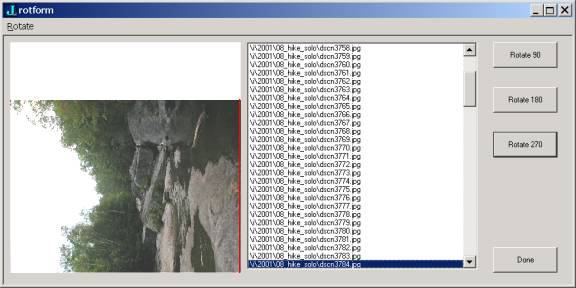
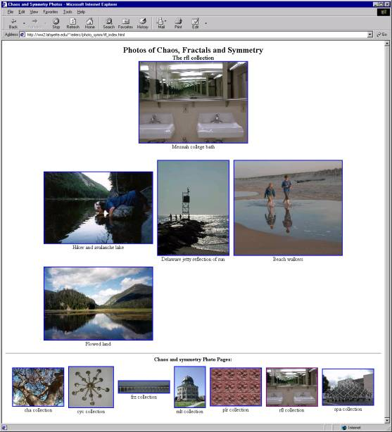

*by Clifford A. Reiter and Zachary X. Reiter*
{ .byline }

In an earlier note Cliff described the first release of the image addon for J [\[5\]](#ref5). Meanwhile, Zach was becoming experienced with Linux and C. He took on the project of doing direct file to memory reading of jpeg files as a warm-up exercise. Since the approach in [\[5\]](#ref5) involved intermediate conversion to a temporary bitmap file and then reading the result into J, Zach expected his version would be more efficient. Moreover, because of the use of a third party dll in the first release, the image addon was not available for Linux. Zach hoped to change that too. His project was successful and there was a flurry of follow-up activity: \*.png support was also redone and support for 24 bit portable bitmaps was added. Meanwhile, the html gallery script that Cliff wrote had undergone changes and some other utilities had been developed, so it seemed worthwhile to offer a new release of the image addon. The addon may be downloaded from [\[3\]](#ref3).

Like the first release, a lab introduces users to the image2 addon. Even though the Windows lab uses wd commands, the availability of tcl/tk under linux meant that only minor changes were made to allow the lab to run under Linux. In this note we will list some of the major changes from the first release, give performance comparisons, take a look at a rotation utility, and we will also give an illustration of nontrivial gallery maintenance. Readers experienced with the first release will probably want to also read the minor changes in the release notes.

The choice of open source code for reading and writing jpeg and png files changed for release 2 of the image addon. The jpeg library is now based upon the independent jpeg group's library version 6b [\[2\]](#ref2). The png library is based upon version 1.0.8 of libpng, [\[7\]](#ref7). This means that many of the core image addon functions have changed, but most of the high level functions use the same syntax as the first release. Here is a summary of the major changes offered by the second release of the addon.

- Availability on both Windows and Linux platforms
- Library (\*.dll, \*.so) calls are direct, so temporary files are no longer used for jpeg/png reads/writes
- Jpeg read/writes are faster
- Png read/writes are dramatically faster
- Library file is smaller (under Windows, release 1 used three dll's totaling 656k; this is replaced by one dll of size 288k)
- 24 bit Portable aNyMap support is added (\*.pnm, \*.pgm, \*.ppm)
- Limited support for grayscale images as *h* by *w* by 1 arrays
- Lossless jpeg transforms (rotations/flips) available
- A script, `rot_form.ijs`, gives a GUI form for rotating images interactively (the windows version is wd based, linux is tcl/tk based)
- Sample scripts included illustrate simple and complex usage

## Comparisons

Table 1 shows timing and space comparisons for image reads and writes of various sizes and a combined gallery creation benchmark. All the tests were run on the same machine, a 850 MHz Pentium III PC with 128 MB of memory. The Linux version of J used for the test was 4.05a and the Windows version was 4.05d. Benchmarks for both the first and second release of the Windows version of the addon are given. All the images are 24 bit images. Here the jpeg files being “small”, “medium” and “huge” correspond to images with size 423 by 174, 768 by 576, and 2048 by 1536. For the png images, “small”, “medium”, “large”, and “huge” are 100 by 50, 525 by 195, 880 by 880 and 1720 by 1720. The html gallery creation test used 47 PNG and JPEG Images.

Notice that the results are fairly consistent: space usage by release 2 is better than for release 1, but there is very little difference between the Linux and Windows space usage for release 2. Jpeg operations are noticeably faster for release 2, with Linux being marginally better. Png operations are significantly better for release 2, with Linux again being marginally better than Windows again. We note that Dazeley offers J functions for direct JPEG creation although we were unable to run timing tests comparing our library call functions with his direct functions. Still, readers with certain applications in mind may want to use his functions [\[1\]](#ref1).

<table border="1" cellspacing="1" cellpadding="4">
<tr>
<th>Host system</th>
<th colspan="2">Linux Image2</th>
<th colspan="2">Windows Image2</th>
<th colspan="2">Windows Image1</th>

</tr>
<tr>
<td>Benchmarks</td>
<td>time (secs)</td>
<td>space (bytes)</td>
<td>time (secs)</td>
<td>space (bytes)</td>
<td>time (secs)</td>
<td>space (bytes)</td>
</tr>
<tr>
<td>Small JPEG Read</td>
<td>0.0305495</td>
<td>1.31456e6</td>
<td>0.0320786</td>
<td>1.31251e6</td>
<td>0.0727334</td>
<td>2.11104e6</td>
</tr>
<tr>
<td>Medium JPEG Read</td>
<td>0.173818</td>
<td>1.04896e7</td>
<td>0.185458</td>
<td>1.04876e7</td>
<td>0.642457</td>
<td>1.67911e7</td>
</tr>
<tr>
<td>Huge JPEG Read</td>
<td>1.28645</td>
<td>8.38899e7</td>
<td>1.36022</td>
<td>8.38879e7</td>
<td>4.45657</td>
<td>1.34232e8</td>
</tr>
<tr>
<td>Small JPEG Write</td>
<td>0.0547015</td>
<td>1.32966e6</td>
<td>0.0606069</td>
<td>1.32966e6</td>
<td>0.095579</td>
<td>1.59853e6</td>
</tr>
<tr>
<td>Medium JPEG Write</td>
<td>0.311928</td>
<td>1.05047e7</td>
<td>0.353221</td>
<td>1.05047e7</td>
<td>0.467396</td>
<td>1.26086e7</td>
</tr>
<tr>
<td>Huge JPEG Write</td>
<td>2.2544</td>
<td>8.3905e7</td>
<td>2.51351</td>
<td>8.3905e7</td>
<td>3.24597</td>
<td>1.00689e8</td>
</tr>
<tr>
<td>Small PNG Read</td>
<td>0.002567</td>
<td>85760</td>
<td>0.0042236</td>
<td>83712</td>
<td>0.0231914</td>
<td>144960</td>
</tr>
<tr>
<td>Medium PNG Read</td>
<td>0.0416605</td>
<td>2.62528e6</td>
<td>0.0436879</td>
<td>2.62323e6</td>
<td>0.352292</td>
<td>4.20819e6</td>
</tr>
<tr>
<td>Large PNG Read</td>
<td>0.364219</td>
<td>2.09754e7</td>
<td>0.387315</td>
<td>2.09733e7</td>
<td>2.74285</td>
<td>3.35683e7</td>
</tr>
<tr>
<td>Huge PNG Read</td>
<td>1.10173</td>
<td>8.38898e7</td>
<td>1.15532</td>
<td>8.38877e7</td>
<td>10.4585</td>
<td>1.34231e8</td>
</tr>
<tr>
<td>Small PNG Write</td>
<td>0.0087595</td>
<td>99584</td>
<td>0.0108659</td>
<td>99584</td>
<td>0.0486519</td>
<td>123840</td>
</tr>
<tr>
<td>Medium PNG Write</td>
<td>0.136627</td>
<td>2.6391e6</td>
<td>0.160027</td>
<td>2.6391e6</td>
<td>0.927157</td>
<td>3.17126e6</td>
</tr>
<tr>
<td>Large PNG Write</td>
<td>0.985568</td>
<td>2.09892e7</td>
<td>1.13583</td>
<td>2.09892e7</td>
<td>6.36973</td>
<td>2.51914e7</td>
</tr>
<tr>
<td>Huge PNG Write</td>
<td>3.18563</td>
<td>8.39037e7</td>
<td>3.75061</td>
<td>8.39037e7</td>
<td>26.5668</td>
<td>1.00689e8</td>
</tr>
<tr>
<td>HTML Image Gallery Write</td>
<td>50.0724</td>
<td>9.86659e7</td>
<td>57.9819</td>
<td>9.86666e7</td>
<td>168.131</td>
<td>1.34258e8</td>
</tr>
</table>

**Table 1. Comparison of Performance of the Image addon releases**

## Rotation Form

One of the unpleasant but necessary steps described in [\[5\]](#ref5) was the need to rotate some small proportion of the images. While rotation can routinely be accomplished, the nuisance was in identifying and listing of the names of the images which needed to be rotated. In this release, there is a script, `rot_form.ijs`, that defines an interactive form which displays a preview of an image which may be rotated via GUI buttons, menus or hot keys. By default, trimmed, “lossless” rotations are used. If the image needs to be trimmed (the size is not a multiple of the internal JPEG blocksize), this results in loss of some edge pixels. An option allows the simultaneous creation of thumbnails. If that option is used, the html galleries of the images with that thumbnail size may be very rapidly produced. Figure 1 shows an example of the form in use where the image currently previewed should be rotated clockwise 90 degrees for proper viewing.

[{ width="576" height="288" }](cliff1.jpg)  
**Figure 1. The image rotation form in use.**

## Preserving Gallery Descriptions

We next describe an example where the html gallery tools are used to maintain a fairly complex set of image galleries. In particular, this is used to maintain the galleries of photos of symmetry, chaos and fractals at [\[6\]](#ref6). The script we use for that maintenance, `sample2.ijs` is included with the addon. Images are added to any one of several directories and the script, with one line, builds a linked set of image galleries. Figure 2 shows an example of one of the pages. Notice that the gallery has a title and a head image, there is a table of images with associated descriptive text, and at the bottom of the page there is a row thumbnails providing links to all the galleries. As images are added to the gallery, descriptive text is added for each. This is accomplished by editing the html file with a convenient editor (Notepad, Word, Netscape). The preservation of that added descriptive text as new images are added becomes an important requirement. This requires the ability to retrieve information from the existing html galleries and to coordinate it with the updated gallery. We describe how that capability is implemented below. This is meant as an illustration of the flexibility and power of the gallery building tools. While we have successfully retrieved information from html files after editing with the above noted editors, html editors may make extensive changes to files, and hence it is prudent to maintain an archive copy of the gallery.

[{ width="557" height="614" }](cliff2.jpg)  
**Figure 2. A gallery of reflection pictures under development.**

The default descriptive text associated with each image in a image gallery created with `mk_html_gallery` is the name of the image. In the image2 addon, functions determine the html text to prepend and append to the thumbnail image that appears in each table data entry. The default functions are shown below.

<pre>
   td_prolog
+-+-+----------+
|3|:|'&lt;center&gt;'|
+-+-+----------+
<p>   td_postlog
+-+-+----------------------------------------+
|3|:|'&lt;br&gt;',CRLF,(short_fn &gt;{.y.),'&lt;/center&gt;'|
+-+-+----------------------------------------+
</p></pre>

The script `sample2.ijs` defines a function `get_gallery_itd` that results in a boxed array giving the image names, thumbnail names, and descriptive text that it locates within the html file which is its argument. Here is a truncated example from the image galleries [\[6\]](#ref6).

```
   $ get_gallery_itd '\i\www_photo_symm\cyc_index.html'
15 3

   4{. get_gallery_itd '\i\www_photo_symm\cyc_index.html'
+------------------+---------------------+------------------
|cyc_index.jpg     |th_cyc_index.jpg     |A chandelier      ...
+------------------+---------------------+------------------
|cyc_dcwmdome.jpg  |th_cyc_dcwmdome.jpg  |Washington DC war ...
+------------------+---------------------+------------------
|cyc_del_circle.jpg|th_cyc_del_circle.jpg|Delaware beach cro...
+------------------+---------------------+------------------
|cyc_j_disc.jpg    |th_cyc_j_disc.jpg    |Cyclic patterns an...
+------------------+---------------------+------------------
```

The function `mk_desc_td_postlog` makes a replacement `td_postlog`, using the descriptive text from `get_gallery_itd` when possible and using the filename otherwise. This is illustrated below where we see that the image “cyc\_index.jpg” already existed, and hence the existing description “A chandelier” resulted while the image “testing.jpg” did not exist, so its name was used as a description. Notice that the argument to the function `td_postlog` is a boxed list consisting of the filename and the thumbnail name.

```
   mk_desc_td_postlog '\i\www_photo_symm\cyc_index.html'
   td_postlog 'cyc_index.jpg';'th_index.jpg'
<br>
A chandelier</center>

   td_postlog 'testing.jpg';'th_testing'
<br>
testing.jpg</center>
```

The function that retrieves the descriptive text strips off leading and trailing white space and html markers. The assumption being that the html text will be added by the prelog and postlog functions. One can “hide” html code simply by inserting nonprintable characters that are not recognized as white space.

## Wish List

While the improvements and enhancements in the image2 addon have been quite useful to the authors, several facilities could be useful future extensions. Integration of 8-bit and 24 bit raster graphics would be handy. While that is straightforward conceptually, many details would need to be attended to and accomplishing it a manner that is syntactically simple, convenient, compatible with previous releases and without introducing performance degradation might be challenging.

While the file formats supported include widely used types, other file formats are from time-to-time convenient. Graphics interchange format (\*.gif) would be useful, but legal entanglements make offering support for the format unlikely; see [\[4\]](#ref4) for both a discussion of the format and the entanglements. Access to the animation formats used by digital cameras would also be useful. While extracting and writing frames would be of interest in general, even being able to extract a first frame would allow thumbnail generation and hence the inclusion of animations in image galleries could be made routine.

The ability to conveniently select subsets of existing galleries for creating another gallery would be handy. Such a facility could easily grow into a major image management application, but still, often one wants to pick and choose the “best 10 pictures from the hike” and it would be convenient to do that without needing to keyboard image names or numbers.

Lastly, the sample2 gallery maintenance described in the previous section utilized files from several directories and resulted in files in a single directory. We could aim for more automatic construction of linked galleries where the link structure arises from boxing or a directory structure. Far more complex webs of galleries could be maintained with such a facility.

## References

<ol>
<a name="ref1"><li>R. Dazeley, <i>J is for JPEG: Windows Bitmap to JPEG Baseline Compression, Vector</i> 18 1 (2001) 103-124.
<a name="ref2"> <li>Independent JPEG Group, source code jpegsr6b, <a href="http://www.ijg.org/">http://www.ijg.org/</a>
<a name="ref3"> <li>Jsoftware, Downloads, Addons, Image2 Addon, at <a href="http://www.jsoftware.com">http://www.jsoftware.com</a>.
<a name="ref4"> <li>John M. Miano, <i>Compressed Image File Formats</i>, Addison-Wesley-Longman, 1999.
<a name="ref5"> <li>C. Reiter, <i>Web Image Galleries made Routine, Vector</i> 18:1 (2001) 69-82, <a href="../art10007230/">http://www.vector.org.uk/v181/cliff181.htm</a>.
<a name="ref6"> <li>C. Reiter, <i>Photos of Chaos, Fractals and Symmetry,</i> <a href="http://www.lafayette.edu/~reiterc/photo_symm/index.html">http://www.lafayette.edu/~reiterc/photo_symm/index.html</a>.
 <a name="ref7"><li>G. E. Schalnat, A. Dilger, G. Randers-Pehrson, et al., libpng 1.0.8 reference library, <a href="http://www.libpng.org/pub/png/libpng.html">http://www.libpng.org/pub/png/libpng.html</a>.
</li></a></li></a></li></a></li></a></li></a></li></a></li></a></ol>

***
