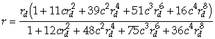
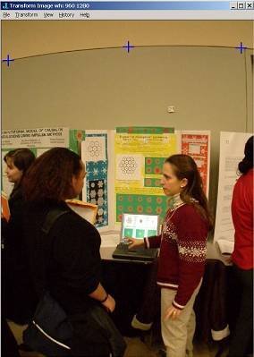
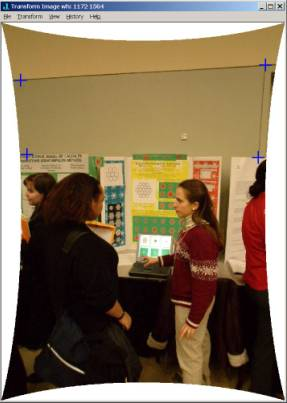
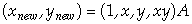
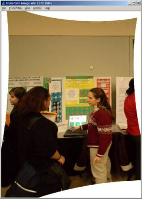
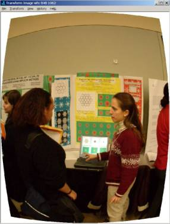
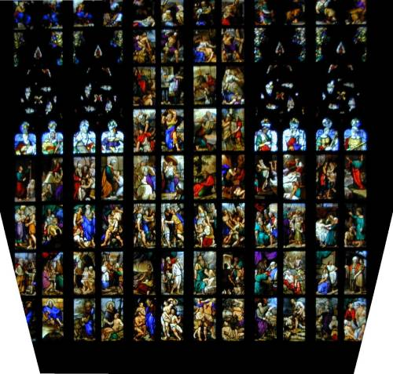

*by Cliff Reiter*
{ .byline }

In the spring of 2002 Fraser Jackson suggested that I ponder the process of removing barrel distortion and he directed me to a commercial product that does a nice job [\[3\]](#note3). I had been using a Nikon 990 digital camera and a wide angle lens that had relatively little barrel distortion so I was only casually interested. However, his e-mail happened to come at a time when I had just killed the Nikon camera during a wet hike, so I was in the market for a new digital camera. After getting advice and studying Steve’s amazing Digital camera site [\[8\]](#note8), I got a Fujifilm S602 camera. I also got a wide angle lens (a Raynox DCR 720), but the lens gives substantial barrel distortion at full wide angle. Suddenly I am much more interested in algorithms for removing barrel distortion.

## Barrel Distortion

Study of computer graphics books and searching the web readily leads to a standard model for barrel distortion. It is based upon the assumption that the distorted radius *r<sub>d</sub>* is related to the true radius *r* by a spherical distortion of the form *r<sub>d</sub> = r(1+cr<sup>2)</sup>* . Warren-Smith and Berry’s page [\[9\]](#note9) is an easily available source that discusses useful facts regarding this model for barrel distortion.

There are a couple of issues to deal with in using the model. First, we typically do not know the constant for a given lens. While one can experiment with positive and negative coefficients to cause pin cushioning and barrel distortion using the model, we aim to automatically straighten a curve from control points. This requires having the distortion map and its inverse. The software [\[9\]](#note9) implements the inverse via an approximation based upon two steps of Newton’s method. We follow that approach and asked Mathematica [\[4\]](#note4), via the following commands, to obtain the rational map that approximates the inverse.

```
   f[r_] = r(1 + c r^2) - rd
   Newt[r_] = r - f[r]/f'[r]
   Simplify[Newt[Newt[rd]]]
```

Rewritten in a form useful for our J implementation; the approximate inverse is the following.



The spherical distortion and its inverse can be readily implemented and applied in J. A script with these barrel distortion functions and a cover form is available from [\[6\]](#note6).

```
NB. radius to barrel distorted radius
R_to_RD=: ] + [ * ^&3@]

NB. distorted radius to radius
p1_temp=.1 11 39 51 16&p.
p2_temp=.1 12 48 75 36&p.
RD_to_R=: ]* (p1_temp % p2_temp)@:([**:@]) f.
```

For *c =* 0.1 we can convert between true and distorted radii and back with the following.

```
   0.1 R_to_RD _1 0.8 1
_1.1 0.8512 1.1
   0.1 RD_to_R 0.1 R_to_RD _1 0.8 1
_1 0.8 1
```

The function `barrel_undistort` defined below is designed to remove barrel distortion. The coefficient is given as the left argument and the image data as the right argument. We like to see as much of the un-distorted image as possible, which means some padding needs to be added. The padding can be subsequently clipped if desired. The function pads the image with one edge of white pixels on the bottom and right. Then, for each pixel in the result image, we compute what the corresponding pixel would have been in the input image. Some of those values are out of range, so by clamping the values between `_1` and the image width/height, white is used for those out of range values.

Notice the heart of the function, which is in the `for_k.` loop, converts pixel coordinates into polar coordinates and adjust the radius with `R_to_RD`.

```
NB. c barrel_undistort raw_image
barrel_undistort=: 4 : 0
wh=.|.hw=.2{.$y.
und=.wh sn_to_pix@(x. sn_undist)@(wh pix_to_sn)
y.=.(y.,{:a.),"_1 {:a.
if. x.<0 do.
'dw dh'=.|und 0 0
else.
'dw dh'=.-<./und -:wh*=i.2
end.
z=.((hw+2*dh,dw),3)${:a.
dsn=. -{.-/hw pix_to_sn 0 0,:1 1
w=.j./"1 hw pix_to_sn (-dh),.(-dw)+i.(2*dw)+{:hw
for_k. (-dh)+i.({.hw)+2*dh do.
  t=.12 o. w
  r=.|10 o. w
  r=.x. R_to_RD r
  in=.;/_1 >. hw <."1 hw sn_to_pix +.r r. t
  z=.(in{y.)(dh+k)}z
  w=.w+dsn
  end.
NB. 'one'+1
z
)
```

The function also uses various utility functions such as `pix_to_sn` and `sn_to_pix` which convert between pixel coordinates (bounds specified on the left) and semi-normal coordinates. Semi-normal coordinates range from `_1` to `1` while respecting the aspect ratio. See the script for the particular implementation details of those and related utilities.

We will see in our example that we determine the coefficient of distortion by selecting points that should be on a line. Various coefficients are tried and how close the resulting points are to a line is determined. A modified bisection strategy is used to determine the coefficient to three decimal places. That coefficient is then used to remove the distortion from the image. Again, the script contains the implementation details.

## An Example

Figure 1 is an image of Angela Coxe discussing her work \[1,2\] with Professor Chawne Kimber that was taken under adverse conditions. The room was very crowded and not very bright. Taking the photo required a lucky break in the crowd and use of the wide-angle lens. The intensity has been slightly increased in the style of &lt; ahref=#note5>\[5\] and the image has been loaded into the `transform_image` function defined by `transform_m.ijs` [\[6\]](#note6). Notice the wall section edge near the top is curved. It should be a straight line. Three points along the curved section near the top have been selected and marked with blue crosses. These are used as control points that determine the distortion coefficient. For those points, the distortion coefficient was `_0.078.`

{ width="284" height="399" }  
**Figure 1. Barrel Distortion and Points to be on a Line**

Running the “transform”–“remove barrel distortion” menus on the Transform Image form results in the underlying image that appears in Figure 2. Notice that the section edge on the wall and even the poster edges are now lines. The barrel distortion has been removed.

{ width="287" height="403" }  
**Figure 2. Barrel Distortion Removed and Points to Form a Rectangle**

However, the angle between the horizontal and vertical section edges is not a right angle. In the next section we see how to make the angle into a right angle.

## Tilt Removal

A problem commonly arising in images is that the image was taken at some angle other than centred and perpendicular to the object of interest. It is common [\[7\]](note7) to adjust such a tilted image by using a function that maps a point *x,y* to a new point via



where *A* is a 4 by 2 matrix of parameters. This is a slightly nonlinear map since it contains the *xy* term. The eight parameters in *A* may be determined by knowing the behaviour of four control points. We have found it convenient to select four points and to map those to a rectangle that is an average of the points. Thus, the four selected points in Figure 2 correspond to points that we want to map to a rectangle. Using the “transform” – “tilt removal” menus, we obtain the image in Figure 3. Notice that the wall section edges now appear perpendicular and the top edges of the posters are horizontal. Of course, other features are somewhat distorted. We can trim the image by selecting a rectangle with the left mouse down and using the “transform” – “trim” menus.

{ width="287" height="403" }  
**Figure 3. Quadrilateral Tilted to a Rectangle**

Of course we are not limited to using this distortion to make images “correct”. For example, one can select points more or less eccentric than those required by the barrel distortion. One can also use the menus to directly specify the distortion constant. Figure 4 shows the result of applying the distortion removal with a coefficient of 0.3. This adds to the distortion.

While the software at [\[3\]](#note3) is faster than the functions described here, we have developed simple and effective tools for removing barrel distortion in J. One of the advantages of the J tools is that the source script is available, ready for modifications and improvements. For example, once the distortion coefficient for a particular lens is known, we are able to modify images taken with that lens under program control simply by using barrel\_undistort with the suitable coefficient.

{ width="286" height="377" }  
**Figure 4. Barrel Distortion Added c=0.3**

### References

> <a id="note1"></a>\[1\] A. M. Coxe and C. A. Reiter, *Boolean Hexagonal Automata*, Vector, 19:3 (2003) 113-121.  <a id="note2"></a>\[2\] A. M. Coxe and C. A. Reiter, *Fuzzy Hexagonal Automata and Snowflakes*, Computers & Graphics, to appear.  <a id="note3"></a>\[3\] Grasshopper&~146;s Image Align, [www.imagealign.com](http://www.imagealign.com).  
> <a id="note4"></a>\[4\] *Mathematica 4*, Wolfram Research, [http://www.wolfram.com](http://www.wolfram.com).  
> <a id="note5"></a>\[5\] Cliff Reiter, *With J: Image Processing 2: Color Spaces*, APL Quote Quad, submitted to APL 2003 Proceedings.  <a id="note6"></a>\[6\] Cliff Reiter, Transform Image script, [http:/www.lafayette.edu/~reiterc/j/vector/index.html](http:/www.lafayette.edu/~reiterc/j/vector/index.html)  
> <a id="note7"></a>\[7\] J. C. Russ, *The Image Processing Handbook, 4th edition*, Boca Raton, CRC Press LCC, 2002.  <a id="note8"></a>\[8\] Steve&~146;s Digicam Site, [http://www.steves-digicams.com](http://www.steves-digicams.com).  
> <a id="note9"></a>\[9\] R. F. Warren-Smith and D. S. Berry, *AST: A Library for Handling World Coordinate Systems in Astronomy*, [http://star-www.rl.ac.uk/star/docs/sun211.htx/node235.html](http://star-www.rl.ac.uk/star/docs/sun211.htx/node235.html).

***

## The Milan Cathedral Challenge

*from Adrian Smith*

I had already made several attempts to ‘straighten out’ some shots of the wonderful stained glass in Milan Cathedral. As always, these can only be taken at a sharp upwards angle, and the various filters in PaintShop Pro tended to trash the quality of the transformed image, I suspect because you have to go through several independent stages.

I sent an original to Cliff to see how much better his software handled the task, and I have to say that the results are considerably superior. Here is his reply, along with a section of the final image.

I updated the transform\_m materials on my web page to include nonlinear rescaling and adding menu items “balance vertical” and “rescale”. Also attached as a tiny zip.

It seems that a cubic transformation does a good job of balancing the size of windows—so I included that as a separate feature rather than imposing it upon the barely nonlinear “tilt to rectangle”.

Taking your original image, I selected four points which should form a rectangle, I applied “tilt to rectangle” (sent previously) Then, I selected four more points, now giving the top/bottom of two windows, one near the top, the other the bottom. I used “balance vertical”. Then I rescaled the vertical direction by a factor of 1.2 to adjust the aspect ratio.

The result is attached.\[<i>Click on the pic for a bigger version. Ed.</i>\]

[{ width="500" height="477" }](detilt.jpg)

***
