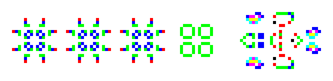
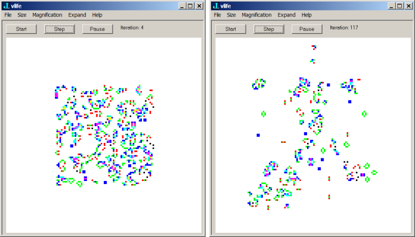
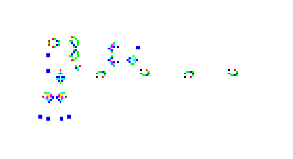
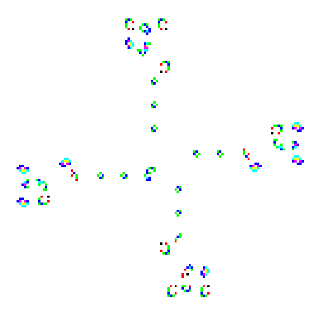
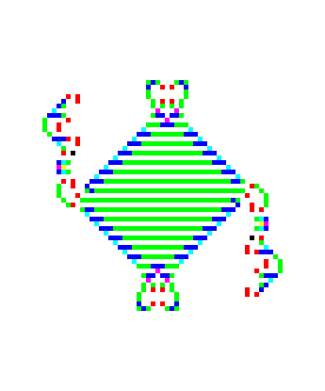

by Cliff Reiter
{ .byline }

## Introduction

The Game of Life is a process that updates a rectangular array of Boolean valued cells according to simple local rules. The process was introduced by John Conway and popularized by Martin Gardner \[3,6,7\]. In particular, a cell with value 1 is considered alive and at the next generation an alive cell remains alive if it has 2 or 3 alive neighbours among its closest 8 neighbours. A dead cell becomes alive if it has exactly 3 alive neighbours. The rich behaviour that results from these simple rules is fantastic. For example, Figure 1 shows the evolution of a Pulsar Puffer Train which is a configuration that moves to the right, leaving a new pulsar in its wake after every 36 steps. The alive cells are shown in colours that depend upon the number of neighbours they have. The Game of Life has been shown to be a universal computer \[5\] and considerable activity remains in identifying configurations that evolve in these fantastic ways \[4,8,16\].

{ width="666" height="162" }

Figure 1. The Trail Left by a Pulsar Puffer Train
{ .caption }

Because the process is so simple and the results are so intriguing, implementing the Game of Life is a popular programming exercise. Writing the “fastest” life program has a long history with some implementations using heap-sorted blocks of local activity to allow portions of the configuration to drift away without hindering performance \[8\].

There have been many discussions of the Game of Life in APL including a survey by McDonnell \[10\]. Interest in the APL community continues, recently including \[1\]. K implementations may be found at \[2\]. Implementing the Game of Life has arisen several times on the Jforum \[9\]. During the \[9b\] thread, Ewart Shaw \[15\] presented an interesting implementation and his amazing signature appeared. His signature implements and runs the game of life on a simple configuration.

Here is his signature and its result.

<pre><tt>   3 ((4&amp;({*.(=+/))++/=3:)@([:,/0&amp;,^:(i.3)@|:"2^:2))&amp;.&gt;@]^:(i.@[) &lt;#:3 6 2
+-----+---------+-------------+
|0 1 1|0 0 0 0 0|0 0 0 0 0 0 0|
|1 1 0|0 1 1 1 0|0 0 0 1 0 0 0|
|0 1 0|0 1 0 0 0|0 0 1 1 0 0 0|
|     |0 1 1 0 0|0 1 0 0 1 0 0|
|     |0 0 0 0 0|0 0 1 1 0 0 0|
|     |         |0 0 0 0 0 0 0|
|     |         |0 0 0 0 0 0 0|
+-----+---------+-------------+</tt></pre>

We will say more about his signature later.

My interest in the Game of Life began around 1977 when a mentor told me that it could be easily implemented by making 9 copies of the cellular arrangement as a three dimensional array and then rotating the planes -1, 0, or 1 units in appropriate directions to organize each cell and its neighbours along one axis. I took the bait and implemented the Game of Life in APL using that idea. I also faced the issue of implementing the Game of Life for my visualization text and have been interested in generalizations for some time \[11, 12, 13\]. It recently occurred to me \[9e\] that algorithms for the Game of Life, such as the one in Shaw’s signature, are fast enough in J that producing a real time GUI-based version of life is practical. GUI based versions have appeared based on Tcl/TK \[9a\], but I have a special interest visualizing processes, and wanted to at least display cells with colour encoding their number of neighbours (as in the 3-dimensional representations in \[11\] which were not created in real time). The script I developed is available from \[14\].

Thus, the purpose of this note is to describe a few of the implementations of Life in J that I considered as I developed the script. I also briefly discuss using the system timer event, since that event was new to me and is a key to having “start” and “pause” buttons on the form.

## Variations on Life

There certainly is no one “best” algorithm for life. One might be interested in speed, memory usage, brevity, readability, subtle beauty or something else, whether it is objective or subjective. Furthermore, context matters. For example, when I introduce the Game of Life in \[13\] it is in the context that some, but not all, of the features of J have been introduced. Furthermore, I know that in subsequent sections I will consider fuzzy generalizations of Life, so it is natural to aim for coherence between those developments.

I have mentioned that rotating planes was the first approach I used in APL. In writing Fractals, Visualization, and J, I really wanted to use tesselations as provided by cut. It seems to me that tesselations separate the local processing from neighbourhood organization in a beautiful way. Here we see all the 3 by 3 overlapping neighbourhoods of `i.4 6` using cut (`;._3`).

<pre><tt>   3 3 &lt;;._3 i.4 6
+--------+--------+--------+--------+
| 0  1  2| 1  2  3| 2  3  4| 3  4  5|
| 6  7  8| 7  8  9| 8  9 10| 9 10 11|
|12 13 14|13 14 15|14 15 16|15 16 17|
+--------+--------+--------+--------+
| 6  7  8| 7  8  9| 8  9 10| 9 10 11|
|12 13 14|13 14 15|14 15 16|15 16 17|
|18 19 20|19 20 21|20 21 22|21 22 23|
+--------+--------+--------+--------+</tt></pre>

In \[13\], the Game of Life was implemented by defining a local sense of Life and then applying it to the 3 by 3 tesselation. However, in the first edition of the book, infixes were used to spread the local behaviour since at that time cut was too inefficient (more on that later). Since there are fewer cells of the tesselation than original cells, we also need to deal with the boundary conditions. We will take periodic boundary conditions. First we implement the local life rule.

<pre><tt>   ]L=:1,1 9 1,:1
1 1 1
1 9 1
1 1 1

   ]n1=:0 1 1,0 1 0,:0
0 1 1
0 1 0
0 0 0
   L*n1
0 1 1
0 9 0
0 0 0
   llife=: +/@:,@:(L&amp;*) e. 3 11 12"_

   llife n1
1</tt></pre>

We encode the local processing using a matrix L. The sum of the entries in `L*n1` is enough to determine the number of neighbours and whether the central cell is alive. Here the sum is 11 which corresponds an alive cell with 2 neighbours which is a configuration that yields life. Next we implement the periodic extension and then distribute the local life function using infix (`life1`) and cut (`life2`)

<pre><tt>   perext=: {: , ] , {.
   perext2=: perext"1@:perext
   perext2 n1
0 0 0 0 0
1 0 1 1 0
0 0 1 0 0
0 0 0 0 0
1 0 1 1 0

   life1=: 3&amp;(llife\)@|:"2@(3&amp;([\))@:perext2

   life2=: 3 3&amp;(llife;._3)@:perext2

   life1 n1
1 1 1
1 1 1
1 1 1</tt></pre>

Table I shows timing tests from 1995 \[12\] that show `life2` was infeasible in that era. By the second edition of book, `life2` became the method used. Notice that in order to have subsecond screen updates, we would have been restricted to around a 10 by 10 array in 1995. Before looking at more modern performance, we discuss the signature.

```
+---+---------------+---------------+
|   |     life1     |     life2     |
| n | time     space| time     space|
+---+---------------+---------------+
| 5 |  0.12 |  2212 | 0.32 |   8344 |
|10 |  0.75 |  2812 | 1.66 |  45684 |
|20 |  3.57 |  4564 | 8.34 | 266248 |
|40 | 15.65 | 12972 |44.1  |1679530 |
+---+-------+-------+------+--------+
```

Table I. Performance of Life, Circa 1995.

## Ewart Shaw’s Signature

In the text of \[9b\] Ewart Shaw defines `test=: (4&{ *. +/=4:) + +/=3:` while in his signature he uses a variant. We define the following.

<pre><tt>   test=: 4&amp;({*.(=+/))++/=3:
   shift=:[:,/0&amp;,^:(i.3)@|:"2^:2</tt></pre>

With those definitions his signature reduces to the following.

<pre><tt>  3 test@shift&amp;.&gt;@]^:(i.@[) &lt;#:3 6 2</tt></pre>

Except for `test@shift`, this is iteration control, boxing and creating the initial configuration. Thus, `lifes=:test@shift` implements the Game of Life with expanding boundary conditions. We will see how those two pieces of the function work.

First, shift appends a number of zeros (from `i.3`) along each axis and the results are assembled into nine planes which contain the original data padded with zeros. Those nine planes are created along two axes, so `[:,/` is used to organize the planes along one axis. The new axis of length nine is such that all nine values from the 3 by 3 tesselations appear along that axis.

<pre><tt>   $shift i.3 3
9 5 5

   3 3$&lt;"2 shift i.3 3
+---------+---------+---------+
|0 1 2 0 0|0 0 0 0 0|0 0 0 0 0|
|3 4 5 0 0|0 1 2 0 0|0 0 0 0 0|
|6 7 8 0 0|3 4 5 0 0|0 1 2 0 0|
|0 0 0 0 0|6 7 8 0 0|3 4 5 0 0|
|0 0 0 0 0|0 0 0 0 0|6 7 8 0 0|
+---------+---------+---------+
|0 0 1 2 0|0 0 0 0 0|0 0 0 0 0|
|0 3 4 5 0|0 0 1 2 0|0 0 0 0 0|
|0 6 7 8 0|0 3 4 5 0|0 0 1 2 0|
|0 0 0 0 0|0 6 7 8 0|0 3 4 5 0|
|0 0 0 0 0|0 0 0 0 0|0 6 7 8 0|
+---------+---------+---------+
|0 0 0 1 2|0 0 0 0 0|0 0 0 0 0|
|0 0 3 4 5|0 0 0 1 2|0 0 0 0 0|
|0 0 6 7 8|0 0 3 4 5|0 0 0 1 2|
|0 0 0 0 0|0 0 6 7 8|0 0 3 4 5|
|0 0 0 0 0|0 0 0 0 0|0 0 6 7 8|
+---------+---------+---------+</tt></pre>

The function test tests whether the centre (plane with index 4) is alive with 4 alive cells among the 9 cells, or if there is a total of 3 alive cells among the 9 in a neighbourhood. While the wording is different, these conditions are equivalent to those given originally, but this view is used since computing sums of all 9 cells is convenient.

Notice that the 4 in the definition of test is used in two quite different ways when it is spread upon the verb train. It is both an index (plane 4) and a potential sum. Since the same word is used in two distinct ways in the sentence in which it is embedded, I believe Shaw’s signature qualifies as humour. It certainly made me laugh out loud.

But his signature is much more than a joke. Table II shows the performance of Life implementations using J 5.03 on a 1.7GHz PC. Cut (`life2`) is now wonderfully efficient, but Shaw's signature (`lifes`) is more than ten times faster than that. Moreover, using subsecond updates, we can deal with universes that have more than 10,000 times more cells than in 1995.

<pre><tt>+----+----------------+----------------+----------------+
|    |     life1      |     life2      |     lifes      |
|  n | time     space | time     space | time     space |
+----+-------+--------+-------+--------+-------+--------+
| 256| 0.2516|  534272| 0.2243|  265152| 0.0125| 2754688|
|1024| 4.0536| 8423168| 3.6037| 4203456| 0.3145|44042368|
+----+-------+--------+-------+--------+-------+--------+</tt></pre>

Table II. Performance of Life, Circa 2005.

## Time for the Game of Life

In preparing my remarks for \[9e\] I used a variant of Life that used table look-ups for neighbour sets and configurations that would lead to life. It was competitive with the signature method and both were fast enough to quickly update universes at least 1000 by 1000. I decided it was time to write a GUI version of the Game of Life in J \[14\]. I eventually grew to prefer the signature method for the style of updating generations, but still preferred the periodic boundary conditions. Slight changes to `shift`, which we call `shiftv`, give those boundary conditions. We also use a slight variant on the test function.

<pre><tt>shiftv=:[:,/1&amp;|.^:(i:1)@|:"2^:2
testv=:(4&amp;{((3:=])+.[*.4:=]) +/)
lifev=:testv@shiftv</tt></pre>

Note that I have gone back to my roots. Instead of adjoining zeros, the function `shiftv` rotates planes -1, 0 or 1 units. You might think that I used `lifev` in my implementation. Actually not, I used `shiftv@testv` instead of `testv@shiftv`. That is because the colour information requires knowing the number of neighbours each alive cell has and that is the same information needed to update a generation. The expensive part of the computation is the `shiftv` portion; thus, rather than compute it twice, we store all 9 planes as the representation of the universe at any iteration. That is my attempt at humour.

Figure 2 shows the form created by running the *vlife2.ijs* script. The configuration was initially a 64 by 64 random configuration embedded in a 128 by 128 universe. It is shown after 4 and 117 iterations. Notice that even after 4 iterations some organization is apparent. After 117 iterations there is much more organization, the information has expanded, but the random quality is not gone.

{ width="696" height="398" }

Figure 2. Evolution of a random configuration
{ .caption }

On the web one can find many sites with very interesting patterns. A classic collection is Al Hensel’s *lifep.zip* collection. These use the Life 1.05 format which may be imported into our life form using the file load menu. Watching the dynamics is far more interesting than viewing static images, but we can nonetheless get some insight into these striking behaviours. Figure 1 showed one stage of the evolution of *psrtrain.lif*. Glider guns such as *gun30.lif* produce streams of gliders; *lwssgun.lif* produces the stream of lightweight space ships seen in Figure 3. Figure 4 shows *spiral.lif* which must be watched to be fully appreciated. Four configurations move away from the centre leaving a small trail of stable configurations that are destroyed by a glider that moves around in a spiral. Figure 5 shows a configuration arising from *max.lif* that grows outward leaving the interior filled with the green strips. The configuration *zips.lif* shows an empty pattern moving inside strips in a fashion similar to a zipper. The Game of Life offers many surprising and beautiful configurations.

{ width="588" height="319" }

Figure 3. A configuration resulting from *lwssgun.lif*
{ .caption }

{ width="522" height="515" }

Figure 4. A configuration resulting from *spiral.lif*
{ .caption }

{ width="414" height="498" }

Figure 5. A configuration resulting from *max.lif*
{ .caption }

## Timer for the Game of Life

In order to implement the Game of Life in a manner that I desired, I wanted “start” and “pause” buttons as can be seen on the forms in Figure 2. Of course, if the “start” button implements an unbounded loop, there is no obvious way for an event to trigger a change that could break the loop. However, the timer event gives the facility required. The “start” button runs one step of life, and sets a timer event to occur later. If some other event happens first, then that event is executed. For example if the “pause” button is pressed, then its event is defined to cause the timer event to be cancelled. If no other event has occurred, then the timer event executes `sys_timer` which is defined to run one more step of life and the next timer event remains pending. This is repeated until the timer is halted by the “pause” button or an error.

<pre><tt>life_start_button=:3 : 0
life_step_button ''
wd 'timer 100'
)
sys_timer=: 3 : 0
try. life_step_button '' catch.
  wd 'timer 0'
  end.
)
life_pause_button=:3 : 0
wd 'timer 0'
)</tt></pre>

The function `life_step_button` runs one step of life and updates the form. Its details are available in the script \[14\].

## Conclusion

We have seen that the Game of Life can be run very effectively in J. While many details have a new flavour, the fundamental ideas of using infix, cut, or multiple planes are old \[10\]. Nonetheless, combined with timer events and a colouring scheme, a GUI allows us to investigate the beautiful evolution resulting from the Game of Life.

## References

1. M. Alfonseca, M. de la Cruz, and A. Ortega, Complex Systems in APL: Fractals, Evolving Cellular Automata and Artificial Life, *APL Quote Quad*, 32 4 (2002) 17-26.
2. S. Apter, Conway’s Game of Life in K, [*http://www.nsl.com/papers/life.htm*](http://www.nsl.com/papers/life.htm) and  [*http://www.nsl.com/papers/plife.htm*](http://www.nsl.com/papers/plife.htm)
3. E. Berlekamp, J. Conway, and R. Guy, *Winning Ways For Your Mathematical Plays*, Academic Press, 1982.
4. P. Callahan, Patterns, Programs, and Links for Conway’s Game of Life, [*http://www.radicaleye.com/lifepage/lifepage.html#catback*](http://www.radicaleye.com/lifepage/lifepage.html#catback)
5. P. Callahan, What is the Game of Life? [*http://www.math.com/students/wonders/life/life.html*](http://www.math.com/students/wonders/life/life.html)
6. M. Gardner, The fantastic combinations of John Conway’s new solitaire game of “life”, *Scientific American* 223, (1970) 120-123.
7. M. Gardner, On cellular automata, self-replication, the Garden of Eden and the game “life”, *Scientific American*, 224 4 (1971) 112-117.
8. A. Hensel, Conway’s Game of Life, [*http://www.ibiblio.org/lifepatterns/*](http://www.ibiblio.org/lifepatterns/)
9. Jforum list server, [*http://www.jsoftware.com*](http://www.jsoftware.com). Messages dated (a) June 24, July 6, 2001, (b) Aug 29, 2001, (c) Jan 31-Feb 7, 2003; (d) Aug 20-21, 2003, (e) Dec 12-16, 2004.
10. E. E. McDonnell, Life: Nasty, Brutish, and Short, *APL Quote Quad*, 18 2 (1988) 242-247.
11. J. E. Pulsifer and C. A. Reiter, One Tub, Eight Blocks, Twelve Blinkers and Other Views of Life, *Computers & Graphics*, 20 3(1996) 457-462.
12. C. A. Reiter, Infix, Cut and Finite Automata, *APL Quote Quad*, 25 4 (1995) 162-169
13. C. Reiter, *Fractals, Visualization and J*, 2nd edition. Jsoftware, Inc, Toronto, 2000.
14. C. Reiter, Viewing Color Life, [*http://www.lafayette.edu/~reiterc/j/vector/vlife\_index.html*](http://www.lafayette.edu/~reiterc/j/vector/vlife_index.html)
15. E. Shaw, J page, [*http://www.ewartshaw.co.uk/jwhat.html*](http://www.ewartshaw.co.uk/jwhat.html)
16. J. Summers, Jason’s Life Page,  [*http://entropymine.com/jason/life/*](http://entropymine.com/jason/life/)

Cliff Reiter  
Department of Mathematics  
Lafayette College, Easton, PA, 18042 USA  
[http://www.lafayette.edu/~reiterc](http://www.lafayette.edu/~reiterc)

***
