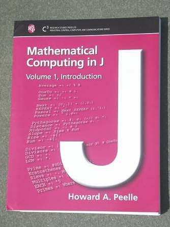

book review by Cliff Reiter
{ .byline }

## Mathematical Computing in J, by Howard A. Peelle

*Mathematical Computing in J* \[[1](#ref)\] is a smart looking book that very gently introduces mathematics and J to its readers. This book is another J book published by Research Studies Press Ltd., Baldock, Hertfordshire, England; the first was Norman Thomson’s *J: the Natural Language for Analytic Computing* \[[2,3](#ref)\]. *Mathematical Computing in J* is the size of ordinary paper with a soft cover, a wire binding, and a large font. The book is very pleasant to read at the same time as using a computer since it lies flat and is easy to read. The cover is attractive, see Figure 1. It is almost 400 pages in length and as we will see, has a remarkably comprehensive style.

{ width="334" height="446" }

The book is aimed at students and teachers of mathematics or computing at the secondary or early college level. The author says his motivation for writing the book was sparked by students’ smiles at understanding by doing. The editor recognizes that being able to implement fundamental mathematical computations is an essential job skill and *Mathematical Computing in J* gives you those skills. Both of their remarks ring true. While the text is in many ways quite straightforward, it is equally brilliant, because the discussion is thorough, careful and motivated.

The topics include those that might be seen by high school: fractions, arithmetic, algebra, equations, exponentials, logarithms, and averaging. Other topics are at a similar level, but might only be seen in high school as enhancement material: Pascal’s triangle, moving averages, tables and 3-D arrays, commutativity, associativity, and the sieve of Eratosthenes. We are reviewing the first volume which has 18 chapters; not surprisingly, the second volume will contain more advanced topics including: logic, recursion, probability, statisitics, series, linear algebra, and much more; it is designed to also have 18 chapters.

Each topic in *Mathematical Computing in J* is thoroughly covered. Each chapter is divided into sections: Vocabulary, Worksheet, Explanation, Review and Problems. That is: at the beginning of each chapter there is a vocabulary listing the J introduced in the section and other J that should be reviewed. There is a worksheet intended for interactive completion by the reader. Then there is extensive discussion and explanation of the ideas that the reader should have explored. Possible mistakes or misconceptions are explicitly discussed, important concepts are highlighted, and advanced material is presented, but noted as such.

For example, Chapter 1 is titled: Arithmetic. Division and reciprocal using (`%`) appear in the experiments that readers should do; in the discussion, the mnemonic that it is similar to the grade school division symbol is mentioned, a warning that it is not (`/`) is mentioned and consideration of division by zero mentioned, referenced, but not extensively discussed. The reader has been given a comprehensive explanation of the functions, the symbol for the functions and suitable warnings and pointers regarding subtleties. The discussion is followed by a review of J, and then the first problem at the end of the chapter is to calculate the number of feet traveled by a car traveling 55 miles per hour for 3 seconds (1 mile = 5280 feet). While the problem isn’t deep, it illustrates an important basic arithmetic computation and exercises the division or reciprocal function. And the reader can’t be left behind: the problem solution appears in Appendix 3.

As a second illustration we consider the breadth of the discussion of averaging. Chapter 11 is devoted to averaging and here we consider the worksheet exercises from that section (although in the text, comments appear along with the worksheet experiments, and further experiments are suggested with words; moreover, we show the results of the worksheet, not just the experiments requested).

The worksheet begins with a straightforward example of computing the average of a list of numbers.

## 1. Averaging Numbers

```
   n =: 85 65 95 90 80

   #n
 5
```

```
   +/ n
 415

   (+/n) % (#n)
 83
```

In the next section of the worksheet, the average is computed using a fork, named and unnamed.

## 2. Functional Averaging

```
   (+/ % #) n
83

   Average=: +/ % #

   Average
+-----+-+-+
|+-+-+|%|#|
||+|/|| | |
|+-+-+| | |
+-----+-+-+

   Average n
83

   Average 2 4 6 8
5
```

Some weights are defined and used to compute weighted averages.

## 3. Weighted Average

```
   weights=: 1 0 3 1

   (+/ weights * 2 4 6 8) % (+/ weights)
5.6

   n
85 65 95 90 80

   weights=: 1 2 2 2 1

   (+/ weights * n) % (+/ weights)
83.125
```

Cumulative sums are given and readers are encouraged to experiment with replacing the sum with averages.

## 4. Cumulative Sums

```
   +/ \ n
85 150 245 335 415

   +/ \ 1 2 3 4 5
1 3 6 10 15
```

Moving averages are computed.

## 5. Moving Averages

```
   2 Average \ n
75 80 92.5 85

   2 Average \ 1 2 3 4 5
1.5 2.5 3.5 4.5
```

All the ideas explored in the worksheet are thoroughly discussed in the explanation section. Indeed, the main discussion of forks in the book appears in the discussion section of this chapter. Notice the coherence of the workshop section: several types of averages are discussed. Different styles of computations (direct and tacit) are discussed and monad/dyad cases of (`\`) are discussed.

*Mathematical Computing in J* gives a gentle introduction to J in the context of actively doing mathematics. It is a useful, active resource for students learning the mathematical topics being discussed, and is a very gentle introduction to J for those who know the mathematics.

<a id="ref"></a>

## References

\[1\] Howard A. Peelle, *Mathematical Computing in J, Volume 1*, Research Studies Press, 2004.

\[2\] Cliff Reiter, Review of *J: the Natural Language for Analytic Computing,* book by Norman Thomson, Vector, 18 3 (2002) 31-37.

\[3\] Norman Thomson, *J: the Natural Language for Analytic Computing, J Dictionary* (electronic version), Jsoftware Inc., Toronto, 2001.
