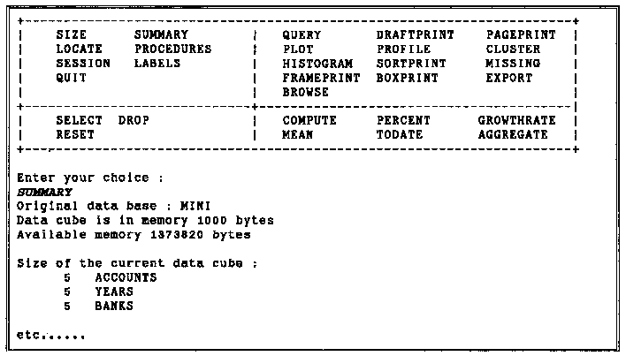
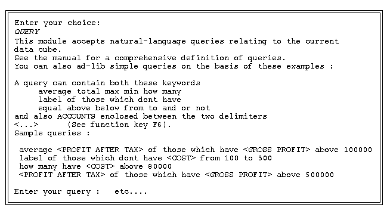
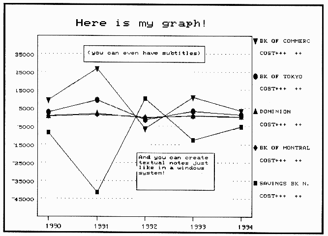

*by Jon Sandles*
{ .byline }

### Introduction

Vector received the installation disks for Helm in April 1993 – asking if it could be reviewed. It is written in APL by a company called Codework from Italy – potentially available for TSO and MS-DOS 286/386/486 and also UNIX. Apparently it is used by about 100 installations – including FIAT. The particular version we received ran under the APL\*PLUS II development interpreter and hence required a dongle. Of course, if you do not already have a dongle this makes it quite an expensive piece of software as you will have to splash out for one in the first place. Helm believe there are good reasons why you need to be in a non-runtime environment for this type of system. (They have tried a runtime version but found it difficult to comprehensively trap all the errors in a suitable way – this type of system will inherently produce errors because the user types the instructions in.)

### Installation

The installation batch file copied a set of packed files/workspaces into the c:\\helm directory. The batch file helm merely calls the non-runtime interpreter from this directory. But, you’ll need to put the path of your APL interpreter in here and make sure it picks up the file config.apl in the c:\\helm directory which then loads the correct initial workspace etc. This bit is not very well documented, and if you had never used PLUS II before you could well struggle. Even though I made it that far I still got thrown out due to a reference to a missing file aplkeys.apl in the file config.apl. I commented this line out and finally got in. (None of the F-keys then worked – Codework say they left the file out at the last minute for copyright reasons.)

Once you are in you have to follow an installation procedure – firstly declaring your hardware configuration and then registering your name and company details. This produces a ‘plate no’ which you have to ring Codework (in Italy) with to complete registration. They then take the codeno and name you have typed in and calculate the password you should enter to complete registration and allow you to use the rest of the code. (When I rang Codework they seemed surprised that I had made it that far!!) After putting in the password that Codework supplied I was finally in.

### Initial Impressions

I initially set up the software in ‘semi-automatic’ mode – this is basically a set of menus which allow you to pick an option which then loads the relevant workspaces. The actual screens are just interactive text screens which prompt you for function names/arguments. You can create/edit your initial data by using spreadsheet style data entry screens. You can then ‘analyse’ the data by selecting the dimensions of the data which you are interested in (seemingly limited to 3 dimensions) and then performing the appropriate functions. There are full-screen graphics which have some useful features. Difficulties I had early on were that I sometimes found problems in relating what I had in the documentation to what I found on screen. I could not send my prints to a networked printer (although I am told there is a way). There was no mouse support (apparently this is in the development version), I could not add a new database of my own (it came with a couple of example databases) – due to not

having any F-keys. (I eventually found a way around this as well.) It should be noted that I did not have the full system documentation – I just had what was presumably a precis of the system’s functionality.

The overall feel of the system is like the old mainframe data/table management systems. It is typical of its genre in the way that the user must type in the commands he wants to run to get the results he requires. Typing errors are usually rewarded with an irrelevant error message (to the user that is) but if you know the commands available the rewards are great. A typical session starts out with (user commands are in italics):

## 

Commands like COMPUTE, SELECT etc. can be issued on their own and you are then prompted for the types of arguments they can take. If you know the full command you can type it in full and get the result immediately. This may appear at first sight tedious, but it is the flexibility which this modus operandi supports which makes it so popular and successful. The initial effort required to learn the ins and outs of the command language is high compared to the reward gained (especially compared to the relative ease with which you can get large rewards from recent Windows software). But, over time the command-driven approach of systems like Helm require much less effort and gain much more reward – and more importantly they are able to cope with the unpredictable nature of ad hoc applications that DSSs are often asked to tackle. The menu-driven approach often hits a brick wall which cannot be overcome without considerable redevelopment.

This flexibility is why these systems are still popular. The menu-driven approach is beginning to hit back by incorporating macro-languages and user-defined toolbars to enable the user to tackle a wider variety of problem within a single system. But because users have become used to the flexibility of their old command-driven systems many are reluctant to change.

Speaking to Helm (in English I’m afraid!) you soon get the same old picture that is besetting most APL system developers: the system was developed on Mainframe TSO and then when the users started turning their mainframes off and turning their PCs on, it was ported to a PC environment, but of course they wanted it to look the same. Hence the current look and feel of the system. Now of course the users are turning round again and asking for a Windows environment. (Helm are currently developing in Dyalog APL – but are sceptical about the Windows environment – who can blame them – it’s going to be a lot harder to maintain the system across all the different platforms I listed in the first paragraph.)

### General Reflections

Why would anybody want Helm? To begin with I was not sure. In the world of Windows most of what this does is an awful lot easier in tools like Excel etc. Text-based interaction went out with the ark (well at least a year ago) – but considering it is *supposed* to look and feel like a mainframe system it is quite good. The prompting and help is reasonable and the manual is full of examples. The data is entered in three dimensions via screens very similar to Lotus (or from text file etc.). Helm believe all data comes in three dimensions – but there are ways to have more or less. The system works best with three.

Here are a few example screens which should give you an idea. First the natural language interface:

## 

At the end of the day the system is used to produce reports – and so the graphical outputs are quite important – here is a sample graph:

## 

I could have done with the full manual to determine how good this interface language was, but it appeared from my limited efforts that it was quite effective (it was tempting to put SQL-like syntax in which did not seem to work).

Of course it’s all in colour if your hardware supports it! Without the manual I could not establish how many different sorts of graphs you could do. (It appeared to be limited to line plots and histograms.) But the graphs I tried were very flexible in terms of layout and titles etc. – which is never easy to do effectively in this type of environment.

### Conclusion

It would be unfair for me to suggest that there is anything wrong with this system. Helm have successfully marketed this system initially onto mainframes and then ported it when required to an environment that their users felt comfortable in. In five years time when the new environment comes along they will port the system again and the users will still be able to access their old data and have the same functionality. (Whereas everyone else will be splashing out for the new Excels and Words of the new world and typing all the data in for the third time.)

Small software vendors like Helm need to be applauded for supplying good usable systems to companies that require more than what is commercially available at the time, and when the commercial sector catches up they are still able to compete. And it’s all done in good old APL!

(webpage generated: 5 December 2005, 19:02)
