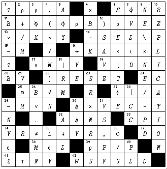
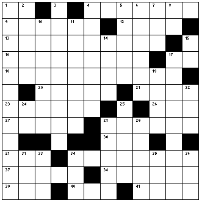

<b>Note:</b>  
The clues for the new crossword contain some APL characters. These are coded as APL2741 (available as a 45K [download](resource/apl2741.zip)), and also with &lt;CODE> tags. The mapping is compatible with both the APL2000 font and the current Dyalog font.

## Solution to APL Crossword from 15.1

## Crossword from 15.2

<b>Across</b>  
1\. Reverse the elements in the vector `L`  
4\. Delete from the vector `N` the even numbers 2 to 100  
9\. Scale up the numbers in the matrix `M` by 100000, and return as a vector  
12\. Fifty-five fives  
13\. The sum of the absolute value of the vector `NV` summed with the magnitudes of the first `R` elements of `V`  
16\. The `N` by `N` identity matrix (1s on the diagonal)  
17\. Get outta here!  
18\. Flag the rows of the 15-column character matrix `CMI` that match the first fifteen elements of `CV`  
20\. A random positive integer no more than 20 bigger than `A`  
21\. The amount to subtract from `T` to make it the next higher integer  
23\. Given `N`, a vector of integers, map all values from 1 to 7 to the numbers 0 to 6  
26\. Find the first four in `F` fast  
27\. What’s currently localized?  
28\. Transform the matrix of scores `S` from students by exams, to exams by students and cap the scores at 100  
30\. `(N+1)-⍳N`, without using `⌽`  
31\. Squeeze all 0s from the vector `V`  
34\. `(⍴M)⍴(1↓⍴M)/V` for the matrix `M` and the vector `V`  
37\. `E` (bits) if the vector `N` is empty, otherwise `(⍴E)⍴1`  
38\. Divide each row of `NM` by the vector `E`, where `S←⍴NM`  
39\. Repeat each column of `M`, `C` times  
40\. `(⍴M)⍴(0)`, for character `M`  
41\. `3⌽2/2⍴'ICE CREAM'`

<b>Down</b>  
1\. `2-(⍴VEC⍳n[⌽⍳C]` in origin 1  
2\. Convert the bit vector `LE`, having length `M`, to the designated indices  
3\. Flag those values of `A` that are contained in the matrix `NT` and for which the corresponding values in the non-negative integer array `N` are nonzero  
4\. How many 27s are there in each row of the matrix `NM`?  
5\. `1 2 3 4 5`, five times  
6\. From the first `N` values in `T`, flag those that aren’t multiples of five  
7\. The indices of the vector `V`  
8\. `1⊥⍳10`  
10\. Generate `NI` ( a multiple of 5) random numbers between 0 and 4, having the same frequency of each value  
11\. `(V[1]+⍳L),(V[2]+⍳L),(V[3]+⍳L), ...`  
14\. Which elements in `R` are 10s?  
15\. `+/⍳4`  
17\. Branch to the line labelled `V` if `I` is a scalar  
19\. `-F1-C`  
22\. `⍎⍞←'T',0⍴T←40`  
24\. Change the sign of `S`  
25\. A random index into the vector `S`, up to the index at which the shape of `M` is found  
28\. Transpose the matrix `NM` along the MINOR diagonal  
29\. The number of whole multiples of `C` in `NM`  
32\. None  
33\. `(⍴M)⍴0`, for numeric `M`  
34\. Transform `NM` from shape (6 3 4) to shape (4 3 6)  
35\. Unfinished business  
36\. If `MAT` were demoted

***

Reprinted with kind permission from Zark APL Tutor News, a quarterly publication of Zark Incorporated, 23 Ketchbrook Lane, Ellington, CT06029, USA
