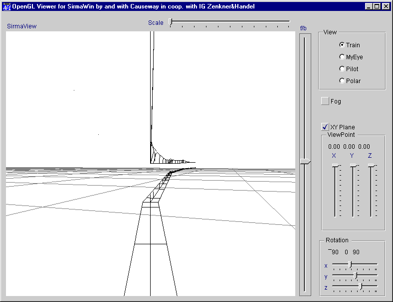

## BAA AGM and Vendor Forum, May 22nd at the Royal Statistical Society

*reviewed by Jon Sandles*

The BAA AGM passed without incident and we moved swiftly on to the main event which was Peter Donnelly of Dyadic Systems talking to us about the latest features in Dyalog APL. He warned us that the main new features of what will become version 8.2 would not be discussed as he was saving them up for the Rome conference. Instead he was going to bring us up to date with some of the more minor things that Dyadic have been up to in the last year.

So the content of Peter’s talk was nothing ground-breaking. He covered the new feature to put Excel-like comments into the Dyadic grid. The file system functions have been revamped to give shy results, this allows them to be strung together to form meaningful expressions. All the functions are fully backward compatible. We saw again the power and beauty of dynamic functions, and a nice example was presented showing a rename dynamic function which used the new shy results of the file system functions.

What was ground-breaking about Peter’s talk was the method of delivery. Peter did very little of the talking himself, instead he had programmed his computer to do the presentation for us. What we saw on his screen was a wizard who guided us through the new features and a genie that asked appropriate questions. At one point an APL+WIN user (called Robbie) appeared on the screen and appeared to be amazed by some of the new features. He was then seen rummaging in a toolbox to see if he had any of these features. He appeared disappointed when he could not find them.

Peter was using a new set of tools provided by Microsoft called the Microsoft Agent. (Some of you may have also seen Eric Baelen using this COM object at APL98.) There was more to this than just showing off. The Agent was being driven by Dyalog APL and was showing just how far Dyadic’s COM (used to be called OLE Automation) support has come. Others may be interested in how this was done so I looked into it further. First you need to get your hands on the Microsoft stuff. This can be downloaded from the Internet.

Go to `http://www.microsoft.com/workshop/prog/agent.` You need to download quite a lot of files from here to get it all working. First you need to download the core components. You will then need to download the character data (for example the wizard is called Merlin), and if you want them to speak through your soundcard you must download the Lernout & Hauspie TruVoice text-to-speech engine. There are other more advanced bits and pieces you can use to create your own characters and you can even teach them to recognise speech commands through a PC microphone.

Once you have downloaded and installed the appropriate bits and pieces you are ready to write some APL to make it work. Firstly you must initialise the COM object.

```
⍝ Initialises Agent.Server and loads the character
SIZE←256 256 ⍝ Size of each character window

⍝ Connect to to Microsoft Agent OLE Server

'AGENT'⎕WC'OLEClient' 'Agent.Server.1'

⍝ Not only does this object export its events through a specific
⍝ event sink named IAgentNotifySink, but it requires that you call its
⍝ Register method with this client's event sink ID that is returned by

MSINK←AGENT.Register(2 ⎕NQ'AGENT' 'OLEAddEventSink' 'IAgentNotifySink')0

⍝ Load the MERLIN character and set its window size
⍝ (uses the "with sound effects" version of MERLIN)
ID_MERLIN←⊃AGENT.Load('c:\agent\MERLINSFX.ACS')¯1 0
'MERLIN'⎕WC AGENT.GetCharacter ID_MERLIN''
MERLIN.SetSize SIZE
```

This should be all you need to get you going! Try the following to check it’s working…

```
        MERLIN.Show 0 0
```

You should see the wizard appear on your screen…


To make him disappear again…

```
        MERLIN.Hide 0 0
```

To make him move to the right hand side of the screen, and say something…

```
        MERLIN.Show 0 0
        MERLIN.MoveTo 500 400 1000 0
        MERLIN.Speak'Hi Guys' '' 0
```

You should see a speech bubble appear above his head with the text “Hi Guys” and if you installed the text to speech converter you will hear him speak as well. Each character has a number of in-built animations. These can be invoked using the Play method. For example,

```
        MERLIN.Play'Wave' 0
```

You should remember to shutdown the control correctly when you are finished with it…

```
        AGENT.Unregister MSINK
        ⎕ex ↑'AGENT' 'MERLIN'
```

This should be plenty of information to get you all going. Back to Peter’s presentation.

### Dyadic Systems (Peter Donnelly)

The new Dyadic Support Service (DSS) was introduced, which is an extended support service that you can sign up to if you use Dyalog APL. It’s a bit like joining Microsoft’s MSDN, as it gives you access to all the latest updates and extra development utilities online via the Internet. People may object to paying more for support, but if it’s done well it is worth every penny.

As a current user of Dyadic’s DSS service, I can assure you it’s done very well. In fact Dyadic think they are doing it so well that they have plans to make the tools they are using to manage the process commercially available. In fact writing this review was made much easier by DSS. The workspace (MSAGENT.dws) that contained the scripts to drive Peter’s talk was available in the COM Enhancements section of the DSS service. All I needed to do to work out how he did it was to go to the Dyadic website, go to the DSS section and type in my DSS account and password, and then download the relevant workspace. The code you see above (and comments) is lifted almost directly from this workspace. So, if you want to see the talk in full, just download the workspace and play it back. (You still need to get hold of all the Microsoft Agent downloads as well.) Peter uses nearly all the features of the Microsoft Agent, so it is well worth looking at this workspace in detail if you are really interested.

### Causeway (Adrian Smith)

Peter’s talk was followed by Adrian Smith of Causeway Graphical Sytems who presented some of the latest features he is implementing in his rain graphics package. Adrian demonstrated a feature he calls ‘Active’ Rain where the chart on the screen is able to provide feedback to the user depending on where the mouse is positioned or where the user double-clicks.

This can be used to provide “drill-down” on pie and bar charts. Developers will have full control of what callbacks can be attached, and hot-spots are embedded into the PostScript that Adrian uses to produce the charts, but with special tags so that they are ignored by printers, but interpreted by his chart engine.

The way this is done enforces a strict separation between the chart engine and the Gui objects on which the charts have been rendered. This is important, as the engine can render charts on to almost any Dyalog object (subforms, buttons, metafiles) but must not attempt to ‘steal’ the event handlers which the application may have defined for its own use. Instead, it provides a set of utilities which let the existing event handlers perform ‘hit tests’ on the object to see if there is anything interesting at a particular (x,y) location.

A simple example would be to call `PostScrp.FindSeries` from a mouse-down handler:

```
xy←⌽2↑2↓msg  ⍝ Mouse position
info←guiobj #.PostScrp.FindSeries xy
```

If this returns an empty array, there are no qualifying data points. Otherwise it returns a 4-element vector giving (chart name)(series name)(row)(column), where (row,column) are the indices into the original data series. Piecharts are treated as 1-column matrices, so report the segment in the row-number.

Similar utilities are provided to test for standard items such as the chart header and axis captions, or to report all the data points which fall inside a bounding rectangle. Adrian showed how these utilities can be combined to offer graphical drill-down, and he also was able to demonstrate a very recent feature of the Dyalog interpreter (the ‘Drawmode’ property of polylines) with a simple graphical editor which allowed the user to move the points of a timeseries plot vertically, while continuously updating a dashed line to show the connections to the previous and next points in the series.

This is a powerful extension to the existing Rain package and will enable users to start to use it not just as a reporting tool, but a genuine alternative front-end for querying and analysing their data.

For a much more convenient interface, *CausewayPro* users have the option of using either the ‘Chart’ or ‘PostScript Viewer’ classes which do the hit-test automatically and queue events back to the chart object, where they can be conveniently handled in the behaviour table. For example a ‘CDATA’ event is queued whenever the user clicks the mouse over a bar, pie-wedge or marker. The application might use this to eliminate points from a trend analysis, put up a dialogue box showing details about that data item, and so on.

Adrian also demonstrated some of the collaborative work Joachim Hoffmann has been doing to provide full OpenGL support from within the Causeway programming environment. Adrian showed a very impressive “virtual walkthrough” of the cabling design for a new section of electrified railway.



The simple case is a fixed camera in the cab, which just ‘drives’ up and down the track with the slider bar. Adrian also attempted to demo the ‘free-flying’ version, but soon found himself lost in space, unable even to locate the railway.

### Bloomsbury Software (APL2000)

Unfortunately Bloomsbury Software had other commitments on the day of the meeting but they were able to provide some slides of the highlights of APL2000’s new version of APL+WIN (v3)…

- TCP/IP support via \[\]NI
- APL applications as an ODBC server
- APL as a COM server
- APL as a COM client
- Additional Mouse Events for Flat Toolbars
- Media Player
- Virtual Function Calls
- Utilities to print Trees and Lists with images

We also happened to have just received the new version in the post, so I was able to do a very simple presentation of the new COM features that allow other applications (like Excel or Word) to call the APL engine directly. An example of some Visual Basic to load a workspace would be

<pre>Dim ws As Object        'Declare an Object Variable
Dim v As Variant        'Declare a Variant Variable
                
∆Create APLW Workspace Engine
<p>        Set ws = CreateObject("APLW.WSEngine")</p>
<p>        
 'Load APL Workspace </p>
<p>        Call ws.SysCommand("load MyWs") </p></pre>

So all in all a fascinating meeting, the most disappointing feature of which was that not many people turned up! It is getting increasingly difficult to persuade people to put in time and effort to produce quality presentations when the audiences are so small. So next time, please try and come along, you will be surprised how much you learn and how entertaining the afternoon can be!

***
