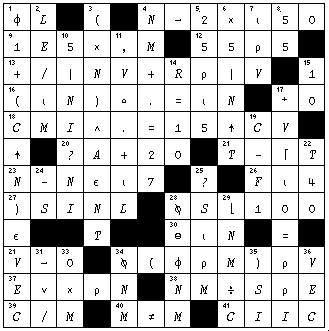
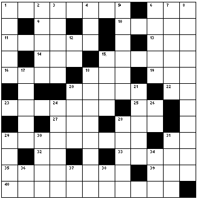

<b>Note:</b>  
The clues for the new crossword contain some APL characters. These are coded as APL2741 (available as a 45K [download](resource/apl2741.zip)), and also with &lt;CODE> tags. The mapping is compatible with both the APL2000 font and the current Dyalog font.

## Solution to APL Crossword from 15.2

## Crossword from 15.3

<b>Across</b>  
1\. The inverse of `+/`, i.e. the first difference of `V`  
6\. `1↓⌽↓'[(A)]'`  
9\. `1⊥⍳4`  
10\. Accept numeric input; call it `NMV`  
11\. Negate the vector `MB` and show its running total, `LIFO` (last in, first out ) basis  
13\. Given distinct values in `A`, return `⍳⍴A` without using `⍴`  
14\. Where `T` is found in `V`  
15\. `(R⌶11)⍴11/V`  
16\. The elements of `V`, capped at `99`  
18\. `3↑'(0∊3↑V)'')'`  
19\. `SN` is contained in...  
20\. The two row matrix `YM` of year and month numbers, converted to months since the year `0000`, for date arithmetic  
22\. If `SV` represents Scalar left argument, Vector right argument, what combination can cause `LENGTH ERROR` for scalar functions?  
23\. `(V⌶25)+(25⌶N>0)-(25⌶N<0)`  
25\. The magnitude of `K`  
27\. Outer product product  
28\. The location of `V`’s first `9`  
31\. Evaluated input as a vector  
32\. The opposite of `+/` (silly)  
33\. For scalar `MA`, `+/20⍴MA`  
35\. `10 13 16 19 ... 34`  
39\. The number of elements in any array `V`  
40\. `(⍳5)∘.=(⍳5)`

<b>Down</b>  
1\. The fractions used to spread a value, given relative weights in the vector `V`  
2\. `¯1↓(¯1↑V9),V9)`  
3\. `9 8 7 6 ... 1`  
4\. `~^/,B`  
5\. One more than `VN` if any of `Y` are true  
6\. The system command for `⎕NL 2`  
7\. Set A as the indices of the elements of the vector `NV`  
8\. The distinct values in the character vector `V`  
12\. A nice acronym for `⍳0`  
15\. If `N` is `1 9 9 2`, an expression that returns `1992`  
17\. The values of the matrix `M`, rounded to the nearest integer  
18\. If `VN=0`, return `⍳0`; but if `VN` is positive, return two elements of ...  
20\. The number of `1`s in the vector ...  
21\. `10⍴⍳M`, in origin 0  
24\. Add to `EACH` of the elements of `V` the numbers 1 to 5  
26\. Fido’s favourite variable name  
28\. The location in `V` of `27` and ...  
29\. `(2/(2⍴(1⍴'()')))`  
30\. Are there some elements in ...  
31\. The matrix `M` expressed as a vector, with a `0` after each row  
34\. `___A` is true only if `A` is a nonscalar  
36\. `2*5`  
37\. `¯2↑'⍎(⍳9)'`  
38\. The most efficient expression that returns `1`

***

Reprinted with kind permission from Zark APL Tutor News, a quarterly publication of Zark Incorporated, 23 Ketchbrook Lane, Ellington, CT06029, USA
