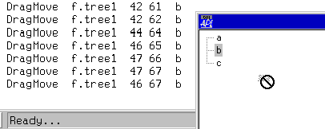
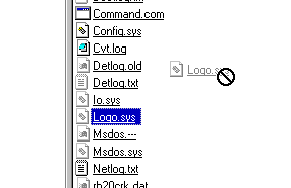
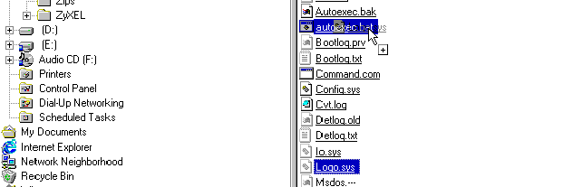

## Drag and Drop in Dyalog APL

*by Jon Sandles*

### Introduction

When you design modern Windows applications, there is often a user-driven requirement to be able to perform complex tasks using the mouse. (As experienced programmers we tend to be keyboard freaks and frequently ignore these rodent fans. Less experienced programmers tend to have the reverse problem!) More often than not the user of the mouse is required to move a control by holding the left mouse button down and moving it – “dragging” – and then to release the mouse button over some other area of the screen – “dropping”. The other area of the screen is not limited to the current form, or even the current application – it could be anywhere.

This madness was almost certainly brought to us by the people at Apple – and for once I am not thanking them. Users demand to drag and drop anything onto anything and get some sort of sensible result. For Microsoft the Windows Explorer paradigm kicked it all off and ever since then we have been dragging and dropping like mad.

This article explores how drag and drop is implemented within the Windows programming environment and shows how to mimic this behaviour in Dyalog APL. The techniques use low level Windows Operating System calls so should apply to most programming languages.

### OLE Drag and Drop

The dragging and dropping of data between applications has been made possible by OLE. (Microsoft keeps changing what OLE means so I will not even start to try and explain: you just have to believe.) OLE defines a method of storing some data in global memory and registering what the data represents so that applications can quickly work out whether they understand what it is or not. There are lots of standard OLE data types that are very useful – text data, delimited text data, file types, images etc. These are very similar to the kind of global descriptors that the Windows clipboard understands. (Indeed, the keyboard shortcut to a drag and drop operation is frequently cut and paste.) If your application understands these data types then you can easily build in drop zones to your forms so that the user can drag this data from other applications onto yours. This saves having to write complex import and export routines.

This technique is fraught with problems. Each application may have a slightly different understanding of how to treat each standard data type and hence data can become distorted or lost when transferred in this way. (Ever tried copying a bitmap from Word to Excel to Paintbrush to CorelDraw?)

As nice as it is, I will not be going any further into the issues of defining OLE drag and drop data types and storing global data. Instead, I will concentrate on the mechanisms of drag and drop within Dyalog APL. Because we are concentrating on this single environment I can get away with using global APL variables to share data for the drag and drop operation. This means that we cannot drag the data onto another application, nor can we accept dropped data from another application. The techniques I propose will be extensible to do this, and it would be interesting to extend this article at some point in the future.

### Dragging

The mechanics of dragging and dropping are the same whatever the control, whatever the programming language. They have to be if they are to co-operate with each other.

So, let’s start at the beginning. What happens to make a drag operation begin. Try it in Windows Explorer and see for yourself. The ListView control in the right hand pane of Explorer is made up of items, which are either folders or files. You can place the mouse over one of these ListView items and press the left mouse button down and without letting the button back up you can start to drag the object around the screen. If the mouse button comes back up, the drag operation ends. Thus, we need to catch the mouse button down event and the mouse move event and check that the mouse button stays down. As soon as we detect the mouse button has come up we must abort the operation.

This doesn’t turn out to be as simple as it sounds. Firstly, you need to take care that you start the drag correctly. Try the following code…

<pre> 
     ∇ TestDrag
[1]    Init  ⍝ just a placeholder to contain ⎕na defintions _ see later
[2]    'f'⎕WC'form'
[3]    'f.tree1'⎕WC'treeview'('event'('MouseMove' 'onMM'))
[4]    'f.tree2'⎕WC'treeview'('event'('MouseMove' 'onMM'))
[5]    'f.s'⎕WC'Splitter' 'f.tree1' 'f.tree2'
[6]    'f.tree1'⎕WS'items'(,¨'a' 'b' 'c')
[7]    'f.tree2'⎕WS'items'(,¨'1' '2' '3')
[8]    ∆handles←('f.tree1' 'f.tree2')⎕WG¨⊂'handle'
[9]    ∆controls←'f.tree1' 'f.tree2'
     ∇
<p>
     ∇ msg←onMM msg;down
[1]    down←1=5⊃msg
[2]    :If down
[3]        msg
[4]    :EndIf
     ∇
</p></pre>

Run this code and you get a form with two panes (like Explorer). Both are empty at the moment. Try doing a drag in the left hand pane (on a mythical pixel!) and watch the event messages that appear in the session as you drag the mouse around. Notice how all the mouse events go to the control where the drag started (the source control) and the position of the mouse is given relative to that source control.

Clearly, we have quite a lot of work to do to be able to work out where the mouse is and which control it is dragging over or dropping on (the target control). To do this we have to take control of the drag from the source and direct the mouse move messages to the relevant target controls. At the same time we can adjust the cursor to indicate the state that the drag is in. (Have another look at Explorer and see how many different cursor states you can get by dragging over different things.)

### Mouse Capture

The first step is to capture the mouse. This technique ensures that all mouse messages are sent to the source control and all positions are relative to the source control (the Dyalog mouse move event is sort of doing this already, but unfortunately not for all objects, so to be safe we take control of this ourselves). You want to apply this as soon as the drag has begun, which is the first mouse move following the mouse down, and remove the capture on the mouse up. We need two `⎕NA` calls:

```
⎕NA'I user32.C32|SetCapture I'

⎕NA'I user32.C32|ReleaseCapture'
```

We can then adjust the onMM event to use the SetCapture call. (Note how the event handlers are removed for the duration of the drag – we need to use our own and then we need to put the old handlers back when the drag has terminated.) When the drag is in progress the cursor should change to a no-entry symbol. (A sensible default as the source does not know yet whether there are any valid targets to drop on. At the start of the drag we need to identify the data that is to be dragged. In this example, I will take it as the currently selected items in the tree that the mouse button was over. If there are none selected we should not even enter the drag operation. (I can’t think of any reason why dragging nothing around is functionally useful!) At the end of the drag (when the mouse goes up) we need a new handler (attached at the start of the drag - onDragUp) to end the drag process (doing whatever we decide it should do) and by calling ReleaseCapture.

```
     ∇ msg←onMM msg;down;sink;selected
[1]    down←1=5⊃msg
[2]    :If down
[3]        ∆source←1⊃msg
[4]        selected←∆source ⎕WG'selitems'
[5]        :If ∨/selected
[6]            ∆data←⊃selected/∆source ⎕WG'items'
[7]            ∆events←∆source ⎕WG'event'
[8]            sink←SetCapture ∆source ⎕WG'handle'
[9]            ∆source ⎕WS'event'('MouseMove' 'onDragMove')('MouseUp' 'onDragUp')
[10]           ∆cursor←'.'⎕WG'cursor'
[11]           '.'⎕WS'cursor' 12 ⍝ No entry cursor
[12]       :EndIf
[13]   :EndIf
     ∇

     ∇ onDragMove
[1]    'DragMove'
     ∇

     ∇ onDragUp;sink
[1]    'DragUp'
[2]    sink←ReleaseCapture
[3]    ∆source ⎕WS'event'('MouseMove' 0)('MouseUp' 0)
[4]    ∆source ⎕WS'event'∆events
[5]    ∆data←''
[6]    '.'⎕WS'cursor'∆cursor
     ∇
```

If you try this code you will find that dragging off the empty tree view results in a “no-entry” cursor and a stream of ‘DragMove’ messages followed by a single ‘DragUp’ message. Do not worry – this is all it’s meant to do. The next step is to extend onDragMove to give more feedback about the drag process. We need to identify which control the mouse is over and what the position of the mouse is relative to that control. If the control that the mouse is over is a valid drop target we will ask it whether we can drop the source data onto the control at the mouse’s position. We need three more `⎕NA` calls to achieve this:

```
⎕NA'I user32.C32|WindowFromPoint I I'

⎕NA'I user32.C32|GetCursorPos >I[2]'

⎕NA'I user32.C32|ScreenToClient I =I[2]'
```

We use GetCursorPos to retrieve the position of the mouse (safer to get it from the Operating System) and then WindowFromPoint to find out which window is underneath that point. This is returned as a window handle, and we then convert the absolute point co-ordinate we just got to be relative to the window handle we just got by using ScreenToClient.

Because this code returns the control we are over as a window handle rather than a Dyalog control name, we need to store the control names and window handles of any valid drop targets on creation. Add the following two lines to the main function DragTest:

```
[8]    ∆handles←('f.tree1' 'f.tree2')⎕WG¨⊂'handle'
[9]    ∆controls←'f.tree1' 'f.tree2'

     ∇ onDragMove;posn;key;handle;target
[1]    posn←⊃⌽GetCursorPos 2
[2]    handle←WindowFromPoint posn
[3]    posn←⌽⊃⌽ScreenToClient handle posn
[4]    :If handle∊∆handles
[5]        target←(∆handles⍳handle)⊃∆controls
[6]        'DragMove'target posn
[7]    :EndIf
     ∇
```

DragMove checks that the window handle we are over is one of the drop targets we have created and if it is it displays the true control name and relative position on the screen. Phew! This may seem like a lot of work to do nothing, but we are pretty well getting there. The basic principle of capturing the mouse and discovering which window the drag is over and then reporting the drop to that window has been put in place. Try it:

{ width="406" height="162" }

To go any further we need to think about what we are dragging, where we are dragging it and what we want to do when it gets dropped.

### Hit Tests and Dropping

Have another look at Windows Explorer. Try dragging a file a short distance across the list view in the right hand pane.

{ width="291" height="188" }

What happens? You see a no entry cursor! Why is that? Well, its because you are not allowed to drop the file in the same directory that it came from, that would be silly. Do the same again, but this time when you are half way through the drag depress the &lt;ctrl> or &lt;shift> key whilst still dragging. The no entry cursor changes to a drag-copy cursor (modified with the “+”). This is because you are allowed to drop a copy of the file into the same directory and &lt;ctrl> or &lt;shift> is the Windows standard for modifying the drag from a move to a copy. It is important to support this functionality, if the copy operation makes as much sense in the particular context. Sometimes only the copy operation makes sense, in which case you don’t need to code this behaviour: the normal drag operation performs a copy and the &lt;ctrl> / &lt;shift> key has no effect. Indeed, if the drag operation you are performing is a copy operation then it is semantically best to always use the drag copy cursor, or modify your own cursor with the “+”. (You can also combine &lt;ctrl> / &lt;shift> to make it a drag-link operation – but let’s not overcomplicate the example.) Now try dragging a file over another file that is associated with an executable extension (.exe, .bat or .com).

{ width="632" height="207" }

Notice how the drag magically modifies to a drag-copy. If you drop, the file will be passed as a parameter to the executable. (Precisely how is defined in the Windows registry, potentially for each executable.) I view the use of the drag-copy cursor in this situation as being a bit overloaded, but it is better than no indication at all. The point is that the type of data underneath the mouse is allowed to modify the drag operation in order to guide the user.

How is all this behaviour handled internally? Our DragMove function needs to perform these tricks somehow. We already know what control is underneath us at any time, but it would be impossible to write generic code for every control and circumstance under the sun, so we must ask the control to perform this functionality itself. So that we know what is going on we ask all controls, who want to partake, to register themselves as drop targets on initialisation. If they aren’t registered we won’t pass any drag events to them. In this case we will just keep displaying the no entry cursor to indicate that a drop would be rejected. Line \[7\] of DragTest already registers the controls required, I now add a line which registers the drag functions that will be called whenever a drag event occurs over that object. In this test case, both controls will support the same behaviour so I use the same function twice (as a general rule you need a function per control).

```
[10]   ∆dragfns←'#.Drag' '#.Drag'
```

This function gets passed the following arguments by the DragMove function.

<table width="80%">
<tr><td><i>TargObj</i></td><td>The object being dragged over</td></tr>
<tr><td><i>SourceObj</i></td><td>The object that owns the drag data</td></tr>
<tr><td><i>Posn</i></td><td>The position within <i>TargObj</i> that we are currently dragging</td></tr>
<tr><td><i>DragData</i></td><td>the data being dragged</td></tr>
<tr><td><i>DropFlag</i></td><td>1 = it was actually dropped</td></tr>
</table>

This function (#.Drag) is responsible for doing any drop hi-liting on the target object (drop hi-liting is the process by which you indicate which part of the object the mouse is currently over – it is not the same as selecting the item – indeed the selection is left intact when drop hi-liting is done). The process of drop hi-liting is very specific to the particular windows control you are implementing it for. In our example , with the TreeView, the drop hi-lited item is indicated in the same way as a selected item (a little confusing, but that’s Microsoft for you). An item is drop hi-lited whenever the mouse is over it. We detect which item in the tree we are over by running a hit-test. If we are over an item we drop hi-lite it. If we are no longer over any items or if we are over a different control we must clear all the drop hi-liting (otherwise you cannot tell which item is selected anymore). To do all this we need two more Windows API calls:

```
'smht'⎕NA'I4 user32.C32|SendMessageA I4 U I4 ={I[2] U I4}'

'smsh'⎕NA'I4 user32.C32|SendMessageA I4 U I4 U'
```

‘smht’ is a cover to allow us to send the Windows API message TVM\_HITTEST to the tree view. To cut a long story short the message returns which tree view item the mouse is currently over and can be wrapped up as follows:

```
     ∇ r←form HitTest posn;whdl
[1]    whdl←form ⎕WG'handle'
[2]    r←smht whdl(4352+17)0(posn 0 0)
[3]    r←1⊃r
     ∇
```

‘smsh’ is a cover to allow us to send the Windows API message TVM\_SELECTITEM (Dyadic provide a cover for this but it doesn’t seem to work correctly). You pass this event along with the value TVGN\_DROPHILITE and the particular item to hi-lite. If the item is 0 then all hi-liting is cleared.

This is wrapped as follows:

```
     ∇ form SetItemHiLite item;whdl;sink
[1]    whdl←form ⎕WG'handle'
[2]    sink←smsh whdl(4352+11)8 item
     ∇
```

Because these API calls deal in terms of Tree View “items” we need to be able to convert these into something that DyalogAPL will understand. Fortunately, there is another Windows API message to convert the item into the index of the item in the tree. This is:

```
'smgih'⎕NA'I4 user32.C32|SendMessageA I4 U I4 ={U U U U I4 I4 I4 I4 I4 I4}'
```

This allows us to send the Windows message TVM\_GETITEM which allows us to get the full details of the item in a TVITEM structure. As it happens the tenth item of this structure is a user-defined data attribute, and it turns out that Dyalog APL stores the index of the item in the tree in this item. So we take advantage of this (admittedly undocumented and hence dodgy) fact and use the following wrapper:

```
     ∇ r←form FindItemHandle hdl;whdl
[1]    whdl←form ⎕WG'handle'
[2]    r←smgih whdl(4352+12)0(4,hdl,8⍴0)
[3]    r←1+10⊃2⊃r
     ∇
```

This is all we need to proceed with the hit-test process of the drag. We can now implement our #.Drag function to do the hit-test and hi-lite the item that is hit:

```
     ∇ r←targobj Drag arg;sourceobj;posn;objdata;dropflag;item;ix
[1]    r←0
[2]    sourceobj objdata posn dropflag←arg
[3]    :If sourceobj≢targobj
[4]        sourceobj SetItemHiLite 0
[5]    :Else
[6]        (∆controls~targobj)SetItemHiLite¨0
[7]    :EndIf
[8]    :If 0<item←targobj HitTest⌽posn
[9]        targobj SetItemHiLite item
[10]       ix←targobj FindItemHandle item
[11]       r←1
[12]   :Else
[13]       targobj SetItemHiLite 0
[14]       r←0
[15]   :EndIf
[16]
[17]   :If (r>0)^(dropflag)
[18]       'data'objdata'from'sourceobj'dropped on'ix'in'targobj
[19]   :EndIf
     ∇
```

Do not worry too much about all the SetItemHiLite 0 lines – they just make sure the drop hi-liting is cleared whenever the mouse has gone out of scope. This function returns a value of 1 if the drag copy is over a valid drop target and a valued of 0 if it is not. It could potentially have returned a 2 to indicate that the drag move has been modified to be a drag copy operation. Our DragMove handler can be modified to call this function as follows:

```
     ∇ onDragMove;posn;key;handle;target;fn;mode
[1]    posn←⊃⌽GetCursorPos 2
[2]    handle←WindowFromPoint posn
[3]    posn←⌽⊃⌽ScreenToClient handle posn
[4]    :If handle∊∆handles
[5]        target←(∆handles⍳handle)⊃∆controls
[6]        fn←(∆handles⍳handle)⊃∆dragfns
[7]        mode←target(⍎fn)∆source ∆data posn 0
[8]        :Select mode
[9]        :Case 1
[10]           '.'⎕WS'cursor' 'drag'
[11]       :Case 2
[12]           '.'⎕WS'cursor' 'dragplus'
[13]       :Else
[14]           '.'⎕WS'cursor' 12
[15]       :EndSelect
[16]   :EndIf
     ∇
```

‘drag’ and ‘dragplus’ are the standard Windows cursors for a drag and a drag copy operation, which should be defined in the Init function we wrote earlier. Of course, it is at this point that you realise you need the same piece of code when the drop occurs in onDragUp. The only difference being the 4th argument to our drag function should be set to 1. Hence create a wrapper for this piece of code, effectively by renaming onDragMove to:

```
     ∇ DragDrop drop;posn;key;handle;target;fn;mode
```

And then changing line \[7\] to:

```
[7]   mode←target(⍎fn)∆source ∆data posn drop
```

OnDragMove becomes:

```
     ∇ onDragMove
[1]    DragDrop 0
     ∇
```

And onDragUp becomes:

```
     ∇ onDragUp;sink
[1]    DragDrop 1
[2]    ∆controls SetItemHiLite¨0
[3]    sink←ReleaseCapture
[4]    ∆source ⎕WS'event'('MouseMove' 0)('MouseUp' 0)
[5]    ∆source ⎕WS'event'∆events
[6]    ∆data←''
[7]    '.'⎕WS'cursor'∆cursor
     ∇
```

That is all there is to it! You should now have everything you need to build quite complex drag and drop operations. We have concentrated on trees as they are one of the most common controls to code drag and drop and also one of the most interesting. The architecture that has been used is easily extensible to plug in new controls without effecting the overall structure of the code. If you have made it this far, I suggest you experiment further with Windows Explorer to see the kind of hit-testing is done, and then try and implement your own variations.

It will be around now that you will start to realise there is (at least) one major component missing from what I have demonstrated – keyboard handling.

### Keyboard Extensions and Auto-scrolling

This essentially mouse-driven operation is also very dependent on the keyboard to provide certain modifications to the process. The most important key by far is the &lt;esc> key – which provides a way of aborting the drag operation without having to let go of the mouse and risk the operation actually doing something unintended!

As mentioned earlier, the &lt;ctrl> and &lt;shift> keys can also be used to modify the state of the drag operation. But these keys by themselves do not generate keypress events in Dyalog APL so we have to be a lot cleverer. You can use a Windows API call to get the current keyboard state:

```
⎕NA'I2 user32.C32|GetKeyState I'
```

The escape key is defined as VK\_ESCAPE (or 27). This function returns a negative value if the key is down and 0 if it’s up. Also VK\_SHIFT and VK\_CONTROL can be queried. (16 and 17). Alternatively, you can use the GetKeyboardState API call to list the state of all 256 keys simultaneously.

```
⎕NA'I2 user32.C32|GetKeyboardState >I1[256]'
```

We could use these API calls in our onDragMove function to detect the keyboard state during each mouse move, but this is not good enough: an &lt;Esc> or a &lt;Ctrl> modifier can occur when the mouse is not moving. Try Windows Explorer again to see how it works. You should be able to keep the mouse perfectly still during a drag and use &lt;Ctrl> to toggle the copy/move state. Given these keys do not trigger keypress events – how do we do this? We have to use a timer. The timer must be fast enough that the effect is good enough, but not unnecessarily fast otherwise processor cycles will just be wasted (every 50 milliseconds is ample). This new code is included as follows. Add the timer on starting the drag:

```
[10] 'f.timer'⎕WC'timer'('Interval' 50)('Active' 1)('Event' 'Timer' 'onTimer')
```

Then code the timer to query the keyboard and if anything has changed to call onDragMove or if &lt;Esc> is down to abort the drag.

```
     ∇ onTimer msg;oldstate
[1]    :If 0>GetKeyState 27
[2]        EndDrag
[3]    :Else
[4]        oldstate←keystate
[5]        keystate←GetKeyState 17
[6]        :If oldstate≢keystate
[7]            onDragMove
[8]        :EndIf
[9]    :EndIf
     ∇
```

Modify Drag to use the global keystate to upgrade the drag state from move to copy.

```
[11] r←1+keystate<0
```

This is enough of an example to give you an idea. All the standard keys need to be handled as well, often in combination with each other. The complexity can become quite mind-boggling.

### Summary

Drag and drop is standard Windows functionality. If the development environment you are working in does not support drag and drop natively then there are Windows API calls that allow you to achieve the required effects. These are fairly easy to use in isolation but when used in combination with each other the task soon becomes reasonably complex.

A solution is to provide a generic abstraction layer that encapsulates the common functionality required for all controls and queries each control for the control specific information. Once this layer is in place the task is considerably simplified.

Some of the more common API calls have been investigated in order to establish the general principles involved. There are so many different types of control and so many different application specific requirements that the architecture has been deliberately left open. Tools such as Visual Basic wrap the common layer in a simple object model and most controls comply to this simple API. This is what is required to simplify the task within APL.

### References

Duncan Pearson: Various conversations and workspaces have changed hands over the years!

“OLE Drag and Drop” - MSDN Visual Studio 6 help.
