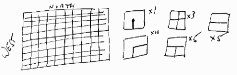
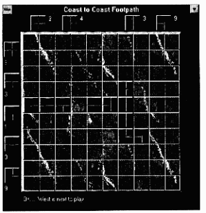
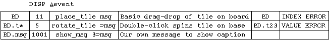

*by Adrian Smith*  ([adrian@apl385.com](mailto:adrian@apl385.com))
{ .byline }

### Historical Note

Once upon a time when the world was young, I shared a house with a mad computer programmer called Dai Lowe. Dai was (among other things) a games fanatic, and had once come across a board game called ‘Terminator’; this was no longer obtainable in the shops, but we made ourselves a set and had a good deal of fun trying to understand the strategy and tactics.

I lost touch with Dai some 10 years ago, but never totally forgot the principles of the game ... accordingly when I was looking for something ‘a little different’ to test out the more obscure corners of the Dyalog APL GUI, I re-activated some long-dormant brain cells and quickly sketched out the basic design:

## 

As you can see, the game is played on a 10-by-10 board (although other variants would be just as good, and clearly with Windows a ‘soft’ design would be preferable) with a set of tiles, each of which has drawn on it a ‘path’ linking one or more edges. Again, the number of tiles could be varied, although the piece distribution shown here seems to give a nicely balanced game.

The game is for two players, one of whom plays North-South and the other East-West. The winner is the first to complete a continuous path joining his two opposite edges - of course once a piece is played the path on it counts for both players! Games can be drawn, as you could easily complete your opponent’s path in the very act of completing your own.

### Prologue

I am getting increasingly bothered by the growing conflict between the existing APL design paradigm (based firmly on the Workspace, containing functions and arrays) and the newer object models (as partially implemented in Visual Basic, PowerBuilder, and the Dyalog `WDESIGN` workspace). I instinctively shy away from anything which buries code where it is hard to find it, and which makes the ‘structure’ of the application less than obvious to anyone other than the developer. The great advantage of the APL workspace is that everything you need to know about the application is there ... and if you can’t find it quickly you can write yourself some utilities which can!

Under the Visual Basic design paradigm, code is attached to objects and the application structure is implied by the events which trigger that code. As Duncan Pearson put it in Vector 9.4 “How do you, as a developer starting to maintain someone else’s broken system, know what the hell does what, with what, when?”. I like my application structure explicit, my code where I can find it, and I want my events logged where I can see who fired them, with what, when! Applying the first rule of amateur astronomy:

“It takes less time to grind a 3" mirror, then a 6" mirror, than it takes to grind a 6" mirror”

... I started work on a 3" mirror. The game described above seemed ideal as:

- it clearly lends itself well to an object-based design (each tile is an object, with certain obvious properties such as its rotation, topology etc.).
- the whole problem is well-bounded, and could produce an interesting end-product in a short space of time.
- I wanted to have some fun with the visual design - for example I was keen to make a nice 3D board with etched grooves, and I wanted to make the tiles stand well, snap nicely into place, and show the partially completed path as clearly as possible.
- there is just enough complexity to make it a worthwhile test of my (at this point very sketchy) ideas for managing objects within the traditional APL workspace.

I hope that along the way I can leave behind some useful code which may help you to:

- make nice 3D bitmaps ‘on the fly’ without the need to draw them by hand in Paintbrush, and waste vast amounts of workspace storing them as bit-patterns.
- manage the Dyalog ‘DATA’ property in a simple and transparent way.
- manage and trace the relationship between objects, events and code in a highly visible and effective way.

All suggestions and comments welcome ... it is my intention to get this code ‘up to scratch’ in time for the November BAA meeting, and any input from the Windows APL community will be of enormous help to me in achieving this.

### The Basics - Setting up the Board

On the time-honoured principle of “here is one I prepared earlier”, here is a sample game with a few pieces in play:

## 

The top-level function is so trivial as to be hardly worth showing you:

```
     ∇ start
[1]   ⍝ Set up and play game
[2]    'bcg'⎕WC'BITMAP'∆board
[3]    'ssf'⎕WC'FONT' 'MS Sans Serif' 8
[4]    init_board
[5]    init_icons
[6]    init_game
[7]    set_events
[8]    ⎕DQ'.'
     ∇

     ∆board←'c:\windows\marble'   ⍝ or some such
```

So to the playing surface, set up by `init_board` as follows:

```
     ∇ init_board;hgrd;vgrd;ttl
[1]   ⍝ Set up playing area ...
[2]    ttl←'Coast to Coast Footpath'
[3]    'BD'⎕WC'FORM'ttl(50 20)(400 400)('COORD' 'PIXEL')('SIZEABLE' 0)('MAXBUTTON' 0)('BCOL' 0 64 64)
[4]    'BD'plinth(40 40)(320 320)4
[5]    'BD.bdr'⎕WC'RECT'(40 40)(320 320)('FCOL' 255 255 255)('FSTYLE' 'bcg')
[6]    'BD.msg'⎕WC'TEXT' ''(370 40)(⍬ 320)('FONT' 'ssf')('FCOL' 255 255 255)
[7]   ⍝ Horizontal grid ....
[8]    hgrd←(18⍴1 0)⊂[1](2/40+32×⍳9),[1.5]18⍴40 360
[9]    'BD.g1'⎕WC'POLY'hgrd('FCOL'(⊂0 0 0))
[10]  ⍝ Vertical grid ....
[11]   vgrd←(18⍴1 0)⊂[1](18⍴40 360),[1.5](2/40+32×⍳9)
[12]   'BD.g3'⎕WC'POLY'vgrd('FCOL'(⊂0 0 0))
[13]   hgrd←hgrd+¨⊂2 2⍴1 0 1 0
[14]   'BD.g2'⎕WC'POLY'hgrd('FCOL'(⊂255 255 255))
[15]   vgrd←vgrd+¨⊂2 2⍴0 1 0 1
[16]   'BD.g4'⎕WC'POLY'vgrd('FCOL'(⊂255 255 255))
     ∇
```

The one non-obvious trick worth pointing out is the use of a partitioned enclose on lines \[8\] and \[11\] to make each grid line into a separate 2-by-2 array; note also the requirement to enclose the colour specification when drawing multiple objects in the same `⎕WC` call. In passing, it is worth noting just how effective this simple trick - drawing a black line one pixel above a white line - really is. Incidentally in the world as defined by Microsoft, the sun is always shining from the top left!

Now for some tiles ...

```
     ∇ init_icons;cm;bmp;map
[1]   ⍝ Make tile icons
[2]    cm←∆cmap  ⍝ Since default colour map is suspect!
[3]
[4]   ⍝ make_xxx requires orientation on left, colour on right.
[5]   ⍝ DATA is (rotation)(function to make one)(bits map)
[6]
[7]    bmp map←2 make_term 3
[8]    'ttmk'⎕WC'BITMAP' ''bmp cm
[9]    'ttmk'set_data('rtn' 2)('fn' 'make_term 3')('map'map)
[10]
[11]   bmp map←3 make_term 1
[12]   'ttmr'⎕WC'BITMAP' ''bmp cm
[13]   'ttmr'set_data('rtn' 3)('fn' 'make_term 1')('map'map)
[14]
[15]   bmp map←3 make_line 3
[16]   'ttlk'⎕WC'BITMAP' ''bmp cm
[17]   'ttlk'set_data('rtn' 3)('fn' 'make_line 3')('map'map)
[18]
[19]   bmp map←2 make_line 1
[20]   'ttlr'⎕WC'BITMAP' ''bmp cm
[21]   'ttlr'set_data('rtn' 2)('fn' 'make_line 1')('map'map)
[22]
[23]   bmp map←2 make_tee 3
[24]   'ttek'⎕WC'BITMAP' ''bmp cm
[25]   'ttek'set_data('rtn' 2)('fn' 'make_tee 3')('map'map)
[26]
[27]   bmp map←3 make_tee 1
[28]   'tter'⎕WC'BITMAP' ''bmp cm
[29]   'tter'set_data('rtn' 3)('fn' 'make_tee 1')('map'map)
[30]
[31]   bmp map←2 make_cross 3
[32]   'tcrk'⎕WC'BITMAP' ''bmp cm
[33]   'tcrk'set_data('rtn' 2)('fn' 'make_cross 3')('map'map)
[34]
[35]   bmp map←3 make_cross 1
[36]   'tcrr'⎕WC'BITMAP' ''bmp cm
[37]   'tcrr'set_data('rtn' 3)('fn' 'make_cross 1')('map'map)
[38]
[39]   bmp map←2 make_corner 3
[40]   'tcnk'⎕WC'BITMAP' ''bmp cm
[41]   'tcnk'set_data('rtn' 2)('fn' 'make_corner 3')('map'map)
[42]
[43]   bmp map←3 make_corner 1
[44]   'tcnr'⎕WC'BITMAP' ''bmp cm
[45]   'tcnr'set_data('rtn' 3)('fn' 'make_corner 1')('map'map)
     ∇
```

It really doesn’t matter very much which `make_` function we look at ... so let’s go with `make_tee` as the most complex example:

```
     ∇ tm←orient make_tee clr;msk;bm;cen;rtn;bc;lc;map
[1]   ⍝ Set up new tee tile from plain bitmap
[2]    bm←init_tile ∆tile ⋄ msk←bm=3 ⋄ bm←(msk×clr)+bm×~msk
[3]    lc←∆line ⋄ tm←bm ⋄ cen←bm[1+⍳30;1+⍳30] ⋄ bc←cen[2;2] ⋄ map←3 3⍴0
[4]    cen[⍳14;15 16]←lc ⋄ map[1 2;2]←1
[5]    cen[15 16;]←lc ⋄ map[2;]←1
[6]    cen map←orient spin¨cen map
[7]    cen←shade_3D cen
[8]   ⍝ Drop it back on top of full tile ...
[9]    tm[1+⍳30;1+⍳30]←cen
[10]   tm←tm map
     ∇

     ∇ tile←init_tile sz
[1]   ⍝ Make a plain square tile of the right size
[2]    tile←sz sz⍴3
[3]   ⍝ Basic 3D effect ...
[4]    tile[1;]←15 ⋄ tile[;1]←15
[5]    tile[1↑⍴tile;]←0 ⋄ tile[;1↓⍴tile]←0
     ∇
```

The globals `∆tile` and `∆line` just give the standard tile size (32 by 32) and footpath colour (10 = bright green works well). Note from the hefty function above that not all the tiles start in the same orientation (the West-East player naturally prefers his ‘straights’ to start horizontally), so we need a little utility to rotate square bitmaps ...

```
     ∇ new←orient spin mat;rtn
[1]   ⍝ Bitmap flipper to orient correctly ...
[2]   ⍝ See 'dance of rounds' ... Benkhard 1991
[3]    rtn←(orient+1)⊃'  ' '⊖⍉' '⊖⌽' '⌽⍉'
[4]    ⍎'new←',rtn,'mat'
     ∇
```

... for convenience the function which makes the visible tile also records the topology in the most convenient way I could think of ... as a 3 by 3 boolean:

```
     map
0 0 0
1 1 1
0 1 0
```

... which will come in really handy when checking if the player has dropped his tile on the board so that all boundaries match! Finally, a look at the tricks needed to give that nice 3D effect:

```
     ∇ new←shade_3D cen;msk
[1]   ⍝ Now the tricky bit ... shade it 3-D ...
[2]   ⍝ Uses lc and bc from make_... etc
[3]    msk←(lc=1⊖cen)^cen=bc ⋄ cen←(7×msk)+cen×~msk   ⍝ Shadow
[4]    msk←(¯1⊖cen=lc)^cen=bc ⋄ cen←(8×msk)+cen×~msk  ⍝ Highlight
[5]    msk←(1⌽cen=lc)^cen=bc ⋄ cen←(7×msk)+cen×~msk   ⍝ Shadow
[6]    msk←(¯1⌽cen=lc)^cen=bc ⋄ cen←(8×msk)+cen×~msk  ⍝ Highlight
[7]   ⍝ Tidy edges (leave where line colour)
[8]    msk←∆line≠cen[1 30;] ⋄ cen[1 30;]←(msk×⍉30 2⍴8 0)+cen[1 30;]×~msk
[9]    msk←∆line≠cen[;1 30] ⋄ cen[;1 30]←(msk×30 2⍴8 0)+cen[;1 30]×~msk
[10]   new←cen
     ∇
```

This applies only to the middle of the tile (the edges being already accounted for) and uses colours 7 and 8 (the light and dark greys) rather than black and white, which are much too stark for this job. Ignore the fussy bit about the edges; the essential trick is well illustrated by lines \[3\] - \[6\] where the bitmap is shifted and compared with itself to find the boundaries. Anyway, enough of these gritty details ... now for something seriously useful ....

### Managing Object Data

Here is a wholly unexplained line of code from `init_icons` ...

```
[9] 'ttmk'set_data('rtn' 2)('fn' 'make_term 3')('map'map)
```

This is where you need to think hard about your design, in particular you need to be very clear about what data is logically associated with particular objects. It makes obvious sense to keep all the data about an object with that object (which is where the Dyalog ‘DATA’ property comes in so handy), but the last thing an application should need to know is anything about the internal structure of the DATA array (which can after all be any APL array).

In the above example, we want to record: how the bitmap was rotated (so that when a player asks to rotate it we know where it is starting from); what code we used to make it (so we can quickly make another one); what its topology is (for edge checking). The `set_data` utility is intended to take the pain out of managing the data property, and to insulate the application entirely from its internals: essentially it implements a simple named component file system on each object (rather like APL2/PC’s AP 211):

```
     ∇ obj set_data arg;prop;inx;dt;prp
[1]   ⍝ Set data property sub-element prop[1] to prop[2]
[2]   ⍝ Add property to table if new, else update inplace
[3]   ⍝ e.g. 'ff' set_data 'usage' (12⍴0)
[4]   ⍝ May be used to set multiple properties like ⎕WC ...
[5]   ⍝ e.g. ('p1' 12)('p2' 'hello')('p3' ('Hi' 1 2 3))
[6]   ⍝
[7]    dt←obj ⎕WG'data'
[8]    →(0∊⍴dt)↓Exists
[9]   ⍝ Initialise a new list as (dir)(contents) ...
[10]   dt←2⍴⊂⍬
[11]  Exists:→(0 1 2 3 4=4⌊|≡arg)/0 0 Encl Next 0
[12]  ⍝ Only one pair ... so enclose it to loop round!
[13]  Encl:arg←⊂arg
[14]  ⍝ Find 'item' in property list
[15]  Next:prop←⊃arg
[16]  ⍝ Must be 2 elements ... so fix ('prop' 2 3 4) ...
[17]   →(2=⍴,prop)↑Fixed
[18]   prop←(⊃prop)(1↓prop)
[19]  Fixed:prp←⊃dt ⋄ inx←prp⍳prop[1]
[20]   →(inx≤⍴prp)↑Fnd
[21]  ⍝ Add new property ...
[22]   dt←dt,∘⊂¨prop ⋄ →Done
[23]  Fnd:((2,inx)⊃dt)←2⊃prop
[24]  Done:arg←1↓arg ⋄ →(⍴arg)↑Next
[25]  ⍝ Finally replace the updated DATA ...
[26]   obj ⎕WS'data'dt
     ∇
```

Simply to be able to associate named properties with each and any GUI object, and to retrieve and remove them by name, seems to me to be a huge step forward in design, and it fits so well with all the APL style we already know. To illustrate the point, here is the function to rotate a tile (well actually all it rotates is the bitmap) on its starting block:

```
     ∇ r←rotate_tile msg;tile;bmp;rtn;fn;new;map
[1]   ⍝ Rotate tile on starting block ...
[2]   ⍝
[3]    tile←1⊃msg ⋄ bmp←tile ⎕WG 'BITMAP'
[4]    rtn fn←bmp get_data'rtn' 'fn'
[5]    rtn←4|1+rtn
[6]    new map←⍎(⍕rtn),' ',fn
[7]    bmp ⎕WS'BITS'new
[8]    bmp set_data('rtn'rtn)('map'map)
[9]    r←1
     ∇
```

This gets fired when a player clicks on the tile, so it gets the whole event message as left argument ... it throws away everything except the tile name and uses this to find out which bitmap was stuck on it. Now we can simply ask the bitmap what its rotation was, and how it was made:

```
[4]    rtn fn←bmp get_data'rtn' 'fn'
```

... and a suitably trivial piece of APL spins it around, and then records the new information where it belongs ... back with the bitmap!

Back to the game ....

```
     ∇ start
[1]   ⍝ Set up and play game
[2]    'bcg'⎕WC'BITMAP'∆board
[3]    'ssf'⎕WC'FONT' 'MS Sans Serif' 8
[4]    init_board
[5]    init_icons
[6]    init_game
[7]    set_events
[8]    ⎕DQ'.'
     ∇
```

... we have drawn the board and made lots of handy bitmaps ... now to generate the starting position and let the players get going:

```
     ∇ init_game
[1]   ⍝ Set up game
[2]   ⍝ Record starting state and some useful diagnostics
[3]    'BD'set_data'Next' 1   ⍝ Next available tile
[4]    ∆map←10 10⍴⊂⍬          ⍝ Connections map
[5]   ⍝ Now make initial tile collection ....
[6]   ⍝ Right arg is (bitmap name) (number in pot)
[7]    56 2 make_tile'tcrk' 3
[8]    2 56 make_tile'tcrr' 3
[9]
[10]   120 2 make_tile'ttek' 5
[11]   2 120 make_tile'tter' 5
[12]
[13]   186 2 make_tile'ttmk' 1
[14]   2 186 make_tile'ttmr' 1
[15]
[16]   248 2 make_tile'ttlk' 5
[17]   2 248 make_tile'ttlr' 5
[18]
[19]   312 2 make_tile'tcnk' 10
[20]   2 312 make_tile'tcnr' 10
[21]
[22]  ⍝ Next free tile number should be 11!
[23]
[24]   'BD'set_data'ToPlay' 'WN'   ⍝ Either player!
     ∇
     ∇ pos make_tile arg;bmp;rm;nxt;nm
[1]   ⍝ Use given bitmap <bmp> to make tile at <pos>
[2]   ⍝ Gets next available tile name (held at board) ...
[3]    bmp rm←arg
[4]    nxt←'BD'get_data'Next' ⋄ nm←'BD.t',⍕nxt
[5]    nm ⎕WC'IMAGE'pos('DRAGABLE' 1)('BITMAP'bmp)
[6]    nm ⎕WS('EVENT' 5 'rotate_tile')
[7]    nm set_data'rm'rm
[8]   ⍝ Label it with no. of tiles remaining in set <rm> ...
[9]    pos←pos+('r'=¯1↑bmp)⌽36 0
[10]   ('BD.l',⍕nxt)⎕WC'TEXT'(⍕rm)pos('FCOL' 255 255 255)('FONT' 'ssf')
[11]  ⍝ Click tile counter on 1 ...
[12]   'BD'set_data'Next'(nxt+1)
     ∇
```

Surprisingly little data is relevant at the board level ... it is a handy place to record the next free tile name, and who is next to play. This is recovered from the objects by `get_data` as follows:

```
     ∇ prp←obj get_data prop;inx;dt;prp
[1]   ⍝ Get data property sub-element prop[1] from obj
[2]   ⍝ e.g. 'ff' get_data 'prop1'
[3]   ⍝ or   'ff' get_data 'p1' 'p2' .... 'pn'
[4]    prp←⊃dt←obj ⎕WG'data' ⋄ →(⍴,prop)↓0 ⋄ →(0∊⍴dt)↑0
[5]   ⍝ Check if only one item, and enclose if so ...
[6]    ⍎(2>|≡prop)/'prop←⊂prop'
[7]    prp←⊃dt ⋄ inx←prp⍳prop
[8]   ⍝ Weed out any mishits ...
[9]    inx←(inx≤⍴prp)/inx ⋄ prp←'' ⋄ →(⍴inx)↓0
[10]   prp←(2,¨inx)⊃¨⊂dt
[11]  ⍝ Strip outer case if only one element ...
[12]   ⍎(1=⍴prp)/'prp←⊃prp'
     ∇
```

When I get around to finishing the program, I will probably store `∆map` with the board as well - but while I am trying to work out nifty ways of detecting winning lines (and maybe of getting the computer to play the game) it is much handier to leave this in the workspace as a global.

The only obvious tile property is the number of siblings remaining in the pot; this is used when a player ‘clones’ a tile by dragging it onto the board and letting go:

```
     ∇ pos clone_tile bmp;txt;nxt;nm;bits;cm
[1]   ⍝ Repeat tile using bitmap <bmp> on board at <pos>
[2]   ⍝ Uses next available tile name (at board level) ...
[3]    nxt←'BD'get_data'Next' ⋄ nm←'BD.t',⍕nxt
[4]   ⍝ Make a new bitmap, in case the parent is rotated ...
[5]    bits cm←bmp ⎕WG'BITS' 'CMAP'
[6]    bmp←nm,'x'
[7]    bmp ⎕WC'BITMAP' ''bits cm
[8]    nm ⎕WC'IMAGE'pos('BITMAP'bmp)
[9]   ⍝ Click tile counter on 1 ...
[10]   'BD'set_data'Next'(nxt+1)
     ∇
```

... and also to update the label (and maybe kill the tile altogether) when a new instance is made:

```
     ∇ r←place_tile msg;tile;lbl;rc;pos;bmp;rm;nxt;map
[1]   ⍝ Drop tile on board (snapped to grid) ...
[2]   ⍝ Reject drop if tile is dropped illegally
[3]   ⍝ Otherwise make a new tile at the correct spot
[4]   ⍝ and reject the event anyway!
[5]    r←0 ⋄ tile←3⊃msg ⋄ rc←16+msg[4 5]
[6]   ⍝ Snap to nearest square and check it ...
[7]    rc←41+32×⌊32÷⍨rc-40
[8]    →(∨/(rc<40)∨(rc>40+10×32))↑0
[9]    pos←⊂1+⌊32÷⍨rc-41 ⋄ →(2=⍴⍴pos⊃∆map)↑Inuse
[10]  ⍝ Position is Ok ... check legal neighbours ...
[11]   bmp←tile ⎕WG'BITMAP'
[12]  ⍝ Are we trying to play out of turn?
[13]   nxt←'kr'['WN'⍳'BD'get_data'ToPlay']
[14]   →((¯1↑bmp)∊nxt)↓OutofTurn
[15]   map←bmp get_data'map'
[16]  ⍝ map can be checked for edge fit with adjacent maps
[17]   →(chk_fit map pos)↓Illegal
[18]  ⍝ =============== all OK =====================
[19]   rm←tile get_data'rm'
[20]   tile set_data'rm'(rm-1)
[21]  ⍝ Redo label (and possibly kill tile if none left) ...
[22]   label_tile tile
[23]  ⍝ Update diagnostic data
[24]   (pos⊃∆map)←map
[25]  ⍝ Copy parent tile to right place on board ...
[26]   rc clone_tile bmp
[27]   nxt←⊃('North' 'West')[1+'r'=¯1↑bmp]
[28]   'BD'set_data'ToPlay'(⊃nxt)
[29]   log'OK ... ',nxt,' is next to play'
[30]   →0
[31]  ⍝ ================== Errors ======================
[32]  Inuse:log'Silly billy' ⋄ →0
[33]  Illegal:log'Piece must match on all boundaries' ⋄ →0
[34]  OutofTurn:log'It's not your turn!!' ⋄ →0
     ∇
     ∇ label_tile tile;rm
[1]   ⍝ Update tile label with number remaining
[2]    rm←tile get_data'rm'
[3]    lbl←tile ⋄ lbl[4]←'l' ⋄ lbl ⎕WS'text'(⍕rm)
[4]   ⍝ Count remaining tiles; kill parent if none ...
[5]    →(rm>0)↑0 ⋄ ⎕EX¨tile lbl
     ∇
```

So far, I have never needed to remove data from an object, but just for completeness:

```
     ∇ obj rmv_data prop;inx;dt;prp;msk
[1]   ⍝ Remove named data property from obj
[2]   ⍝ e.g. 'ff' rmv_data 'usage'
[3]   ⍝ May be used to kill multiple properties ...
[4]   ⍝ e.g. 'ff' rmv_data 'p1' 'p2'
[5]   ⍝
[6]    dt←obj ⎕WG'data' ⋄ →(0∊⍴dt)↑0
[7]    ⍎(2>|≡prop)/'prop←⊂prop'
[8]   ⍝ Find 'items' in property list
[9]    prp←⊃dt ⋄ inx←prp⍳prop
[10]   inx←(inx≤⍴prp)/inx
[11]  ⍝ Kill em from catalogue and value list ....
[12]   msk←~(⍳⍴prp)∊inx
[13]   dt←(msk/prp)(msk/2⊃dt)
[14]   obj ⎕WS'data'dt
     ∇
```

All that is needed to run the finished game (in human vs human) mode is a couple of extra events and a `⎕DQ` ...

```
     ∇ set_events
[1]   ⍝ Set up event table
[2]    'BD'⎕WS'EVENT' 11 'place_tile'
[3]    'BD.msg'⎕WS'EVENT' 1001 'show_msg'
     ∇
```

... the strategy for displaying messages is quite novel (and I’m not at all sure it is sensible):

```
     ∇ log txt
[1]   ⍝ Send message to message area to get txt displayed
[2]    ⎕NQ'BD.msg' 1001 txt
     ∇

     ∇ show_msg msg
[1]    'BD.msg'⎕WS'text'(3⊃msg)
     ∇
```

Rather than allowing functions to update the message text directly, I have defined 1001 as a ‘message’ event and sent it to the ‘message object’ along with the appropriate text. Comments please - this is getting a little too ‘object-oriented’ for my taste.

### Tracking Events

By now, the astute reader will have noticed that the code totally fails to achieve the other objective I set myself ... making visible the relationship between objects, events and the blocks of code which they fire. As always, I wrote the workspace first and only later did I realise the problems I was setting for myself in debugging and maintaining it. What I think I need is something like this:

## 

... and a little function to maintain it (why should I have to remember that event 11 is a ‘drag-drop’ ?)...

```
     ∇ obj set_event action;pos;eno
[1]   ⍝ Update event table ⍙event with new action
[2]   ⍝  Monadic call initialises table ...
[3]   ⍝    (obj)(eno)(action)(comment)(who)(what happened)
[4]   ⍝  Null right arg kills all events for that object
[5]   ⍝  Null action kills specific event only.
[6]   ⍝
[7]    →(0=⎕NC'obj')↓Update ⋄ ⍙event←0 6⍴⍬ ⋄ →0
[8]   ⍝ Map text event mnemonics to dyalog event numbers
[9]   Update:→(⍴action)↑Set
[10]   pos←~⍙event[;1]∊⊂obj
[12]  Set:⍎(2>|≡action)/'action←,⊂action'
[13]   eno←5 11 1001 9999['dclk' 'drdp' 'msg'⍳action[1]]
[14]   pos←((⍙event[;2]=eno)^(⍙event[;1]∊⊂obj))/⍳⊃⍴⍙event
[15]   →(eno=9999)↑0 ⋄ →(1=⍴action)↑Kill
[16]   →(⍴pos)↑Replace
[17]   ⍙event⍪←⊂⍬ ⋄ pos←⊃⍴⍙event
[18]  Replace:⍙event[pos;]←obj eno,(2↑1↓action),2⍴⊂⍬ ⋄ →0
     ∇
     'BD' set_event 'drdp' 'place_tile msg' 'etc'
```

... obviously to do this for real you need a global table of event names and internal codes to replace the subset required for line\[13\]. I have been wondering about inheritance (should the function that searches this table check the parent if it fails to find an event defined on a given object?) and provisionally come to the view that wild-cards are more useful - and a lot less dangerous! Accordingly:

```
     ∇ r←list ∆wcm tgt;hits
[1]   ⍝ Wild Card Match of <tgt> to word list
[2]   ⍝ '?' is don't care about this char.
[3]   ⍝ '*' is forget anything to the right of me.
[4]   ⍝
[5]   ⍝ e.g. 'fred' 'ted*' 'bill?' wcm ¨'teddy' 'billy'
[6]   ⍝      matches 0 1 0  0 0 1
[7]    tgt←tgt,'I'  ⍝ ensure no false hits on leading part!
[8]    list←(⍴tgt)↑¨list,¨'I'
[9]    hits←(list='?')∨list=⊂tgt
[10]   r←^/¨(¯1+list⍳¨'*')↑¨hits
     ∇
```

and to manage the whole complex web of objects and events, I think that all I need is a ‘standard’ event which fires on all interesting events on any object:

```
     ∇ ∆fire msg;tgt;ex;result;⎕TRAP
[1]   ⍝ Field all tracked events and fire associated
[2]   ⍝ code from global event table ⍙event.
[3]   ⍝ N.B. wild card matches on objects are allowed.
[4]   ⍝ Updates event table to log who fired it, and when.
[5]    tgt←⍳⊃⍴⍙event
[6]    tgt←(⍙event[;2]=msg[2])/tgt ⋄ →(⍴tgt)↓0
[7]   ⍝ We are interested, so check the object ...
[8]    tgt←(⍙event[;1]∆wcm⊃msg)/tgt ⋄ →(⍴tgt)↓0
[9]   ⍝ If more than one hit, just fire the higher ...
[10]   tgt←⊃tgt
[11]  ⍝ Extract code and run it ...
[12]   ex←tgt⊃⍙event[;3]
[13]   ⎕TRAP←0 'C' '→Event_Error'
[14]   result←'ok' ⋄ ⍎ex ⋄ →Log
[15]  Event_Error:⎕TRAP←0⍴⎕TRAP
[16]   result←⊃⎕DM
[17]  ⍝ Log success or trapped failure in event table
[18]   ⍙event[tgt;5 6]←(⊃msg)result
     ∇
```

In this rather simple case, with only three interesting classes of object, there is no real problem, but I get the strong feeling that I am going to need something like the above very badly indeed when I start to work on anything at all heavyweight. The advantages are fairly obvious:

- because all events are sent through the same funnel, it is very easy indeed to build in a ‘debug’ mode which tracks ‘who fired what’ in a little window out to one side.
- you can attach any executable APL expression to an event, not just a single function which gets force-fed the event message as one argument!
- this should be the only place you need an error trap, and again it can be a lot more sophisticated, for example it might dump a lot of useful diagnostics to file when a triggered event fails.
- the bane of the product-support technician is the un-reproducible bug - and under Windows the situation is a hundred times worse than in an old-style menu-driven system. At least with a global event log, he can ask to see exactly what events were triggered, and get some clue what the results were!
- workspace documentation starts here!

All of which had better be left for the next Vector!

### Appendix - Just for the Record

Here is the rest of the code ...

```
     ∇ fm plinth arg;rc;hw;lw;off;ct;crd
[1]   ⍝ Make a plinth around rectangle defined by arg
[2]   ⍝ ... white top left, dark lower right
[3]    rc hw lw←arg ⋄ ct←1
[4]   Loop:→(ct>lw)↑Tl
[5]    off←ct
[6]    crd←3 2⍴(rc+(hw[1]+off),-off),(rc-off),(rc+(-off),hw[2]+off)
[7]    (fm,'.pl1',⍕ct)⎕WC'POLY'crd('FCOL' 192 192 192)
[8]    crd←3 2⍴(rc+(hw[1]+off-1),-off),(rc+hw+off-1),(rc+(-off),hw[2]+off-1)
[9]    (fm,'.pl2',⍕ct)⎕WC'POLY'crd('FCOL' 128 128 128)
[10]   ct+←1 ⋄ →Loop
[11]  ⍝ Mitre top corner nicely ...
[12]  Tl:(fm,'.pl3')⎕WC'POLY'(2 2⍴rc,rc-ct)('FCOL' 255 255 255)
[13]   (fm,'.pl4')⎕WC'POLY'(2 2⍴(rc+hw),rc+hw+ct-1)('FCOL' 192 192 192)
     ∇
     ∇ ok←chk_fit arg;map;pos;nesw;fit;chk
[1]   ⍝ Check for fit with neighbours.
[2]   ⍝ <map> is the square to be verified, placed at <pos>
[3]    map pos←arg ⋄ ok←1
[4]    nesw←(¯1 0)(0 1)(1 0)(0 ¯1)+¨pos
[5]    fit←((1 2)(3 2))((2 3)(2 1))((3 2)(1 2))((2 1)(2 3))
[6]    chk←(^/¨nesw>0)^^/¨nesw<11
[7]    nesw←chk/nesw ⋄ fit←chk/fit
[8]    chk←2=⊃∘⍴∘⍴¨∆map[nesw] ⋄ nesw←chk/nesw ⋄ fit←chk/fit ⋄ →(⍴fit)↓0
[9]   ⍝ now check each adjacent map from ∆map
[10]   chk←∆map[nesw]
[11]   ok←^/fit mat_edge¨chk
     ∇
     ∇ ok←fit mat_edge chk
[1]   ⍝ check each required edge (uses map from calling fn)
[2]    ok←(fit[1]⊃map)=fit[2]⊃chk
     ∇
```

If that isn’t all the code, I’m sorry. As usual with APL-385 experiments, the workspace is ‘free to good home’, but please wait until November for the finished version. If anyone has any bright ideas about a computable strategy for actually playing the damn’ game, I should be delighted to hear from them.

(webpage generated: 5 December 2005, 18:50)
