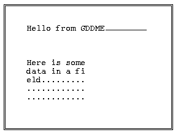

*by Adrian Smith*  ([adrian@apl385.com](mailto:adrian@apl385.com))
{ .byline }

### Introduction

GDDME is (as its name implies) a GDDM emulator for Dyalog APL/W. The version I have is an early beta, and is reviewed as such. As it stands, it is technically quite brilliant, but needs quite a deal of polishing to be a usable product. Essentially, it sets out to be a complete emulation of the AP126 calls supported up to GDDM Release 2.0 (roughly 1988): this covers all the standard alphanumeric screen handling and enough graphics to run APL Graphpak successfully. GDDM 3.0 calls, such as the use of partitions, are not supported.

GDDME is written by Andrei Kondrashev, and will be marketed by Lingo Allegro (see Product Guide for availability and price).

### Installation and Documentation

Installation could hardly be easier; GDDME is an independent task, which you can either start from Windows, or kick off with a `⎕CMD` from your APL session. All you need to do is copy GDDME.EXE into the directory of your choice, and assign a PATH variable to tell APL where to find it. You start the emulation with a function such as:

```
     ∇ task←SHARE;rc
[1]   ⍝ Sign on to GDDME using X
[2]    →(2=⎕SVO'X')↑0
[3]   ⍝ Set initial value
[4]    X←(,0)''
[5]    rc←'DDE:'⎕SVO'X GDDME'
[6]    task←⎕CMD(PATH,'GDDME.EXE -',⎕WSID,' -GDDME')''
[7]   ⍝ Give it a chance ...
[8]   Wait:→(1≠(⎕SVS'X')[2])/Wait
[9]   ⍝ Interlock
[10]   rc←1 ⎕SVC'X'
[11]   rc←X
[12]  ⍝ Create default page ...
[13]   X←(302 0 240 400 0)''
     ∇
```

This opens a small (240 x 400 pixel) window in the bottom corner of your screen, and from now on this window pretends to be a 25 x 80 character mainframe screen. The default size is somewhat larger, but for testing it is nice to tuck it away in the corner to leave plenty of screen free for your APL session.

The general quality of the documentation is very high. There are a few minor typos (e.g. the parentheses on line\[6\] of the above sample were missing), but where it matters – the detailed syntax of the GDDM calls – I have not found any errors at all. The manual is very well produced, and shows clearly the few minor deviations from the standard GDDM syntax. The only big change is that instead of sharing two variables (e.g. CTLFSM and DATFSM), you only have one (X in the sample) which takes both control and data arguments. However all the calls are nicely illustrated with examples, so this should not be a big problem.

### Using GDDME for a Simple Screen

Having got over the shock of seeing the Graphpak SKYSCRAPER plot for the first time in years, I set to coding up some simple AP126 calls to check out the basics. The following little function sets up a two-field format, clears the fields, sets the cursor, and waits for you to type something:

```
     ∇ xx;fmt;nmod
[1]   ⍝ Simple GDDME test
[2]   ⍝ Make a simple format and set up screen ...
[3]    fmt←2 5⍴1 4 10 1 24,2 8 10 5 12
[4]    X←(402,(⍴fmt),,fmt)''
[5]    X←(407 1 4,407 2 3)''
[6]   ⍝ Fill top field with green underscores ...
[7]    X←(424 1 24)(24⍴'_')
[8]   ⍝ ... and lower field with red dots
[9]    X←(424 2 60)(60⍴'.')
[10]  ⍝ Set Cursor and Hold it ...
[11]   X←(430 1 1 1)''
[12]   ⎕DL 1 ⍝ Essential!
[13]   X←(,101)'' ⋄ nmod←⊃X ⋄ 'Read result was: '(5↓nmod)
[14]  ⍝ Query modified fields ...
[15]   nmod←⊃⌽nmod
[16]   X←(420,nmod)'' ⋄ 'Flds to read: '(5↓⊃X)
     ∇
```

The first element of the couplet is always the control variable. It is a minor annoyance that even when the data variable is ignored (as for the format lines 4-5) you still have to supply it. Otherwise, this is all absolutely standard GDDM stuff, and should look quite familiar to anyone who has programmed mainframe screens. The only significant snag is on line\[12\], where I found it essential to wait a little while before issuing the ASREAD call on line\[13\]. If I ran the code from the session (or under Trace) – no problem. If I let the function rip through it flips up the GDDM screen, but returns immediately to APL with a result of 0 0 0 0 0. I suspect a nasty interlock problem on the DDE connection which may only show up on a fast machine when you have little or no APL processing between calls.

Assuming you let it wait, the result looks like:

## 

The window behaves just like a mainframe screen, but you can position the mouse with the cursor, and you don’t need to &lt;reset> if you accidentally type something in the wrong place. When you press &lt;enter> or a function key, it returns with the customary information about what you hit, and how many fields have been modified.

### Things that Need Fixing

Programming this beast is rather like riding a monocycle up an alpine pass with no safety fence! It is very sensitive to abuse, and I quickly learned to be extra careful – the alternative is frequent use of Ctrl-Alt-Del to escape from a totally locked-up machine. Specifically:

- it is not a good idea to close its window with the control menu. This kills the task OK, but if you attempt to re-start with SHARE the shared variable fails to couple and you can’t type anything in your Dyalog session ever again!
- the field behaviour in &lt;insert> mode is distinctly weird, and definitely not standard GDDM behaviour, although in most instances it is harmless.
- the function key mapping is strange. I think most mainframers expect F11 and F12 to behave as advertised, and Shift+F1 to give F13. This is not what it does!
- during an ASREAD it locks the mouse totally into the client area of the GDDME window – you can’t even get at its own title-bar or system menu. This is quite unacceptable behaviour (Windows is a multi-tasking environment after all), and also dangerous. On a couple of occasions I managed to kill the GDDME task, but my mouse was still trapped in the rectangle where its window had been!
- similarly, during an ASREAD, none of the standard Windows switching keys work. This prevents you from doing basic and obvious things like snapping a copy of the window to the clipboard. You can’t even get at its own control menu to select the ‘Print’ option (see the mouse problem above).

### Suggestions for Improvement

As I said at the beginning, the emulation is a technical tour-de-force, but the interface could do with some tidying. Specifically:

- it insists on a white background. This is probably the worst choice, as all the foreground colours are bright. Our mainframe screens are heavily into cyan, yellow and pink; all these colours are virtually invisible on a white background. I use the IRMALAN 3270 emulator on the rare occasions I need the mainframe – this defaults to black (acceptable) but allows you to choose dark grey which I find much more restful.
- Courier may not be the only monospace font available, and again the user should be offered a choice. It may be worth abandoning the total scalability of the window and using the font set that Windows installs for its DOS boxes. These are very much more readable, particularly when running at small sizes.
- simple clipboard support would be nice, even if only at the level of a system-menu option to copy the whole text screen to the clipboard.
- trapping the mouse really is not on! The user spends 99.98% of his time at an ASREAD; it is quite ludicrous to prevent him from moving / resizing / minimising GDDME, let alone switching out to do something else.

### Summary

This product shows a lot of promise. I can think of a number of major mainframe applications I could try out on it with minimal effort. If you have an urgent need to get your GDDM code off a mainframe, give Lingo Allegro a call and push them for a date on a pukka version. I am pretty confident that internally this thing is rock-solid; it just needs to be made more approachable.

(webpage generated: 5 December 2005, 19:02)
