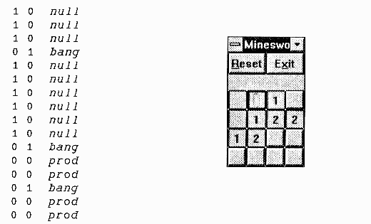
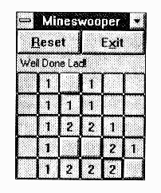

*by Adrian Smith*  ([adrian@apl385.com](mailto:adrian@apl385.com))
{ .byline }

### Prerequisite

For those of you (surely a small minority) who haven’t yet played the "Minesweeper" game that comes with Windows 3.1 - go and play it! If your boss tries to sack you for playing games during working hours, you can quite reasonably claim that your are actually acclimatising yourself to the Object-oriented paradigm. You can also (incidentally) try to beat Richard’s best times of 89secs (intermediate) and 289secs for ’the big one’. When you think you have the hang of it, get out the APL GUI of your choice, and see if you can knock off a reasonable facsimile in your lunch hour.

Then do it without GOTO!

### Making a State-Event Matrix (SEM)

The State-Event Matrix is the fundamental tool of the real-time programmer. It consists very simply of a three-column table, giving the actions to take when an object (in a given state) receives an event. Here is a tiny Mineswooper (sic) game in play, and the SEM as it stands at this point in the game:

## 

In this case I have used the first column to flag whether or not a cell has been investigated; the middle column marks the location of any mines; the third column is the action (function) associated with that state.

Here is the usual heap of `⎕WC` junk to set up the layout, make some buttons, leave space for a status line, and call the rest:

```
     ∇ R←MS grid;sz;bw;map;bs
[1]   ⍝ Build MS form, then activate form.
[2]    grid←4 4⌈16 24⌊2⍴grid
[3]    bs←24 ⋄ sz←48 0+bs×grid ⋄ bw←0.5×2⊃sz
[4]    'map'⎕WC'FORM' 'Mineswooper'(24 12)sz('COORD' 'PIXEL')
        ('SIZEABLE' 0)('MAXBUTTON' 0)('EVENT' 1001 1)
        ('BCOL' 192 192 192)
[5]    'map.RESET'⎕WC'BUTTON' '&Reset'(0 0)(28 bw)
        ('EVENT' 30 'Reset')
[6]    'map.EXIT'⎕WC'BUTTON' 'E&xit'(0 bw)(28 bw)
        ('EVENT' 30 'Quit')('CANCEL' 1)
[7]    'map.note'⎕WC'LABEL' ''(28 4)(⍬(2×bw))
        ('FONT' 'MS Sans Serif' 10)('BCOL' 192 192 192)
[8]   ⍝ Get ready to play ...
[9]    init_sem grid              ⍝ Starting State-Event Matrix
[10]   ∆nbr←ct_nb grid⍴∆sem[;2]   ⍝ Count problem neighbours
[11]   ms_tab grid                ⍝ Draw 'em
[12]  ⍝ All set, so here we go ...
[13]   R←⎕DQ'map'
[14]   R←'Ready'
     ∇
```

This is where it all starts. As you can see, the probability is crudely hard-coded; a better simulation of the real game would be to chose a random pattern for a given number of mines. However this is harder!

```
     ∇ init_sem grid;nm
[1]   ⍝ State-event matrix records ...
[2]   ⍝ [;1] Explored  (1|0)
[3]   ⍝ [;2] Live Mine (1|0)
[4]   ⍝ [;3] Action on Select Event (30)
[5]    nm←×/grid
[6]    ∆sem←(nm,3)⍴0
[7]    ∆sem[;1]←0                 ⍝ Start unexplored
[8]    ∆sem[;2]←5=?nm⍴6           ⍝ 1 in 6 are live
[9]    ∆sem[;3]←('prod' 'bang')[1+∆sem[;2]]
     ∇
```

Line\[9\] starts the process of coding the logic of the game into the state-event table. Dangerous squares go bang, safe ones must be prodded to discover their neighbour count.

Having seeded the playing space with our mines, we can then count them:

```
     ∇ ct←ct_nb mn
[1]   ⍝ Count mines in adjacent squares across grid.
[2]    mn←0,mn,0 ⋄ mn←0⍪mn⍪0
[3]   ⍝ Now shift every which way, and add up the planes ...
[4]    ct←+⌿(1⌽1⊖mn)⍪(1⊖mn)⍪(¯1⌽1⊖mn)⍪(1⌽mn)⍪(¯1⌽mn)⍪
        (1⌽¯1⊖mn)⍪(¯1⊖mn)⍪(1,⍴mn)⍴(¯1⌽¯1⊖mn)
[5]    ct←,1 1↓¯1 ¯1↓ct
     ∇
```

... using an ancient line of code from my earliest Life program! Now we just need to knock out an array of buttons:

```
     ∇ ms_tab rc;nb;pos;bb;bp
[1]   ⍝ Make ms table as array of buttons ....
[2]   ⍝ bs is button size in pixels
[3]    'map.GRP'⎕WC'GROUP' ''(44 0)(bs×grid)
[4]    nb←×/rc
[5]    bb←'map.GRP.B'bfm ¯1+⍳nb
[6]    bp←(nb,5)⍴⊂⍳0
[7]    pos←((nb,2)⍴bs)×⍉rc⊤¯1+⍳nb
[8]    bp[;1]←⊂'BUTTON'
[9]    bp[;2]←' '                         ⍝ Button label
[10]   bp[;3]←↓pos                        ⍝ Location in group
[11]   bp[;4]←⊂2⍴bs                       ⍝ Size in pixels
[12]   bp[;5]←⊂('EVENT' 30 'plop')
[13]   bb ⎕WC¨↓bp
     ∇
```

... and just for completeness ...

```
     ∇ fm←pfx bfm inx
[1]   ⍝ Make object name from prefix and inx
[2]    fm←'0123456789'[1+⍉10 10 10⊤inx]
[3]    fm←(⊂pfx),¨↓fm
     ∇
```

That really is all we need to get an authentic Minesweeper facsimile on screen. Now the actions (plop is the ’switch’ function which all the buttons operate when clicked):

```
     ∇ r←plop msg;inx;obj;action
[1]   ⍝ User clicked a square ... process event.
[2]    inx←1+⍎¯3↑obj←1⊃msg
[3]   ⍝ Get action from State-Event table ...
[4]    action←3⊃∆sem[inx;]
[5]    ⍎'obj ',action,' inx'
[6]    r←1
     ∇
```

### All the Logic is Here:

You will have to try this out to convince yourself! The fancy recursive behaviour that occurs when you clear a square with no neighbours ... the State-Event table holds it all!

When a ’safe’ square is prodded, the first thing it must do is to record the fact, and then it changes its own action to null, so that if prodded again it responds by doing nothing! It checks for a ’won’ game with a nifty ’not-equals’ reduction, and ’turns over the tile’ to reveal the neighbour count.

Now we encounter the single solitary à in the entire workspace: it ducks out if it had any neighbouring mines! If not, it simply sends a ’Select’ (30) event to all its neighbours, so that they in turn call prod (or null if they have already been cleared) and so on ad infinitum:

```
     ∇ obj prod inx;mn;nbrs;bb
[1]   ⍝ Prod safe squares ... see <bang> for the other sort
[2]    ∆sem[inx;1]←1 ⋄ obj ⎕WS'STATE' 1
[3]    'map.note'⎕WS'CAPTION'((^/≠/∆sem[;1 2])/'Well Done Lad!')
[4]   ⍝ Change action to do nothing ...
[5]    ∆sem[inx;3]←⊂'null'
[6]    obj ⎕WS'CAPTION'(' 12345678'[1+∆nbr[inx]])
[7]   ⍝ Clear neighbours if zero count ...
[8]    →∆nbr[inx]↑0       ⍝ <<<<<<<<< SPOT the GOTO <<<<<<<
[9]    nbrs←grid nbr inx
[10]   nbrs←(nbrs∊⍳⍴∆nbr)/nbrs ⋄ nbrs←nbrs~inx
[11]   bb←'map.GRP.B'bfm nbrs-1
[12]   ⎕NQ¨(⊂¨bb),¨30
     ∇
     ∇ r←grid nbr inx
[1]   ⍝ Find all neighbours of inx on grid
[2]    r←8 2⍴grid⊤inx-1
[3]    r←(8 2⍴¯1 ¯1 ¯1 0 ¯1 1,0 ¯1 0 1,1 ¯1 1 0 1 1)+r
[4]   ⍝ Lose any that fall off the edges ...
[7]    r←1+grid⊥⍉r
     ∇
     ∇ obj null inx
[1]   ⍝ Do nowt (quietly!) ...
[2]    obj ⎕WS'STATE' 1
     ∇
```

Something very similar happens when you tread on a mine:

```
     ∇ obj bang inx;bb
[1]   ⍝ Prod dangerous squares ... see <prod> for the other sort
[2]    ∆sem[inx;1]←1 ⋄ ∆sem[;3]←⊂'show'
[3]    obj ⎕WS'CAPTION' 'M'
[4]    'map.note'⎕WS'CAPTION' 'Oh bother ...'
[5]   ⍝ Clear rest of board ...
[6]    bb←'map.GRP.B'bfm ¯1+⍳1↑⍴∆sem
[7]    ⎕NQ¨(⊂¨bb),¨30
     ∇
```

Every tile gets its action switched so that it simply turns itself over ... and then a Select is fired at the entire board to run ’em all:

```
     ∇ obj show inx;bb
[1]   ⍝ End of game ... expose square
[2]    ∆sem[inx;1]←1 ⋄ ∆sem[inx;3]←⊂'null'
[3]    obj ⎕WS'CAPTION'('-M'[1+∆sem[inx;2]])
     ∇
```

Just to prove it can be done ...

## 

(webpage generated: 5 December 2005, 19:02)
