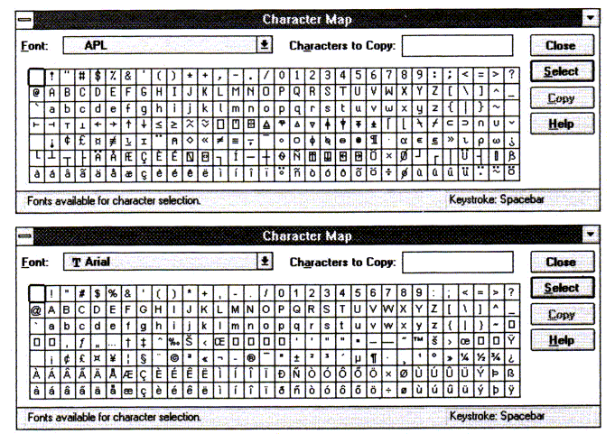
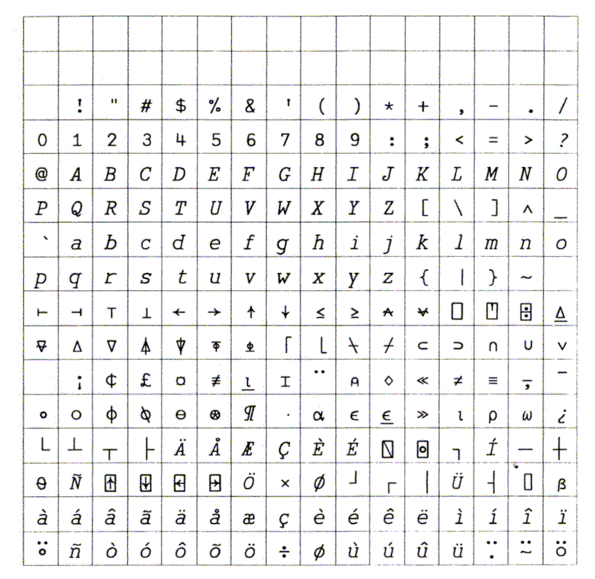

by Adrian Smith
{ .byline }

Three .DINs for the Elven-Kings under the sky  
Seven for the Dwarf-Lords in their halls of stone ...  
One font to rule them all, one font to find them  
One font to bring them all, and in the darkness bind them.  
with apologies to JRR Tolkein

### Introduction

Two recent items in Vector prompted me to write this. Gfeller and Kromberg \[1\] make the point that under Windows, it is meant to be easy to move stuff between applications. With Dyalog-7 (which now uses the clipboard sensibly) and APL\*PLUS III, I should be able to move `⍳2` from one session to the other via the clipboard, and have it execute just the same in either interpreter.

Then we have Jan Karman’s letter \[2\] complaining at the near impossibility of getting an `↑` into Word for Windows using the Dyalog APL font.

Finally, I was goaded into action by the Finns, who got really upset that the APLPLUS font omitted most of the Scandinavian characters!

### Objectives

1. To be able to cut and paste code between Dyalog-7, APL\*PLUS III, WinWord, Write etc. If it arrives (by any route) into an APL interpreter, it should run.
2. To have one and only one TrueType APL font loaded in Windows for use by all the Windows applications on my machine.
3. To have (at most) a couple of bitmap fonts for use in APL development, which support exactly the same character set as the TrueType equivalents.
4. To leave as many as possible of the ‘special’ characters (such as the £ sign and all the Scandics) where Windows users expect to find them.
5. To avoid known bear-traps, such as the ch(160) location which Dyalog ill-advisedly occupied with the afore-mentioned `↑`.

### Compromises Required

1. Goodbye <u>A</u> — <u>Z</u>. There are simply not enough holes in the 256-character set to put these in.
2. Goodbye some of the accented capitals.
3. Hello APL\*PLUS font encoding. Dyalog suffers for being too public-spirited! It is easy to change their output mapping, and impossible to change STSC's, so APL\*PLUS it is. Actually, the Maryland mapping is very sensible, and makes it quite easy to remember things like ‘abc’ >> `∆abc∇` if you want proper paired quotes in your text. The Copyright © symbol is an APL `⍝` which is nice.

However, I do insist on keeping the basic line-drawing set (I like the Dyalog DISP function) and all known APL symbols, including the oddballs which APL2 defined and never used.

### What Does it all Look Like?

You might like to compare the CharMap prints of the bitmap font and standard Arial to see which characters I have stolen!

## 

All the Scandics have been checked out by the Finnish APL group (thanks, Kimmo), so it remains to see which other outposts of Europe I will have left bereft of some crucial part of their alphabet.

### The Complete APL2741 Font as Currently Proposed

## 

This uses exactly the same character designs as DyalogAPL and the VectorAPL font supplied with the Vector APL typewriter. The original artwork is in CorelDRAW! and the final production was done with FontMonger. It is available in TrueType and Adobe Type-1 format. All variants may be freely distributed with no restrictions of any kind.

### What Happens Next?

Someone needs to kick whatever remains of the APL Standards group to start the ball rolling towards a generic font mapping for APL under Windows. I can see scope for plenty of argument over the details, but at least if everyone accepts the principle, then the smaller fish will quickly fall into line, and interpreters like APLIWIN will also adopt enough of the standard mapping to be acceptable citizens. The APL\*PLUS III font has to be the obvious starting point, and the APL2741 scheme is totally compatible with it.

Someone needs to find out (and publish) more about what is going on in the Unicode world \[3\]. When is this likely to hit us (I don’t see any signs of a mass migration to Windows NT or OS/2) and is it just being driven by IBM?

I need to plan a move from Word-for-DOS technology (Vector is still produced with the old APL\*PLUS/PC mappings) to a full Windows platform. I may well go to PageMaker (which supports styles properly) rather than WinWord (which remains less functional than Word 5.0 for DOS, even in the new resource-hogging version). Either way, I will need a bi-directional mapping from VectorAPL to APL2741 without loss of information.

### References

1. Gfeller and Kromberg, *Standardisation beyond the Language*, Vector Vol.10 No.4 pp58 - 63
2. Karman J, *Take it or Leave It*, Vector Vol.10 No.3 page 129
3. Brown J, *Extending the APL2 Character Set*, APL93 Conference Proceedings, page 41

(webpage generated: 27 June 2007, 16:34)
