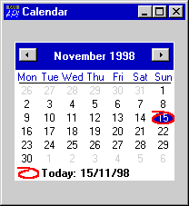
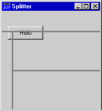
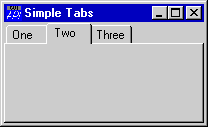
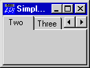
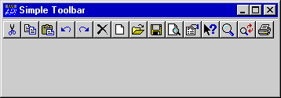
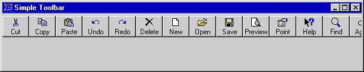
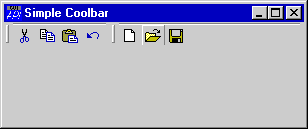

*by Adrian Smith (causeway@csi.com)*
{ .byline }

## Introduction

This review has much the same status as the “Dyalog APL for Windows 95” article in Vector 12.2 (October 1995). It is a surface skim over the new features which have not been fully explored elsewhere, and is based on the first beta release of the interpreter from the Dyalog DSS web site. Of course, bugs and major irritations will get fixed before it goes live, but the basic design and feature-list is now fixed.

## Language Improvements

APL2 convergence continues with ...

<b>N-wise reduction</b>  
Designed originally for moving averages (the replicate, rotate and add method being slow and heavy on workspace):

```
      vv←?365⍴12
      ⍴12+/vv
354
```

... but also very useful for bitmap manipulation. If you want to do edge-detection or smoothing on a bit-pattern (or run a fast ‘Life’ program):

```
      mm
0 0 1 1 0 0
0 0 1 1 0 0
1 1 1 1 1 1
1 1 1 1 1 1
0 0 1 1 0 0
0 0 1 1 0 0
      (3+/3+⌿0⍪(0,mm,0)⍪0)-mm
0 2 3 3 2 0
2 5 6 6 5 2
3 6 7 7 6 3
3 6 7 7 6 3
2 5 6 6 5 2
0 2 3 3 2 0
```

... neighbour-counting just got *really* easy, and a lot faster!

<b>Scalar Functions with Axis</b>  
Really, this should have been in APL from the beginning! Row-wise addition of vectors to matrices was just about bearable, but anything else is a real pain, and again soaks workspace unnecessarily. Now we can say:

```
      mm←3 4⍴⍳12
      mm+[1] 20 30 40
21 22 23 24
35 36 37 38
49 50 51 52
```

Hard to see how anyone could object to either of these (rather long overdue) extensions.

## New Control Structures

`:Hold` is well covered elsewhere in the articles on threading, so just a brief mention for `:with` which is a nice alternative to `⎕CS`, and a lot safer:

```
:with obj
   instancevar+←1
:endwith
```

... is so much neater than the current alternatives of:

```
 obj⍎'instancevar+←1'
```

or

```
here←⎕CS obj ⋄ instancevar+←1 ⋄ ⎕CS here
```

... which always leaves me feeling nervous if it is spread over several lines, as I may accidentally reuse `here` and lose track of where I came from. I expect that as we encounter more and more OLE servers with object trees yards deep, we will get used to `:with excel1.application.sheet5.range` and our APL code will look more like VB by the day. *C’est la vie.*

## Environmental Stuff (mostly session changes)

<b>Session Coolbars</b>  
Hmmmm. It took me about 3 sec to hate these and 10 sec to get into the WS Explorer and `⎕EX` the lot of them. Fortunately 8.2 happily loads your existing `⎕SE` so I am back on a black screen with nobbut a menu bar. However *de gustibus non disputandum* as they say in Basingstoke.

<b>Permanent Session Log</b>  
Something the mainframe APLs had from the beginning, and APL2/PC showed the way with back in 1990. Very useful, particularly given the increased buffer size mentioned below.

<b>Bigger Input Buffer</b>  
This one I really like, for a slightly oddball reason. For years, I have run with a version of `WsLoc` which echoes lines to the session, decorated fore and aft with `∇` characters ...

```
      ⎕se.WsLoc '38'
∇onKeyPress[12]      :CaseList 38 40 ⍝ Up/Dn should work weekly∇
∇onKeyPress[13]        dte+←7ׯ1*ks=38∇
```

This makes for a very efficient global replace operation (with manual verification) as you can simply whip down the session changing any required lines and then hit \[Enter\] to process the lot. The downside was that it was easy to fill the input buffer, in which case Dyalog just barked and rejected the whole stack. Now I can make the buffer so huge that I will never lose work this way again. Brilliant.

<b>Strong Interrupts (System Tray Icon)</b>  
Interested to know why they did it this way! This will get more useful with multithreading, as the cheap way to implement `:hold` is simply to diamond up critical sections into single long lines. It then becomes more necessary to be able to break execution mid-line.

## Existing Gui Stuff

The usual pot-pourri of minor updates to existing objects:

- 24-bit bitmaps now report a CBits array which is the encoded RGB value for each pixel.
- graphical objects tell you where the mouse hit them. Also you can use ('Drawmode' 6) on polys and rects to make DIY locators. Essential for stuff like the draggy line-charts in RainPro.
- bitmaps can make uncompressed GIFs and compressed PNGs.
- listviews have checkboxes, optional gridlines and (at last) you can select a row by clicking anywhere, not just on the left-hand column, in report view.
- smooth progress bars are back in the frame!

The implementation of checkboxes looks somewhat half-baked – it is not at all clear how you set them and the recommended method for reading back the value:

```
      STATE←2 ⎕NQ'Form.ListView' 'GetItemState' 11
      13⊃⌽(32⍴2)⊤STATE
1
```

... looks like a pretty serious loop if you have a few hundred items on your list. I think a ‘checked’ property might be in order here!

## New Gui Objects

Just as the language is converging slowly on APL2, the Gui is gradually evolving towards the true Microsoft look-and-feel. However the usual caveats apply – use these new toys because you want to, not because you can!

<b>Calendar</b>  
Probably the simplest of the new controls to describe, and likely to turn up as a ‘drop-down’ on many people’s date fields very quickly.

```
     ∇Cal
[1]   ⍝ Simple Calendar
[2]    'ff'⎕WC'Form' 'Calendar'(400 100)(200 200)('coord' 'pixel')
[3]    :With 'ff'
[4]      ⎕WS'event' 40 '#.onFocus'
[5]      'cal'⎕WC'calendar'('event' 22 '#.onKeyPress')
[6]    :End
     ∇
```



Note the need for the fully-qualified callbacks if you use `:with` here – I spent a few moments wondering why I was getting `VALUE ERROR error` as soon as I clicked on the form. Of course it was looking for the callback functions in the namespace of the form!

The only serious snag with this one is the total lack of any built-in keyboard behaviour. As a well-known muriphobe, I was relieved to find that it did respond to keystroke events, so here is a first-cut handler for it:

```
     ∇msg←onKeyPress msg;this;ks;ctrl;dte;ts
[1]   ⍝ Do some intelligent things with the Calendar keyboard
[2]   ⍝ Extend to taste!
[3]    (this ks ctrl)←msg[1 5 6]
[4]    :With this
[5]      dte←1⊃⎕WG'SelDate'
[6]      ts←2 ⎕NQ'' 263 dte
[7]      :Select ks
[8]       :Case 84  ⍝ t=today
[9]         dte←2 ⎕NQ'' 264 ⎕TS
[10]      :CaseList 37 39 ⍝ Left/right just roll the days
[11]        dte+←¯1*ks=37
[12]      :CaseList 38 40 ⍝ Up/Dn should work weekly
[13]        dte+←7ׯ1*ks=38
[14]      :CaseList 33 34 ⍝ PgUp/Dn
[15]        :Select ctrl
[16]          :Case 0 ⍝ ... roll months
[17]            ts[1 2]←1+0 12⊤(¯1*ks=33)+0 12⊥2↑ts-1
[18]          :Case 2 ⍝ ... or years if Ctrl
[19]            ts[1]+←¯1*ks=33
[20]        :End
[21]        dte←2 ⎕NQ'' 264 ts
[22]     :EndSelect
[23]     ⎕WS'SelDate'dte
[24]   :End
     ∇
```

You can also queue a ‘GotFocus’ on it, hence the handler on the parent form:

```
     ∇msg←onFocus msg
[1]   ⍝ Set focus to calendar
[2]    ⎕NQ((⊃msg),'.cal')40
     ∇
```

... which makes quite a nice little mini-application out of it. If you click on the month, you get a month menu – click on the year and it magically becomes a spinner! Probably it does other party tricks too – neither of the above were documented anywhere. The calendar runs from 1600, and the last valid date is day 23242571, which is Dec 31st 65535.

<b>The Splitter Object</b>  
This one leaves me feeling very relieved. Causeway has been faking splitters for some time, and I do this in a very non-Microsoft way by having the splitters at the same level as everything else on the form, and setting a property of the list of other objects the splitter should manage. This has the great advantage that you can add splitters retrospectively to existing designs very easily.

The Dyalog splitter works very much in this way, and provides ‘start’ and ‘end’ events so that you can totally ignore the built-in behaviour and use it in almost any way you please. The only thing to watch is that the order of creation is crucial:

```
     ∇Split
[1]   ⍝ Simple Splitter
[2]    'ff'⎕WC'Form' 'Splitter'(400 100)(200 200)('coord' 'pixel')
[3]    'ff.s1'⎕WC'Splitter'('Posn' 40 ⍬)
         ('Style' 'Horz')('bcol'(3/128))
[4]    'ff.s2'⎕WC'Splitter'('Posn'⍬ 20)('bcol'(3/128))
[5]    'ff.s3'⎕WC'Splitter'('Style' 'Horz')('bcol'(3/128))
[6]    'ff.b'⎕WC'Button' 'Hello'(30 12)(28 72)
     ∇
```



Normally splitters are invisible, but the colour shows how they organise themselves in a series of smaller and smaller panes, working to the right and downwards. You can set the width of the line, and one element of the position, but a splitter never intersects a previous splitter.

As the example shows, splitters completely ignore objects which are not mentioned in any of their ‘splitobj’ properties. However they always resize each other to prevent crossovers.

<b>Tab Controls and Tab Buttons</b>  
Referring back to Vector 12.2, I noticed that I prematurely celebrated the demise of the old TabBar and TabBtn when the property sheet arrived on the scene. Unfortunately, property sheets and property pages are far too specific in what they do, so we have mostly made do with the hand-crafted Dyalog tab-bars until now. The problem with this is that they do not look ‘quite right’ and that you are very limited in what you can do (e.g. adding and removing tabs) without creating ugly redraw problems.

The new tabs hook straight through to Windows95 common controls, so should look authentic and generally behave better when rebuilt on the fly.

```
     ∇Tabs
[1]   ⍝ Top-aligned tabbar
[2]   'ff'⎕WC'Form' 'Simple Tabs'(400 100)(100 200)('coord' 'pixel')
[3]   'ff.tc'⎕WC'TabControl'
[4]
[5]   'ff.tc.t1'⎕WC'TabButton' 'One'
[6]   'ff.tc.t2'⎕WC'TabButton' 'Two'
[7]   'ff.tc.t3'⎕WC'TabButton' 'Three'
[8]
[9]   'ff.tc.s1'⎕WC'SubForm'('TabObj' 'ff.tc.t1')
[10]  'ff.tc.s2'⎕WC'SubForm'('TabObj' 'ff.tc.t2')
[11]  'ff.tc.s3'⎕WC'SubForm'('TabObj' 'ff.tc.t3')
[12]
[13]  ⍝ Get the second tab to the front ...
[14]   ⎕NQ'ff.tc.t2' 30
     ∇
```



My only concern here is the lack of events reported by the tab buttons – only Create and Select. There are applications out there using right-mouse menus on tabs, and fielding drag-drop events to move items between pages of notebooks.



Otherwise these seem to work quite nicely, and the scroller you get when you make the form too small is very much less visually obtrusive than its predecessor:

There are plenty more party tricks here (like adding icons to the tabs), but for the moment I think the important thing is that the basics work well, and that the new-style tabs should be a very painless upgrade for most applications.

<b>Tool Control and Tool Button</b>  
*Note that both the tool control and ‘coolbar’ controls need a version of comctl32.dll which is more recent than the one shipped with Windows95 OSR2. This has implications for runtime installation, which you should consider very carefully before using them.*

Again, these are a direct Windows-95 pass-through and so they also have the authentic Office-97 appearance and behaviour. Causeway has been faking these since Toronto (cunning use of mouse-enter/mouse-leave and much swopping of btnpix) and it will be a great relief to kick the code well into the long grass, and use a native Dyalog control here. It should build very much faster and be a touch more reliable.

```
     ∇Tools cap
[1]   ⍝ Simple toolbar (cap is 0 or 1)
[2]   'ff'⎕WC'Form' 'Simple Toolbar'(400 100)(100 300)('coord' 'pixel')
[3]   'ff.tb'⎕WC'ToolControl'('Showcaptions'cap)('Style' 'buttons')
[4]
[5]   'ff.tb.il'⎕WC'ImageList'('Masked' 0)('Mapcols' 1)
[6]   'ff.tb.il.'⎕WC'Bitmap'('Comctl32' 120)
[7]   'ff.tb'⎕WS'ImageList' 'ff.tb.il'
[8]
[9]   'ff.tb.b1'⎕WC'ToolButton' 'Cut'('ImageIndex' 1)
[10]  'ff.tb.b2'⎕WC'ToolButton' 'Copy'('ImageIndex' 2)
[11]  'ff.tb.b3'⎕WC'ToolButton' 'Paste'('ImageIndex' 3)
[12]  'ff.tb.b4'⎕WC'ToolButton' 'Undo'('ImageIndex' 4)
[13]  'ff.tb.b5'⎕WC'ToolButton' 'Redo'('ImageIndex' 5)
[14]  'ff.tb.b6'⎕WC'ToolButton' 'Delete'('ImageIndex' 6)
[15]  'ff.tb.b7'⎕WC'ToolButton' 'New'('ImageIndex' 7)
[16]  'ff.tb.b8'⎕WC'ToolButton' 'Open'('ImageIndex' 8)
[17]  'ff.tb.b9'⎕WC'ToolButton' 'Save'('ImageIndex' 9)
[18]  'ff.tb.b10'⎕WC'ToolButton' 'Preview'('ImageIndex' 10)
[19]  'ff.tb.b11'⎕WC'ToolButton' 'Point'('ImageIndex' 11)
[20]  'ff.tb.b12'⎕WC'ToolButton' 'Help'('ImageIndex' 12)
[21]  'ff.tb.b13'⎕WC'ToolButton' 'Find'('ImageIndex' 13)
[22]  'ff.tb.b14'⎕WC'ToolButton' 'Again'('ImageIndex' 14)
[23]  'ff.tb.b15'⎕WC'ToolButton' 'Print'('ImageIndex' 15)
     ∇
```

Somewhere in the Windows documentation, there must be a complete list of these built-in icons! Here is what this set looks like:



One of the nice touches is that you can turn captions on/off on the fly, which makes for a very easy ‘user preferences’ dialogue:

```
 'ff.tb'⎕WS 'Showcaptions' 1
```



To space the buttons into logical groups you add a button with style ‘separator’, which I never would have guessed – thanks to Dyadic for pointing out this undocumented facility!.

Again, these do several other party tricks, for example you can do see-through buttons like Explorer (but not the effect of grey shades which light up on mouse-over), and of course the default is the Office-97 style which are flat until they sense the mouse.

<b>Coolbars and Coolbands</b>  
These are by far the least convincing of the new controls:



As you can see, it has bad redraw problems (the mouse was over the ‘file open’ tool which has lost its lower edge, and the grippers cut an unpleasant notch in the upper groove), and the behaviour is unlike any Office tool I have seen, except for Internet Explorer.

```
     ∇Cool cap
[1]   ⍝ Simple coolbar (cap is 0 or 1)
[2]    'ff'⎕WC'Form' 'Simple Coolbar'(400 100)(100 300)('coord' 'pixel')
[3]    'ff.il'⎕WC'ImageList'('Masked' 0)('MapCols' 1)
[4]    'ff.il.'⎕WC'Bitmap'('ComCtl32' 120)
[5]
[6]    'ff.cb'⎕WC'CoolBar' ⋄ 'ff.cb.c1'⎕WC'CoolBand'
[7]
[8]    :With 'ff.cb.c1'
[9]     'tb'⎕WC'ToolControl'('ImageList' '#.ff.il')('Showcaptions'cap)
[10]    'tb.b1'⎕WC'ToolButton' 'New'('ImageIndex' 7)
[11]    'tb.b2'⎕WC'ToolButton' 'Open'('ImageIndex' 8)
[12]    'tb.b3'⎕WC'ToolButton' 'Save'('ImageIndex' 9)
[13]   :EndWith
[14]
[15]   'ff.cb.c2'⎕WC'CoolBand'
[16]
[17]   :With 'ff.cb.c2'
[18]    'tb'⎕WC'ToolControl'('ImageList' '#.ff.il')('Showcaptions'cap)
[19]    'tb.b1'⎕WC'ToolButton' 'Cut'('ImageIndex' 1)
[20]    'tb.b2'⎕WC'ToolButton' 'Copy'('ImageIndex' 2)
[21]    'tb.b3'⎕WC'ToolButton' 'Paste'('ImageIndex' 3)
[22]    'tb.b4'⎕WC'ToolButton' 'Undo'('ImageIndex' 4)
[23]    'tb.b5'⎕WC'ToolButton' 'Redo'('ImageIndex' 5)
[24]   :EndWith
     ∇
```

You will also see that I have arranged the bars to hide the ‘Redo’ tool, but there is no visual indication that it is missing. Word-97 shows a tiny ‘>>’ symbol if this happens. My feeling here is that if we can’t have proper docking toolbars, which can detach into floating palettes, then better not to bother at all. These guys are just mightily confusing for the user and are best left in the box.

*Dyadic rightly point out that the above may well be true, but it is hardly their problem if Microsoft produce a set of ‘standard’ tools and then proceed to ignore them with the entire Office suite, Visual Studio, etc. If we want to do true ‘Office’ look-alikes we will have to wait a little longer, which is probably just what Redmond intended.*

## Other Stuff

<b>TCP ‘SendPicture’</b>  
Interested to know what this is for! I have been shoving GIFs and PNGs down raw sockets, apparently successfully; clearly there must be some circumstance when the simple-minded approach fails.

<b>SQAPL Version 3</b>  
Lots of small improvements, some of which will remove installation problems (the hardwired registry key for SQAInit was a nuisance) and some of which will mean big speedups. Support for array update is very welcome.

## Summary

Obviously, the main thrust of work in version 8.2 was towards OCX support, with a substantial investment in multithreading. There must be lots of Dyalog users around who wouldn’t know an OCX if it came up and bit them, and who are rightly running scared of multiple concurrent `)SI` stacks. Hopefully they will have gleaned enough from these notes to judge whether an upgrade to 8.2 is worth the trouble and expense.

My feeling is that it is a bit like Windows-98 – it rolls up a lot of minor improvements which have been filtering out of DSS, consolidates the documentation, and adds a couple of bonus goodies (like the Calendar) to make you feel good about it. It is also remarkably stable – I have not crashed it once while writing these notes, in spite of pushing the Gui around trying to find redraw problems and other minor irritations.

I think it is worth it for the language improvements alone, and I welcome the chance to take a bunch of code out of the Causeway splitters, picture buttons and tabbed dialogues. Forms should load faster, and look a touch more professional, which all helps to keep APL in the frame as a viable Gui development tool.

***
