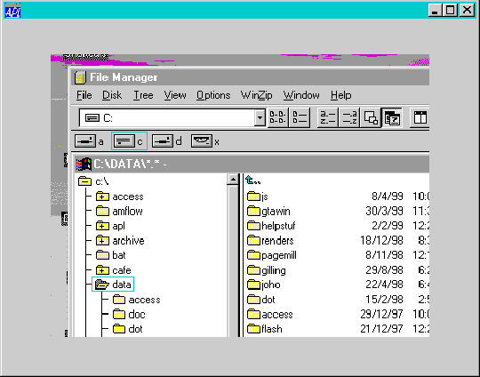

*by Adrian Smith (adrian@cgsl.demon.co.uk)*
{ .byline }

### Motivation

> *“The great storm of computer progress moves on, leaving behind many puddles, in which teem interesting life…”* (Ted Nelson, Stanford, 1991)

Somewhere between October 1998 and January 1999 the great storm of computer progress swept through Basingstoke, leaving behind it a subtle change to the Dyadic interpreter which few people noticed, but which had some rather bizarre consequences for one particular application which just happened to be dominating my life at the time. It also upset the children, whose ‘Mystro’ adventure puzzle game developed strange rectangular ‘windows’ to the desktop (or File Manager or whatever else was underneath at the time) – something funny was going on, and I was going to have to find out what it was!

### Investigation

Obviously the first thing to do was to find out what I was doing to trigger this strange behaviour, and then to make up a sample function to illustrate the problem. It turned out that my problem was caused by exploiting a very useful (undocumented) feature of the interpreter which allows you to set a subform as (`'BCol' ⍬`) – this completely prevents it from painting, but it still registers mouse events, and it has a ‘Cursor’ property. This is exactly what you need if you have a pictorial adventure game where various areas on the picture are marked as ‘hot spots’ which either jump to another picture, or run some kind of challenge where you need to type in the right code to proceed. More immediately relevant, it lets you simulate ‘active desktop’ with illuminating shortcuts where the icon labels magically change on mouse-over.

Here is the sample function, and if you turn the page, you can see the weird effect it produces ...

```
     ∇goo
[1]   'ff'⎕WC'form'
[2]   'ff.sub'⎕WC'subform' ''(10 10)(80 80)('bcol' ⍬)
     ∇
```

{ width="540" height="424" }

The problem is that not only has Dyalog (correctly) left the subform unpainted, but it has carefully avoided painting the underlying form too! After several conversations with the Basingstoke helpline it turned out that they had added a ‘ClipChildren’ style to the ‘Form’ object, apparently to reduce flicker when Windows98 or NT users set ‘Show contents while dragging’ in Display Properties. This also explained another effect I had become aware of – forms with lots of child controls were being drawn with holes cut out under the controls, which were then drawn over the holes. Running on a black desktop with a (fairly) slow graphics card, you really notice this.

### The Solution

<pre>
     ∇setwdw obj;gwl;swl;hdl;bits
[1]   ⍝ Zap the 'Clipchildren' style on parent object <obj>
[2]    'gwl'⎕NA'U user32.C32|GetWindowLongA I I'
[3]    'swl'⎕NA'U user32.C32|SetWindowLongA I I U'
[4]    hdl←obj ⎕WG'HANDLE'
[5]    ⎕←bits←(32⍴2)⊤gwl hdl ¯16
[6]    (7⊃bits)←0
[7]    {}swl hdl ¯16(2⊥bits)
[8]    ⎕←bits←(32⍴2)⊤gwl hdl ¯16  ⍝ Debugging code - remove
     ∇
</obj></pre>

The 7th bit is the one that you need to zap to reverse the change and get back to the old settings. Zapping various of the other bits has bizarre and unpredictable effects, and is not recommended. Simply run this function, passing it the name of your main form after creation and your children will no longer be clipped.

```
     ∇goo
[1]   'ff'⎕WC'form'
[2]    setwdw'ff'
[3]   'ff.sub'⎕WC'subform' ''(10 10)(80 80)('bcol' ⍬)
     ∇
```

***
