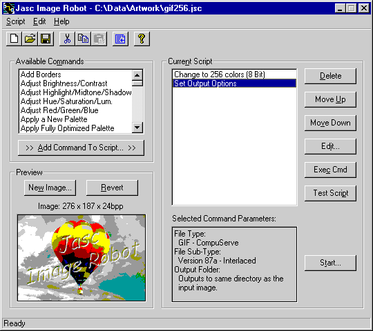
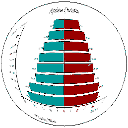

*by Adrian Smith, with assistance from Gert Glantz ([gert.glantz@tietoenator.com](mailto:gert.glantz@tietoenator.com))*
{ .byline }

## Disclaimer

Unusually for a Hackers’ Corner, this article requires you to go out and buy some additional software to make it all work. However it does cover some interesting techniques which the +Win programmer needs to recover the bits from a picture object and save the result as a bitmap file. This is courtesy of Gert Glantz, and came via Carl House who uses much of the HTML code published in previous *Vectors* to maintain a large and complex web-site. The BMP conversion code may be downloaded from the [APL2000](http://www.apl2000.com/) website.

## Why Bother?

The problem with web graphics is gradually receding as ‘modern’ formats like .PNG replace the old lingua franca of the Compuserve GIF. However GIF is still by far the most commonly recognised filetype, and is very efficient in storing simple block graphics, where the run-code compression can work well. The snag is that the algorithm used to compress GIFs has been retrospectively claimed as copyright by Unisys, who are vigorous in pursuing any software development company which dares to post GIF files on its web site. The answer is to find a software package (such as PaintShopPro) which *is* licensed, and to make your GIF files with this. Unfortunately this is a very labour intensive solution if you are automatically generating a large stack of pictures (like the climate charts on the Causeway website) as PSP has no command-line interface.

Carl House and I had reached roughly this point in the weeks leading up to Orlando, when he discovered that JASC (the PSP people) also sell a package called Image Robot \[1\] which is essentially a command-line, scriptable PaintShopPro-5. Now all we have to do is to generate our image (in +Win we use a ‘Picture’ object), capture the bits, generate a standard .BMP file and launch Image Robot from the command-line. Well, it works a treat, and as far as I know is both legal and decent, as well as honest.

## Stage-1: First make your BMP

Fortunately, Dyalog does this bit for us, so what follows is only necessary for APL+Win. Dyalog readers may skip ahead to the next subhead!

```
    ∇ z←Image2BmpFile im;h;cmap_entries;bits_per_pixel;offbf;offbc;ih;iw
[1]   ⍝ Creates the contents of a BMP-file from an image
[2]   ⍝ im=image created with "Get" method or "image" property
[3]   ⍝ z=file contents
[4]   ⍝| 1998 9 18 11 6 37 ⍝  Gert Glantz, Enator Sweden
[5]   ⍝ Please send comments and suggestions to: gert.glantz@enator.se
[6]    (ih iw)←⍴im                    ⍝ Image-dimensions
[7]    cmap_entries←0                 ⍝ No of entries in colormap
[8]    bits_per_pixel←24              ⍝ No of bits per pixel
[9]    h←(14+40)⍴⎕tcnul               ⍝ Initialize file header
[10]   offbf←0                        ⍝ Fileheader offset
[11]   offbc←14                       ⍝ Infoheader offset
[12]
[13]  ⍝ Bmpfileheader
[14]   h[offbf+⍳2]←'BM'               ⍝ Always 'BM' in the 2 first bytes
[15]   h[(offbf+2)+⍳4]←I2C 14+40+(cmap_entries×4)+(ih×iw) ⍝ bfSize = file size
[16]   h[(offbf+10)+⍳4]←I2C 14+40+cmap_entries×4     ⍝ bfOffBits = header size
[17]
[18]  ⍝ Bmpinfoheader
[19]   h[offbc+⍳2]←S2C 40             ⍝ bcSize = size of infoheader
[20]   h[(offbc+4)+⍳4]←I2C iw         ⍝ bcWidth = bitmap width
[21]   h[(offbc+8)+⍳4]←I2C ih         ⍝ bcHeight = bitmap height
[22]   h[(offbc+12)+⍳2]←S2C 1         ⍝ bcPlanes = always 1
[23]   h[(offbc+14)+⍳2]←S2C bits_per_pixel    ⍝ bcBitCount
[24]   h[(offbc+24)+⍳4]←I2C 0         ⍝ xPels/M
[25]   h[(offbc+28)+⍳4]←I2C 0         ⍝ xPels/M
[26]   h[(offbc+32)+⍳2]←S2C cmap_entries  ⍝ bcClrUsed
[27]   z←h
[28]
[29]  ⍝ Bmpcolormap
[30]  ⍝ z←z,(cmap_entries×4)⍴???      ⍝ Not used
[31]
[32]  ⍝ Data
[33]   z←z,Image2Bmp im       ⍝ Convert image to bitmap and append
    ∇
```

This explains itself most adequately from the comments; however it does show one very useful idea – including your email address in the function header. As I said in the disclaimer, I picked up this code in Orlando (actually at the airport on the way home) and started digging into it to prepare this article; obviously I needed to seek the author’s permission, so I simply pasted the address from the above comment line and fired off a mail. The answer was back in less than 2 hours. On the principle that APL is inevitably open-source, I would suggest that the implementors consider adding timestamping (*visible* timestamping), author’s name and email contact as leading comment options on saving any function.

Next up are a couple of little utilities for getting integers packaged up as bytes:

```
    ∇ z←S2C n;⎕IO
[1]  ⍝ char←S2C int -- Convert SHORT integers to character pairs
[2]   ⎕IO←0 ⋄ z←⎕AV[,⌽⍉1 0↓0 256 256⊤,n]
    ∇
```

```
    ∇ c←I2C n;⎕io
[1]  ⍝ char←I2C int -- Convert integers to character
[2]   ⎕IO←0 ⋄ c←⎕AV[,⌽⍉256 256 256 256⊤,n]
    ∇
```

This neatly avoids problems with `⎕dr` which fails on booleans. Now all we need is to convert the actual bits to make the body of the file:

```
    ∇ z←Image2Bmp im;maxb;blk;s;res
[1]   ⍝ Creates 24-bit bitmap from 32-bit image
[2]   ⍝ im=image created with "Get" method or "image" property
[3]   ⍝ z=bitmap
[4]   ⍝| 1998 10 11 19 38 18 ⍝  Gert Glantz, Enator Sweden
[5]   ⍝ Please send comments and suggestions to: gert.glantz@enator.se
[6]    z←'' ⋄ s←⍴im
[7]    im←,⊖im            ⍝ Bitmaps are stored "bot to top"
[8]
[9]   ⍝ Convert 32-bit integer to 24-bit (=3 chars)
[10]  ⍝   Stored in BGR order in stead of RGB
[11]   maxb←10000         ⍝ Block size to avoid WS FULL
[12]  :while 0<⍴im
[13]       blk←(⍴im)⌊maxb
[14]       z←z,,⌽82 ⎕dr ¯8↓[2](blk,32)⍴11 ⎕dr blk↑im
[15]       im←blk↓im
[16]  :endwhile
[17]
[18]   z←((1↑s),3×1↓s)⍴z
[19]
[20]  ⍝ Row length must be a even multiple of 4
[21]  :if 0≠res←4|1↓⍴z
[22]       z←z,((1↑⍴z),4-res)⍴⎕av[256]
[23]  :endif
[24]
[25]   z←,z                       ⍝ Return bitmap as vector
    ∇
```

Now to try it out ... we need a form with a picture on it so the `RawGui` code from RainPro looks a good place to start hacking.

This needs quite a large workspace to run in – I settled on 12M as the minimum working size required to snap and convert a typical chart.

```
    ∇ bits←RawGui PG;bb;SCL;ppt
[1]   ⍝ Sample function to show a Rain chart on a picture
[2]   ⍝ Hardcode bounding box (x y x y) at standard setting
[3]   ⍝ Get this from PG in a real application!!
[4]    bb←0 0 432 324
[5]   ⍝ Initialise resource tables if not already present
[6]    :if 0=⎕nc 'ps⍙brush' ⋄ ps⍙brush←0 2⍴0 ⋄ ps⍙font←0 2⍴0 ⋄ :end
[7]   ⍝ Set the extent to match your desired viewing size.
[8]    ⎕wself←'tgt' ⎕WI 'Create' 'Form'('where' 2 2)('extent' (1.6×324 432÷16 8))
[9]    ⎕wself←'tgt.pic' ⎕WI 'New' 'Picture'('where' (0 0, 1.6×324 432÷16 8))
[10]   ⎕WI 'scale' 5
[11]  ⍝ Wipe the slate
[12]   ⎕wi 'Draw' ('Brush' 1 (255 255 255)) ('Clear')
[13]  ⍝ Save scaling command <SCL> (r c h w) ...
[14]   SCL←⊂(⊂'Scale'),bb[4 1],1 ¯1×-⌿⌽2 2⍴bb
[15]  ⍝ Calculate Pixels per Point to get fonts sized right
[16]   ppt←.5+.×((⎕WI 'scale')[1+4 3])÷|-⌿2 2⍴bb
[17]  ⍝ Run our PostScript interpreter with these parameters ...
[18]  ⍝ Use a final 0 here for 16 or 256 colour systems
[19]   SCL ps_exec PG 'tgt.pic' ppt ps∆cmap 1
[20]  ⍝ Grab the bits to we can save them to file
[21]   bits←⎕WI 'image'
[22]  ⍝ Clear resource tables (optional)
[23]   psFree
    ∇
```

To exercise it ...

```
    Population
psView PG ⍝ to see it
    qq←RawGui PG
    bmp←Image2BmpFile qq
    'qwe.bmp' ⎕ncreate ¯1
    bmp ⎕nappend ¯1
    ⎕nuntie ¯1
```

Double-click the file in Explorer, and sure enough it loads up in Windows Paint, so we can sign off stage-1. Now to reduce the byte count from a little over 1M to something reasonable.

## Stage-2: Write your Script

Writing the script is almost a no-brainer here: we need to cut the image down to 256 colours and save it as the simplest available GIF format (no transparency information is required). Save the script, get a DOS prompt in the directory where you put that bitmap and run:

```
C:\TODO>C:\util\irobot\IRobot c:\data\artwork\gif256.jsc /r *.bmp
```

{ width="540" height="480" }

The resulting reduction in byte-count is pretty spectacular:

```
C:\TODO>dir qwe.*

 Volume in drive C is SYSTEM
 Volume Serial Number is 07CF-0A15
 Directory of C:\TODO

QWE      BMP     1,067,142  07/01/00  23:20 qwe.bmp
QWE      GIF         9,415  08/01/00   0:05 qwe.gif
         2 file(s)      1,076,557 bytes
         0 dir(s)   1,120,272,384 bytes free
```

## Stage-3: Roll it out ...

Say we have a selection of timeseries to be generated as charts and saved down to the website in compressed GIF format. Probably we would dump the bitmap images into a working directory (such as c:\\todo) and set the output folder in the script to a suitable target. We can give ImageRobot a specific list of files to work on, but the easy option is to start with a clear directory and simply convert the lot with a wildcard filespec as above. So in both Dyalog and APL+Win we have:

```
⎕cmd 'C:\util\irobot\IRobot c:\data\artwork\gif256.jsc /r c:\todo\*.bmp'
```

The only difference being that in +Win we see the DOS box pop up, unless we insert a left argument of 2 to run the command in the background. Dyalog waits for the command to complete; this is not possible in +Win which continues processing immediately. Probably we would add a logfile parameter to the batch command and check for the existence of the file as a secure way of knowing that the job had run OK:

```
2 ⎕cmd 'C:\util\irobot\IRobot c:\data\artwork\gif256.jsc /r c:\todo\*.bmp
        /l gif256.log'
```

{ width="258" height="258" }

Just for fun, here is the chart I have been using as my example, with a little spherical distortion applied for good measure ...

```
  C:\TODO>type gif256.log
  Reading qwe.bmp
  Executing Script Commands...
  Executing Script Line 1 of 3
  Executing Script Line 2 of 3
  Executing Script Line 3 of 3
  Script Complete
  Saving .\qwe.gif
  Output file exists. Overwriting.
  Batch processing complete.
  1  File(s) successfully converted.
```

As I said in the introduction, it works a treat! Probably the best $89 you will ever spend. From now on, the RainPro climate demos are definitely going on the web site as compressed 16-colour GIFs for the benefit of all those poor souls who still run Netscape-3.

## Reference

1. Jasc Image Robot 1.2 can be purchased direct from [www.jasc.com](http://www.jasc.com/) for $89, or with manuals and CD for around $135 including shipping to Europe. This compares well with the benchmark UK price of £138, so web purchase is recommended!

***
