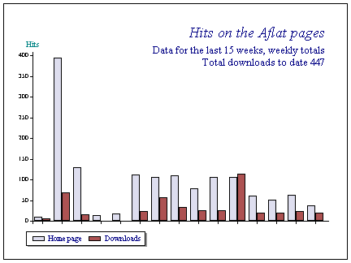

*by Adrian Smith*
{ .byline }

## Current Status

The first thing to say is that there has been a steady trickle of interest in the website at [www.vector.org.uk/aflat/](../../aflat/):

{ width="432" height="324" } There was a major peak when Vector 18.2 was mailed, followed by a rather flat patch, followed by a steady download rate at about 20 per week.

The online manual has been getting a similar smattering of hits, spread quite evenly across all the pages.

Several people have mailed in substantial pieces of A+ code, and Sasha Skomorokhov has nearly completed the ‘Weigang’ translator which will turn ASCII-mode A+ to APL mode and back.

Of course, nearly everyone would like a ‘real’ APL session; only Sasha is completely happy with Emacs and the console we already provide!

## Next Moves

At the Vector working group on January 19th, Stephen Taylor volunteered to manage the next phase of the A+ project, with the object of having APL in use in ten British schools at the beginning of the 2003-4 school year. We will shortly be asking the BAA for the funds to complete the port of the interpreter (which must now lose the last vestiges of its Unix heritage) and to begin the design work on the kind of environment we believe will be necessary to achieve Stephen’s goal.

***
