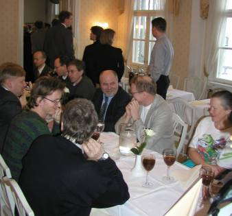
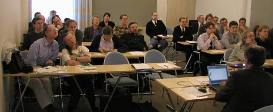

*reported by Adrian Smith*
{ .byline }

## Welcome at Krapihovi

Once again, Arto Juvonen welcomed an enthusiastic group of APLers (33 of us this time) to a hotel in the Finnish forests. This one was a little less remote, and was nicely placed within easy walking distance of a large nearby lake. We think the *Krapi* part of the hotel name translates as *Crayfish*, which would make sense, given the location.

{ width="338" height="315" }

As always, the accommodation, food and company were excellent. The normal format of a 2-day meeting with one overnight was extended a little, as we started quite early on the first day. However the Finns know the value of sensible breaks, and the schedule was not overcrowded.

The only severe let-down was the weather. The week before the meeting, the temperature had been around –17°C with clear bright air and snow. Just before we arrived, temperatures soared to +4° and a cold fog settled around Helsinki. Even Finns object to being thrown into icy lakes in these conditions, and the rest of us were content to discover just how slippery wet ice can get. Never mind, we will be back next year, hoping for better things.

## The Talks

Three of the talks are included in this Vector, so I will make a very brief summary of my notes. Conrad Hoesle-Kienzlen showed a substantial reporting subsystem which he had written to support a client who wanted ‘printout’ from Dyalog APL via Excel. This was all created in Dyalog 8.2 (“version 9 sits in its package”) and was most interesting for the unexpected limitations of the Excel object model, for example you cannot choose the number of copies to be printed. There are also plenty of Microsoft annoyances, for example you must be careful to set the state of the spreadsheet to ‘saved’ before you quit, to avoid Excel popping up a helpful “Save changes?” reminder. I remember going some way down the same road back in 1993 using DDE, and I think that all this ‘Object model’ stuff may actually have made life harder. At least with DDE\_Execute you simply ran commands off menus and getting and setting data by range was really easy.

Kimmo Kekäläinen showed a similar application, this time driving MS Word, and again produced this way because the client wanted something similar to the Word “Merge to Document” capability. He did comment that NewLeaf is much more efficient if you just want bulk output, and that for production code it is much better simply to generate an RTF merged document rather than fight the Word COM object.

Arto Juvonen illustrated many old and new utilities from the FinnAPL idiom library (some excellent ones for date handling) and Jukka Vaijärvi showed the macro capability for “Saurus” the Dinosoft product. This seems to have a lot in common with the VoxProxy approach in adding scripts to PowerPoint.

{ width="535" height="220" }

Day-2 opened with Veli-Matti Jantunen running a very nice PowerPoint show on Dyalog’s dfns to wake us all up, then we had demonstrations of major APL applications from Reima Naumanen and Richard Eller.

Conrad showed how the web-browser technology can be used with APL2 on the mainframe to modernise old AP124 interfaces, and I waved my arms about in an attempt to explain the inner secrets of PDFs.

A good meeting, and well worth the trip. Thanks, as always, to the organisers, hosts and hotel staff.

***
