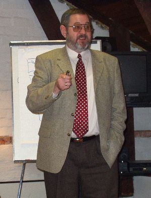
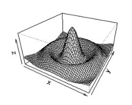
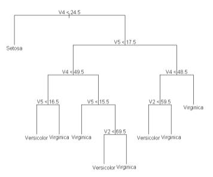
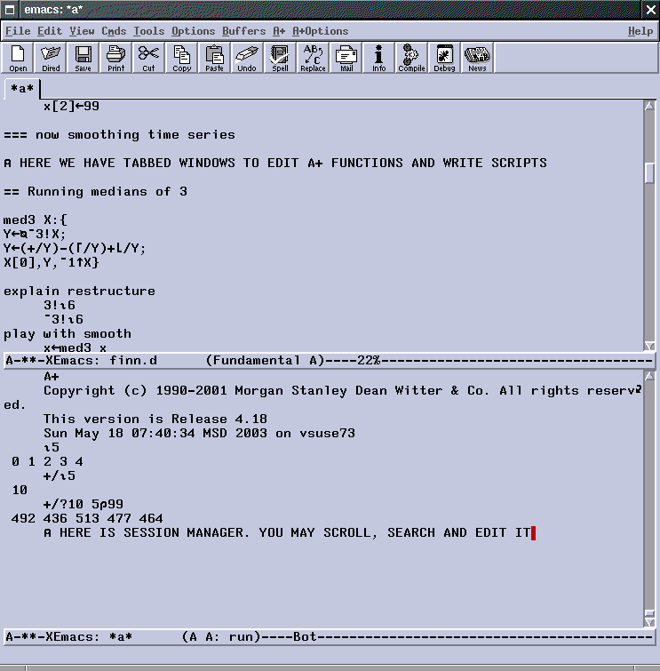
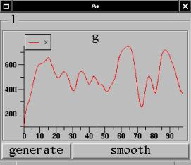
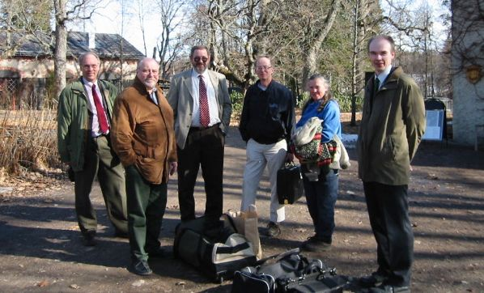

*reported by Adrian Smith*
{ .byline }

## Introduction

It all started with a mail which mentioned “The event takes place in the stables of “Svartå Slott”. See http://www.mustionlinna.fi/ ...” and listed Sasha as the keynote presenter. This year, the meeting was around a month later than usual, but as you can see from the picture, the sea remained mostly well frozen, and a sun-tan could only be acquired by the truly dedicated.

{ width="629" height="225" }

The meeting returned to the Svartå Manor, which was a comfortable country hotel, with excellent facilities, about an hour out of Helsinki. As ever, there were lots of useful discussions in the breaks, and some solid APL material in the presentations. My notes inevitably reflect my total ignorance of the Finnish language, so I can only encourage under-represented speakers to make a rough English translation and send it to the editor for publication.

## The Presentations

After a brief welcome from Jouko Kangasniemi (see the group photo at the end of the notes) we were shown around the Adaytum Planning ‘Cube’ editor and ‘e-planning’ on-line submission tool by Richard Eller, who is the agent for Adaytum in Finland. Now that all this is part of the Cognos empire, I guess that at least the artwork will soon need to change on his slides! There followed a coffee break, and a warm welcome for Sasha (Dr Skomorokhov) who had just managed to defeat an obdurate bureaucracy in time to get his passport renewed.

## Sasha, on APL in Co-operation with Matlab and S+

{ width="300" height="394" } I can only try to use bold and italic here to represent the characteristic ‘Russian bear’ emphasis that makes Dr Skomorokhov such a great speaker to listen to.

“Data mining and machine learning .... is APL a good tool? *Yes!* Are there other good tools? *Yes!* Do we need to use more tools? <b><i>Yes!</i></b> Let me prove why we need some extra tools, and how it may help us”

Sasha noted that S+ has over 4000 utilities built in. All the statistics routines available in the APL world probably amount to less than 1000, including the ASL libraries and many more. MatLab has 500,000 users around the world, and its the standard for technical computing. If you want Wavelet transforms, APL can do the maths, but visualisation is still an issue.

These tools can be compiled, so they are much faster than APL and have dynamic memory management. They can be run from script files. What is more, the version of S+ called **R** is free under the GNU public license, has an extremely active development group (over 100 posts every day to the new group), and some routines are already better than those in S+.

So why use **R** from APL? Because “you can also use <i><b>APL</b></i> from APL!”. MatLab users have awful trouble inventing vector code, and **R** needs nearly half a page to implement the APL concept ‘take’ on a vector. Here is an example from the MatLab newgroup:

```
I would like to speed up the following code but I
am unsure how to convert to vectors. Any help
would be appreciated.


for i = 1:500
  for j = 1:500
      if rand < 0.5
        matrix(i,j)=1;
      else
        matrix(i,j)=-1;
      end
  end
end

As the matrix gets larger this coding becomes
very slow! Thanks in advance Harry.
```

Well, someone stepped in with this:

```
This should work for you:

matrix = rand(500,500);
idx = find(matrix<0.5);
% you can also use idx = matrix<0.5; but it is slower
matrix(idx) = 1;
matrix(~idx) = -1

Hope this helps, Jon
```

Which is much better, but with array thinking, you can do this:

```
mm←ׯ.5+(÷m)×?500 500⍴m←¯1+2*31
```

or in the language of MatLab:

```
matrix=sign(rand(500:500)-.5)
```

But not everything in APL translates as easily. Here is the code for ‘take’ which was posted in reply to Sasha’s query on the newsgroup:

```
"%take%" <- function(i, x) {
    ## Purpose: emulate APL's  take (up-arrow) operator in R
    ## --------------------------------------------------------
    ## Author: Martin Maechler, Date: 30 Jan 2003
    K <- length(i <-as.integer(i))
    if(K == 0  || K != length(d <- dim(x)))
        stop("`i' and `dim(x)' must be have same positive length")
    ii <- APLind(i,d)
    do.call("[", c(list(x),ii, drop = FALSE))

}

dn <- list(LETTERS[1:2], letters[1:3],
          paste("T",1:4,sep=""), paste("F",1:5,sep=""))

A0 <- array(1:120, dim = 2:5) # no dimnames
A <- A0; dimnames(A) <- dn # with dimnames

r1 <- 1:4 %take% A
str(r1)# [1, 1:2, 1:3, 1:4]
r1 # looks good

str(r2 <- c(-1,-2,1,1) %take% A)
r2#ok too

## but 0 does not work with dimnames!
str(-2:1 %take% A0)# ok
# fails :
str(-2:1 %take% A)
```

```
APLind <- function(i, n)

{
    ## Purpose: construct "APL indices" for take (|^)  {or drop (v|)}
    ## ----------------------------------------------------------------------
    ## Arguments: i : integer vector, positive or negative components
    ## if i[k] >=  1  give 1 : i[k]
    ## if i[k] <= -1  give  (n[k]+i[k]+1) : n[k]
    ## else i[k] = 0: give <empty>  {"take" nothing, "drops" nothing
    ## ----------------------------------------------------------------------
    ## Author: Martin Maechler, Date: 30 Jan 2003
    if(any(abs(i) > n))
        stop("`i' must be absolutely less than `n'")
    K <- length(i)
    if(length(n) != K) {
        if(length(n) == 1) n <- rep(n, K)
        else if(K == 1) {K <- length(n); i <- rep(i, K)}
        else stop("length of `i' and `n' must match (or be one)")
    }
    if(K == 0) return(list())
    r <- vector("list", K)
    if(any(pos <- i >=0))
        r[pos] <- lapply(i[pos], function(k) seq(length = k))
    if(any(neg <- i < 0))
        r[neg] <- lapply((1:K)[neg], function(j) (n+i+1)[j]:n[j])
    r

}
```

Surprised that it was so hard? *For us, it is in the fingers!* So we must stay with our native language and only use these other tools as tools! Looking for signals in noise – often it is *just array handling* – no higher mathematics! A box of beer to anyone who can do this in anything but APL. (Sasha showed a nice example of data from reactor control rods, and the APL code to find where the rods actually moved).

### How to co-operate

You can talk to R with just 4 functions (anyone who has used the J DLL will recognise the style), and because R uses scripts for everything, we can define functions to be executed in the R environment. Of course, it is not convenient to repeatedly call rexec, so we prepare a set of commands as a vector of vectors, and pass all the lines at once.

```
[0]   rinit
[1]   '#.R'⎕WC'OleClient' 'StatConnectorSrv.StatConnector'
[2]   #.R.Init('R')

[0]   a←{r}rexec exp
[1]   ⍎(0=⎕NC'r')/'r←0'>
[2]   a←⍬
[3]   :If r
[4]   a←#.R.Evaluate(exp)
[5]   :Else
[6]   #.R.EvaluateNoReturn(exp)
[7]   :EndIf

[0]   {m}rput a;x1
[1]   ⍎(0=⎕NC'm')/'m←''x'''
[2]   m←,⊂m
[3]   a←,⊂a
[4]   #.R.SetSymbol(m,a)

[0]   r←rget name;rho;Re;Im
[1]   r←#.R.GetSymbol(name)
```

### Mexican hat time!

Here is how it looks (note that right arrow, by the way – it creates a new variable as a NL-delimited text vector) ... { width="270" height="216" }

```
)ed →script
      ⍴script
168
       script
x<-seq(-10,10,length=50)
y<-x
foo<-function(x,y){r<-sqrt
   (x^2+y^2);10*sin(r)/r}
z<-outer(x,y,foo)
pers p(x,y,z,theta=30,phi=30,
   expand=0.5)
```

... and to run it

```
      rexec¨{(~⍵∊⎕tc)⊂⍵}script
```

... which makes a classic ‘Mexican hat’ for us:

### Regression

The linear modelling is just like the syntax in ASLGreg, which is hardly surprising, given the common source of both packages. Here is a simple regression model, set up in APL and run for us by the **R** engine:

```
       +x←9?25
4 19 12 14 6 2 17 24 10
      +/x÷⍴x
12
      'x'rput x
      rexec 'm<-mean(x)'
      rget 'm'

12
      1 rexec 'mean(x)'
12
```

```
      rexec 'y<-10+3*x-0.1*x^2'
      rexec 'x1<-x'
      rexec 'x2<-x^2'
      rexec 'mod<-lm(y~x1+x2)'
      rexec 'c<-mod$coeff'
      rget 'c'
10 3 ¯0.1
      y⌹x∘.*0 1 2
10 3 ¯0.1
```

Comforting that APL gets the same answer! There is more ...

<pre>      rexec 'yn&lt;-y+rnorm(9)'
      rexec 'mod1&lt;-lm(yn~x1+x2)'
      rexec 'c1&lt;-mod1$coeff'
      rget 'c1'
9.555004062 3.193844447 ¯0.1062125247
      yn←rget 'yn'
   +a←yn⌹x∘.*0 1 2
9.555004062 3.193844447 ¯0.1062125247
   e←yn-a+.׳x∘.*0 1 2
   ((+/e*2)÷⍴e)*.5
0.4995013834

  rexec 's&lt;-sd(yn-mod1$fitted)'<br>   rget 's'
0.5298012232
   ((+/e*2)÷¯1+⍴e)*.5
0.5298012232</pre>

Of course, there is much, much more. “In APL I may do terrific things, but ‘get random number from Student Distribution’ is HARD. Now we just have it, and of course the **R** stuff is well tested and analysed by 100s of 1000s of statisticians.”

### Classification trees

“Why am I not happy with my tested APL code (as shown at APL2001)? In APL it was not easy to write this code. In R it is only this much ...

```
rexec 'library(tree)'
'row'rput↑⍴data
'col'rput 2⊃⍴data
'data'rput data
rexec'data<-matrix(0,ncol=col,nrow=row)'
rexec'data<-as.data.frame(data)'
formula←'V1~., minsize=2,mindev=0'
rexec't<-tree(data=data,formula=',formula,')'
  rexec 'plot(t)'
  rexec 'text(t)'
```

{ width="356" height="297" }

... which is some 200 times faster for 4 factors (very few). For 100 factors **R** is 2000 times faster for the same result. We *have* to analyse by factor – there is no nice array solution here!”

### Cooperative Productivity

“APL programmer feels comfortable in MatLab and or SPLUS/<b>R</b> after a 30 minutes introduction. A couple weeks are needed for diving in depth.

If we estimate productivity of problem solving in APL, <b>R</b>/SPLUS and in MatLab as 10 arbitrary units for each environment then productivity in cooperative environment may be estimated as multiplication or 100 units for a pair or 1000 for all three.”

## Lunch and After

We ate well (as ever) and enjoyed the tour around the manor house. Arto Juvonen showed us a nice application in APL+Win with Finnish-Russian dictionaries, and Jouko showed some of his work with RainPro and PowerPoint in co-operation. I talked about the Dyalog .Net compiler, and finally Reima arrived with some interesting work he had done with NewLeaf and PDF. This led directly to the implementation of ‘bookmarks as page references’ in NewLeaf on the way home.

Then it was the inevitable sauna, dinner and evening seminar with Sasha. The reporting team escaped at around 1:00am, by which time it was very cold indeed for the walk back across the park to our room.

## Day 2 (Morning)

Olli Paavola gave an excellent tutorial on the +Win Treeview object, based around the example of a product catalogue. Veli-Matti Jantunen described a multi-dimensional editing tool called PXEdit (now this is a paper that we really could use as a translation – I can’t do it justice here). After the lunch break, it was back to Sasha!

## Sasha – Why be Interested in APL for Linux?

The prediction is that major developers will use Linux as the primary platform. The German government switched to Linux last year. Whole countries like China and India are Linux. So what are the options for the APL developer?

- SAX – free for personal use. Close integration with Java. But – old-style editor.
- DYADIC – I’m sorry but I do not like this at all. Actually it’s an emulation of the Windows product, and crazy expensive.
- IBM APL2 – free for educational purposes. Very good compatibility – all the APs exist and there is a TCL/TK interface. In Yale, Dave Liebtag was sitting next to me and heard for the first time about this. They already had a REXX AP – Dave said “goodbye Sasha – I am going to bookstore” .... in 1 hour “Would you like to see the first version of TCL?!”. Bad thing (again) – the editor.
- APLX – looks pretty nice, and is also free for personal use.

BUT ... nothing is free for development except ...

- A+ from Morgan Stanley. You may use it anywhere.

When MS announced it in January 2000, I expected that everybody would switch – now I am really surprised that there seem to be no users of this wonderful product! Let’s start with a demonstration!

{ width="743" height="755" }

This is NOT A+ - it is the legend of the Unix world – EMACS. It is not an editor, it is a *religion*. It has LISP as a built-in language. With 10 lines of LISP we make it available to A+ also.

<pre>     +x←10?100

Load screen management and graph environment
     $load s<br>     s.QUIETû2
     show `x</pre>

... and here is a window with x in a grid! Change x\[4\] to 3 and automatically the grid refreshes. It works both ways \[changes the grid and checks x\[4\] has updated\].

<pre>now see x as graph
     show `x is `graph
drag and drop
     x[2]
 20
     x[2]←99

see and explain symbols
     t←`one`two`three`four
     ⍴t<br> 4
     t⍳`two
 1</pre>

{ width="271" height="234" }It works both ways on the graph too. If Y has a **dependence** on X (say a moving average) then dragging X automatically redraws the graph of Y.

Here is Hanning, another smoothing algorithm:

```
  hann X:{
  Y←⍉¯3!X;
  Y←.25 .5 .25+.×Y;
  X[0],Y,¯1↑X}
```

A few more lines make this simple Gui, where we can experiment with the results.

What else is good about A+? Distribution is simply a saved A+ script and APlus itself. Client-server is simple with the TCP/IP support. There is a very good implementation of memory-mapped files, and a built in database facility which holds columns of tables in separate files, making a ‘directory’ the equivalent of a ‘table’. You can call code in other languages – best of all in C. With Emacs as your editor and session, you have a marvellous experimenting tool at your command.

## Summary

Yes, we ran out of time, and I ran out of energy to take notes! I have Sasha’s scripts, but I don’t have a handy Linux box to play in, and I don’t know Emacs. I think he may be right to wonder why the APL world continues on its way, largely ignoring one of the fastest engines available. Just because it is free doesn’t mean there is anything wrong with it. Do we need this ‘full’ build under Windows, or do we just go with Sasha’s view that sooner or later Linux will sweep the development world anyway. There is a lot of power out there, if only you have the energy and enthusiasm to find it. Enthusiasm and energy are two qualities our Russian Bear is not short of.

Time to head home - the inevitable group-photo gives you a good idea of the surroundings and some of the last of us to leave:

{ width="552" height="334" }

Maybe it will come around again next year? If so, it would be good to be back, and to see how far APL has moved forward in Finland in another 12 months.

***
