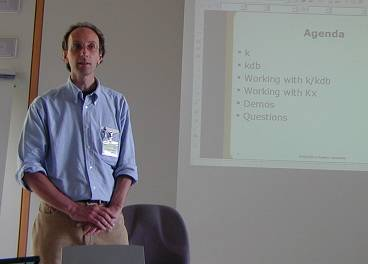
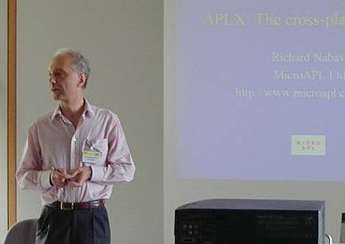

*Adrian Smith*
{ .byline }

## Background

The meeting followed the usual format of a Guide-Share day (joint with IBM), followed by an APL Germany day with the formal AGM and an assortment of speakers. I flew over with Richard Nabavi, which gave us enough time to kill at Heathrow that we very nearly had RainPro running on his APL.68000 box by the time the flight was called. Finding power outlets was a bit like finding carcases in the desert – watch for circling vultures (otherwise known as KPMG consultants) and nip in the moment one unplugged and ran for the gate! Then I had the adventure of finding the Novotel around the back of the Mercedes plant (Richard had reserved earlier and had a more central hotel), and just failed to make it through the door before a most splendid Rhine valley thunderstorm kicked off the evening’s entertainment. Simon Garland met me in the bar, and fed me peanuts until I recovered enough to dry out.

## The Meeting

{ width="368" height="264" } We started with an excellent presentation from Simon Garland on K (the language) and Kdb (the hottest new database product in town).

Simon has sent us some excellent notes of his own, which follow this report, so I will just report some of the key points in his talk, and one or two of the more quotable quotes.

K was first seen at APL93 in Toronto, and Simon first tried it at Credit Suisse. Then it was locked away in UBS for a few years (including a 64-bit version – 10 years on we may finally see it). K is written in ANSI C so it can run anywhere. The philosophy was simple – let the compiler-writers do the tricks. The K source is just 26 pages of C code (with lots of macro explosions) in the style of Roger Hui’s J (see Vector 9.4 page 93 for some examples of this approach).

> “Give it a PC and it will say ‘thank you, I’ll grab it ... ’ – K has sharp elbows”

And the outcome (as Stefano commented recently) is that K is *insanely* fast when faced with data-heavy computations. So how does it do it?

### What is different from APL?

Simon listed many of the key differences, and followers of A+ can see an interesting progression here as Arthur’s thinking has moved forward:

- K has single glyphs (like APL) but uses plain ASCII (like J).
- it runs from scripts, and has no saved workspace.
- data is always mapped, rather than ‘loaded’ into memory. This is rather like having lots of private pagefiles.
- functions can be called with an unlimited number of named arguments. *\[This probably addresses the biggest single deficiency of APL and J as commercial programming tools – and improves on A+ which has a system limit of 9 named arguments. AS\]*
- iteration can be controlled with \{eachleft\} and \{eachright\} as well as the conventional pairwise \{each\} which requires both sides to match up.
- there is an explicit *null* data type, which is very useful when working with databases.
- K makes little use of booleans. There are some utilities for getting indices from temporary ‘monster’ bools.
- K has `lists`, not  `matrices`. Essentially everything is one-dimensional (with no explicit enclose) but if your list is regular, then functions like \{transpose\} do work as you would expect.
- K is very lightweight. The executable is about 5K (of which 4K is the icon) and the DLL is 150K. This allows applications to multi-thread very simply by launching new K tasks which can run synchronously or asynchronously (like Sharp S-tasks and N-tasks)
- K has intrinsic support for Dictionaries (arrays of key-value pairs) which allow indexing by name, and can be organised into trees.

### So where did Kdb come in?

Kdb was ‘invented’ sometime in 1998, more or less by accident. Everybody had written something like it via dictionaries, so it was getting silly. The message went out “Let’s standardise and add some SQL stuff to search it”.

Most customers simply use Kdb as a database, with K as the scripting language! This works superbly, as Kdb is written entirely in K (with no hidden stuff) so extending and customising the supplied tools is totally seamless. Kdb is (of course) column-oriented and is perfect for timeseries where you almost always want to process each column, rather than each record. And, of course, it is all built on mapped files, so even a huge table ‘loads’ really fast.

Some other features that an APL audience might relate to ....

- Kdb is aware of the sort order, so can (for example) do a binary search for names. It also holds timeseries dates as integers to simplify data-related selection.
- Joins are very elegant and fast, as we already have hard indices (pointers to the next table). You can do a 4-way join in a simple one-shot Select statement to chain down a series of reference tables (employee->dept->division->business unit for example).
- Kdb is very scalable. By default tables are folders and columns are files, but big columns can be chunked (by date or A-M, N-Z) and can be spread across machines (which may even be running different operating systems). The sort order can vary within a column, for example old data could be sorted and indexed where today’s transactions are just held ‘cast in order of appearance’ to speed the logging process.

### The K development experience

“Gui – either you write your own or you decide early on to forget it. K just decided to do without, so here we are on the DOS box ...”.

*... OR*, of course you write your own IDE, and plenty of people have done just that. Actually any editor which supports syntax colouring will do the job, and you can use a range of change-control tools as all your scripts are just simple text files. Charlie Skelton ([c.skelton@skelton.de](mailto:c.skelton@skelton.de)) has a very nice IDE which he can show us running a complex query on some 20M records (in around 0.2 sec).

### For more information

Talk to *First Derivative* who are selling and supporting Kdb in Europe, watch the newsgroups at [kx.com](http://www.kx.com)  or mail me at [simon@kx.com](mailto:simon@kx.com).

## The Rest of the Meeting

{ width="388" height="274" } **Richard Nabavi** followed with a demonstration of the latest incarnation of APL.68000 (now APLX) and showed one or two new capabilities from the beta of the next release.

Again, he has chosen the route of launching lightweight tasks to handle threading, and he showed how you can have multiple sessions open on the same workspace, which can synchronise under program control.

In fact, this seems a really nice usability feature for the developer. It allows you (for example) to keep a few test lines sitting in session-a ready for repeated execution while you fool around in session-b getting the code to work. I have lost count of the number of times I have had to scroll miles back up my Dyalog or +Win session to grab my ‘test piece’ so I can re-execute it.

**Adrian Smith** did a pretty straight rerun of the talk on .Net and APLScript from Finland. As yet, no-one really cares much about this stuff, but they will get the message just as soon as the IT bosses issue the “if it’s not managed code, get it off my machines” decree. Ironic really, as APL applications have been managed code from APL\\360 onwards.

**Nancy Wheeler** told us a lot of interesting stuff about `⎕ATR` for sharing data between APLs or with external applications. Unfortunately, my notes run out about this point, and it is much too long since I used APL2 for me to make sense of what I have. I guess that any self-respecting APL2 shop already knows it all anyway, so I will take the safe option and leave it there. Sorry.

## Summary

A well-organised meeting in an excellent venue. Thanks to APL Germany for the invitation and to IBM Ehningen for hosting the meeting.

***
