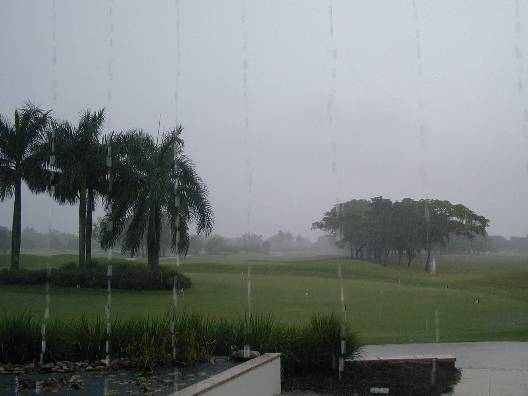
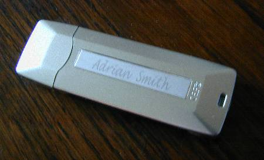
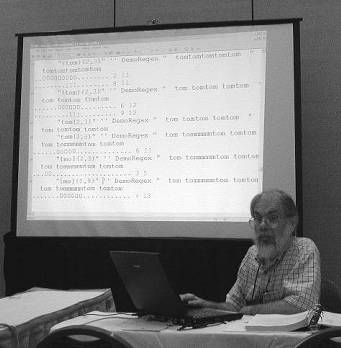
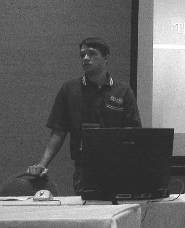
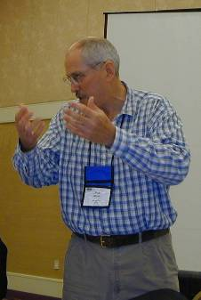
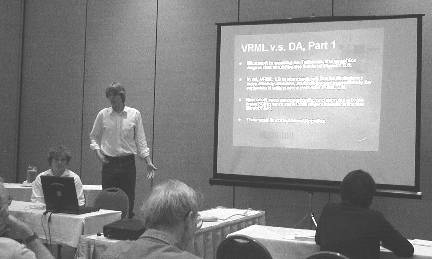

*reported by Adrian Smith*
{ .byline }

## Location (see last year) and General Impressions

Really, I should just refer readers back to the January 2002 edition of Vector. This time, Causeway did take advantage of a Virgin Atlantic 7-day golfing holiday which flew into Miami just in time to let us clear customs, get to the Dollar car-rental desk and drive over. The weather in Miami was pretty horrid (mid 80's, relative humidity 110%, steady rain) but it cleared nicely as we drove across Florida, and for the first 4 days, Naples was its usual sunny self. Then the wind shifted on-shore and oh-boy did it rain!

But mostly, it was fair, and getting trapped in the poolside bar by a 2-hour downpour is not such a terrible thing. There were 92 registered attendees (so a slightly smaller gathering than last year) of whom around a dozen were from APL2000. Sunday was a well-attended training day, and there were 2 full days of papers on Monday and Tuesday. Wednesday offered additional training time, although by then many delegates had drifted home. We had an excellent informal reception and meal on Monday (with live entertainment Boogie-style from The Revd Billy Wirtz - I made sure to buy his CD so the family could suffer in sympathy) with the banquet back at the excellent Chinese restaurant which we visited last year.

## Conference Programme - Day-1

### Opening Remarks, from Eric Baelen

Eric opened with the usual excellent pep-talk, focussing on APL's reliability and performance. He noted that the APL components always passed the stringent Cognos pre-release trials, and stressed the excellent statistics you get on comparing the APL+Win webserver technology with IIS.

> "Everything has been said before, but you guys weren't listening!"
>
> What's good about APL? It has a low TCO (Total Cost of Ownership) - competitively priced, and allows a small group to develop systems fast. Look at Vox Proxy! It turned a daft idea from an APL conference into a business reality.
>
> APL has a large sweet-spot. It can take on OLAP problems, detailed calculations, specialised file I/O. You can write scripting tools with it, or create a web service. The performance will typically be 10 times faster than the same apps written in VB.
>
> APLers are smarter, and care more about their users. We spend longer thinking about the problem and we make sure the solution works as well as it can.

Eric also introduced us to the excellent conference freebie - instead of a jacket (shirt, fleece ...) we all got a 128Mb USB Jumpdrive pre-loaded with the proceedings and workspaces. What's more, early registrants all had their name very nicely engraved on the back! This was a far more practical way to deliver the supporting workspace than the usual CD ROM, and many more delegates than usual were able to 'type along' with the presenters as a result. The drives also came in very handy for ad hoc workspace swapping - they were automatically recognised by any laptop with Win2000 or above, and drivers are available for Windows 98 from the APL2000 website if you want to use it on an earlier OS.

### What's New in Version-5 and Version-6, by Michael Steiner

Version 5 has been a year in the making (we all got the pre-beta last year) and it is one of those releases which changes very little on the outside, and quite a lot on the inside. Bill Rutiser has been quietly migrating the 'COMIC' memory management into the production interpreter so that it now grabs and releases memory on demand, rather than allocating a fixed slab of workspace and sitting on all of it regardless. There were lots of other small improvements (mostly session colours and logging options) which you can read about on the APL2000 news page in this Vector.

### Web Services and the Google API from William Parke

I was torn between this paper and the concurrent session from Bill Rutiser on RegExp. In the end I tossed a mental coin and joined the Rutiser stream, so here are a few comments from the author:

> "Regarding my own presentation, unless I misjudged the mostly expressionless faces of my audience, I think most of the attendees were lost or bored midway through the talk. In my defense, it would have flowed more smoothly and made a little more sense if I had had Internet access, but I should have been able to demonstrate all the necessary steps and code anyway. In retrospect, I had prepared too many examples demonstrating different approaches to application implementation *and* tried to touch on them all, in the process failing to explain some of the important basics along the way. The sequence of steps for accessing the Google API is quite simple, but some of the steps themselves are complex. The main aspects needing more emphasis and detail were the general methodologies for manipulating XML directly in APL, although in truth that should be a workshop or two on its own.
>
> Nevertheless I do believe there is some value in the workspaces I included on the conference disk, so anyone who wants to pursue this topic should have enough material to get started. On the other hand, the usefulness of the Google API may be shortlived if Fred Waid's predictions about the search engine in the next version of Windows are fulfilled."

It looks like really useful stuff, and I know how good and solid his utilities normally are (I rely on his JPEG code in RainPro and NewLeaf) so I am betting that there will be some high-value free stuff ready to take away and use. I don't think Google will go out of fashion for a year or two.

### Regular Expression Pattern Matching by Bill Rutiser

{ width="348" height="341" }It is probably best to refer you direct to Bill's notes here. Regular expressions are a little programming language in their own right, and for some very specific search-and-replace operations knowing the right regexp can save you masses of work. The challenge is partly in knowing when you have the right problem, and then finding the regexp to crack it.

Bill left us with all the tools we need to get at a free regexp engine from APL, but I think many in the audience went away wearing slightly puzzled frowns and wondering if they would ever have the courage to use it.

### A Layman's Tour of .Net for APL Developers by Adrian Smith

When I wrote the notes for this paper I was very unsure just what colour of rabbit Fred Waid would be pulling out of his hat immediately afterwards. In fact, we were both doing much the same thing - running the +Win COM server though a .Net facility caller COM InterOp - only he was hiding it better. I was very encouraged how many people came to my talk, and at the level of awareness of the .Net technologies in the +Win community. I think the pressure on APL2000 to 'do it right' (cut out the InterOp step) will be coming from all sorts of directions over the next few months as key users take home the message that this technology is now very imminent and they are going to have to live with it, come what may.

### Tool Talk by Rex Swain \[notes from Bill Parke\]

Rex shared some of his favorite user-command development tools, including: \]filedoc and \]pkgdoc, GUI tools to inspect .sf file components and user command packages; \]notlocal, a tool to identify all workspace functions in which a given variable is used as a global; \]varss and \]fnss, with case-insensitivity, multi-word and whole-word extensions to the original like-named search functions; \]varfind, that searches variables for strings and numbers similar to the way \]wsloc searches functions; \]si, an enhanced display of )si that includes the relevant line of code with each level in the stack; and \]symfind, another GUI tool that examines and displays the symbol tables in every workspace (using your library definitions) and user-command file it can find. Finally he demonstrated \]diff, a cover for a 3rd-party, side-by-side code-comparision utility called Araxis Merge (www.araxis.com/merge/ -- $129 US.) Rex provided his own, personal money-back guarantee that we'd find this tool indespensible.

It's always a treat to listen to one of the masters, and Rex has a relaxed style that is easy to follow. These are all handy tools to have available, and as with most of the workshops, his work serves to spark more new ideas among the audience. He said he usually develops his tools to about 90% functionality, stopping at the point that meets his own needs, but that just means there's room to add whatever custom features we can dream up. No doubt we'll take at least one example and use it as a starting point to create our own next favorite tools.

Bill Parke 21 Nov 2004

### .Net, Managed Code and your Future by Fred Waid

In his talk at Madrid, Fred left us with the feeling that he regarded .net as mostly marketing hype, and not really worth being interested in. To be fair to him, what he was mostly saying was that the Microsoft marketing guys had gone way too far in promoting .net as the future of everything and this needed some serious debunking. Be that as it may, Fred has now firmly fallen in behind the technical stuff in .net (basically the Framework, the Runtime, and the SDK) which is really all that is left, now that Microsoft have virtually abandoned the 'brand' and released *Windows 2003 Server* with no mention of .net in its name.

He ran us through the usual 'Fred' warmup which included some pretty interesting statistics (some 35% of recent hits to the OpenHere website are from clients with the .net runtime installed) and some useful pointers to where the market is headed. Then he showed a simple cover on the +Win COM server, called *APL+ Inter* which effectively automates both the generation of the .net assembly from your APL code, but additionally registers that as a valid COM server itself, and as a bonus uses the tools from the SDK to build a very standard help file for the DLL you constructed. This is a nice mechanisation of the 'fully manual' approach I had showed in the previous session, and I like Fred's syntax of 'triple-comment' as the equivalent of '///' for marking out the meta-data needed to create the help information. I probably won't use all his toolkit here, but I will fall into line with the basic approach.

### The DHTML Object Revisited by Warren Baelen and Andy Weiss (pictured)

{ width="185" height="228" }Now this one looks to have some really useful stuff hidden in there. It is probably best if Warren and Andy write this one up themselves, but my impression was that the DHTML object could be used to create a 'web-style' interface in a stand-alone desktop application. Why do this? Well one reason is that you can allow your user to make radical changes to the look and feel very easily simply by having them edit the CSS style sheet for your interface. Microsoft Money is an application which plays just these games.

One thing I may be investigating very soon is the possibility of making an HTML Edit control which behaves very much like a RichEdit (from the user's perspective). As outlined in Vector 20.2, parsing RTF is a dog of a job, while parsing HTML is very straightforward. For GraPL, I should allow my users to make 'rich' notes for their charts - far better to have them create these in HTML directly, then formats like VML and SVG are 'fall-through' and PDF/EPS are much easier to produce from the marked-up text.

### Plenary Session - APL in MetLife by Bob Shalack and George Weiss

This felt like one of those many APL success stories that it is hard to get excited about. MetLife have 12 marketing executives working on highly tailored personal insurance plans, mostly for the seriously rich who want to move money to the children without it getting taxed. The rules are complex, and change frequently as the government stops up one loophole but leaves another one open. So APL scores highly, for all the reasons Eric gave in his opening session. A small team (basically the two presenters, with George on the nth year of his 3-month contract) can keep the calculations in line with the legislation. It is a low-cost, fast moving, calculation-rich, business-critical application. Right in APL's sweet-spot.

Probably this was not really a full 1-hour presentation - there were rather too many PowerPoint fill-ins and too little real meat. We did glean that they used 2 add-in grids (FarPoint for data input and Formula-1 for reporting) but were looking hard at the native APL2000 grid control, particularly in the light of the change to the deployment rules on Formula-1. Some kind of grid is essential, as Excel is the prime target for all the output from the system.

## Conference Programme - Day-2

### The Plain Vanilla Player from Carl House and Davin Church

From the feedback I heard afterwards, Carl and Davin left the audience feeling a little confused over what they had been shown. I think this was a pity, because Carl has some good ideas and Davin has been working really hard to make them happen. In the end, they probably left the construction of the presentation too late in the day, and a few pieces went missing at the last minute.

Carl's main business is in modelling social and strategic infrastructure for major city developments (often green-field sites like the new capital of Tanzania). The basic problem is very stable (a city is a city) but the detailed requirements for data management are different every time. Carl (like the rest of us) hates writing Windows forms, programming lots of reports, and building multiple HTML tables. "I don't want to write forms - I want specifications for forms".

Which is where Davin comes in. He has been working with Carl on an application called "Phoenix" which can take a data-driven specification and generate input documents, HTML tables, and NewLeaf reports (for printing or mailing as PDF). It uses an MDI interface so that each form handles a single set of data. The user can select from the views which the developer has specified, and it is easy to update on the fly simply by mailing out new view definitions. Davin showed a very nice HTML implementation with a 2-level menu structure organised to fit in with the style of the Microsoft website. Carl has also been making good use of the APLDraw OCX (now generally available with version 5) to watermark photographs for his 'hobby' project of managing a major website of swimming information. Unfortunately many of the best examples didn't make it across to his laptop, so we will have to check them out on the web for ourselves.

### Nationwide Delivery of Pension Plan Valuations from Joe Blaze

For me (and for many others) this talk was the highlight of the conference. Was it a co-incidence that Joe simply sat and talked for an hour with no foils, no jokey videos, no PowerPoint strait jacket? Probably not. He had good material and he delivered it in a simple and logical way. An APL audience appreciates this.

> "I'm actually on a 25-year sabbatical as a maths professor - we had more tenured professors than we had students!"

{ width="226" height="337" }Joe started out with a pension valuation product for 'smaller machines' in the days when all the competition had only expensive timesharing. He was running with 50 employees within 2 years, the vast majority were programmers as the work was very tedious. By comparison, his company today operates with 25 employees, of whom only 5 are programmers, and supports a very much bigger business operation. His main site is in New Jersey, but a group of 5 support folk are based in San Diego to be on west-coast time. Most of the current employees have been with the company for over 20 years.

Joe went on to describe a number of his products, many of which are gradually converting to a web-based model, but which must still be maintained in parallel as stand-alone applications.

1. The Document System. Secure and proper distribution of documents for employee benefit plans. Some of these are required to be filed with the federal government, so the government people also use the system to validate return dates and other critical details on the forms
2. Risk factors for coronary diseases. This system uses a predictive formula to estimate the probability of coronary disease based on various known risk factors. The system is web-based and can be used on the Blaze server, added to the websites of drug companies, doctors and hospitals, or offered by personnel departments in a 'kiosk' at the employees workplace. Individuals can use the model to get a prediction, and companies offer it in the hope of changing employee behaviour. The same system (with a different interface) is available to the underwriters of healthcare cover. They have partial information on the whole of an employee group, so a risk-estimate helps to set the level of premium. Finally, it can be used by employers to contest the group premiums they have been offered!
3. Tax code modelling. This is a classic 'what-if' system used by the IRS to determine the effect on revenues of changes to the tax codes. The same system can be used by pension plan administrators and the plan sponsors.
4. Specialised pension valuation. This system is used in countries where the normal rules fail due to high inflation. Joe commented that these may be very nice countries for his staff to visit, but that this is a very good case for pure web delivery!
5. Very standard (so lots of competition) plan valuation. This was a fine example of using the web to lower the transaction cost for low throughput, and so make the system very competitive for smaller users.

Of the 87 systems that BlazeSSI supports, 20 have more than 1000 users, one has 100,000 users, some have 5 users, and one has 1 user.

Joe made some excellent points on methodology, which I hope I have accurately quoted here:

- Concentrate on systems that have a very large user-base. Smaller systems are hard to make profitable.
- We do a lot more on market research than on systems work (15 people out in the field, 5 back at base).
- We always find out what the customers really want. Never just duplicate what they have.
- Documentation is very lightweight now - just training guides with references to primary sources (actuarial regulations and so on).

Moving from conventional contracts to licensing via the web was a 6-8 month redesign after long discussions with customers. The model changed from an annual fee to a cost per transaction, but Blaze shared the risk by capping the annual charge for the first year to give existing customers a "comfort zone". Often the initial cost did not trip the customer's 'ceiling' making the contracts much easier to negotiate. Sometimes it was possible to reach really tiny outfits who might do only 1-2 transactions per month - they would never have taken on the up-front cost.

Joe pointed out the value of choosing systems that require regular updates. Security is not an issue, as the regulations change every year, so there is no danger of anyone stealing your source code as it goes out of spec very quickly. Blaze take care to mail out descriptions of the updates very early, giving 'sunset' dates for expiring features and systems. They keep the customers informed well ahead of time of new software and hardware requirements (for example "we need you to move to 800 by 600 screens" could be a big issue for a site with 1000 users). Although updates are usually a progressive change, Joe noted that an interface with 200 fields could drift over time to having 5000 fields, and sooner or later you must make a major rebuild. Joe was hopeful that the present monthly mailing of over 3000 CDs would start to come down as more web-applications are deployed.

He made some interesting observations on the Adobe PDF tools. Blaze use Acrobat to add 'fields' to dumb government forms, with a \[Submit\] button to get the completed form sent over the web and hence to have the information captured by an ASP page. They have incorporated some validation into the form fields, but Joe noted that the JavaScript engine inside Acrobat Reader is very poor and it was hard to write good validation code. Someone from the audience commented that after 'upgrading' to Acrobat Distiller 6 their PDF documents had mushroomed in size for no apparent reason. I have been working with Joe over the summer to update Causeway's NewLeaf engine to merge multiple reports into a single PDF (and get the image handling up to speed with JPEGs) so hopefully he will not have this problem, as NewLeaf creates very lean and mean PDFs which run any anything from Reader 2.0 upwards (see *A PDF Primer for APLers*, Vector Vol. 18 No.4 page 77 for the details). Joe noted "The use of .pdf-format output created by NewLeaf from Causeway, and compatible with a broad range of Adobe Acrobat Reader versions, was important in converting systems to the web-services environment" which is nice to know.

The final section of Joe's talk was all about efficient internet delivery, and the value of APL web services. On switching from IIS+VB to IIS+APLWCO certain calculations went from needing 9 servers to just 2 (of which one is just there for backup). The problem with this technology is debugging (you cannot make the server visible in the live environment) and the overhead of loading the workspace for every call. The next stage is a move to web services which already have the workspace loaded and initialised. The welfare plans system dropped from 4 servers (APLWCO) to partial use of one server, and the most heavily loaded system dropped from 21 servers to 2 (each with 5 instances of APL loaded).

### Creating COM Servers with APL+DLL by Andy Weiss

Best to read Andy's own notes on this one. Essentially I saw it as automating what we had done by hand when we built our GraPL COM server. We used Delphi (where Andy uses VB6) and we constructed the property table once (using definitions from RainPro, the clipboard, and some clever Search/Replace in Notepad) and now maintain the Delphi code in parallel. I think that automating the process makes a lot of sense, but it is a pity that no-one did this two years ago! If Causeway's experience (and Joe Blaze's comments) are anything to go by, COM is going rapidly out of fashion as the server folk move to web services or to ASP.net for the applications they are building today. However the principle is fine - use structured comments or definition variables in your workspace to generate source code you can compile. The target language is easy to change, once you have the infrastructure in place.

### Using the New Unicode Controls by Marvin Renich and Colyn Phillips

This one caused some interesting spluttering noises among the delegates! The idea of a text field that takes *integers* - what can they be thinking of? Actually what APL2000 have done here is extremely sensible, and is not at all hard to program for. Moving your APL to a full Unicode environment is a tough call (do you really want 65000 elements in quad-AV?) and strictly unnecessary. Handling input in Greek, Korean, or whatever is essential for many applications, and most of the standard string-handlers (deb and friends) can easily be adapted to work with integer vectors with very little loss of efficiency. As long as you keep your Unicode 'text' as numbers then everything just works as before. Web output is fine (just use the AmpersandHash notation with the decimal values) and I think it works in PDF. I am interested to know how you print it, though. I didn't see anything about the 'DRAW' method taking Unicode characters. I also have the problem of taking Unicode strings in as properties of a COM server, and as the return from Windows calls like GetDateFormat when used in Korean. There is a little way for APL2000 to go here, but this is a hopeful pointer and a very promising start.

### Cryptographic Functions with APL by Warren Baelen

Warren made the mistake of writing this up much too well in the distributed papers. I enjoyed it, understood most of it, and went off to loaf by the beach. If you are interested in the techniques which work well in APL, then read Warren's paper. The sample functions were all included on the conference JumpDrive.

### Version 5 Memory Management by Bill Rutiser

Again, I can only recommend reading Bill's written notes, which are an excellent summary of memory management techniques from the early days of APL to the strategies employed by Version-5 to make the workspace as elastic as the memory in your machine.

### Animated Graphics and APL by Fred Waid IV and Gerald Waid

{ width="432" height="259" }Microsoft have a strange habit of smuggling out really useful tools, either disguised as something else or just plain undocumented. Fred took us through the strange history of VRML (a C-like language for defining 3D worlds) which Microsoft promised to implement as ActiveVRML in IE4 (but never did) which mysteriously showed up as Direct Animation in IE5 and above. APL2000 discovered it as a handy way of implementing a selection of the DRAW method commands in the browser (as exported with JSave) and Fred showed us some of the nice stuff it can do with true 3D animations.

Which all emphasises the question "why is no-one using this stuff?". I suppose that the 'scripted only' interface has a lot to do with it. Web authors expect to be able to write their pages with HTML tags, but to make the DA control do anything you have to generate JavaScript. Having said this, it does have handy features like proximity detection (this object just hit that object, so fire an event) which are just what games authors need. It also looks likely to turn up in yet another disguise as Avalon (the interface layer for Longhorn) so it is well worth being interested in, and you might also be interested in some work Gerald has done to scan old APL listings with OmniPage (this was edged out of the programme due to lack of slots, but we did get the printed material and I reckon it deserves to be more widely known).

## Summary and Wrap-up

Every time I go to one of these events, I have to ask myself "was it a conference or a reunion?". The SigAPL conferences were sliding towards reunion status back in 1995, and the only way to go from there is down, and eventually out. I think that the APL2000 meeting is still OK - most of the people who came were there for the content, not the beer and the beach. It would be good to get more code-heavy papers for next year - looking back through the notes there were depressingly few APL symbols in there, and one reasonably APL-heavy paper had had all the code blocks reduced to bullets. It would also be good to have more talks of the same quality as Joe Blaze gave, and I am sure the training days were good value for those with specific techniques to learn. By this time next year .net will be pervasive (at least on servers) and Longhorn will be imminent. How APL gets to play in this world is going to affect all of us for the next 10 years, maybe 20. I think they should start planning the programme now.

{ width="631" height="317" }

Oh, and if we do come again next year, please can we have Room 41 again! The view from the patio was gorgeous!

***
