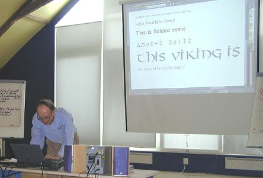
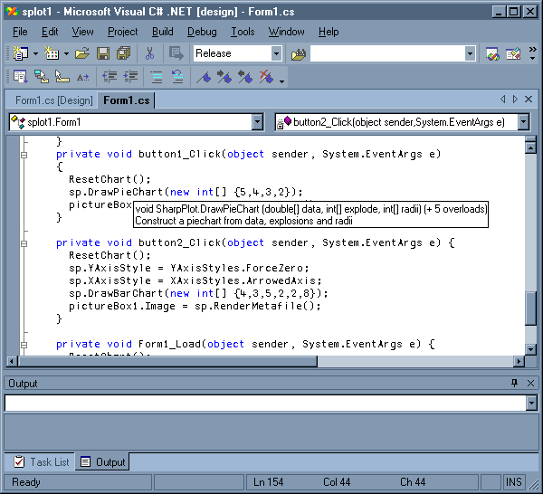

*reported by Adrian Smith (adrian@apl385.com)*
{ .byline }

## Acknowledgements

Thanks again to FinnAPL for setting up a winter seminar in wonderful surroundings. This time the snow was crisp, the air was cold and clear, and I got to go ski-ing on the Baltic.


The content was excellent too. *Morten Kromberg* gave two superb talks on SQAPL and the future of databases with ADO.net. I learned a great deal, much of it of likely commercial value. We were also shown a DVD made from a panel discussion at the 1974 APL conference with Ken, Adin, Larry Breed and others, many with hair and beard in classic 1970s 'programmer' style. *Kimmo Linna* gave an extended example of the use of SQAPL running against MySQL in Finnair, and *Kimmo Kekäläinen* another very thorough application demo, again using database access to get at a huge data-warehouse very efficiently.

My talk was more of a workshop - I thought it would be fun to take a random piece of APL from the last Vector and have a go at compiling it. I think I succeeded in convincing the audience that I am not trying to 'get out of APL' by generating C# from my old RainPro code. The object is to stay with APL as the development tool, but to ship the results as lean, mean, compiled code. With Dyalog 10.2, even APLers might prefer to call it as a .Net library rather than cluttering their application with my namespaces.

On the second day, *Sami Laitinen* showed us a lot of interesting stuff calling Dyalog from Excel (including the use of RainPro, using some tricks which I hadn't seen before), Morten continued with a review of database performance under Dyalog 10 and .net (there are some major beartraps here which can absolutely kill your speed), then we were treated to a major web-application development by Dinosoft, and the meeting closed with a review of *Anssi Seppälä's* work with APL and J in modelling power-supply quality in Finland.

## Day-1 - DVD on the Origins of APL (1974 panel)

I think everyone found this fascinating, and not just because of the haircuts on display. It sent me off searching for the System/360 specification (the single most important piece of APL ever written?) and also to re-read "A Programming Language" to get right back to the roots of the language.

The initial choice of a fixed workspace size was to facilitate swopping and storage allocation for a simple and reliable timesharing operation. Someone on the panel commented "Today even, people are still building APL systems using these techniques" - this was back in the early 1970s, remember. And here we are running Dyalog APL (or APL2000) under Windows XP which has excellent memory management, and still we see WS FULL messages. Unpicking old design strategies does take a remarkably long time.

I hope the BAA can make this excellent historical document available on the web in some way. I was rather expecting a tacky video with blurred pictures and fuzzy sound, but not at all. This was done in a proper studio on real film, with a professional chairman who moved the discussion along in just the right way. Highly recommended viewing.

## Morten Kromberg on SQAPL Version 5

SQAPL is one of those products that just refuses to die. It was devised in the days when getting at databases was really hard, and for a while "middleware" was a killer concept which insulated applications from the nitty-gritty of data storage. SQAPL dates from this time, and much of the original 1983 code is still around. Time has moved on, and for the world of 'real programmers' Microsoft have more or less killed off the market by providing ODBC, ADO and now ADO.net which all purport to make the bridge between data-provider and application.

So why is SQAPL still crucial to so many major commercial APL systems? Looking at Morten's examples (some of which follow in the report of his second talk) the answer is a mix of 'ease of use' and speed. I suppose inertia has something to do with it too, but if I had got used to the comfort of SQAPL, I would really hate to learn all the new tricks that you need to make ADO work for you as fast and reliably as SQAPL does.

### New features in SQAPL version 5

SQAPL has been modified to work well with ODBC 3.51 and now goes directly to the drivers, improving speed and reliability. Errors are better trapped, and the reliance on INI files or registry settings is removed, making installation trivial.

One of the most appreciated updates is the 'columnwise' option - formerly SQAPL would return the result of a query as a matrix, so 10,000 rows of 2 columns (say 'Name' and 'Age') would make a very large nested structure in memory. Now it simply makes a 2-element vector, each part having a uniform 10,000-element array. The only puzzling thing here is that it still insists on padding strings out to the column width, which seems a huge waste of time and space, as I guess the first thing most APLers would do is strip the unwanted blanks! I think a further option may be added very soon to prevent this.

Anyway, it was running at around 160K records per second on Morten's laptop, which feels fast enough for all practical purposes. Part of the speed-up is due to a bug fix - version 3 accidentally limited maxrows to 50 even if you explicitly set a much bigger number. This fix alone could be worth a factor of 10 on a fast machine with plenty of memory. Here are some more highlights:

- Many databases support a 'read-only' connection, which is an excellent precaution for analytical software, and often yields another small speed-up.
- Exceptions are now trapped, which stops Dyalog dying with Syserror 999. Morten was very clear that the application should NOT trap around these errors - you should always let the application fail, close the database connection and restart from cold.
- SQAPL has also added a new Julian date format "J#2" which faithfully reproduces the Excel bug and regards 29th Feb 1900 as a perfectly reasonable date. This brings the retrieved dates into line with dates read (for example) from Excel worksheeets.
- The syntax for setting up 'bind variables' has been made more programmer-friendly, as you can now construct a 7-column matrix with all the required information and pass this in a single call.
- If you pass a list of commands for multiple execution, you can now stop on the first error, rather than running them all and then checking the flags. But ... MySQL ignores this setting so SQAPL can make use of a fallback setting ('Loop' 0) which stops the driver looping and iterates in SQAPL instead. The extra time taken is trivial.

There were plenty of minor improvements, many are really workarounds for the increasingly popular MySQL database where the ODBC drivers are distinctly flaky. All told, this looks like a very welcome step forward, and from the warm applause at the end, Morten (and of course Bjørn Christensen who has done the hard work in C) had answered a good many prayers from existing users.

## Adrian Smith on Updates to RainPro and NewLeaf



This was shoe-horned into the programme, to save time answering lots of questions in the sauna afterwards.

*RainPro* has gained horizontal boxplots, spanned X-axis labels and infinitely variable tick-mark lengths. Thresholds can be set so that only ticks above a certain length trigger gridlines. This should make summary timeseries (Years, Quarters, Months) very easy to program and label. Currently, some of this code is only in the SharpPlot workspace, but it will all be back-fitted to RainPro for Dyalog and APL+Win.

*NewLeaf* has gained the ability to embed TrueType fonts in PDFs. Of course you may not always want to embed a font like Verdana, just have it show up in the document if it is available on the user's machine and fall back nicely if not. Thanks to Joe Blaze (who chased me around Naples until I ran out of pillars to hide behind) I finally faced up to reading the (intentionally obscure) Adobe manuals and spending a few days growling at Acrobat Reader's complete lack of debug help. Anyway, it all works nicely now (see screenshot above) and if anyone really really wants PostScript fonts as well as TrueType, I know how to do that too.

## Adrian Smith on APL to C# Conversion

Why has Causeway invested the best part of 2 man years ignoring everything Dyalog are offering and writing their own toolkit to save RainPro as a true .Net component (see www.sharpplot.com for the result)? Basically because we want a product that ticks ALL the right Microsoft boxes, and shipping a charting component with a 2Mb 'unmanaged' APL engine stuck to its rear-end makes no sense at all. Could we have simply re-written it in C# in that time? Maybe, but then it would have become detached from its (much valued) APL user-base and would very likely freeze at that point.

Is this technology likely to be useful to anyone else? Well, here are some ideas:

- **Legacy applications.** "Recode or die" is often the message. Now you can at least mechanise (I would never claim automate) the recoding process. Redo the Gui in raw C#, convert the guts of the system from the original APL.
- **Bottleneck functions.** Sometimes you just can't escape iteration. Simulation is typical, genetic algorithms would be another example. Now you can compile these, and (with Dyalog 10.1) just use them as if they were a normal namespace. Factors of around 20 seem readily achievable. Following on from Morten's 2nd talk, I think I should add 'database calls' to this list!
- **Memory hogs.** If you want to stay in a 20M workspace most of the time, but just have to access a huge array once in a while, kick it out into C# and let Windows do the garbage-collection.
- **All-new APL libraries.** Suppose you have a great little utility-set for actuarial work or logistics, or whatever. You are never going to sell this with a runtime Dyalog attached, but if it weighs in at 200K as a single DLL, you have a very good chance. As a bonus, you get all the right XML stuff generated from a few additional APL header comments, so all the hints and tips in Visual Studio work as they should.
- **Gui stuff.** I have a wild dream that come Longhorn and XAML, I am going to be able to compile CPro dialogue definitions and convert whole applications, not just libraries. Please don't place any bets on this!

### Ticking all the right boxes

One of the (many) good things about the .Net environment is that most of the tools are either free (like the Microsoft compilers, and the *SharpDevelop* visual development workbench) or quite affordable (like Microsoft Visual C#). It is also really easy to integrate new components into any of these tools, using some easily generated XML.

The examples which follow come from [SharpPlot](http://www.sharpplot.com) and were automatically generated by the code-conversion process, but there is no reason why you should not hand-author these XML files to accompany libraries created with APLScript and John Daintree's compiler. It is all very simple stuff.

Here is a simple example, showing a tooltip which appears in Visual C# when you mouse-over any of the major function names:



This is a trivial Gui application with two buttons to draw a piechart and a barchart. As an aside, this would be a really useful addition to Dyalog 10.2. Add a new control-structure such as `:Summary` and have this show as the tip for any function - much more use than trying to show the whole function in one tip!

Anyway, where did that fragment of informative text come from, and how did it make it from the APL original into the Visual C# documentation? We start with a simple 'special comment' in the original APL:

```
 DrawPieChart arg;DATA;data;explode;radii
⍝ Constructs a piechart from an array of data values
⍝⍝s Construct a piechart from data, explosions and radii
```

My convention is that the `⍝⍝s` entry offers a simple one-line summary of the function. Many of these have been created from the existing 'first comment' line in the old RainPro code. In addition you can have lots of `⍝⍝r` lines which are 'remarks' and also build into the XML. They are used by tools such as NDoc which will give you a first-cut CHM-style help file from the XML output.

The XML file which accompanies the SharpPlot DLL gets a section like:

```
   <member name="M:Causeway.SharpPlot.DrawPieChart
          (System.Double[],System.Int32[],System.Int32[])">
    <summary>
     Construct a piechart from data, explosions and radii
    </summary>
   </member>
```

There is a similar section for each overload (variation in argument type) of each public method in the library. Enumerations (defined lists of allowed values) are documented in just the same way, for example if I wave the mouse over:

```
sp.YAxisStyle = YAxisStyles.ForceZero;
sp.XAxisStyle = XAxisStyles.ArrowedAxis;
```

... then I get a short description telling me what the option means. This comes from another block of XML:

```
    <member name="F:Causeway.YAxisStyles.ArrowedAxis">
     <summary>Arrowed axis</summary>
    </member>
```

... which doesn't add a lot in this case, as I haven't been through all the styles yet, adding extra text. As far as Dyalog is concerned, an enumeration is simply a namespace containing a bunch of integers:

```
      #.YAxisStyles.ArrowedAxis
16
```

Until we have some way of documenting variables (an extension to `⎕AT` maybe) I just have a 'special' variable in the namespace called `#.YAxisStyles.⍙fields` to give a one-line summary for each variable, and then reformat this as XML.

### Code-conversion workshop

We know that the engine can convert 'Adrian code' rather well. Just for a bit of fun, let's take a typical piece of legacy code and have a go at converting that - we will learn more that way. The Monty Hall simulator from the most recent Vector makes an excellent starting point, and illustrates very well the sort of problems you are likely to meet. Often, they are not at all what you expect!

Here is the original code - give it a quick look and try to guess where the trip-wires are.

```
     ∇ CARS←N GOATDOOR C;⎕IO;DOORS;PICK;GOAT;NG
[1]   ⍝ Let's make a deal!  We can choose 1 of 3 doors: 1 hides a car,
[2]   ⍝ 2 hide goats.  We pick one but Monty gives us a chance to re-choose
[3]   ⍝ after he opens one of the remaining 2 doors to reveal a goat.
[4]   ⍝ How many cars do we get by
[5]   ⍝ C: 0←→keeping 1st choice, 1←→changing to other door?
[6]   ⍝ N: number of trials.
[7]    ⎕IO←1 ⋄ CARS←0
[8]
[9]   L_MAKEADEAL:DOORS←(?3)⌽0 0 1        ⍝ Randomize choices: 1=car
[10]   PICK←(?3)⌽0 0 1                    ⍝ We pick a door: 1 is choice
[11]   NG←0+.=GOAT←DOORS∨PICK             ⍝ Number of unpicked goat doors
[12]   GOAT[((~GOAT)/1 2 3)[?NG]]←NG≠1    ⍝ Show a goat at random (=0)
[13]   DOORS←GOAT/DOORS ⋄ PICK←GOAT/PICK  ⍝ Eliminate the shown door
[14]   PICK←C≠PICK                        ⍝ Change pick or don't
[15]   CARS←CARS+PICK/DOORS               ⍝ Add car if we got it
[16]   →(×N←N-1)⍴L_MAKEADEAL
     ∇
```

Here are a few things that the audience suggested as potential problems:

- The inner product on line 11
- The embedded assignments on lines 11 and 12
- The use of labels and the dreaded 'goto' on lines 9 and 16

In fact, these are all quite innocent! To get this into shape as a library call, I need to do some routine housekeeping, then let's just let the convertor rip and see what dies! Two additional comment lines are essential:

```
⍝:Public
⍝: int N,C,CARS
```

These make sure the function is declared public (private is always the default) and determine the data-types of the arguments and result. All other data types can be deduced from context. Also I removed the Index-origin setting (our engine is 1-origin without the option) giving:

```
CARS←0
```

Now let's give it a try and see what errors we get back:

```
      qq←try 'GOATDOOR'
 TYPES - (int[],int[]) not supported by AE.Or at #.GOATDOOR[11]
 TYPE CLASH - int[]  bool[] at #.GOATDOOR[14]
 TYPE CLASH - int  int[] at #.GOATDOOR[15]
```

Three errors is a pretty good start, so now we can take this apart to see what is causing the trouble. We can have a look at the generated C# source (stored in `qq`) in a moment. We are clearly trying to do a boolean OR on line 11 between variables `DOORS` and `PICK` - but surely these are already logical vectors?

Unfortunately not - as I explained in the last Vector I really cannot assume that a constant vector like `1 0 0` is always boolean. There are two ways to fix this one:

1. declare another variable such as `bool[] mask` and assign `1 0 0` to this. If I know the type of the name to the left of an assignment, I will do my best to format constants correctly!
2. use a couple of global variables `true` and `false` in place of `1` and `0`

I chose the second approach here, as it preserves more of the spirit of the original, so three lines are modified:

```
L_MAKEADEAL:DOORS←(?3)⌽false false true
 PICK←(?3)⌽false false true
 NG←false+.=GOAT←DOORS∨PICK
```

The last change is really for style only - there is no problem with the integer scalar and boolean array here!

So what can be wrong with this:

```
CARS←CARS+PICK/DOORS
```

It looks innocent enough, but we APLers have got far too tolerant of singletons behaving like scalars. The one thing you must not do when writing code in a conventional language is change the datatype of a local variable. Here, `CARS` is a scalar integer, and the result of the compression is a 1-element array, so adding a scalar to an array yields an array and the assignment to a scalar fails. The solution is obvious:

```
CARS←CARS+↑PICK/DOORS
```

... and now we seem to have a fully functional C# conversion:

```
public int GOATDOOR(int N,int C)
{
  int CARS;  // Result
  bool[] DOORS,PICK,GOAT;
  int    NG;

  CARS = 0;
 L_MAKEADEAL: DOORS = AE.Rotate(AE.Roll(3),new bool[]{false,false,true});
  PICK = AE.Rotate(AE.Roll(3),new bool[]{false,false,true});
  NG = PlusDotEQ(false,GOAT = AE.Or(DOORS,PICK));
  GOAT[AE.Compress(AE.Not(GOAT),new int[] {1,2,3})[AE.Roll(NG)-1]-1] = NG != 1;
  DOORS = AE.Compress(GOAT,DOORS);
  PICK = AE.Compress(GOAT,PICK);
  PICK = AE.NE(C,PICK);
  CARS = AE.Plus(CARS,AE.First(AE.Compress(PICK,DOORS)));
  if (AE.Signum(N = N - 1)) goto L_MAKEADEAL;
  return CARS;
}

int PlusDotEQ(bool larg, bool[] rarg) // Inner product
{
  return AE.PlusReduce(AE.EQ(larg,rarg));
}
```

The converter preserves all the trailing comments - I have stripped them here to save space. Notice that all the local variables (`DOORS` etc.) have been declared for us, and that the inner product has been in-lined as a reduction. The other thing I really like about this conversion strategy is that it preserves the structure of the original, so if you do get an error in the compiled code, the .Net debugger takes you to a line of C# which you can immediately track back to the original line of APL. Anyway, let's add a couple of lines to time it and throw this at the MS compiler and see what happens:

```
⎕←'Started ',(⍕⎕TS),' for ',(⍕N),' iterations'
........
⎕←'Ended   ',⍕⎕TS
```

```
D:\Tools\aplc>cs bench
bench.cs(120,9): error CS0029: Cannot implicitly convert type 'int' to 'bool'
```

This is complaining about our test on the penultimate line:

```
if (AE.Signum(N = N - 1)) ...
```

Again, APL is being horribly tolerant here, and I would say that this line is really a bug in the original! It would be far better coded as:

```
→(0<N←N-1)⍴L_MAKEADEAL
```

... so change it to this and regenerate the C# version:

```
if (0 < (N = N - 1)) goto L_MAKEADEAL;
```

Now it works, so time for a little test:

```
Console.WriteLine("No switch was " + test.GoatDoor(150000,0));
Console.WriteLine("Switched was  " + test.GoatDoor(150000,1));

Started 2005 4 24 11 36 56 622 for 150000 iterations
Ended   2005 4 24 11 36 57 643
No switch was 49980
Started 2005 4 24 11 36 57 653 for 150000 iterations
Ended   2005 4 24 11 36 58 635
Switched was  100189
```

The numbers look very plausible, and it seems to be running at somewhere near 150,000 iterations in a second. Just for interest, let's try the converted APL original with the same numbers:

```
     150000 GoatDoor 0
Started 2005 4 24 11 41 7 0 for 150000 iterations
Ended   2005 4 24 11 41 30 0
49985
          150000 GoatDoor 1
Started 2005 4 24 11 41 35 0 for 150000 iterations
Ended   2005 4 24 11 41 57 0
100231
```

Different answer (just as well, really) at about 23sec for each run. This is probably fairly typical of the speedup you should expect on simple scalar code. For carefully hand-crafted APL code which really exploits arrays, the chances are it will run at almost exactly the same speed when compiled. In fact it could run slower, as I am sure there are places where John Scholes' array primitives are much cleverer than Causeway's!

That hardly does more than scratch the surface of this technology, but maybe it does enough to make you look hard at your own APL code and wonder if there are some benefits in this approach. Questions and discussion can follow over a beer in the usual way.

## Day-2: Morten Kromberg on Database Performance

Morten is writing this up for the next Vector, so I will just add a few comments here and leave him to complete it. Here is one good reason for using SQAPL for a few more years:

### Prepare call in SQAPL

```
r"⍙SQAPL 'Prepare' (CursorName Statement [BindInfo])
```

### Prepare call with ADO.Net

```
 (Expression PARAMS)←#.SQA.Parse z
 CMD←OleDbCommand.New Expression Connection
 Types←OleDbType.(VarChar Integer Double DBTimeStamp)
 PARAMS[;3]←Types[1 2 3 10⍳PARAMS[;3]]
 z←CMD.Parameters.Add¨{(⊂,'?'),⍵[1],(200=⍵[1].value__)/⍵[2]}¨↓PARAMS[;3 5] ⍝ Name Type Size
 CMD.PARAMS←CMD.Parameters.(Item¨¯1+⍳Count)

 CMD.Prepare
```

Enough said, I think. I really have no idea what is going on in the second example, and I don't think I want to know. However even if you do master the magic words to make ADO work for you, there is a big efficiency problem when you start to query data and get the results back into a Dyalog workspace:

```
      ⎕←z1←3 1⊃#.SQA.Do 'C1' 'select * from speedtest where c1<11'
000000000000000000000000000001  1 1.11  1900-01-02 00:00:00.000
000000000000000000000000000002  2 2.22  1900-01-03 00:00:00.000
000000000000000000000000000003  3 3.1   1900-01-04 00:00:00.000
...

      ⎕←z2←3 1⊃#.ADONet.Do C2 'select * from speedtest where c1<11'
000000000000000000000000000001  1 1.11  02-01-1900 00:00:00
000000000000000000000000000002  2 2.22  03-01-1900 00:00:00
000000000000000000000000000003  3 3.1   04-01-1900 00:00:00
...

     ⍴¨z1 z2
 10 4  10 4
     ⎕size¨'z1' 'z2'
1420  10460
```

Two apparently identical queries, but the result from SQAPL takes 1420 bytes where the result from ADONet takes 10460 bytes! On digging a little further:

```
       ⍴¨z1[;4]
23  23  23  23  23  23  23  23  23  23
       ⍴¨z2[;4]
       {⊃2⊃⎕VFI 4↑⍵}¨z1[;4]
1900 1900 1900 1900 1900 1900 1900 1900 1900 1900
       z2[;4].Year
1900 1900 1900 1900 1900 1900 1900 1900 1900 1900
       z2[1;4].PropList
  MinValue  MaxValue  Date  Day  DayOfWeek  DayOfYear  Hour  Millisecond  Minute  Month  Now  UtcNow  Second  Ticks  TimeOfDay  Today  Year
       z2[;4].ToOADate
3 4 5 6 7 8 9 10 11 12
```

This is one of those "oh no" moments. Because ADONet is returning dates as C# objects (very sensible if you are a C# or VB programmer) Dyalog is converting each individual date into a namespace. So if you query 10,000 rows from a table which happens to contain dates, you get 10,000 new namespaces. This (a) fills your workspace and (b) takes forever to run.

The solution - I think I will let Morten tell it in his own words in the next unmissable instalment. See Vector 21.3 which will be following along very soon.

## Dinosoft Oy and Dyalog APL with .Net

Now these guys are doing something really good with Dyalog APL and webservices. For all I said about delivery, if you are running your APL server-side then none of the issues apply, and the native Dyalog method is fine. They have been having some great fun with the SVG gradients and using RainPro in a server-side analysis tool to make some really pretty graphics for display in the browser.

Well, I was impressed!

## Summary

This was the 9th Forest Seminar, and FinnAPL are beginning to wonder if it is time for a change. If they choose not to repeat it again next year, at least we went out on a high note. If they do run another one, they will have to work hard to match the venue and the weather.

  
Ski trails into the Sunrise (Erkki Juvonnen)

***
