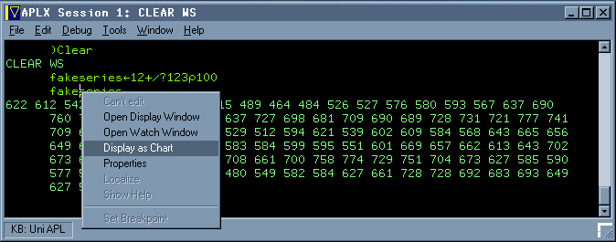
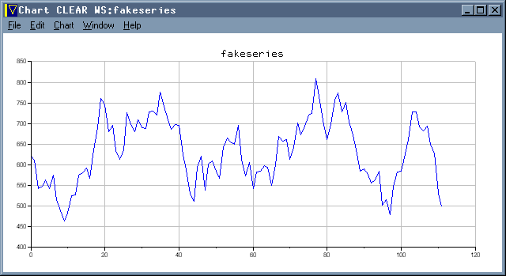
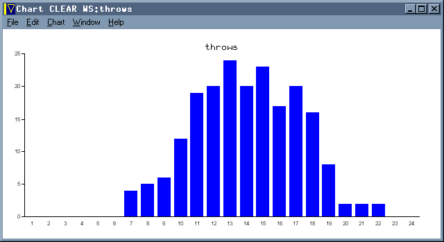
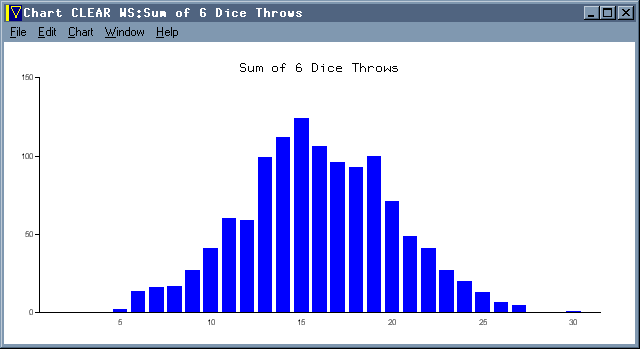
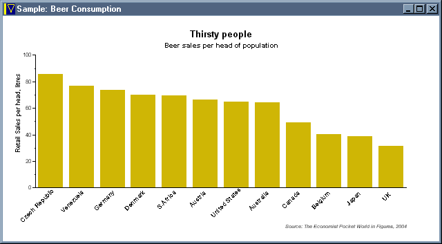
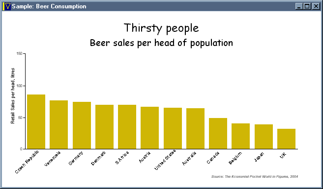
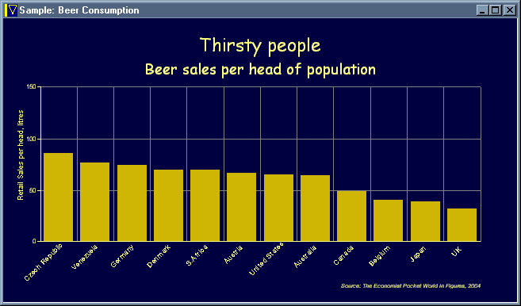

first impressions by Adrian Smith (adrian@apl385.com)
{ .byline }

## Just Show the Data!

APL is often described as a super-powerful pocket calculator. Great for fooling with numbers, but missing one key ingredient – visualising the numbers once you made them. Only A+ (in the Unix build) comes with this charting capability as a native part of the interpreter – until today that is. Now MicroAPL have added `⎕CHART` as a system function, and “Display as Chart” to the right-mouse menu which shows up on any (numeric) array.



Let’s play with numbers ...
{ .caption }

The nice thing about this is that it requires exactly zero programming effort to get a perfectly adequate visualisation of the result. Let go of the mouse, and up pops a new window ...



Looks pretty convincing to me!
{ .caption }

If all you want is some test data for a sales-forecasting system, then away you go. Seriously, this is very well done indeed – the scales are nicely auto-ranged and the tick-mark intervals take good default values. Basically, this just works ‘out of the box’ so let’s see what else it can do! How about some simple statistics ...

```
      fourdice←?200 4⍴6
      throws←+/(⍳24)∘.=+/fourdice
```



Throw 4 dice 200 times for a nice Normal curve!
{ .caption }

Did someone mention the possibility of using APL in schools? Maybe this is just the missing ingredient that we need. It is certainly a major selling point for J, and puts APL back on a level field with Excel and all those fancy Casio calculators that you can’t take into exams these days.

Quibbles? Well the second thing I tried (as you do) was to regenerate my fake series with some new numbers with the chart window still open. I know that in A+ the chart always watches the variable automatically (Sasha showed some splendid animations last time he talked to the FinnAPL meeting) and I rather expected this to work in the same way. But it doesn’t – so please can we have a ‘Refresh’ option so I can fool in the session and see the results without having to open lots of new windows? Maybe a few more options (for example to force the Y-scale through zero) could creep into the drop-down menu on the chart window? I realise that there is a lot more power available in the `⎕CHART` system function, but it would be good if just a little more of this was accessible here.

To summarise – if I had had this capability in any of the mainstream APLs I have worked in over the years, I would have definitely done my job better. It would have saved time and eyestrain looking for outliers in sales forecasts (at Rowntrees in my mainframe era), and given me just the tool I needed to tune Causeway in the days when we Dyalog programmers still cared about speed.

## Deeper into `⎕CHART`

The right-mouse capability is great, but (obviously) severely limited in what it can do. If you need to use charts in a real application then there is a much more comprehensive interface available to you. For starters:

```
       sixdice←?1200 6⍴6
       throws←+/(5↓⍳36)∘.=+/sixdice
      'type=bar' 'title=Sum of 6 Dice Throws' ⎕Chart throws
```



Throw 6 dice 1200 times for a very nice Normal curve!
{ .caption }

Essentially, you can drive any of the menu options with a simple keyword interface, provided as the left argument to `⎕CHART`. This is a nice way of short-circuiting the pull-down menus (and adding a few extra tweaks like titles and legends) but for real power I am afraid you have to open up the help file and explore the properties and methods of the chart object. Here is one of the examples from the supplied demo workspace:

```
 Chart_Beer;labels
⍝ Sample bar chart
 'Beer' ⎕WI 'Create' 'Window'('title' 'Sample: Beer Consumption')('visible' 3)
 'Beer.Chart' ⎕WI 'New' 'Chart'('align' ¯1)('type' 'bar')
 'Beer.Chart' ⎕WI 'title' 'Thirsty people'
 'Beer.Chart' ⎕WI 'subtitle' 'Beer sales per head of population'
 'Beer.Chart' ⎕WI 'note' 'Source: The Economist Pocket World in Figures, 2004'
 'Beer.Chart' ⎕WI 'yaxislabel' 'Retail Sales per head, litres'
 'Beer.Chart.s1' ⎕WI 'new' 'series'('color' 374479)
 'Beer.Chart.s1' ⎕WI 'values' 85.8 76.7 73.9 69.9 69.7 66.6 64.7 64.5 49 40.2 38.6 31.7
 labels←'Czech Republic' 'Venezuela' 'Germany' 'Denmark' 'S.Africa'
 labels←labels,'Austria' 'United States' 'Australia' 'Canada' 'Belgium' 'Japan' 'UK'
 'Beer.Chart' ⎕WI 'xlabels' labels
```



Beer Sales with Custom Colours and Text
{ .caption }

So far, so good. Now for a few little challenges. Can I change the Y-axis range to run from 0 to 150, for example? A quick dig in the help file gives me a very APL syntax for this – rather than setting the Y-range (and having APL figure out the tickmarks) I simply provide a vector of tick-mark positions directly:

```
'Beer.Chart' ⎕WI 'ymajorticks' (0 50 100 150)
```

... and let's have a less ugly title font while we are about it:

```
'Beer.Chart' ⎕WI 'fonttitle' 'Comic Sans MS' 0.1
```

The font size is given as a fraction of the window width, so that it resizes nicely as the chart is scaled. This time things do change ‘as you type’ so it is easy to play around in the session until the chart looks OK, then copy and paste the statements into a function to preserve it for posterity.



Beer Sales with Y-tickmarks and Heading Font
{ .caption }

Styles can be set with a collection of flags, for example to add some gridlines:

```
'Beer.Chart' ⎕WI 'style' (2+8)
```

Colours can be set for many of the individual chart elements, such as the background and gridlines:

```
'Beer.Chart' ⎕WI 'color'(255 255 128 0 0 64)
'Beer.Chart' ⎕WI 'colorgrid'(128 128 128)
```

This gives us a very nice dark blue background, with yellow text (and axes) but with the gridlines specifically set to mid-grey:



Beer Sales with a more restful colour scheme
{ .caption }

I think there is enough here to satisfy most reasonable graphics needs, and the functionality is a good compromise between power and usability. It is also (of course) very fast and copes with arrays of up to a million points with no trouble at all. If you really run out of options, MicroAPL have thoughtfully provided the ultimate ‘power user’ option of setting the Draw method scale to 7 (which uses the chart axes) and simply adding arbitrary artwork to any existing chart object.

## Summary

I think that this is a really worthwhile addition to the APL environment. If APL\*PLUS/PC had offered something similar back in 1989, I would probably never have gotten around to writing *RainPro*. Of course there are plenty of things RainPro can do that `⎕CHART` probably never will, but there is also a much longer learning curve to ascend before you really feel that you have the software completely under your control. I think I would like a few more styles (e.g. for legend positioning) and I could use a few extras like custom dash-repeats, but these can come along later without wrecking the basic simplicity of the interface.

Dyalog and APL2000 and APL2 please copy!
