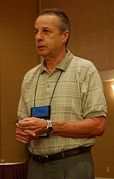
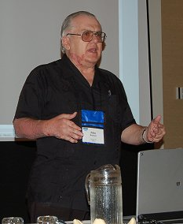
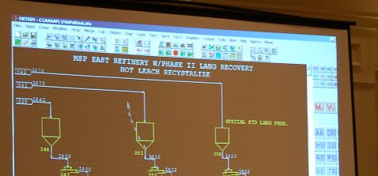

*reported by Adrian Smith (adrian@apl385.com)*
{ .byline }

{ width="791" height="433" }

## Location

A little knocked about by the passage of Wilma two weeks before, but the beach was still there and the hotel was remarkably unscathed. Lots of palm fronds all over the minor roads, and the practice netting on the driving range well-shredded, but apart from that, Naples was its usual welcoming self. We had good weather right through, with the temperature in the mid 80s, but a cooling breeze and clear air. Venus was spectacular in the sky after sunset, and on two evenings we got to see Mercury setting over the sea. For those who missed it, you can always get a replay at [Causeway’s old Starmap server](http://starmap.causeway.co.uk/starmap.sky?place=Other&lat=20+0+North&long=90+0+West&date=2005%2F11%2F8&time=6+00+pm&dst=0&unit=Dys&show=S&show=P) if you want to exercise some 1974 APL code one more time!

## Conference Highlights

In no particular order (personal choice, of course) ...

- [METSIM](#metsim). This was the very last talk on the “All APLs” day – it was unscheduled and unprepared and frankly magnificent. John Bartlett is a chemical engineer of genius who has single-handledly cornered the world market in simulating mining projects. It is all written in APL, and (the key) it relies heavily on the ability to model anything from bacteria in ore heaps to massive underwater dredges with simple APL expressions entered by the model builder. Wonderful stuff.
- [Bill Rutiser on Try/Catch](#try). Bill takes time to think things through, and what he implements tends to work ‘right out of the box’ every time. This looks good and solid and useful.
- [DNA and APL](#dna). Charles Brenner is making a name for himself as an expert witness in all sorts of exotic paternity cases, identification challenges, and so on. This was a superb introduction to a tough topic, and the software he uses is in APL+DOS and works just fine.

Just for the record, there were 75 non-APL2000 delegates to the main conference and over 40 stayed around for the all APLs day. The theme colour was blue, and the shirts were fine cotton turtle-necks. The Conference CD included many of the presentations, the latest beta of APL+Win and sample workspaces to accompany Bill’s two talks.

## Day-1 Monday November 7th

### Welcome and Introduction *Eric Baelen and Joe Blaze*

Eric started by noticing the existence of the new Kids Programming Language from Microsoft, and wondered if we should call our favourite the Adult Programming Language? Probably a great way to get banned from the internet! He handed over to Joe Blaze (now president of APL2000) who gave us a quick run-down on the new company structure. APLNow LLC was formed as a legal entity to receive the assets of APL2000 from Cognos. It is now an employee-owned company with ownership shared between many of the familiar names from previous conferences. Eric will be on the board of directors, and Joe thanked him for his help in facilitating the new setup.

> “As an employee-owned company with each person having a really solid stake, we are able to be a lot more responsive to our customers’ needs”

### Kermit the Frog *Jon Capps of DataReference*

OK, the frogs came at the end (I have one to prove it) but you can guess what this talk will be remembered by! Jon’s company does data migrations, typically getting data off old AS400 systems onto .Net servers. FINAC is an APL shop with a very flexible ‘pull it here, push it there’ application for moving data between databases fast and reliably. Jon has simply wrapped this as an ‘appliance’ which has an LED panel on the front (to set the network address) and apart from that is entirely configurable over the intranet. Installation – slot into rack, set address, forget. Apparently the first prototype was bright green (hence the frogs) but the shipping build is a tasteful matt white. John was actively looking for more systems which it would be good to deliver in this way, so if you have a killer app and it is only the installation that is holding you back, give him a call. The worst he can do is throw a frog at you!

### <a id="try"></a>Try/Catch Exception-handling for APL+Win *Bill Rutiser*

“It’s actually very hard to say anything deep about this stuff” said Bill, in his usual self-deprecating fashion. Basically, what he has done is added the (almost universally accepted) Try/Catch error-handler to APL in a way which should have no impact on existing code. To make it completely transparent to existing programs (which probably have some wonderful ELXHandler technology already in place) Bill took the decision that the only code guarded by the :Try block was the code you could see as you typed it. It has no effect on called functions, and if the error is not fielded by the following :CatchIf or :CatchAll blocks, normal `⎕ELX` rules apply.

### APL+Santa Fe – a Language Peer to C# *Fred Waid and Jairo Lopez*

The [filibuster](http://en.wikipedia.org/wiki/Filibuster) may be a well-established political technique, but this is the first time I have seen it used to such good effect in an APL conference. The audience was already restive, after Fred and Jairo had managed to spend the entire Sunday ‘training session’ talking about .Net, showing endless PowerPoint slides, and completely failing to get to the interesting part – a demo of Santa Fe. This time, it got serious. Fred made the mistake (with about 5 minutes to run) of asking the audience whether he should sit down and let Jairo run the demo. There was something approaching a football-game chant of *Jairo, Jairo* which Fred simply ignored, and proceeded to talk out the time.

All rather disturbing. This time last year, we seemed close to having a beta copy of Santa Fe ‘by Christmas’. This year, it seems that there wasn’t even a reliable demo version on the developer’s hard-drive. Maybe there was some other reason Fred was so determined to make sure we didn’t get time to see it, but most of the people I spoke to were deeply sceptical. When I asked why there was no Santa Fe on the conference CD, the best answer I got was “I guess they tried, but they just couldn’t get the vapour to condense” which may be a little unfair. There were certainly some issues wth the runtime release dates of Visual Studio 2005 which probably screwed things up for them. I think they did get it going for the Wednesday training day, but (in common with most delegates) I had Wednesday down as a rest day and gave priority to the beach. You can read [Eric Lescasse’s excellent notes](http://www.lescasse.com/aplsantafe.asp) on the web – to be fair to Fred and Jairo, Eric came away from this second training day with a much more positive impression.

As for what the Santa Fe language really is, I am no closer than I was last year. I suggest checking [chimera](http://en.wikipedia.org/wiki/Chimera) in wikipedia for the word that first came to mind. Oh, and I missed Warren’s talk which included a brief demonstration of Excel and Santa Fe, but caught up with him in time to see what he was having to do to make it work. He needed to write a ‘shim’ layer in C# to translate the Excel datatypes inbound into Santa Fe, and then back again outbound. Hmmm – this is just not a first-class citizen of the .Net world until it can expose public methods with properly typed arguments. If you read to the bottom of Eric’s notes, you will see an example of calling Santa Fe from C# which looks like:

```
      utils.Spread sp = new utils.Spread(); // instantiate the APL Santa Fe class
      int[] total = new int[] {100, 200, 300};
      int[,] matrix = new int[3,3] {{110,220,330} , {110,220,330}, ... }
      int[,] res = (int[,]) sp.SpreadTotal(total, matrix);
```

Note that the C# code is casting the result to an integer matrix. What I think I need to see is some running code where this casting is not required – that way you can be sure that all the data-types are checked out at *compile* time and that you won’t get runtime errors in shipped applications.

## Day-2 Tuesday November 8th

### New Features in APL+Win Version 6 *Eric Baelen*

Eric summarized the recent work on APL+Win, much of which is on the conference CD, and which will be released early next year as Version 6.

- Component files now show up many more useful properties when poked in Windows Explorer
- The right-mouse button now fires a specific ‘onContextMenu’ event to simplify application code which must respond to multiple mouse actions.
- Much better integration for `⎕MOM` – in particular the parsing of expressions involving dotted names is now handled.
- Better control over implicit output (things that just spill to the session). This can continue to behave as now, but you have the option to bury it, or to treat it as an error.
- The new Try/Catch error-handler
- Monadic `⎕FTIE n` will report information about a currently tied file
- The new ‘colossal files’ turn out to be 25-30% faster than ordinary component files.
- `⎕DL` really does ‘sleep’ and so releases other processes to run.
- Limited Unicode support with `⎕UCS` which converts between characters and codepoints.

It is likely that support for the ZIP format will be in this build also, as well as several grid-control enhancements.

### <a id="dna"></a>DNA Identification and APL *Charles Brenner*

{ width="187" height="293" }

Often the most enjoyable talks at these conferences are the ones that hardly mention APL, but instead show you how it can be used to really good effect to help to solve a real-world problem. I didn’t learn any APL at all here, but I now know an awful lot more about DNA matching (and how to combine probabilities) than I knew before. Read his notes in full at the [dna-view website](http://dna-view.com/DNAtechID.htm).

> “*DNA, APL, Sex and Violence.* This is a 4-part talk – we will be doing the first 2 parts today.”

I am hopeful that we can just run Charles’ excellent paper in full, so I will just mention one or two of the ‘user stories’ here rather than trying to reproduce the introduction to the DNA matching techniques. He lists his speciality as ‘forensic mathematics’ which gets him called as an expert witness on lots of interesting court cases, as well as being asked to help out with the identification of victims of disasters like the twin-towers attack.

> I’m not going to talk about programming, as most of you left me behind in 1988!

Of course it helps a lot if you have DNA from both of the people you are trying to match up, but sometimes it is possible to work ‘blind’ just on the balance of probabilities. The example he gave was of the Hillblom case:

> He enjoyed flying light planes, which he crashed 3 times, once fatally. I guess that must have been the last one ...

Hillblom is someone that no-one will have heard of, until you see the H in DHL which he almost wholly owned. As well as crashing light aircraft, he enjoyed the company of young Asian women, and after his death children (called C1 to C4) came out of the woodwork to claim a share in the very considerable fortune. For various legal reasons, it was impossible to get a sample of Hillblom’s DNA, but the DNA from the potential children was analysed and conclusively showed that 3 of them had the same father, and the 4th was unrelated. This was enough to prise open the doors of the hospital where Hillblom’s DNA was stored, and the paternity was confirmed. A nice piece of detective work, and a good story!

### The Lady or the Tiger *Joe Blaze (of BlazeSSI)*

For the story behind the title, refer to this lovely [Russian folk tale](http://res.krasu.ru/paradigma/2/15.htm). One of the main parts of Joe’s business is helping end-users fill out government forms on-line. This means he has to read the regulations ‘like the Talmud’ and follow them to the letter. Of course his users don’t care what happens behind the scenes, and one of Joe’s objectives was to have the system look just the same whether locally installed or running off a web server. This led to Blaze working with APL2000 consultants to build on top of the APL Web component and APL web services architectures.

In Joe’s words “this was an enormous culture-shock within the company, with lots of new names and confusions”. The APL Web component could move the `⎕WI` parts (cleaned up) to JavaScript code to run on the client side, but they continued to maintain one set of sourcecode in APL and run it through the convertor to create the shipped versions. Joe noted that this “was fairly hard, but not as much of a culture-shock as moving to Santa Fe” which is probably a good summary. He also recommended Eric Lescasses’s web site as the only good source of training material if you *really* want to use this stuff.

> Q: Having been through the JScript conversion, do you have automated testing?  
> A: The helpline crew run scripts against the test server. Standard stuff and ‘reasons for update’ tests. But it’s not that easy to deploy and update the APL Webservices on their own kit. It’s *not* just another webservice!

Joe’s comments on the reasons for moving to .Net were very interesting. “I have absolutely *no* interest in moving to .Net – I read the government regulations like the Talmud so I am being forced to move to .Net. My object is to minimize the disruption to our environment.” To get to .Net with the current set of running code (much of it vanilla APL from 66,67,68) Blaze will paste it across into Santa Fe and make the few changes required to get it to run. Then they will create a little DLL (both as a .Net assembly and wrapped as COM) so that this ‘little piece’ can be called from the rest of the APL system as before. Of course the user-interface will be harder to handle, so first to get the business rules moved over, then Blaze will start to look at the applications as a whole.

## All APLs Day Thursday November 10th

This day was a real success story with well over 40 attendees staying on. All the speakers had good material, and showed genuinely new stuff. The talks are mostly well backed up with written material, so I will just note a few of the highlights here.

### New Connections from APL2 *David Liebtag, IBM*

David showed the interfaces to Java, and also the work on accessing COM objects from APL2 which was first presented to APL Germany this spring.

### Going Native with .Net *Adrian and Jonathan from Causeway*

As always, we ignored the written paper and just had some fun. The idea was to present a little ‘story’ with Jonathan playing a C# programmer and Adrian playing the ancient APLer. I think it worked out pretty well (it kept the audience amused, and all the examples worked) and our little smoothing algorithm got a round of applause! There is a [more substantial set of notes](cool222.htm) in this Vector.

### APLX goes 64-bit *Richard Nabavi, MicroAPL Ltd*

{ width="730" height="246" }

Note the (highly undocumented) system call which you can use to see the internal representation of any array in memory. Yes, that bit at the end really is a 64-bit representation of 67 in hex notation! See [Richard’s notes in full](nab222.htm) in this Vector.

### APL and OO *Morten Kromberg, Dyalog Ltd*

Any takers on how to pronounce “OO”? Morten made a couple of suggestions, of which “Uh Oh” was probably the most appreciated by the listeners. Again, I can leave the details of this talk to Morten to write up, but it was a nice gentle walk-through of the object-based ideas, from their origins in Simula (more or less contemorary with the origins of APL) to the explosion of interest today.

### <a id="metsim"></a>METSIM for APL+Win *John Bartlett*

{ width="233" height="284" }

This system is just amazing. METSIM is not just the tool of choice at the world’s major mining companies, it is virtually mandatory. No way is someone going to dig a hugely expensive hole in the ground unless METSIM shows the downstream processing to be economically reasonable.

We have to get a proper writeup on this one, even if the only way is to get Vector to send me to Arizona for a week to interview John!

{ width="477" height="223" }

Just one ‘off the wall’ definition which I thought was great – comminution is one of the many processes you can model, which John defined as “taking a lump of rock and beating the hell out of it”.

## Wrap Up

A good trip, well worth the time. The absence of a Santa Fe demo in the main conference session was a major disappointment, but there was plenty of other interesting material on show. The company was (of course) as good as ever, and it will be good to see you all again in Denmark in September 2006.

See Also: [a few shots of the local wildlife](http://www.apl385.com/florida05/) taken with Adrian’s new toy.

***
