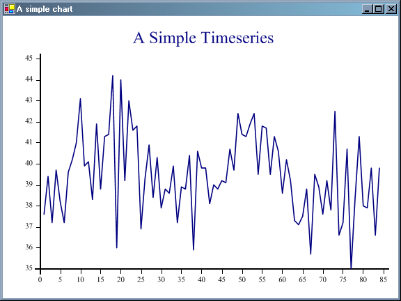
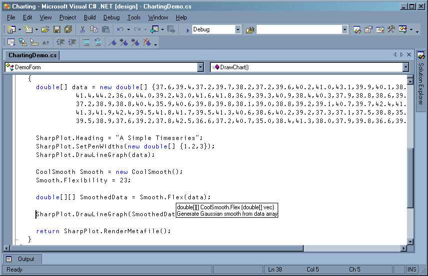
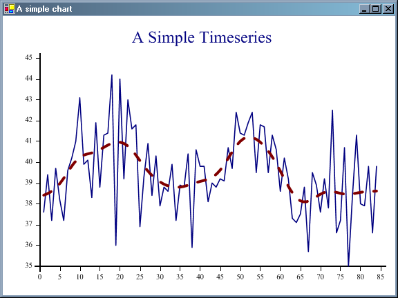

by Adrian Smith and Jonathan Manktelow, Causeway  
Talk given at the “All APLs Day”, Naples Beach, 2005
{ .byline }

## Outline

Rather than bore everyone with yet more PowerPoint and chat, Jonathan and I decided to act out a little scenario, illustrating one possible approach to mixing traditional APL development with the .Net future. I should point out that we picked the example quite carefully; everything from the APL side translated easily into C# and tripwires were avoided. The C# code was mostly written ahead of time, but nothing was hidden, and everything we did was genuine enough on the day. Just be aware that it is not quite as easy as we made out!

## Cast in Order of Appearance

Jonathan – the unfortunate C# programmer with a particularly irritating boss.

Jonathan’s boss (non-speaking part) – who likes to think that a bit of bluster and some arm-waving are equivalent to a detailed specification.

Adrian – the mad boffin with the cranky old APL system tucked away below the company radar.

## The Challenge

Jonathan’s boss is in charge of a project to add an MPG summary to the typical in-car computer system to go alongside the SatNav and all the other fancy toys. He has collected some sample data, and given Jonathan the task of developing a nice timeseries graphic so the car-owner can see how things are progressing over time.

Jonathan winds up the marvellous *SharpPlot* (aka *RainPro*) charting toolkit and proudly shows his boss the results.

```
  public Metafile DrawChart()
  {
    double[] data = new double[] {37.6,39.4,37.2, .... ,39.8,36.6,39.8};
 
    SharpPlot.Heading = "A Simple Timeseries";
    SharpPlot.DrawLineGraph(data); 
    return SharpPlot.RenderMetafile();
  }
```

The data is quite genuine – and gives you a good picture of the seasonal variations in fuel usage, as well as the large random errors introduced by inconsistent filling!

{ width="576" height="432" }

“Wow”says the boss, “You did all that coding in less than a day”. It actually took Jonathan 10 minutes, so he tries not to look too smug.

“What we really need” muses the boss “is some kind of cool smooth”. He waves a boss-like finger in an up and down kind of way at the data; “See what you can do by this afternoon – I promised to show this to a couple of customers at 3:00”.

Jonathan breaks out in a cold sweat, and goes Googling for “cool smooth” which doesn’t really help. Then he has a brainwave – maybe that APL nut who hides out on the 5th floor can help. He knows about this sort of thing.

## The APL Approach

The APL nut is quite used to users who have no idea what they want. He starts by looking at the data, and mentally discarding concepts like <span class="APLU">12+/</span> as far too uncool. Simple moving averages never make a tidy job of the ‘ends’ and their intrinsic ‘top-hat’ shape often leads to all sorts of strange artifacts as the averaging period ‘beats’ with the data.

How about a simple Gaussian? That’s pretty cool, and easy to do in APL. Let’s have a look ...

```
wt←*-(xd×dieaway)*2
wt←wt÷+⌿wt
```

... will create a weighting that falls off in a pretty ‘bell-curve’ way depending only on the absolute x-distance. It is nice, in that every point in the series contributes something to every point on the average, but nearer points count most. The <span class="APLU">dieaway</span> controls how wide a bell we use – it ranges from 0 (every point has equal weight) to about 5 when the average sees very little other than the nearest point. It looks like a good candidate for a trackbar to let the user play with the settings!

After a few minutes fooling around, the APLer has come up with this:

```
    ∇  xy←dieaway flex vec;gx;ct;xd;wt;mm
[1]   ⍝ Generate Gaussian smooth from data array
[2]
[3]    mm←1,⍴vec
[4]    gx←mm[1]+(0.01×0,⍳100)×--/mm   ⍝ 100 is hard-wired for now
[5]    xy←gx,[1.5]0                   ⍝ Pre-allocate
[6]
[7]   ⍝ May as well loop here - outer product is a memory hog
[8]    :for ct :in ⍳⍴gx
[9]      xd←|(⍳⍴vec)-gx[ct]
[10]     wt←*-(xd×dieaway)*2
[11]     wt←wt÷+⌿wt
[12]     xy[ct;2]←vec+.×wt
[13]   :end
[14]
    ∇
```

```
      1 flex 4 5 6 5 4
 1    4.291876722
 1.04 4.31099321
 1.08 4.331030772
 1.12 4.351994593

 ............

 4.92 4.331030772
 4.96 4.31099321
 5    4.291876722
```

So we have a piece of working code, and some simple test-data. “Great” mutters Jonathan, looking bemused. “How do I call this from C#?”.

## With one mighty bound, he was free ...

It is Jonathan’s lucky day – Adrian has been playing around with a deceptively simple C# conversion tool that can take APL utilities like this and spit them out as compiled DLLs that any .Net application can call. First, he must agree the ‘interface’ with Jonathan and then add a few extra comments to the APL code to assist in the translation process.

They decide that the class will be called **CoolSmooth** (to conform with Microsoft naming style) and that it will have a method called **Flex**. Rather than passing in the dieaway as an extra argument, Jonathan decides it would be good to have a **Flexibility** property, ranging from 10 to 100 (because users like percentages) with a default value of 10. He is very uncomfortable with the idea of getting the result as a matrix (C# programmers much prefer arrays of arrays) so they agree that Flex can return a 2-element array with the X and Y values needed to plot the smooth.

Here is what Adrian needed to code to make this all work:

```
    ∇  CoolSmooth flex
[1]   ⍝⍝s Constructor for CoolSmooth taking optional flexibility (default 10)
[2]   ⍝:Constructor():this(10)
[3]
[4]    ∆flexibility←flex
    ∇
```

```
    ∇  SetFlex newvalue
[1]   ⍝ Set the Flexibility adjuster (constrained 0-100)
[2]   ⍝:PSet Flexibility Set responsiveness of fitted Gaussian
[3]   ⍝: int newvalue
[4]
[5]    ∆flexibility←100⌊0⌈newvalue
    ∇
```

```
    ∇  value←GetFlex
[1]   ⍝ Get the Flexibility adjuster
[2]   ⍝:PGet Flexibility Responsiveness of fitted Gaussian
[3]   ⍝: int value
[4]
[5]    value←∆flexibility
    ∇
```

```
    ∇  flexed←Flex vec;dieaway;gx;xy;ct;xd;wt;mm
[1]   ⍝ Generate Gaussian smooth from data array
[2]   ⍝ Creates 100 points spanning range of original data
[3]   ⍝ Uses a gaussian curve weighted by the x-distance from each point.
[4]   ⍝:Public
[5]   ⍝: double[] vec
[6]   ⍝: double[][] flexed
[7]
[8]    dieaway←0⌈0.01×∆flexibility   ⍝ Default parameter = 10
[9]
[10]   mm←1,⍴vec
[11]   gx←mm[1]+(0.01×0,⍳100)×--/mm   ⍝ 100 is hard-wired for now
[12]   xy←gx,[1.5]0                   ⍝ Pre-allocate
[13]
[14]  ⍝ May as well loop here - outer product is a memory hog
[15]   :for ct :in ⍳⍴gx
[16]     xd←|(⍳⍴vec)-gx[ct]
[17]     wt←*-(xd×dieaway)*2
[18]     wt←wt÷+⌿wt
[19]     xy[ct;2]←vec+.×wt
[20]   :end
[21]
[22]   flexed←⊂[1]xy
    ∇
```

Let’s look at the <span class="APLU">Flex</span> function first, to see what changed from the original APL code. Line\[22\] simply changes the result into an array of arrays, and line\[8\] uses a global variable instead of a left argument. That leaves lines \[4-6\] which appear to APL as comments, but are used by the code-conversion to give data-types to the argument and result. By default, all functions in a class are ‘private’ (and invisible from outside) so we need a hint that this function is a public ‘method’ of the class.

Hopefully, the two functions to *Set* and *Get* the **Flexibility** are simple enough to be self-evident. The converter looks for comments like:

```
[2]   ⍝:PSet Flexibility
```

and uses these to create Properties in the generated C# code. The property will be available for Read/Write/Both depending on which functions are marked (the actual function names do not matter at all).

In order to compile the converted APL code, we need a small amount of C# boilerplate, which is saved in a simple text variable:

```
      cs∆flex
using System;
using AE=Causeway.SharpArrays;

namespace Causeway
{

!CoolSmooth=Flex,SetFlex,GetFlex,CoolSmooth,∆flexibility  /doc

}
```

This mostly just passes straight to the generated source-code, except for lines beginning *!ClassName* which invoke the translator with a list of function and variable names. The */doc* flag makes the translator create the XML documentation that Visual Studio uses for popup tips and auto-completion of code.

Here is the complete C# source:

```
 using System;
 using AE=Causeway.SharpArrays;

 namespace Causeway
 {
  public class CoolSmooth
  {
    int _flexibility = 10;

   // ============ Flex ============
   // Generate Gaussian smooth from data array
   // Creates 100 points spanning range of original data
   // Uses a gaussian curve weighted by the x-distance from each point.

    public double[][] Flex(double[] vec)
    {
      int[]     mm;
      double    dieaway;
      double[]  gx,xd,wt;
      double[,] xy;

      dieaway = AE.Max(0,0.01 * _flexibility);  // Default parameter = 10
      mm = AE.Join(1,vec.Length);
      gx = AE.Plus(mm[0],AE.Times(AE.Times(0.01,AE.Join(0,AE.Range(100))),
                 -AE.MinusReduce(mm)));  // 100 is hard-wired for now
      xy = AE.Laminate(1.5,gx,0);  // Pre-allocate
     // May as well loop here - outer product is a memory hog
      for (int ct = 1; ct <= gx.Length; ct++) {
        xd = AE.Magnitude(AE.Minus(AE.Range(vec.Length),gx[ct-1]));
        wt = AE.Exponential(AE.Negate(AE.Power(AE.Times(xd,dieaway),2)));
        wt = AE.Divide(wt,AE.PlusReduceFirst(wt));
        AE.IndexAssign(xy,ct,2,AE.SumTimes(vec,wt));
      }
      return AE.MatrixToRagged(AE.Transpose(xy));
    }

   // ============ SetFlex ============
   // Set the Flexibility adjuster (constrained 0-100)

    void SetFlex(int newvalue)
    {
      _flexibility = AE.Min(100,AE.Max(0,newvalue));
    }

   // ============ GetFlex ============
   // Get the Flexibility adjuster

    int GetFlex()
    {
      return _flexibility;
    }

   // ============ CoolSmooth ============
    public CoolSmooth():this(10) {}
    public CoolSmooth(int flex)
    {
      _flexibility = flex;
    }

   // =========== Properties of CoolSmooth ============
    public int Flexibility {
      set { SetFlex(value); }
      get { return GetFlex(); }
    }
  }
}
```

And here is the accompanying XML:

```
<?xml version="1.0"?>
<doc>
  <assembly>
   <name>flex</name>
  </assembly>
  <members>
   <member name="M:Causeway.CoolSmooth.Flex(System.Double[])">
    <summary>
     Generate Gaussian smooth from data array
    </summary>
   </member>
   <member name="M:Causeway.CoolSmooth.#ctor(System.Int32)">
    <summary>
     Constructor for CoolSmooth taking optional flexibility (default 10)
    </summary>
   </member>
    <member name="P:Causeway.CoolSmooth.Flexibility">
     <summary>Responsiveness of fitted Gaussian</summary>
    </member>
  </members>
 </doc>
```

The source-code can be compiled from the command prompt like this:

```
 D:\Tools\aplc>csc /t:library /r:sharparrays.dll flex.cs
 Microsoft (R) Visual C# .NET Compiler version 7.10.6001.4
 for Microsoft (R) .NET Framework version 1.1.4322
 Copyright (C) Microsoft Corporation 2001-2002. All rights reserved.

 D:\Tools\aplc>dir flex.*
 30/01/2006  23:22             1,958 flex.cs
 30/01/2006  23:25             4,096 flex.dll
 30/01/2006  23:22               582 flex.xml
```

So Adrian copies flex.dll, flex.xml and sharparrays.dll (just under 500Kb) to his handy APL2000 keydrive and hands it over to Jonathan to plug in to the finished application. Yes, I’m sure Jonathan could have coded it up in C# in a couple of days, but this is a classic example of the APL mode of thought in action. Adrian never sat down and designed the algorithm – he just created some handy test data and typed away until the output looked right.

## Happy Ending

Calling the new DLL from C# is a breeze:

{ width="857" height="554" }

Jonathan added the lines to create an instance of the CoolSmooth class and set the Flexibility to 23 – of course he could have passed this as an argument to the constructor. The screen-snap was taken with the mouse hovering over the **Flex** method name – notice how the leading comment-line from the original APL function has appeared as the second line of the tip! This is why we made the XML file to accompany the DLL. If you look carefully, you can see exactly where the ‘intellisense’ is coming from for the methods and properties.

So let’s test it – hit that F5 key to compile and run ...

{ width="576" height="432" }

... well, the audience thought it was cool! This has to be the first time a simple dashed line got a spontaneous round of applause.

## Summary

My feeling is that .Net is beginning to compete on level terms with APL as a general-purpose application development tool. C# is a good language, the Framework is an excellent utility library, and the Gui designer is reasonable. When we have Framework-2 and XAML for the Gui, then I think C# may be ahead. What .Net is *not* (at least not yet) is an environment for mucking around with ideas. For that you need a **session** and a **workspace**, and an environment that lets you stop halfway through a function, play with the data, fix up the next line and **continue**.

The little scenario that Jonathan and I tried to illustrate may be one way APL can continue to survive in a conventional application development shop.

***
