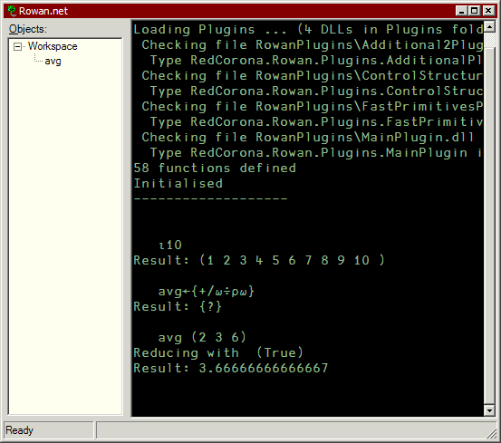
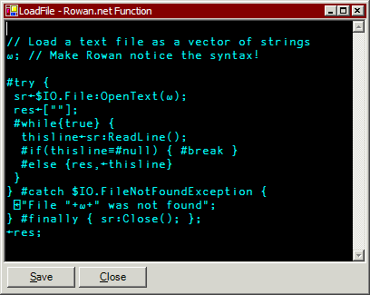

*by Richard Smith ([richard@redcorona.com](mailto:richard@redcorona.com))*
{ .byline }

*Note: to view the code examples in this article correctly you need a Unicode font including APL characters (ideally [APL385 Unicode](resource/apl385.zip), but Arial Unicode is also OK) and a Unicode enabled browser.*

## Introduction

A couple of issues ago I wrote an article about R.net (*Vector* 20.2, p.136), a reverse Polish array interpreter. As I hinted in that article the target was to include a parse table similar to Hui’s (*Vector* 9.4, p.85) to allow APL-like syntax, and fulfil a longstanding ambition to write my own APL interpreter.

Rowan is the result of this effort: a language which is superficially very APL-like, using single-character primitives in the main and a conventional syntax. The APLers among you should recognise this code fragment as one which you could copy-paste into another language:

```
   avg←{(+/⍵)÷⍴⍵}
   a←3 5 6
   avg a
Result: 4.66666666666667
```

This short example shows how Rowan allows direct-definition functions, how it uses the D-style `⍺` and `⍵` for left and right arguments (although the averaging function is a monad, so there is no `⍺` used here) and how it supports operators like `/`.

Rowan is built on the same engine as R, so it has the same array capabilities, the same connection to the main .Net framework, the same error-handling and the same namespace architecture (see the article on R if you're interested). Having an infix syntax brings in new ideas too: monadic and dyadic functions, operators and conjunctions; these are all catered for in a second level of core, which builds on the basic concepts in the R core.

Rowan supports basic arithmetic operations on extended precision numbers, represented by the LargeInteger class. You enter an extended precision number by appending the backquote character (`` ` ``) to a number:

```
   li←1e300`   ⍝ Extended precision
   (li + 1) - (li - 1)
Result: 2`
   d←1e300     ⍝ Normal double precision
   (d + 1) - (d - 1)
Result: 0
```

As you can see, you can use arithmetic functions with ‘ordinary’ numbers on one side and extended-precision ones on the other; in this case the narrow operand is widened to extended-precision.

These numbers have arbitrary precision, but obviously the space they take up gets larger the more significant figures are preserved: `(li + 1)` takes up 128 bytes. However they are smart and when they have blank bytes at either end they shrink themselves, so `li` is only 4 bytes plus an integer exponent.

### Character Set

As you can see, Rowan uses APL-style one character glyphs. You might recall that R is an entirely ASCII language, which dates from its days as a Java applet where no APL font was present, and I had a decision to make when I started on Rowan. I decided that since .Net has good Unicode support throughout, I would throw off the restrictions of a small character set and make use of the APL characters which are defined in the Unicode spec. I have always liked the conciseness of APL, and the Unicode character set lets me have that without defacing the accented characters and so on; it also means there are unused symbols for which I can invent a use (for example, the Customise operator `⌾`).

## Rank

An important feature is the concept of *rank*. This is effectively the level of ‘digging’ a function does before it starts to work, and is best illustrated with an example:

```
   b←[[5 6][7 8]]
   avg b
Result: (6 7 )
   (avg^1) b
Result: (5.5 7.5)
```

With no digging (rank 0, the default for user-defined functions), the averaging function does `((5 6) + (7 8)) ÷ 2` – running on the whole array at once – whereas with rank 1 it ‘digs’ one level and then runs on (5 6) and (7 8) separately. You can use rank -1 to operate on the scalar elements at the deepest level of an array.

Of course all array languages have a similar method of getting at deeply buried data within arrays, probably slightly different from mine! For the APLers among you, you can imagine that `b` is a rectangular array, and the rank of a function then corresponds to the axis to operate on.

Dyadic rank is very similar, allowing you to dig into the arguments on both sides, but with the addition of separate left and right ranks.

## Scope

Rowan takes the D approach that everything is local unless declared otherwise. It’s not full-blooded lexical scope, because Rowan is based on a dictionary-stack language in R and so actually uses dictionaries for scoping; how it works is that every function internally pushes a new dictionary, localising everything declared within them. For example:

```
   c←12
   f←{c←4}
   f
Result: 4
   c
Result: 12
```

(This example also shows how the last statement in a function is its return value; see below.) To affect the global environment you need to use the Global Assign function, which is represented by the Left Vane character (`⍅`):

```
   f←{c⍅4}
   f
Result: 4
   c
Result: 4
```

You have to use Left Vane in a script to assign functions and variables that you want to be available once the script has finished; the normal assign arrow makes things local to the script, so would be useful for intermediate values.

While control structures in Rowan often require a block, delimited by braces, as part of their syntax, these blocks don't enclose scope because you often need to assign variables in the function they are in, and that would be impossible if they did. (You can't assign to 'super-locals', i.e. up the stack, in Rowan, only to locals and to globals.)

## Functions and Statements

As the example right at the start of this article shows, you define simple functions by assigning a functional block (enclosed by braces) to a name. The same method can be used to assign longer functions; ending a line with a brace open will let you enter the rest of the function, until you enter the final closing brace. You can also use `#ed`, as in R, which lets you edit your function in a separate window.

An important point with Rowan is that functions don't have (in any syntactic sense) lines, they have *statements*. Because everything we’ve seen so far has been a single statement, we’ve got away with ignoring this because Rowan automatically adds a statement separator at the end of every block it's asked to parse (including session entry).

If we look at a simple script for the Average example – a script is run in exactly the same way as a function – we can see what this means:

```
⍝ Avg.rws
avg⍅{(+/⍵)÷⍴⍵};
a⍅(3 5 6);
b⍅((5 6)(7 8));
c⍅((1 2)(3 4));
```

Each line is ended with a semicolon, which tells Rowan where to split its parsing. Note that all the assignments use the Left Vane, as explained above, as otherwise they would be local to the script and disappear once it had finished running. The new-lines are no different from other whitespace; this is intentional to allow readable definitions of large arrays:

```
⍝ Array.rws
array⍅(
 (1 2 3)
 (4 5 6)
 (7 8 9)
);
⍴array
```

The return value of a function is that of the last statement which produces a value, the same as Perl. You can force a return by using a monadic left arrow:

```
   f←{
    ←4;
    3
   }
   f
Result: 4
```

## Connecting to .Net

As with R, the classes of the Framework are available to you with no effort at all, using a similar colon syntax. Because of not needing to put all the arguments to the left of the function, function calls in Rowan are almost identical to their C# counterparts. For example:

> Rowan: `s←300:ToString("X");`  
> C#: `String s = 300.ToString("X");`
>
> Rowan: `worldString←"Hello, world!":Substring(7 5);`  
> C#: `String worldString = "Hello, world!".Substring(7, 5);`
>
> Rowan: `#using "System.Drawing";` (at top of file) ...  
> `p←#new $Point(30 40);`  
> C#: `using System.Drawing;` (at top of file) ...  
> `Point p = new Point(30, 40);`

This means Rowan has a large advantage over non-.Net APLs, as it doesn't need any utility libraries to make it useful – Microsoft have already written one for you! More than that, it's a very good one: the Framework has utility classes for almost everything you would ever want to do. And even better, there are a large number of freely available .Net components posted by developers on the Internet, (almost) all of which you can just call from Rowan – just point Rowan at it using `#addassembly` – without a problem, in case you find something that isn't in the Framework. Of course, you can also use your own components if you happen to be an amateur C# hack too.

I say almost because, at the time of writing, Rowan doesn't support delegates and therefore events signalled by external components. This is due to a technical difficulty which I hope to sort out once finals are out of the way, as it is the only major stumbling block left to producing functional applications with Rowan.

The .Net bridge works both ways, too, and it's just as easy to call Rowan from your own .Net classes, written in C# (or VB.Net etc). You need to use the RowanExecuter class from RowanInterpreter.dll, which has public methods for calling the engine. For example, here is a simple program which does `2×+/⍳10` direct from C#:

```
using System;
using RedCorona.Rowan.Interpreter;

namespace Tests {
 public class RowanTest {
  private static RowanExecuter rex = new RowanExecuter();

  public static void Main(String[] args){
   int[] iota10 = (int[])rex.ExecuteMonad("⍳", 10);
   int sum = (int)rex.ExecuteMonad("+/", iota10);
   sum = (int)rex.ExecuteDyad(2, "×", sum);

   Console.WriteLine("Answer is "+sum);
  }
 }
}
```

Obviously the whole thing could be done with one call (`int sum = (int)rex.Execute("2×+/⍳10").Value`; the Value is because this form of execution returns a Symbol structure containing type information, which we don't need here) but I've split it up to show the different ways to access the engine. To get and set variables you can use SetVariable and GetVariable:

```
rex.SaveVariable("data", new int[]{1, 2}); // save
int[] data = (int[])rex.GetVariable("data"); // retrieve
```

... and to define a function use SetFunction:

```
rex.SetFunction("f", "+/⍳⍵", -1);
int[] results = rex.ExecuteMonad("f", new int[]{7, 8});
```

The numeric argument is optional and specifies the rank at which the function will run, and the default is 0. This C# expression is equivalent to the Rowan `f←{+/⍳⍵}^-1`.

You need to compile your assembly with reference to the assemblies RowanInterpreter.dll (of course) and Core.dll, and clearly you need a full copy of Rowan present when you run it.

You can also call the base functions (Plus, Iota etc) directly – they reside in the Main and Additional2 assemblies – but if you do you lose the conciseness of the language and some functionality (the evaluation of rank, for example, is done by the engine), and you need to construct the Symbol structure yourself each time. On the other hand, you then don't need to distribute a full interpreter, just the appropriate assemblies plus Core.dll and RowanCore.dll.

## Architecture

I know this is a vector-languages journal and not a C# one so I won’t go into any great detail of how Rowan works, but it is probably instructive to see how simple a vector interpreter actually is.

**R core**
:   The little rubber feet of Rowan are the classes and structures of the R core: the Symbol structure, which represents data and does a lot of work to manipulate it; the Kernel class, which provides universal array (rank, type-matching, length-matching etc.) capabilities to functions; the SymbolTable class; the tokeniser; and the BaseEngine class which lets Rowan call other .Net functions, gives it stack, function stack and other basic features.

**Rowan core**
:   The Rowan core introduces concepts not needed in R: structures and delegates to deal with arguments, monadic and dyadic functions and operators, conjunctions, system variables, and to help with the parse table.

**The Rowan Interpreter**
:   The interpreter is actually quite simple. An expression is first tokenised, then the token stack is moved through matching patterns against the parse table until it is reduced to a single value. (An error occurs if an expression doesn’t eventually reduce to a single value type – noun, verb, operator or conjunction at present – or an empty token stack.) The parse table is the vital ingredient, but (as with Hui’s) is simply a list of 4-element patterns to match to, and an action to perform in each case.

**Plugins**
:   The actual functions are added to the interpreter at load time from plugin assemblies. The interpreter itself provides parsing, tokenising and syntax resolution, so the functions manipulate the data in its native state. This separation of framework and content makes it very easy to add more features.

**Environment**
:   So far nothing I’ve mentioned lets a user pass expressions to the engine! This is the outermost layer, providing a window, input, output and a (customisable) keyboard handler and making the language usable. There's more information about the environment below.

## Flexibility

Rowan was originally written as a left-to-right language, because of what I thought would be a major problem parsing invocations (colon syntax, allowing calls to .Net methods outside the interpreter). I was eventually persuaded that this wasn’t going to be popular, and the problem was actually not a problem, so I added right-to-left parsing. Because of the simple architecture this was simply a case of adding a new parse table, and now Rowan can parse either way! At startup its default is now right-to-left, but you can still change it with the system variable `#r2l`.

## Extensibility

Again like R, Rowan uses plugins to provide its functionality. Any assembly which contains a class implementing the *IRowanPlugin* interface (defined in RowanCore.dll) is loaded at start-time, giving it the opportunity to add more primitives and #-functions to Rowan. This potentially lets one create powerful array-based access to databases, websites and so on, simply by writing the C# to retrieve (and replace) data in these environments.

## Environment

Because Rowan uses Unicode characters which are difficult to enter in most places, and because you will always want a session to try things out in as well as a script executer (this is one of the huge advantages APL has in rapid development), Rowan needs an environment. It is very simple:



The Rowan environment

The large edit field is obviously the session, where you type expressions and Rowan gives you the answer. It has a keyboard handler which lets you type the characters you need, which is customisable via a simple text file. I decided not to do what Dyalog have done for their APLScript and create a Windows keyboard layout for Rowan, because they are not customisable by the user; this mean it is not possible to type Rowan anywhere except in the environment, but it can be copied and pasted into other Unicode-supporting applications (such as the Windows XP Notepad) so you can still create scripts easily.

The treeview on the left shows all the functions and variables you have defined, either by directly assiging them or by running a script which does so. You can double-click on a name in the tree, and if it is a function you will be able to edit it using the function editor:



The function editor

... which uses the same keyboard handler as the session, naturally. If you double-click anything else the value is displayed in the right-hand status field.

## Conclusions

I think Rowan is potentially a very useful tool. It has certainly been a very instructive experience learning how an APL interpreter works, and I have to admit to being surprised at how easy it was to write one! By using a plugin-based system Rowan makes it possible to use its array capabilities in arenas I haven't even considered. I hope someone will find it helpful!

As I mentioned in the previous article, it is good to have a lightweight .Net vector language which makes it easy to talk to the rest of the .Net framework. Rowan has all the same 'call-out' capabilities as R, but because of its syntax it is much easier to use, and with its 'call-in' capability it is just as easy to use Rowan for little bits of array code within a standard .Net scenario.

April 2005

***
