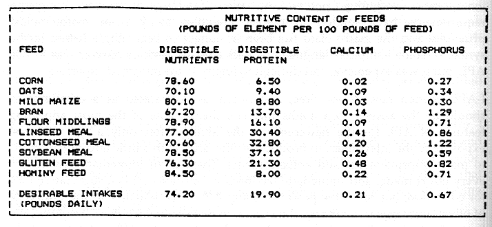
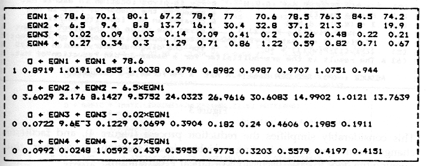
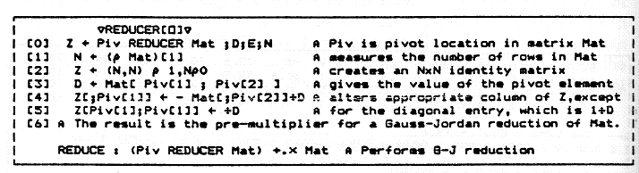
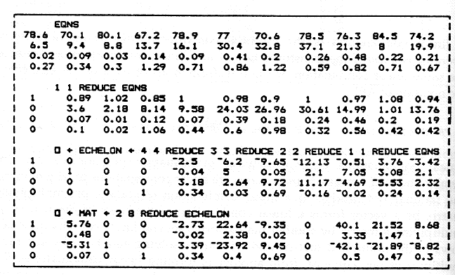
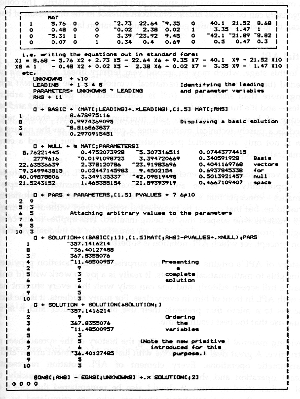

by Walter Spunde <span class="affil"></span> <span class="email"></span>
{ .byline }

For over a decade keen mathematics instructors have been searching for ways to incorporate computing power into their teaching of maths. Language requirements have tended to deflect attention away from mathematical principles and the maths class has been in danger of becoming a lesson in the syntax of some computer language or package. An obvious answer was to use APL, but it was expensive, and difficult to justify to un-informed superiors.

I-APL opened new doors. Free, and nearly as convenient as a calculator, it should be the answer to a maths master’s dream. One of the most appealing features of APL for the newcomer is the ability, after only a few minutes’ exposure to the interpreter, to produce results, and, with a little additional effort, to make improvements and enhancements. There is an immediate reward for every effort made, and immediate feedback on mistakes. It is a superlative tool for education; but, since the power of using APL is as seductive as the drudgery of other languages is confining, it has even more potential for itself becoming the focus of attention. This note is intended to show how little APL notation is really necessary to make working with an I-APL disk productive in a maths class, with the focus clearly on mathematical concepts, at tertiary, or upper secondary level. At the same time too, it may sound a little warning to APL enthusiasts.

### A Mathematical Perspective

Linearity is a central concept in much of mathematical theory, and the study of linear algebraic equations is one of the first non-trivial examples illustrating the properties of linear operators that students encounter.

The small square systems of equations usually presented, since they are manageable with hand calculators, provide only poor examples of these properties, as they are apparent only in the non-typical cases and are difficult to discern. Solving a square system of equations is, in any event, such a common operation that, like taking the square root of a number, (i.e. solving the quadratic equation x² = n) there should be (as there is in APL) a primitive to do the job.

By a “primitive” we should understand a mathematical operation that is so common and well understood, that the details of the algorithm producing the result need not be a concern (even when they are not, or have never been, known to the user.)

The typical problem leading to a system of equations is an arbitrary number of equations in any number of unknowns. Setting up a system of four equations in ten unknowns, from data in Figure 1, is conceptually no more difficult than setting up two equations in two unknowns. It may actually be easier, since the pattern in adding up certain fractions of various quantities is more apparent when there are several of them.

## 

Figure 1

The computing power available from APL implies that the size of the equations we work with in class is limited only by what can be conveniently displayed on the screen, and that we need no longer be concerned with the errors that students might generate (and thus destroying a discussion of the patterns apparent in the working).

### Fundamental concepts

The procedure for “solving” equations involves subtracting multiples of one equation from the others until an equivalent reduced system is found. This conceptual structure can be maintained if we can assign a name such as `EQN1` to the string of coefficients in any equation together with the demands. Working with equations as in Figure 2 requires a knowledge of only the assignment arrow beside the elementary operations and the ease of doing it would in itself be sufficient justification for using I-APL in teaching elimination techniques. However, if we concentrate on the idea of *linear combination* - the sum of multiples - which underlies the very formation of the equations, we soon depart from this approach to the problem.

## 

Figure 2

A linear combination is the essential construct in discussing linearity. An operator is *linear* if the transformation of any linear combination of elements is the same linear combination of the transformations of each of the elements. In the notation of APL2:

```
FN Coefficients +.× Elements = Coefficients +.×  FN¨ Elements
```

Linear combinations occur widely in mathematics: polynomials are linear combinations of powers, Fourier series are linear combinations of trigonometrics, the familiar dot product is a linear combination of scalars, pre-multiplying a matrix by a vector forms a linear combination of the rows of the matrix, pre-multiplying a matrix by another matrix forms several linear combinations of the rows of the multiplied matrix, and, of course, solving equations by subtracting multiples of one equation from another is forming linear combinations of the equations. When we represent a set of equations by a matrix containing in its rows the vectors (`EQN1`,.. ) for the various equations, it is easy to see that the elimination procedure is equivalent to a matrix pre-multiplication.

This observation is one of the basic goals of an elementary linear algebra course, and once it is appreciated, we can deduce the possible existence of an *inverse matrix* for a square system, and more generally, of LU factorisations. In APL, though not by hand, it is also a very practical observation, since we can write a function (Figure 3) which produces the required multiplier for a particular reduction, and use it to actually do that reduction.

## 

Figure 3

This considerably simplifies the reduction process (Figure 4), and facilitates changes from one set of leading variables in a “solution” to another, thus opening the door to easy discussions of Linear Programming.

## 

Figure 4

Interpreting the “solutions” shows that the leading variables are given as the sum of the basic solution and an arbitrary linear combination of the columns of the coefficient matrix associated with the parameters (Figure 5). The basic solution is the particular solution obtained when the parameters are set to zero. The general solution is seen to be the sum of a particular solution and an arbitrary linear combination of vectors each of which must satisfy the associated homogeneous equation. This is the structure characteristic of all linear equations, be they algebraic or differential.

## 

Figure 5

The shift of emphasis to linear combinations of columns that occurs in the process of writing the general solution opens further avenues of theoretical investigation, but no further computational tools are required to discuss the ideas of linear dependence, spanning sets and bases for n-dimensional vector spaces, or of column, row and null spaces, and the rank of a matrix. The concept of *orthogonality* can be seen as an algebraic convenience in the discussion of bases, which can be given an insightful geometric interpretation later.

### Essential APL

To get to this stage, which may be second year tertiary linear algebra, we have not needed (beyond the usual mathematical symbols and the *assignment arrow*) anything more than *shape*, *ravel*, (*roll* is convenient for generating arbitrary examples -- and it’s fun), the *index* brackets, *transpose*, the *inner product* and some knowledge of how to define and edit functions. The latter should not be regarded as a purely technical matter, since a concentration on the nature of a *function* is not only an essential pre-requisite to calculus but indeed a central mathematical concept.

One of the very pleasing side benefits from introducing APL notation to students is the opportunity to revise and to re-examine elementary concepts in mathematics - concepts that are not always as well understood by students as they should be, but that cannot be broached at tertiary level without inviting the scorn of students who suspect they’re being insulted. This applies to the concept of a logical proposition (as embodied in an equation or an inequality) and the function concept, for which APL notation is superbly suited.

The history of APL’s origins makes it no surprise that the notation provides so many insights to mathematical concepts. It really is a joy to work with (if only I-APL had a full screen editor!), and one can only wish that every student had a laptop with APL in front of him in every class. For many students, it is the lack of easy access to a micro that prevents their use of the notation, and it is with continual use that the best results come.

In providing material for teachers, recalling the history of the spreadsheet may be instructive. A great deal can be done with just the assignment arrow and the four arithmetic operations. Every element of APL notation represents a significant operation and should not be introduced any more quickly than normal mathematical notation. It should also be remembered that one’s own discoveries are the most satisfying. Students who are stimulated to solve problems using APL will ask the questions they need answered. There is no virtue in giving them one iota of information more than they need, and it is a wonderful feeling for a teacher when the students clamour for more.

(webpage generated: 6 April 2006, 14:16)
