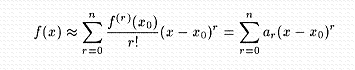
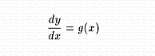
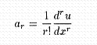
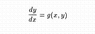
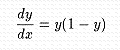
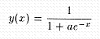
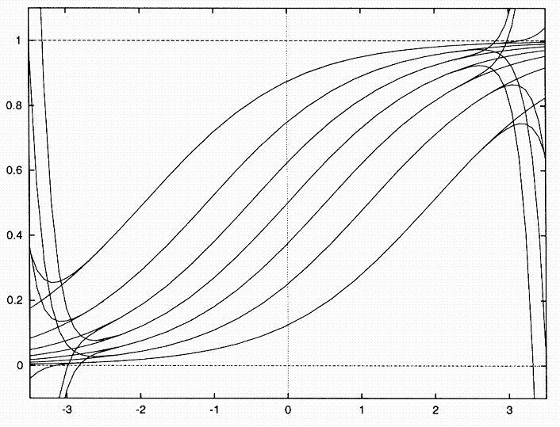
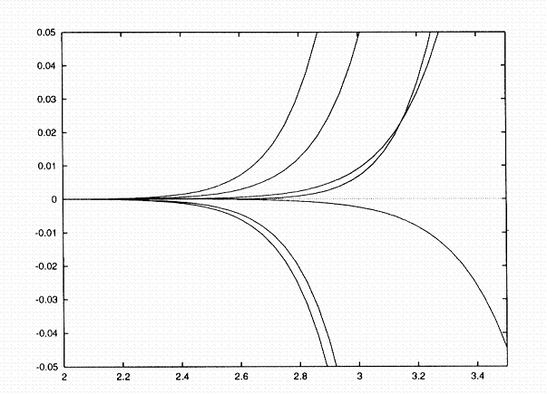

by Walter Spunde <span class="affil"></span> <span class="email"></span>
{ .byline }

### Introduction

In the APL93 conference paper\[4\], it was shown how a differentiation arithmetic for *function samples* could be developed using two functions `By` and `Times` for calculating the samples of linear combinations and products of functions with

samples. A function `sample` was defined as a vector of vectors holding the values of the function and its derivatives up to a given order at a set of sampling point of the function’s domain. The set of derivative values at any particular point may be used to write a truncated Taylor series for the function in the neighbourhood of that point, thus providing an analytic expression for the function in some neighbourhood of the point.

## 

Following Rall’s development \[3\] and Neidinger’s \[2\] suggestion that the Taylor coefficients, \{<i>a<sub>r</sub></i>\} be used in computation rather than the derivative \{<i>f<sup>(r)</sup>(x<sub>0</sub>)</i>\} values, a function sample could be re-defined as a vector of vectors holding the Taylor coefficients for the function at a set of sampling points. This article demonstrates the simplicity of developing such a Taylor arithmetic and applying it to the solution of differential equations. A calculus course that develops skill with differentiation arithmetic and Taylor series has its reward in being able to produce series solutions for systems of non-linear differential equations without any further tools of analysis.

### The Differentiation Arithmetic

Function By remains the same for Taylor samples as for derivative samples:

```
T←M By Tns;n
n←⌊/⍴¨,¨Tns ⋄ Tns←n↑¨Tns ⋄ T←⊃+/m×Tns
```

The product of two Taylor samples is simply the polynomial product truncated to the order of the lowest order sample.

```
T←T1 Times T2;n;⎕io
⎕io←0 ⋄ n←(⍴,T1)⌊⍴,T2
T←+⌿((⍳n)∘.≤⍳n)×(-⍳n)⌽(n↑,T1)∘.×n↑,T2
```

We say that a function, *f*, is *known* if, given any sample, `U`, for a function, *u(x)*, the sample for *f(u(x))* can be computed. For example, the *square* function is known, since the sample for the square of any function can be found from `U Times U`; the polynomial *2+3x-4x²* is known, since the sample for *2+3u-4u²* can be computed from `2 3 ¯4 By One U (U Times U)`, where `One = 1 0 0 ... 0`. Samples for the identity and constant functions of order *n* are given by

```
T←n Constant a     z←n Identity v;m
T←(⊂,a),n⍴⊂(⍴,a)⍴0     m←⍴v←,v
          z←(⊂v),(⊂m⍴1),(n-1)⍴⊂m⍴0
```

When a function, *y = f(x)*, satisfies a differential equation of the form

## 

where *g* is a *known* function with sample `G`, the chain rule for differentiation may be used to find the sample for f(u(x)) for any known function u; that is f is known.

```
T←CTFI U;⎕io;n
⎕io←1 ⋄ →(1≠n←⍴,U)/L1 ⋄ T←f,U ⋄ →0
L1: T←(f 1↑U),(G Times D U)÷⍳n-1
```

Here 1îU are the values of function u at the sampling points, and the function D gives the Taylor sample for the derivative of u.

```
T←D U;⎕io
⎕io←0 ⋄ T←1↓U×⍳⍴,U
```

Whereas for a derivative sample we had only to drop the first term of the sample to obtain the sample for the derivative of a function, for a Taylor sample, each coefficient must be suitably adjusted since the rth Taylor coefficient is related to the rth derivative by

## 

Since the function Times returns a sample of the same order as the smaller of the orders of the two samples in its arguments, it is clear that even if G is only of zeroth order then the result of executing line L1 in CFTI will produce a function sample of order 1. Repeated execution of this line can therefore be used to find a sample whose order is the same as that of U. Thus when a function, y=f(x), satisfies a differential equation of the form

## 

where g is a known function, the sample G can be computed to 0th order provided that the function values of y are computable (or arbitrarily assigned) at the sample points. The function CFTN can be used as a prototype for defining functions that make known all the elementary functions of mathematics, and any desired special functions as well.

```
T←CFTN U;⎕io;n;T0
⎕io←1 ⋄ →(1≠n←⍴,U)/L0 ⋄ T←f,U ⋄ →0
L0: T←T0←f 1↑U
→(n=⍴T)/0 ⋄ T←T0,(G Times D U)÷⍳⍴T ⋄ →⎕lc
```

Replacing f by ÷ and G by -T Times T will produce a function for calculating the samples of reciprocals (thus providing a way for calculating samples for quotients). Using 3\* for f and 1 1 By One (T Times T) for G will calculate samples for the tangent of any function. For functions such as the arctangent, where f is replaced by -3\* and G by Reciprocal 1 1 By One (U Times U) we may use function CFTI since the repeated executions of the final line are not required.

### Solving Differential Equations

To find the nth order sample for the integral of a function, f(x), whose Taylor sample at x can be computed by executing the character string F, composed of known functions of X, where XÉn Identity x, one need only execute (with ŒioÉ1) YÉY0,(nî–F)÷!¼n where Y0 is the 0th order sample of (arbitrary) initial values of the function at x points.

When the function y satisfies a differential equation of the form y’ = f(x,y) the string F contains terms in Y. If Y is of order k-1, then executing F gives a Taylor sample for y’ of order k-1. The last term of this sample is y’(k-1)/(k-1)! or y(k)/(k-1)!, which, if divided by k, could be catenated to Y to give a kth order sample for y. Thus, repeated execution of the line

```
Y←Y,(¯1↑⍎F)÷k
```

will produce Taylor series solutions of the differential equation about the sampling points to any order. Series solutions for differential equations can be obtained from function TDE.

```
Y←F TDE Data;k;n;X;Y;Y0
⎕io←1 ⋄ k←0 ⋄ n←Data[1]
X←n Identity 2⊃Data ⋄ Y←Y0←¯1↑Data
→(2==Data)/L0 ⋄ Y←Y0←⊂Y
L0: →('Y'∊F)/L1 ⋄ Y←Y0,(n↑⍎F)÷!⍳n ⋄ →0
L1: →(n≤k←k+1)/0 ⋄ Y←Y,(¯1↑⍎F)÷k ⋄ →L1
```

As an example we find a family of solutions for the logistic equation

## 

The precise solutions can be found analytically to be

## 

Given non-zero initial values y0 at x = 0, these solutions can be computed from

```
x←100 Divs ¯1 1 ⋄ a←(÷y0)-1 ⋄ es←÷1+(*-x)∘.×a
```

where n Divs I is a function that divides an interval, I, into n equal parts. First we find the values of the polynomial approximations to the solutions of degree 8, using a polynomial evaluating function, Poly, with

```
One←20 Constant 1 ⋄ degree←8 ⋄ de←Y Times 1 ¯1 By One Y
x0←8⍴0 ⋄ y0←7 Divs 0.125 1
ps←⍉⊃(,⌿⊃de TDE degree x0 y0) Poly¨⊂x
```

The largest difference between the values for exact (es) and approximate (ps) solutions was 0.00005768, over the (¯1, 1) range. Over a range of (¯2, 2) the largest error was 0.01117 and errors were readily apparent on a graph. Re-calculating the approximate solutions with 20 degree polynomials we found the largest error to be 0.00003448 over the (¯2, 2) range, with the errors becoming apparent on a graph when |x|>2.25

## 

Solutions and Polynomial Approximations for y’=y(1-y)
{ .caption }

The errors only become significant at the ends of the interval of usefulness and the accuracy of the results within the interval is much greater

## 

Errors in Approximate Solutions for y’=y(1-y)
{ .caption }

### Speeding up the Computations

The function CFTN above recalculates all lower order terms in a sample with every repetition of its final line through application of the Times function. This can be avoided by computing only the leading term of the polynomial product in this line.

```
T←CFT U;n
→(1≠n←⍴,U)/L1 ⋄ T←fn ,U ⋄ →0
L1: T←fn 1↑U
→(n=⍴T)/0 ⋄ T←T,(+/(⌽(⍴T)↑D U)×G))÷⍴T ⋄ →⎕lc
```

The function listing for the modified function, CFT, may not display the simplicity of the chain rule as clearly, but it does give much faster execution times. Using Neidinger’s \[1\] test function (X Times Reciprocal Sin X) Times Reciprocal Ln Arctan Exp X average execution times for calculating a 10th order sample at the point x=1 were reduced from 2.58 to 1.43 seconds, and for a 25th order sample from 27.53 secs to 11.97 secs.

The speed of execution of the Times function was improved by re-writing it as

```
T←T1 Times2 T2;n;k
k←1 ⋄ n←(⍴,T1)⌊⍴,T2
T←(1↑T1)×1↑T2
→(n<k←k+1)/0 ⋄ T←T,+/(⌽k↑T1)×k↑T2 ⋄ →⎕lc
```

A third version, avoiding the loop with the each operator, proved to be consistently better.

```
T←T1 Times3 T2;⎕io;n
⎕io←1 ⋄ n←(⍴,T1)⌊⍴,T2
T←⊃+/¨((⍳n)↑¨⊂T1)+⌽¨(⍳n)↑¨⊂T2
```

Average execution times for each of the three versions of the Times function for the different inputs are shown below for the computation of both X Times X and (X Times Reciprocal Sin X) Times Reciprocal Ln Arctan Exp X

```
Secs            10-1           25-1
Times    0.055 1.429    0.280 11.95
Times2   0.033 1.275    0.126  7.82
Times3   0.027 1.242    0.110  7.22

               10-25          25-25
Times    0.093 3.049    0.478 28.23
Times2   0.060 2.165    0.280 14.74
Times3   0.055 2.082    0.258 14.22
```

Computing the test function as X Times Reciprocal Sin X Times Ln Arctan Exp X a 10th order sample at x=1 took 1.011 secs (using Times3) which is comparable to the time taken by Mathematica for this computation. Calculating the values of the tenth derivative of the test function at 100 points took 3.85 secs compared to the 17.5 secs in \[4\] and was over a second faster than with analogous functions for derivative samples.

Walter G. Spunde,  
Department of Mathematics, University of Southern Queensland, Toowoomba, Australia, 4350

### References

1. R.D. Neidinger, “Automatic Differentiation and APL”, College Mathematics Journal, 20, 1989, 238-251.
2. R.D. Neidinger, “Differential Equations are Recurrence Relations”, Quote Quad, 23, 1992, 165-169.
3. L.B. Rall, Automatic Differentiation Techniques and Applications, Lecture Notes in Computer Science, No. 120, Springer-Verlag, Berlin-Heidelberg – New York, 1981.
4. W.G. Spunde “Point-wise Calculus”, Quote Quad, 24, 1993, 259-266.

(webpage generated: 18 February 2006, 02:16)
