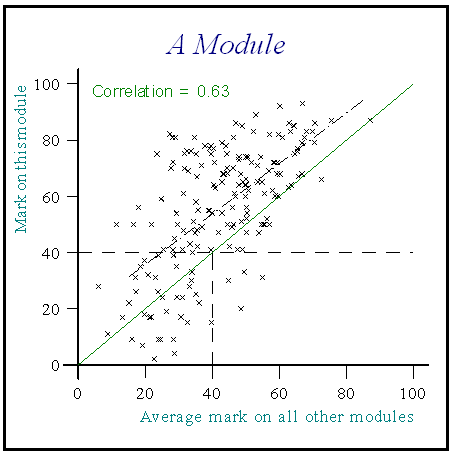
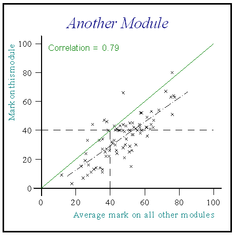
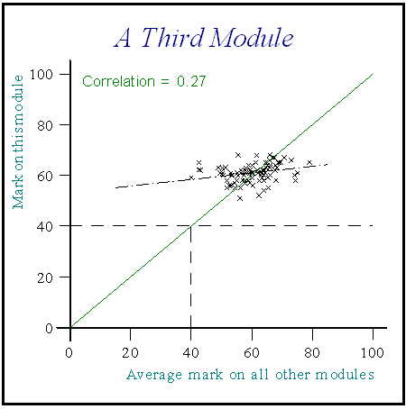
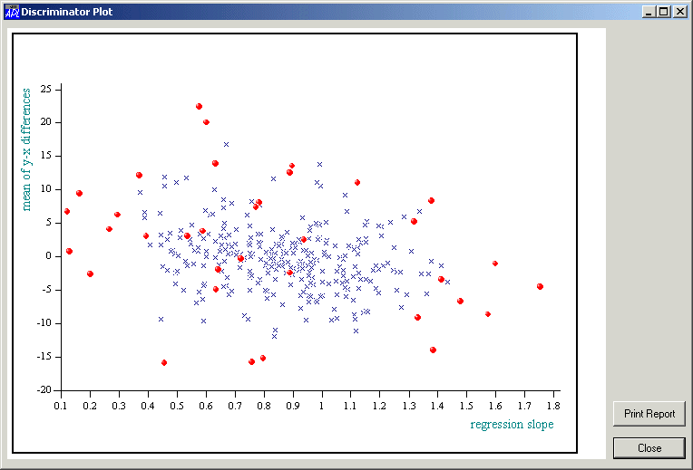

by Alan Sykes
{ .byline }

Paper given at the Dyalog APL Users’ Conference 2005

## Introduction

*ARQUE*, an acronym for ‘Assessment Reports on the Quality of University Examinations’ is a software product, written in Dyalog APL, using many of the Causeway products (CPro, Newleaf, and Rainpro). It was developed in the last five years of my employment in the Business School at the University of Wales Swansea. It is now in use at universities in Swansea and Bangor, with other customers in the pipeline for later this year.

University examinations are produced by university lecturers themselves, subject usually to the scrutiny of external examiners who are there to check consistency of standards across academic institutions. Universities themselves are subject to ‘quality inspections’, which would seek, amongst other things to be re-assured that each university has a quality control system that guarantees high standards in its assessment of student performance. My work developed from the ‘bottom up’ where I was concerned with individual departments within a university and how each department could obtain useful feedback from the examination processes it was responsible for. If a department could establish a clear appraisal of its examinations which demonstrably indicated where quality was assured and also flagged problems if they occurred, then the university concerned could point to such appraisals, and take remedial action where appropriate. If such a system were used amongst all departments, then clear criteria can be developed at a managerial level to assure the quality of all its university examinations.

Modern universities, some more so than others, consist of a plethora of different degree schemes, each specified by a list of modules that students must take in each year of that scheme. Some modules may be compulsory, some optional, and typically, any module may be used by more than one degree scheme. Hence, from the perspective of a specific university lecturer, faced with a collection of marks for the module he or she is responsible for, it is a non-trivial task to explain, for example, why the marks are so low/high as compared to last year, or as compared to other relevant modules. It is only too easy for a lecturer to be accused of poor marks, simply because, for example, the students opting to do the module concerned were, in general, weak students. Thus, it is clear that any appraisal of the results of university examinations must, necessarily go well beyond a mere reflex reaction of quoting a few means and standard deviations!  Such a scenario is indicative of only one of many questions that can be asked about the assessment process but gives us the key to the most important aspect of *ARQUE*’s methodology

## Comparing Marks on a Module with Average Marks on Other Modules

By doing this, *ARQUE* can attempt to tease out some of the confounding effects on a set of module marks. Here is an example:

{ width="452" height="454" }

The diagonal line represents parity between mark on this module and average marks on other modules. The regression line here is parallel to this line, but above it, by 14, so that one can say, on average, on this module, students are scoring approximately 14 marks more than one might expect.

Of course, the regression line could lie parallel, but underneath the parity line:

{ width="456" height="458" }

so for this module, students are scoring on average, approximately 12 marks below what one might expect.

Other scenarios are possible, as the regression line need not be parallel to the parity line, indicating an assessment strategy that might, for example penalise the weaker students, or fail to discriminate between the weakest and strongest students in the class:

{ width="450" height="454" }

In an age when academics (at least in the UK) are under pressure to be more innovative in trying different methods of assessment, the radically different assessment profiles presented above (all genuine examples) make a strong case for substantial feedback from the examination results to the examiner, the department concerned and the university.

## *ARQUE*’s Top-Down Facilities

Whilst the top-down facilities are the latest additions to the facilities, it seems sensible to follow the motivation above, by examples of how one might view graphically, what is happening for the institution as a whole. Data for an institution are compiled from raw csv files and stored in APL component files to facilitate the production of reports as required. (For example, the examination results would be compiled by *ARQUE* from a csv file each of whose lines present information from one student-examination – i.e. *student identity*, *module taken* and *module mark* obtained.)

A data-mining facility is provided that enables you to look at different characteristics of the examination process across the institution. For example, the following plots the mean difference between average mark and average mark on other modules (basically measuring how far above or below the parity line, the regression line is) against the slope of the regression line:

{ width="764" height="513" }

Here, every point represents one examination – the points in red indicate modules with an assessment profile that is extreme on one or more (or a combination of) characteristics. Specifically, points which are high on the vertical axis indicate a profile where students gain a large number of marks over and above their average on other modules (as for example 1 above), whereas a point with a very low value on the horizontal axis indicates an assessment profile similar to example 3 above.

Such data-mining reports give an insight to the amount of variation in assessment profiles across the institution and facilitate the setting of critical values which can then be used in the provision of an institutional report, consisting of lists of modules that are extreme for one reason or another.

## Individual Module Reports

The original motivation for writing *ARQUE* came from my department trying to understand as much as possible as to what was happening in a busy department and to give individual lecturers as much feedback as possible on how their assessment strategy had worked. An individual module report may be produced for each examination in an institution. Such a report comments on the salient features of the assessment profile, providing graphical and numerical information, together with a substantial written report (which may be in English or Welsh). These reports are, to my mind, the most important reports, as they provide the means whereby a lecturer can relate the content of the report with other information about the examination process (e.g. verbal comments from students and other staff) and make, where necessary, important changes in future assessment strategies.

## Other Reports

It is often useful to be able to compare performances on comparable modules, may be, for example, all first year modules in a department. Comparative reports of this nature are also available.

## Using *ARQUE*

Currently, *ARQUE* is used in universities by central administrators who make appropriate reports available to departments after the examination process is complete. For a university of some 12000 students with over 2000 modules, this is feasible within a day, even if paper copies are supplied. Alternatively documents produced by *ARQUE* may be compiled in pdf form and transmitted electronically.

## Some Technical Comments

As indicated in the introduction, I would not have been able to produce *ARQUE* without (a) APL, and (b) the Causeway products. The graphical user interface is a series of CPro forms, hence changes and enhancements are easily made. Reports are produced using Newleaf, and all charts are constructed using Rainpro. Customers are impressed with the quality of graphical information, and the speed with which it all works. The written information is compiled with the aid of a dictionary (two-column matrix) with English statements in the first column, and Welsh statements in the second.

## The Future

Obviously, I hope to sell more copies as I have the time and energy to persuade universities that they need the facility. From an APL perspective, I envisage that in the future, the facilities of *ARQUE* will be made available via a University Intranet – how this should be done is yet to be determined.

Alan Sykes  
Director of [Acadvent Ltd](http://www.acadvent.com/)  
Author of <i>ARQUE</i>  
Retired Senior Lecturer in Statistics in the Business School of the University of Wales, Swansea

October 2005
