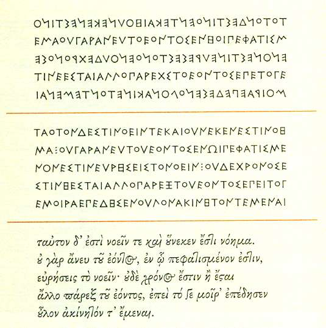
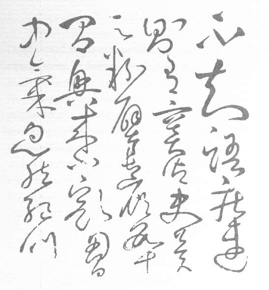

## The Solid Form Of Language Robert Bringhurst

Does mathematics have a liquid form? This question is prompted by a new book from the poet, linguist and typographer Robert Bringhurst, author of the classic *The Elements Of Typographic Style*.

> Writing is the solid form of language, the precipitate. Speech comes out of our mouths, our hands, our eyes in something like a liquid form and then evaporates at once. \[…\] Yet language can also solidify — into iridescent, sharp, symmetrical crystals, or into structures more like hailstones or shale beds or mud.

Bringhurst’s essay, *The Solid Form of Language*, looks at the natural history of human writing systems and their relationships to languages.

> Languages and scripts, like plant and animal species, are also subject to change. Their territories grow and shrink and subdivide and fuse, but there are none that are not mortal, none that will not someday be extinct.

> Starting from scratch, with no imported models, people have made the shift from oral to literate culture at least three times but perhaps not many more than that. In Mesopotamia about 5,000 years ago, in northern China about 4,500 years ago, and in Guatemala and southern Mexico about 2,000 years ago, humans created a script and a scribal culture, apparently without imported models of any kind.

Writing is an “outgrowth of drawing” that acquires certain formal characteristics. Among them:

> *A writing system is codified.* It consists of a repeating set of symbols sufficient to the language that it serves. Twelve Latin letters are enough to write Hawaiian. To write a lengthy Chinese text, thousands of glyphs may be required. But whatever system is used, writers can write *what has never been written before* without inventing further symbols. The system is not entirely closed; new symbols *can* be borrowed or created.. The point is that they very rarely have to be.

Æsthetics and technology combine to mould the letter forms.

> As a calligraphic tradition develops, the symbols start to talk to one another, nourished by the dialogues of writers with their tools.

Three versions of the same Greek text: a passage from the poem of Parmenides, composed about 500 BCE. Engraved in stone in Parmenides’ time and place, the text might have looked like version 1: lines alternating direction and breaking arbitrarily; letters changing orientation with the lines; no spaces between the words. At Athens in Plato’s time, it would have looked more like version 2. After many further transformations, Greek script had acquired punctuation, diacritics, and a cursive form replete with ligatures and alternates. In Western Europe during the Scottish Enlightenment, the same text would have looked like version 3.

In the example above we can see how the script used for Greek was adapted to changes in the inscribing technology. Like Scandinavian runes, the original glyphs were suitable for carving into wood or stone. The latest form is adapted to the fast and fluent strokes of pens.

Bringhurst’s essay introduces us to a wide world of languages and scripts, evolving over thousands of years, shaped by factors both technical and political.

> Turkish was written in Arabic script from the twelfth or thirteenth century until 1928, when a government decree forced a shift to the Latin alphabet. Tajik was first written in Arabic script, then for a time in Latin letters, but in the Soviet era, these scripts were replaced by Cyrillic. In 1991, when Tajikstan declared its independence, efforts were underway to return to Arabic script.

The forces of evolution are always at work. Typewriters brought crude and simple printing to every office. Setting this type no longer required a skilled craftsman, only a trained typist. Typewriters changed the economics of producing documents, and habits of writing, spelling and punctuation adapted to the change in the inscribing technology.

The spread of typewriters deprecated the use of characters not found on the QWERTY keyboard. So the use of ligatures in English came to be seen as at first *mediæval*, then *mediaeval* and in American English, *medieval*.

A corresponding industrial æsthetic (sorry about that) sought the simplification of forms that produced typefaces such as Helvetica and Gill Sans.

> The same industrial civilization gave us Greek, Cyrillic, Hebrew, Devanagari, Japanese and Chinese types with similar characteristics: a global epidemic of Helveticas..

The middle of the century saw the turn of this tide, as the defeat of Fascism ended the Modernist love affair with the iconography of heavy industry. Typographers like Herman Zapf drew faces inspired by Renaissance printers such as Aldo Manuzio. The new humanism saw lighter, more calligraphic forms; the closed forms of Helvetica were supplemented by the open and fluent shapes of Lucida Sans.

A generation ago typing was still a specialist job, albeit lowly. As a programmer, I was assured that managers would never use keyboards. The spread of personal computers has changed all that. No one is now considered competent for office work without basic keyboard skills.

At first the Anglo-Saxon cultural and technological hegemony looked set to condense written expression further around the English language and the QWERTY keyboard; or more precisely, the <acronym title="American Standard for Computer Information Interchange">ASCII</acronym> character set. For those of us who worked between countries it was possible to regard the alphabetic variations of other European languages and their local keyboards as anomalies to be accommodated for the time being by the Extended Latin <acronym title="American Standard for Computer Information Interchange">ASCII</acronym> characters, but eventually fated to disappear. Surely one day all Germans would write *Strasse* and not *Straβe*?

That view now looks hopelessly naïve. While English remains unassailed as the *lingua franca* of international business, the spread of Net-linked PCs has fuelled demand for access to the new technology through the languages people already speak. Machines remain in the service of humans.

Part of a letter written in kuáncǎo or Wild Grass cursive by the monk Huáisǔ, c. 725-785. [After Chiang Yee 1973.]

Between us, my partner and I write in <acronym title="A Programming Language">APL</acronym>, Danish, English, French, German, <acronym title="HyperText Markup Language">HTML</acronym>, Italian, Japanese, Javascript, <acronym title="PHP Hypertext Preprocessor">PHP</acronym> and Swahili. Japanese writers use three native scripts (one phonetic, another adapted from Chinese ideographs), Arabic numbers and Latin letters (*rōmaji*). Japanese is possibly the most challenging of our languages to type on a computer keyboard, but it is a thoroughly solved problem.

When I last bought a computer I set aside some time to configure it for writing in Japanese. I need not have troubled. On a machine bought in a non-specialist store in New York, standard configuration options allowed me to select the writing systems we wanted to use. (These included native American languages I’d scarcely heard of.. Bringhurst, who speaks some. must be pleased.) Internationalisation — across languages and writing systems — is now commonplace.

The keyboard mappings shipped with MacOS X include native American languages, but not <acronym title="A Programming Language">APL</acronym>. Presumably our linguistic community is smaller. More importantly, we don’t have a consensus on what our keyboard maps should be. But the Unicode positions are fixed for our glyphs, and it was trivial to install Adrian Smith’s APL385 Unicode font.

In the narrow world of information technology, English and the <acronym title="American Standard for Computer Information Interchange">ASCII</acronym> character set rule. From the wider perspective that Bringhurst opens, machines remain in our service, and human preferences are insisting they use our languages and our scripts. Twenty years ago it looked as if the change in inscribing technology, from golfball and daisywheel to <acronym title="cathode ray tube">CRT</acronym>, would kill off <acronym title="A Programming Language">APL</acronym>’s elegant glyphs. Now we can see that the script can remain — if we want it.

The latest <acronym title="A Programming Language">APL</acronym>, Rowan, has been developed by Richard Smith who is an undergraduate at Cambridge University. He has built it using <acronym>.NET</acronym> components and it is “Unicode from the little rubber feet up,” as his father Adrian says. I was struck by Richard’s use of traditional <acronym title="A Programming Language">APL</acronym> glyphs and asked him about it. He said he liked having single character glyphs instead of reserved words. Well I always did too.

Does mathematics have a liquid form? It is a difficult language to speak. Unlike natural languages, it flourishes mostly in its solid form. (Though I do remember awaking many years ago from a dream in which some repeated event had occurred to me as a repeated 1-drop on a list.) Iverson’s notation has evolved rapidly since the publication of *A Programming Language* in 1962. So too has the inscribing technology. Bringhurst opens our eyes to a landscape in which the solid form of mathematics enjoys more freedom than we thought it had.

Robert Bringhurst, *The Solid Form of Language*, Gaspereau Press, Canada. ISBN 1-894031-88-1. 75pp. C$19.95, US$16.95.  
See [Gaspereau Press](http://www.gaspereau.com/solidform.html)

***
