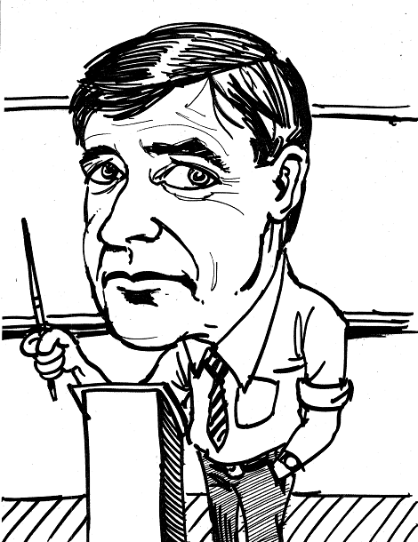

{ width="250" height="324" }For the best memorial, die while your colleagues have energy to write. With this issue Vector at last commemorates the life and work of Dr Kenneth E. Iverson. We had hoped to publish a substantial review, by colleagues and collaborators, of his life and work. But Ken Iverson’s influence and long working life covered so many decades, countries and people that this larger project must be left to posterity.

Ken Iverson started developing his notation at Harvard in the 1950s as a mathematical code for describing computations. It blossomed through APL into a family of languages. Many hands have nourished these languages; but Ken Iverson was father to them all.

Iverson Notation was at the centre of the young computer industry. Ken was lured from Harvard to become an IBM Fellow. At IBM his notation was used for the first-ever formal description of an operating system. His Harvard teaching assistant, Fred Brooks, managed the development of this operating system, OS/360, the heart of IBM’s breakthrough mainframe series. Brooks’ experiences managing the project formed the basis of his classic The Mythical Man-Month: Essays in Software Engineering, in which he proposed the optimum size of a programming team to be “fewer than six or more than a hundred”.

Brooks’ formula nicely distinguishes two ways of developing software. Industrial methods require large teams, disciplined administration and Big Design Upfront; craft programmers work flexibly, alone or in small groups. To industrial programmers, writing software looks like engineering; to the craftsmen, like developing a movie. Craft programmers find the use of powerful notations repays the effort of mastering them; managers of industrial programmers shy from high skill levels, and rely on development methods to which coding agility and productivity have little to contribute.

There is not much to wonder at in any of this; it replicates a division found in many fields. In computing, the APLs remain an esoteric tradition, the province of solo programmers and small teams; there is no reason to expect this to change.

The more reason to heed Dr Iverson’s appeal in his article “APL in the New Millennium”, published here for the first time. He writes: My hope is to encourage the relatively small APL family to mute their differences, and present a more united face to the programming world.

Keith Smillie weighs in with a survey of his life as an array programmer. Professor Smillie teaches at the University of Alberta, Roger Hui’s alma mater, in the home province of both Ken Iverson and Arthur Whitney. (Perhaps the acronym should denote the Albertan Prairie Languages.)

Love of music and mathematics frequently coincide. Ken Iverson shared them with Norman Thomson, who here uses J to reach new clarity in an exposition of the mathematics of tempering. For his tribute, Eugene McDonnell measures a quarter-century of progress by comparing the number of tokens used in solutions written in APL\\360 and in J.

Adrian Smith’s work has him frequently switching languages. Writing C# is something you do to earn a living; fooling around in an APL session is something you can do of an evening, with Bach on the radio, and a nice log fire at your feet. (That music again.) He celebrates, by relaxing with a New Scientist puzzle and an APL interpreter.

Peter McDonnell’s caricatures of APL luminaries ornament this edition. We print memories of Ken from Linda Alvord, Bob Bernecky, Jim Brown and Eugene McDonnell. Larry Breed recounts the implementation of APL\\1130. Gitte Christensen, Michel Dumontier and Richard Hill remember Ken Iverson in Denmark, France and Australia. (English represents arrays too.) Roger Hui, Donald McIntyre, and Keith Smillie write of their decades of collaboration with KEI. And we finish with Roger Hui's collection of quotations and ‘Kenecdotes’.

*Stephen Taylor*
