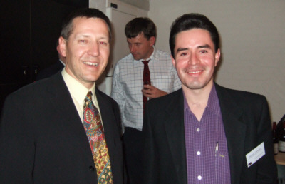
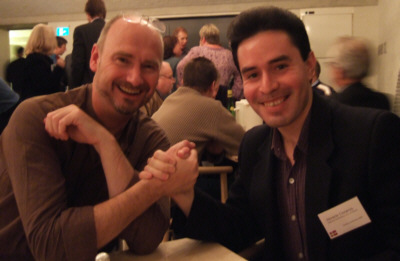
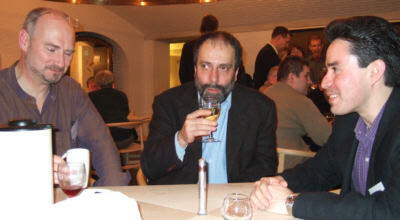
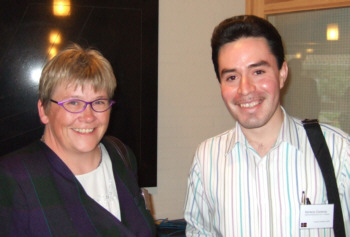
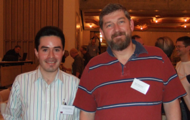

by Horacio Alejandro Cisneros Tovar
{ .byline }

When I was about 11 years old, I remember that my <acronym>APL</acronym> professor, Dr. Javier Fernández Pacheco told me that, if we kept up the good work with <acronym>APL</acronym>, we might make it to a user conference, in Denmark maybe. At that time I thought of it as a dream that would never come true, but I enjoyed the idea for a long while. Two years later I gave a talk for the Mexican <acronym>APL</acronym> Society titled ‘Horacio, 13 years and <acronym>APL</acronym>.’ Prof. Fernández organized it and showed how <acronym>APL</acronym> was the perfect programming language for educational purposes in early levels. During the talk I presented some basic calculation algorithms, compared iteration against recursion and finally presented a small game I had programmed in APL\*PLUS v.4, ‘The Boatman’ (an animated version of the problem about the boatman that had to take a goat, a dog and a pack of grass to the other side of the river, one by one). We made a very good impression and I was accepted as a member of the Mexican <acronym>APL</acronym> Society. But that was all. The Society eventually disappeared when it ran out of money, and so too my dream of meeting other <acronym>APL</acronym> users from around the world.

Fifteen years later, I was invited by Dyalog Limited to their annual user conference, to present my thesis project on Computer Engineering, ‘An On-Line <acronym>APL</acronym> Tutorial’ for the National Autonomous University of Mexico. It was a funny feeling. From the moment I requested support for that project, approximately one year ago, all the memories of my happy times with <acronym>APL</acronym> came back as if they had happened yesterday. The re-discovery of <acronym>APL</acronym> through Dyalog’s product which is surrounded now by new and modern implementations along with its integration to current technologies and the Internet, made me feel like the child I was when I accidentally switched an <acronym>IBM</acronym> 5110 machine from <acronym>BASIC</acronym> to <acronym>APL</acronym>.

{ width="400" height="258" }After almost one year of hard work on my thesis project, I was invited by Morten Kromberg to the conference in Elsinore, Denmark, from October 19th to 21st. Dyalog offered to co-sponsor my trip along with the British <acronym>APL</acronym> Association. As I said, it was a mixture of feelings: joy, thankfulness, excitment and also sadness, because my <acronym>APL</acronym> teacher had passed away two years earlier and he was not with me to share this reality that was born as a dream of my childhood, that had been eclipsed when <acronym>APL</acronym> disappeared in Mexico and that was reborn again when Pete Donnelly sent me the Dyalog APL/W CD and granted a free licence to develop my thesis project. (APL2000 had still one distributor in Mexico City, but its high price was one of the reasons why the Mexican <acronym>APL</acronym> Society disappeared).

Even though this was not the first time I given a talk on an <acronym>APL</acronym> subject, it was the first time I had ever left Mexico and also my first time on a plane. This particular experience was terrifying in the beginning, but after 14 hours in the air from Mexico City to Amsterdam, I somehow ended up getting used to the floating floor of the plane. I left Mexico at 22:00 on October 18th and reached Copenhagen at 21:00 on Wednesday 19th, so unfortunately I missed every session of the first day. Bjørn Christensen picked me up at Elsinore train station and thanks to him I made it to the final comments of the Ken Iverson memorial and for the evening snacks. From the very first minute of my arrival at Elsinore and LO-skolen I felt very good even though I was surrounded by strangers in an unknown country. I met Peter Donnelly at LO-skolen’s reception and it was like meeting a long-distance good friend. I also met Morten Kromberg, Helene Boesen and John Daintree. I had been in touch with them months earlier through email so it was very good to finally meet them in person. During the evening snacks I talked with them and that was when I realised that, despite coming from a different country and speaking a different language, I was somehow among my own. We knew the most important and universal language, which was also the powerful reason that gathered us all there: <acronym>APL</acronym>. So, as I mentioned in my talk, after working for a long time almost on my own with <acronym>APL</acronym> in the years after the Mexican <acronym>APL</acronym> Society disappeared and during the development of my thesis project, it was a wonderful feeling to find myself among new people that shared the same fundamental interest in this amazing programming language.

For the next two days I didn’t miss a single minute. I attended three presentations in the morning, even though I didn’t sleep the previous night. I found the [FlipDB](http://www.flipdb.com) presentation particularly interesting, because of the clever way that a database model was conceived using directories for the general structure and the power of dynamic functions to make queries and other operations. Later on that day, I participated in the ‘Viking Challenge’ which I enjoyed a lot more than I expected and I didn’t mind having three embarrassing blank targets. I was the best of my team in the blowpipe along with Stefano Lanzavecchia, so at least I kept the pride of knowing that I have a special talent that may come handy in the rainforest. I enjoyed very much the Viking Challenge despite the rain. I had to run back from that area to LO-skolen and was a little bit late for my own presentation.

{ width="400" height="261" }So, it was my moment of truth and I was sweaty and nervous. About 30 people attended and it was actually more than I had expected. I started by explaining the origins of my thesis project, how I came up with the idea and the reactions of my professors at my university. I briefly showed the structure of the website, talked about the content and gave a brief summary on each chapter. I also showed, with some difficulties, the examples and exercises evaluation window. Finally, I spoke about what is yet to be developed, my expectations for the work and also a little bit about my personal experience. I dedicated my talk to several people , among them my father Alejandro Cisneros Muñoz, my uncle Sergio Cisneros Muñoz, my <acronym>APL</acronym> professor Javier Fernández Pacheco and of course the people from Dyalog Limited and the <acronym>BAA</acronym>. In the end, I overcame my initial nervousness and, despite my terrible accent, I think everything went very well. After my presentation, I received several nice comments, congratulations and very useful suggestions. From that I think it was a success.

{ width="400" height="220" }As with everything else during the conference, the flavours in the banquet where new to me — in fact, every meal there was. I found the Danish food excellent, although I missed hot peppers! Apart from all the delicious things in the banquet, from the the first course to the desserts, I met and talked with very nice people, among them Stephen Taylor, from whom I learned interesting concepts in teaching <acronym>APL</acronym>. One thing he passed on to me from Dr Iverson’s <acronym>APL</acronym> Instructors Course I remember most clearly is that the best way to teach is to support people in their study rather than to supply answers — empowering them as students. That was a very interesting point of view, since I was educated in the old-fashioned way and always believed that there are some subjects that you must learn even if you don’t like them, and you need a teacher to teach it. I also met Carlo Spinicci, from Italy. He approached me after the banquet to congratulate me and shared his experience on how he found a book about <acronym>APL</acronym> in a library in Milan and how he started his company, <acronym>APL</acronym> Italiana. Carlo was very nice to me, he invited me for a walk in Elsinore after the conference ended, along with the rest of <acronym>APL</acronym> Italiana crew, and we had a very nice time. Thank you very much for everything Carlo!

{ width="350" height="237" }During those days I felt that I had found my place in this world. However everything has to come to an end, and so too the conference. The closing program was fun and interesting, starting with Brooke Allen telling us how to be lucky, with Stephen Taylor talking about the new *Vector* and finally with Gitte Christensen and and Paul Grosvenor, who closed the conference with brief but moving speeches. Actually I felt very grateful and deeply touched when Gitte and Paul again welcomed me to this community.

{ width="390" height="246" } So now I am writing this report while I fondly remember every minute I spent with the people I met there. Paul told me that there was no need to write a report, but still I wanted to do it as a testimony of my gratitude to Dyalog Limited and the <acronym>BAA</acronym>. I also wanted to reiterate my commitment to finish the tutorial, publish it and have it translated. I would be honoured to work with the <acronym>BAA</acronym> on this if they are still interested. In a way I think my on-line <acronym>APL</acronym> tutorial fits Stephen’s conception of teaching <acronym>APL</acronym> because it will be available for anyone interested but no one will be forced to visit it nor to follow the course strictly. I hope that when the tutorial is exposed to search engines, at least one person will find it and maybe learn something on <acronym>APL</acronym> from it. If such a thing ever happens then the tutorial would have achieved its main goal. I hope a day will come when I will be able to tell you about such an achievement in some other conference… perhaps next year.

Like I said in my talk, only good things happen to me when I work with <acronym>APL</acronym>. This time I visited beautiful places, met interesting people and made new friends. I would like to mention and give special thanks to Gilgamesh Athoraya who took all the pictures above and also speaks very good Spanish. *¡Gracias hermano!* I discovered that there are others like me in this world, disregarding borders or nationalities. That is why I would love to work full time with <acronym>APL</acronym> not just developing applications, but also in educational projects, and &mdash why not? — developing <acronym>APL</acronym> itself. And I am sure I will somehow make it happen.

In the meantime, I hope to see you all again next year!

***
