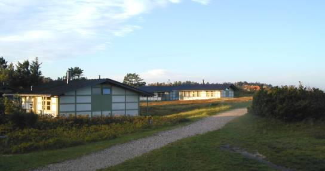
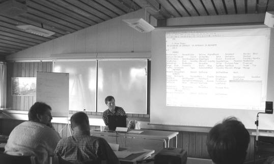
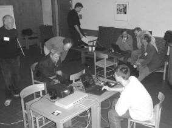
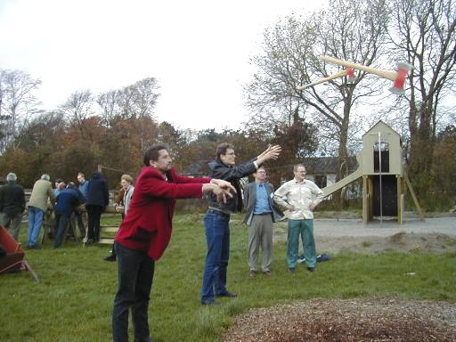
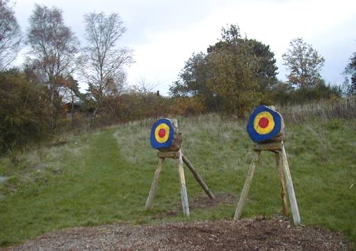
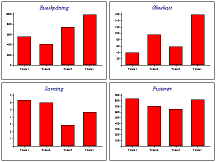

*notes by Adrian Smith, photos by Adrian Smith and Jim Lucas*
{ .byline }

## Where and Why

The idea of VikAPL was born early in 2000, rested for a while and was crystallised at Berlin, when it became clear that there was a real demand for a short, workshop-based gathering for the Scandic APL community. In part this was to share some of the Berlin material with a wider APL audience which had been unable to afford to take a full week out in July, and in part it was a desire to explore technical (rather than academic) issues in significant depth.

Accordingly Insight Systems (Helene Boesen did the bulk of the organisation) yielded to the pressure to set something up, and collared Pete Donnelly, Adrian Smith and Conrad Hoesle-Kienzlen who ‘volunteered’ to do the actual talking bit. The hope was to get around 25 attendees, and the realistic target was 20. Maybe the Millenium Dome could learn something here? Helene had to close the doors on late-comers when the numbers reached 40 and the capacity of the seminar rooms was clearly going to be exceeded.

  
**Gilleleje at Dawn**

The venue was excellent, the price very reasonable, the company good (as always at APL gatherings) and the social programme unbeatable (see below!). The meeting took place at the Gilleleje Holiday Centre which consisted of a central ‘hub’ housing the restaurant, sauna, bar, and seminar rooms – and a scattered collection of chalets distributed amongst the sand-dunes along the nearby coast. A brisk half-mile walk to breakfast does wonders to ensure the audience is awake for that 9:00am start!

The scheduling allowed for one full day on the Thursday (with an optional late arrival the night before) and most of the day following, after which many of the delegates retreated to the Hotel Hamlet in Helsingør for the Friday and Saturday nights (the reduced cost of the flight more than paid for the extra stopover time). As always, much useful work was done out of hours, especially as we ate together on the Friday night also.

## Presentations and Seminars

I was much too involved in preparing and presenting material to be able to take good notes here! I believe I scored a hit with my impression of a flock of birds on the Heathrow runway when faced with a change of wind direction (and hence oncoming Jumbo-jets) – this was actually introducing a serious example of graphics and data-analysis as part of Adrian’s Causeway seminar! Pete Donnelly took us through the mechanics of setting up the Dyalog DLL as an in-process OLE server (improving steadily in Dyalog Version 9, and very easy to run from an ASP script in a web-server) and Conrad showed us a strategy for replicating the mainframe interface using TCP/IP and an AP124-style engine.

  
**Pete Donnelly showing Dyalog 9 as an OLE Server**

The other two Causeway seminars were relocated to the downstairs bar (actually a rather good venue) where the primary focus was on documentation development with the originally-titled ‘HelpStuf’ application. I have been using this for many years to build help-files and large slabs of the website, as well as the paper manuals. Every time I think I may have finished it (to the point where it is stable enough to sell safely) something unexpected comes along and I start bolting on new stuff. Last year it was the new-format ‘compiled HTML’ files – myhelp.CHM – and this year it is the near-universal support for CSS-style sheets. I would very much like to do PDFs as a native format, but it is still unclear whether this is a viable long-term option or if HTML will overtake it soon.

This time, I used the seminar as an opportunity to test out the idea of a truly co-operative help-development system which could run locally on a LAN or even over the internet. Richard Smith used part of the time to show a TCP/IP application server which he developed for Adapta DLS in the week before the Berlin conference. Rather than hosting a multi-player production-scheduling application, this was used to run a multi-player tournament of a simple 2-player boardgame (see *Vector* 10.1 for the original design).

<table><tr valign="top">
<td> <b>A Coast-to-Coast Tournament in Progress</b></td>

<td>This was an excellent pressure-test of the server, as well as an interesting exercise in multi-user system design and aeroplane code for the Causeway Company. More usefully, it provoked some very good feedback on the essential elements of a trans-national documentation engine, in particular the requirements for multi-language support. The ‘single-user, single-site’ product will be for sale by the time you read this, and the working design for the ‘multi-user, single site’ version was scribbled on the back of one of Pete Donnelly’s handouts in the Hotel Hamlet on the Saturday. Multi-user, multi-site is much harder (until the internet gets so fast that the whole world counts as one site) but no-one else has written this one yet!</td></tr></table>

We also had time for a couple of short sessions on RainPro and NewLeaf, which were really problem-solving and debugging opportunities for existing users. I think the score was about 50:50 in terms of user-misunderstandings to genuine bugs which I knew about but had been unable to reproduce well enough to fix them. I think everyone went home happy as a result.

## The Viking Challenge

This was the fun-part of the experience, and will doubtless be remembered by the delegates long after the APL code has faded into obscurity. The first lunch break was followed by such traditional winter activities as log-sawing and axe-chucking, all against the clock and with a strongly competitive atmosphere between the four teams. I think Jim took the classic picture here, with both axes in flight ...

  
**Axes Away**

... and interested readers may attempt the Vector ‘Spot the Axe’ contest online. The cross nearest to the head of the axe wins!

## Spot the Axe...

  
**Spot the Axe**

The 2 lucky winners will have the honour of being used as targets in next year’s contest. No, seriously, we will think of something, probably Danish, very likely alcoholic, to be presented at the AGM. The booby prize will be a lifetime’s supply of *Gammel Dansk* (a very safe offer, as the life of the lucky recipient is unlikely to continue far beyond the first encounter).

For the record, the final scores in the Viking Challenge were as follows:

A decent veil will be drawn over the membership of the 4 teams – we know who we were!

## Should We Do it Again?

Yes, I think we should, but the timing is tricky. This was much too close to the APL2000 meeting, and the content was too strongly Dyalog-biased as a result. However the basic idea and format was very sound, and I hope Insight will have made a small profit from the venture – certainly they deserved to, having taken the risk and done all the hard work.

In many ways it complements the ‘Forests in Finland’ meeting so should probably stay in Scandinavia, but maybe should be in late summer rather than early winter? Of course winter does have the advantage that hotels are cheap and it is easy to get a provisional reservation for 25 people which can reduce or increase (within limits) as the bookings roll in. But ... someone has to run it which takes time and energy and organisation. Volunteers welcome if Helene can’t be talked into setting up VikAPL-2001.

***
