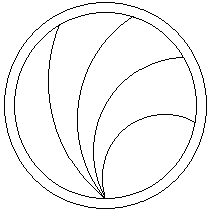
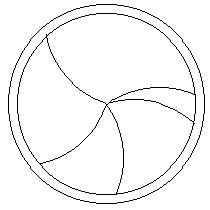
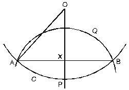
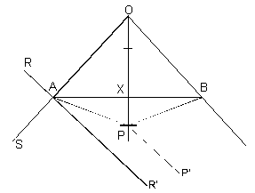

\[This article from Vol.15 No.1 contains some maths, included as Symbol font.\]

## APL and the Mountain

*by Anne D. Wilson*

## Introduction

As a mathematician who loves APL, is obsessed with needlework and hooked on software engineering; it was natural to combine all my interests, so that each individual activity is used for the good of the whole. I used the mathematical functionality of APL with the trigonometry learnt in my youth and some *turtle graphic* techniques; then exploited the facilities provided by both Windows and my trusty printer to produce a system for designing patchwork, which may be of interest to mathematicians, programmers, needlework designers and students of software engineering alike. The system has been extended to draw and print all-over patchwork patterns, regular shapes, various graph papers and oriental rug designs; the next extension will be to design bobbin lace templates.

This article describes the method of producing shapes based on intersecting circles, including the derivation of the formulae used. There is a discussion on some of the design principles used in the system, and a few comments on testing. Even though this is a recreational application I have used a professional approach to analysis, programming, and testing.

## Background

*What is this mountain?* Many years of sewing for many daughters has resulted in a boxroom full of small pieces of material; this is known as *Anne’s material mountain*. As a farmer knows his herd of cows so I know my scraps; their colour, textures and patterns. I could no more bin my *mountain* than the farmer could kill his cows mindlessly. The solution is obvious – kill the cows for meat, and make my scraps into patchwork.

I decided to use some of an excellent crop of lavender to fill pin cushions for Christmas presents and two designs of intersecting circles evolved. Armed with pencil, compasses, ruler and paper I started drawing paper patterns, but this soon became tedious, so I handed the task over to my computer.

<table cellpadding="8"><td align="center"> <i>Equal Areas Design</i></td>
<td align="center"> <i>Equal Radii Design</i></td>
</table>

In the *equal areas* design arcs of dissecting circles divide the *main or bounding* circle; these circles each have their centre on the circumference of the main circle, but their radii vary; they have a common intersection on the circumference of the main circle. Only one item of data is required to draw each of these arcs; the radius **or** the position of the centre, **or** the angle subtended by the chord to the centre of the main circle will suffice. The parameters required are the radius of the main circle and the number of divisions.

The *equal radii* design uses arcs of circles with the same radius as the *main or bounding* circle. Their centres are at randomly generated points on the circumference of the main circle, and therefore they all intersect at the centre of the main circle. The same parameters of radius and the number of divisions are required for this design.

## Practical Details

### Computer Requirements

I used a 486 Compaq with a colour screen. Colour enhances the appearance, but adds nothing to the functionality, nor is it printed, although I use filling patterns for some designs.

The volumes of data are small, so there should be no problem with memory or space.

### Printer

The system was written using an Epson LQ500 dot matrix printer for output. This is a 24 pin dot matrix printer, with 180 dots per vertical inch, but references to any of its parameters are by way of variables. The resulting print is accurate to the nearest pixel.

### Dyalog APL

I used Dyalog APL for Windows Version 7.0, a product for which I have much praise, and little criticism. Programs take on Windows compliant features almost automatically. Later version may have even better facilities, but I enjoy using this version. The tutorials and the presentation of information in the manuals made it a *Teach Yourself* package par excellence.

### Windows and the Clipboard

Microsoft Windows 3.1 provided many of the facilities used in Dyalog APL and controls output to the printer. Every attempt has been made to produce a system conforming to Microsoft standards. Output to the Clipboard facilitates export and import of the pictures, but I have problems with *cropping* and the circularity of exported shapes.

MDI (multiple document interface) allows many windows to be opened simultaneously, which is useful for a patchwork designer.

## Mathematical Calculation

### Equal area design

It seemed sensible to have all the pieces (a technical patchwork term with an obvious meaning) of equal area. Working out the necessary equation I soon realised there was no simple solution and that an iterative method was required.

The main circle is divided by a series of (n-1) arcs into equal areas. The problem can be reduced to finding a series of arcs which cut off areas of

p R2 × (1/n , 2/n, .....(n-1)/n)

The main circle is **C** centre **O** radius <b>R</b>  
The dissecting circle **Q** centre **P** radius <b>r</b>  
Circle **Q** goes through **A**, the common intersection point for all the circles

The advantage of using radians is that all references to P are contained within the definition of the angles, not in length and area formulae.

<table cellpadding="6"><td></td><td>

Let angle AOB = a 
Angle APB is subtended on the circumference of P 
  \ angle APB =  q = p-a/2 
OA = OB = R 
PA = PB = r 
AB = 2 R sina/2 = 2r sin q/2 = 2r cos a/4 
  \r = 2 R sina/4</td>
</table>

Area of DAOB = 1/2 (2R sin a/2) × (R cos a/2) = 1/2R2 sina  
Area of sector AOB = 1/2R2a  
  \\ area segment ACB = 1/2 R2a - 1/2 R2 sina = 1/2 R2 (a - sina)  
  \\ area segment AQB = 1/2 r2q - 1/2 r2 sinq = 1/2 r2 (q - sinq)

The required area is 1/2 R2 (a - sina) + 1/2 r2 (q - sinq)

Two iterations are used:

- outer loop for once for each dissecting arc;
- inner loop for successive approximations to find an angle giving an acceptable area.

Specifying the ends of the arcs requires further geometric calculations. For each circular arc the angles subtended from the centre of its circle needs to be calculated.

The line **OA** is taken as one axis of a co-ordinate system with origin at **A. RAR'** is drawn at right angles and gives the direction from which the angles are measured. **PP'** is parallel to **RAR'.** Note angle **SAP** is an external angle to triangle **AOP**,

<table cellpadding="4"><tr align="top"></tr><tr valign="top"><td rowspan="3">
</td>
<td>Angle R'AP</td><td> = SAP - p/2 = p - a/2 - q/2 - p/2  = p/2 - a/2 - (p/2 - a/4) = -a/4</td></tr>

<tr valign="top"><td>Direction PA</td><td> = angle P'PA = p + a/4</td></tr>

<tr valign="top"><td>Angle P'PB</td><td> = P'PA - q = p + a/4 - (p - a)/2 = 3a/4</td></tr>

</table>

I am constantly amazed at how geometric values simplify – would you ever guess that one of these directions would be three quarters of the angle at the centre?

### Equal radii design

The algorithm for the *equal radii* design is simpler. A geometric property of such circles is:

if O1 the centre of circle C1 lies on the circumference of C2 then O2 the centre of C2 lies on the circumference of C1.

To specify n circular arcs I generated n random numbers in the range 0.......2p ensuring they were not too close together:

p/2 × (n ? n) / n

The remaining code was lifted from the *equal area* function, see below on copying code.

## System Design and Testing

**Testing** should be incorporated into the entire life cycle of a system; much as breathing is incorporated into our entire lives. The advent of personal computing and the ability to trace the execution of the program makes possible a very immediate ongoing testing environment. All low level functions should be rigorously tested, and re-used as *black boxes.* If a system has complex logic this also must be rigorously tested; but this is a simple system and the menu bar acts as the high level design (see below) which makes it almost impossible to introduce errors at that stage!

**Design** is still important, especially:

- at the top level of design, at one time the job of the systems analyst;
- when coding complex algorithms.

Indeed it is very important to me to have my own systems easily alterable as I may not look at them for years and no-one else knows anything about them.

The use of Windows has to some extent removed the top levels of design. Whereas, once the programmer coded the initial entry into a system, and organised the relationships between different modules, and the flow of control around the system; with Windows this *just kinda happens.* The culture shock in coming from large mainframes to Windows lay mainly in the multitasking feel of Windows. Database systems address the problem of whether the customer can wait until tomorrow to see the effect of today’s withdrawal on his balance; this is the same problem as whether one open window needs to reflect a change in another open window.

**Copying code** across from one system to another results in **standardised** systems; copying from one function to another leads to standardisation within a system; OOPS adopt this idea. Of course, it saves on coding time, on testing and on planning; the downside comes if the original version is not good enough. Another, and usually better, method is to have low level functions for frequently used code; these will characteristically be called from several places; I visualise these as my dialect of the language, i.e. of AdwPL. The technical principal behind this is **bottom up development**, as Myers \[1\] says *“Bottom-up development and top-down development are implementation, not design, strategies”.* I work on the principle – the first time I code directly into the function, the second time I think it would be a good idea to have it separate, and the third time I pick the code out from the earlier two and put it into a separate function. Such functions should be rigorously tested when written, thereafter they will receive repeated testing as they are used by higher functions. The developer should be aware of any opportunities to include an OO (object oriented) approach.

One advantage of writing systems for oneself is that you can put time and effort into making it user friendly, and error free, rather like *running in a new engine.* Paper and pencil designs are very necessary for the overall design of a system, but they fail to *rub the corners* off when it comes to using a system. It is only when using it that you realise what would make life easier, and what is annoying to the user; for example I once added a function DISPALY whose only action was to call DISPLAY because I frequently mistyped! But **all** alterations must be fully tested, and must **not** impact on the existing code. Currently I am trying to introduce keyboard only systems as my mouse is dead; anyway I prefer using fingers to pushing mice.

### First Steps in Design

Knowing some of the functions that I want gives me an idea of the top level functionality of the future system. Rather than write this down I let the *menu bar* of Windows act as:

- **Documentation** – both using the menu item, and the *microhelp* for more details.
- **Top Down design** – by starting with the menu bar, and adding items under each level, although this is only suitable for 3 levels of subdivision.
- **Standardising** – using the File, Quit, Edit etc. that are familiar to all Windows users.
- **Aide de memoir** – storing stubs, without code, for functions I am still planning to include.

While developing and testing the system I test and refine the items included in the menu bar. It is necessary to restrict the levels in this imaginary *top down design* tree to:

1. main menu bar;
2. drop down menuitems;
3. *separators* between associated menuitems;
4. second level of menuitems (used with discretion).

If used, MDI windows should be part of the original design, otherwise all references to window objects may have to be altered if they are included in later. But once you have used them you will never want to go back to single window systems!

### Variables

Data, including variables, has a natural property of *hardness* which goes from *soft* for data which is updated, such as names and addresses, to *rockhard*, i.e. carved in stone (or rom), for items which can never be altered, such as the name of the original author of a system. In between are variables which control the execution of the program – screen colours, printer characteristics, the last setting of variables. The way in which these variables are included, and the method of altering them has repercussions on security considerations, on the ease with which a system can be used, and on the ease with which it can be changed to meet changes in circumstances. Below are notes on how some variables are treated, given in order of hardness, starting with the hardest.

**Hard coded variables.** This is the most difficult variable to amend. Looking at some (of my) code I noticed the vector 0 0 255, setting a particular colour for my computer, it may not be valid for another; far better to assign the value into a variable with an obvious name like *Red Green or Blue.* (N.B. must change my program.) That was bad! If the system requires that variables are coded into it, perhaps values for fonts of different size and weight, they should be coded in a function called by the first executed function, with meaningful names; then both function and variables are easily found if an alteration is required.

**Administrative Variables.** Use a menuitem entitled **Options** or **Administration.** I like to display a form which contains environmental variables about printers, page sizes, how to save data, scrollbars etc. It is customary to have default values which can be used to reset values; these may be coded into the program. Values are saved onto a file, updating occurs both when the values are altered, and on exit from the system. The file is read when the system is fired up; default values being used if the file is not available. If each user has their own file then they can create their own environment.

**Local Variables.** When drawing the circular designs for my patchwork there are 2 variables which will be changed frequently viz. the diameter of the circle for printing, and the number of dissecting arcs. Both of these have a limited range of values, and I have made use of scroll bars, which appear in the same window as the diagrams. Scroll bars restrict the user to entering only valid data – which means no validating in the program (hurrah!)! Values specifying the maximum, minimum and step sizes can themselves be held as variables; note that they will be *harder* than the variables they are describing. The scroll bar variables are stored on my personal file; this removes the annoying habit computers have of forgetting what you did last time. The appearance of scroll bars should follow a logical pattern, so that the user knows what to expect from past experience – standardisation again.

## Problems

Problems I encountered were due to inexperience on my part. My concentric circles were not concentric, and my mutually intersecting circles did not intersect until I assigned to the *Coord* property the value of *Pixel*. This applied to screen, printer and clipboard.

With Windows there are implementation restrictions on the number of objects that can be sent to the screen. Dyalog APL processes multiple arcs and *polylines* very efficiently, but if they are written individually the Windows processing time can be unacceptable for screen, printer and clipboard. Whilst this involves the encoding problem it does save loops, so must be a good habit; I am not alone in having problems with encoding and decoding – will I ever crack it?

## Sewing

An article about patchwork would be incomplete without details of making the pincushions. Having printed off the shapes, cut out the resulting paper pattern, allowing for turnings. If non-frayable material is used turnings are only needed on one side. Pin the pieces together, overlapping adjoining pieces, Hem neatly. Embroider with herringbone stitch over the joins. Cut out a larger circle for the sides and bottom. Run a gathering thread around the edge, and gather to the diameter of the top. Cut out 2 rounds of wadding, pack the lavender in the centre. Join bottom, top and wadding together, and smell!

## Reference

1. Glenford J. Myers: *Reliable Software through Composite Design:* Van Nostrand Reinhold 1975

***
