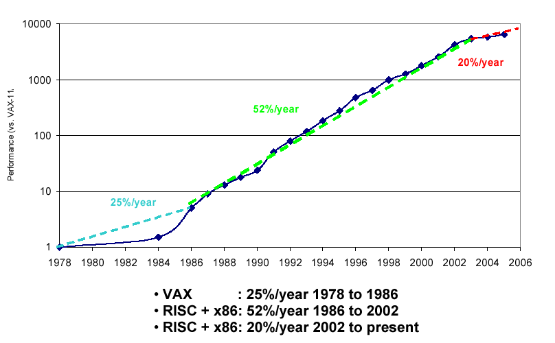
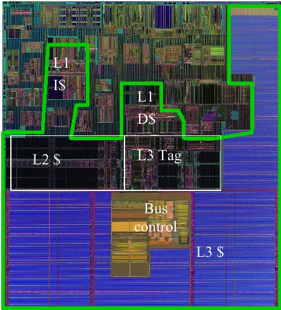
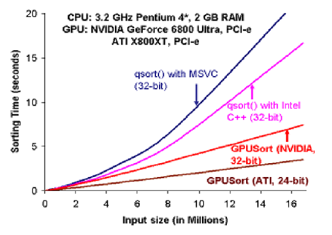

*reported by Adrian Smith (adrian@apl385.com)*
{ .byline }


## Location

The meeting was back at the Merchant Taylors’ Hall, convenient for the many city attendees, and the reception afterwards was at the very top of the Gherkin, which has to be the best view in London, particularly on a gloriously clear night. Thanks to Arthur and the Kx guys for inviting Vector to cover the meeting, and join the crowd (over 50 people attended) at the reception afterwards.

## The Seminar Programme

I think I can honestly say that all the talks were interesting, and several would have been worth the trip on their own. I particularly enjoyed Niall Dalton on the future of Moore’s Law and parallel processing, but then again I learned APL on a 370/148 with ‘vector assist’ so I can enjoy the sight of the wheel turning full circle!

### Chris Purves (Barclays Capital) on Kdb+, Java and Program Trading

This was a nice example of a small team delivering fast results on a mixed environment. The BATS team is a couple of traders, a couple of IT guys, and “our tame stats professor”who advises on the details of the algorithms. Kdb is used to hold the data, and Java is used to write the front-end applications. Chris was asked “why Java?”, and gave the very sensible reason that they knew Java very well, the bank was very comfortable with it, and there were some good tools freely available (like the 3D visualiser he showed later on). The basic requirement is to store, manage and analyse high-frequency market data. They started with 32-bit systems, but are now running on AMD Opteron systems each with 32Gb of RAM and around 4Tb of disk space. The Kdb engine is used “out of the box” except for a few extra feeds, The Java server-side software has the trading algorithms, and the Java client software is used for monitoring.

The statistics were carefully written to be independent of tick frequency, so that no distinction is made between realtime and historical data. The output from the analyses can easily be 100 times more than the input, so this goes into Kdb too! The system then allows for flexible charting of back-tests, and the front-ends allow the users to create and save ‘dashboards’ to get a quick overview of comparative performance.

The Java engine streams information from Kdb, orders the events, and passes the data through various time-series transforms using ‘grids’ of parameters to search the strategy-space quickly. The OO capabilities of Java are well used here as there is a standard 'strategy' interface into which new strategies can be plugged really easily to test out ideas. In summary, Kdb is essential for the volume and speed, Java is good for rapid development and deployment. Any speed issues could be dropped down into q, but the trading algorithms are very iterative, so it is likely that the (compiled) Java code would be as fast as the (interpreted) q code here.

### Jamie Grant (First Derivatives) on building a trading infrastructure

First Derivatives are the main support operation for Kdb and q developers in Europe. This talk outlined their work on taking many of the common components from the wide range of systems they support, and making these components available as a standard ‘starter kit’ for implementing a robust trading system. It will use a TCP/IP hub with a ‘publish/subscribe’ architecture to handle logging and alerts, and will provide a simple ‘execution engine’ to handle the actual mechanics of trading, and a matching ‘risk engine’ to validate requests before they are actioned. The Gui will be implentation-specific and will be the only part not written in q.

In answer to the question “How long?” Jamie replied that the design more or less fell out of an afternoon’s discussion, and that the basics were working in a month. Then of course there was some cleanup to do.

### Niall Dalton (niall@xrnd.com) on the death (or not) of Moore’s Law

For the original set of slides, see [the xrnd website](http://www.xrnd.com/kxtalk.pdf) where Niall has thoughtfully loaded up the PDF of his talk. He may well write it up in full for us in time for the printed edition of this Vector, but meanwhile here are my notes and quite a lot of the charts!

XRND sounds like a fascinating company to work for! They are a small group focussed on getting fast systems to run even faster, so Niall was in a very good position to comment on the impact of Intel’s designs on calculation throughput over the years. He started by showing various ‘quotes’ of Moore’s Law and asking the audience to identify what Moore actually said! To our credit, most of us picked “The number of transistors in an integrated circuit doubles every 24 months” – which is the correct answer and which is still holding rather well. The problem is “What are we doing with them?” which is a very different issue, and shows that processor throughput has very nearly levelled out.

<b>UniProcessor Performance (SpecInt)</b>  


Intel in particular have been working hard to give an illusion of parallelism by adding more and more tricks to the chip to try to keep the instruction pipeline full. Things like branch prediction, speculative execution, caching all serve to keep the processor running at full speed, but are incredibly complex, hard to maintain, and burned into the transistors. All this work uses power and generates *heat* whether or not the actual CPU is really busy. As Niall put it “The P4 is a very interesting processor, mainly for the things Intel got wrong”. They were hoping for 10GHz but we have flatlined at 4GHz, and even that requires a lot of cooling. In fact we have nearly reached the limits of air-cooling, which means that something *has* to change in our thinking. To rub in the point, he showed this picture of the Itanium II chip:

<b>State of the art?</b>  


Of the 211M transistors, around 99% move and store data, only 1% actually *change* data! At 1GHz, this chip dissipates 130 Watts of power over a die size of 421mm<sup>2</sup> which is a lot of heat in a small space! Niall showed a lot more charts to reinforce the point that we really have reached the limits of scalar processing, and that multi-core chips are the only way ahead. Which is where languages like APL and K are suddenly very interesting.

Here is a trivial algorithm that illustrates the problem with conventional (scalar) code

```
int find (float*x,int n,float y){
 int i;
 for (i=0;i<n;i++) if(y==x[i])return i;
 return -1;
}
```

Now in q you could write something more like `find:{[x,y] first where x = y}` which a ‘clever’ compiler could spot as intrinsically parallel and farm out among the processors. With only 32 elements this is still nearly 3× faster with parallel execution. In the C code, it is almost impossible to tell what can be safely run in parallel – even an apparently obvious example like adding two arrays *could* have been coded with two pointers iterating down data that overlapped in memory. A bad piece of programming, maybe, but quite possible in a pointer-based language like C. Even ‘good’ C programming can be really awful when it comes to moving data around – chasing pointers through linked lists is probably the *worst* thing you can do these days! Garbage collectors also get badly in the way – a language that uses reference-counting and does its own cleanup will always win on this type of hardware.

Oddly, the really pioneering applications are the 3D shaders embedded in today’s leading graphics chips. Even more strangely, people are learning to express simple algorithms like sorting and relational queries in the languages meant for painting triangles! The performance results can be astonishing:

<b>Running a simple sort on graphics hardware</b>  


The next Playstation uses IBM’s Cell hardware, which is 8× parallel, and can be 100× faster, but the launch date is going back and back. Maybe the reason is that no-one has yet discovered the right tools for high-level programming in a truly parallel architecture? Apart from q, there are SmallTalk, R, Matlab, Mathematica and almost no others which are widely known. It looks as if q could have a big advantage, as we already know the hardware likes it, and the simplicity of the syntax means the compiler needs very little help to implement it in a genuinely parallel way.

> *“q is one of the best languages I can think of that maps from the problem domain to what the machine wants to do”*

Which sums it up nicely!

### Simon Garland joining the Dotz

This was a short tutorial on the utilities available in the z. namespace, mostly for simple socket programming.

### Stephen Taylor on the danger of falling under the spell of IT

Stephen has seen the creeping menace of the IT professionals roll over many a productive APL shop, and (as he put it) the trading floor may be the last redoubt of the skunk works. His talk was born out of a lifetime of escaping ‘formal methods’ in favour of just sitting down with the users and getting on with whatever they see as important today. Hopefully he did at least make the audience aware that they were in possible danger, although my feeling is that this particular bunch of rabid programmers can fight off the IT steamroller more easily than most of us could. They have the power to make or lose millions in a day, and in the end that should be enough to keep their defences intact. Let’s hope so, because we all want to see APL prospering, making money for its users, and sending programmers home with a spring in their step. From the atmosphere at this meeting, I would say that Kdb and q do this better than most.

## The Reception

Was more than just a fabulous view, good snacks, and free drinks. It was also a good place to talk to the Java guys about data visualisation, the First Derivative guys about life in Ireland, and almost anyone about the fun of array programming. Interestingly, I got quite strong feedback that Stephen was warning of a danger many of them were aware of, but were confident they could defeat. Maybe if you are responsible for *that much* of your organisation’s profit (or of course loss) you really can tell the IT crowd where to stuff their silly rulebook? I hope so, for the sake of the Kx business, and for APL programmers in general.
