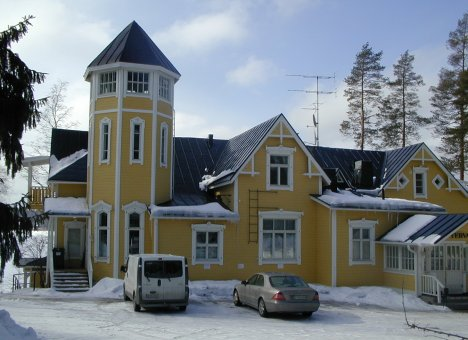
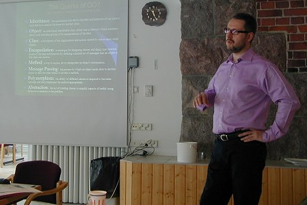
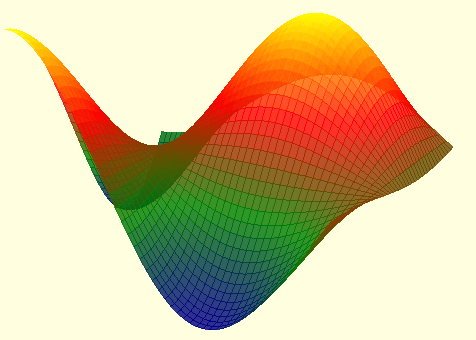
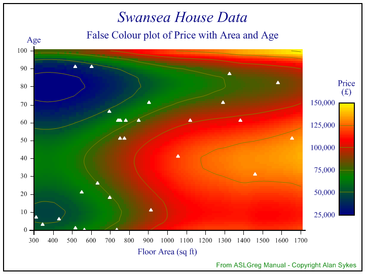
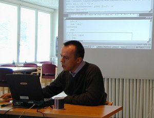
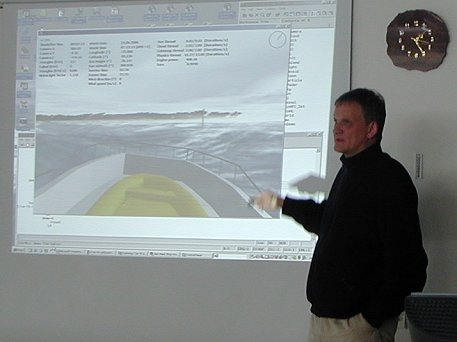

*reported by Adrian Smith (adrian@apl385.com)*
{ .byline }

## Location



Another great location, but the weather was less kind to us than last year. The one small patch of clear weather which gave me time to run around with the camera was a brief relief from continuous dull light, with the temperature just far enough above freezing to leave everything dripping, or sliding off roofs.

The location was really good, just an hour from Helsinki and in a collection of cabins centred around a friendly hotel and small conference centre. Thanks again to our Finnish friends who made life easy by facing the rush-hour traffic to collect us on the first morning, and for dropping us back in town on Friday evening.

Numbers were a little down this year, with just over 20 attendees. I think this was mostly to do with the later date colliding with children’s holidays – certainly several stalwarts had apologised in advance for not being there, and Richard was bribed with a glass of beer to do a shortened version of his Rowan presentation in the hotel in Helsinki on Wednesday night!

## Selected Highlights

Many of the papers (especially on day-1) were in Finnish, so I can really only report a flavour of the subject matter, and a feel for what the audience response was. Hopefully we may see some of these coming around in Vector one day in translation.

### Olli Paavola and Barcodes

Worth knowing about if you ever need to hook up an APL system to a barcode reader, or generate codes to print on output documents. The talk was more an illustration of the possibilities than a detailed technical ‘how to’ presentation, but useful to know that this can be done, and quite easily and reliably.

### Veli-Matti Jantunen with some Sudoku solutions

This one really does need the author to write it up for us. I get the flavour of an algorithm that was sifting the ‘entire’ puzzle-space rather than approaching it serially as an exercise in logic. This also had a very nice Gui that showed the development of the solution as the algorithm gradually became certain about the contents of the cells.

### Pertti Kalliojärvi on Dyalog 11



This was an excellent introduction to the new features in Dyalog 11, and the general principles of object-oriented design. Hard to know how much this will influence the current generation of APL developers – I still get the strong feeling of “very interesting, but what has it got to do with me?” from the audiences at these gatherings. I also suspect that APL still doesn’t go quite far enough to *really* get us using these new concepts. I find it quite hard to adapt to the C# world (which had this stuff from the beginning) and keep going back to the books to refresh my mind as to the differences between virtual functions and interfaces, or the nuances of private, internal and so on as access mechanisms. This stuff is quite a lot to get your brain around, and probably impossible to appreciate fully until you have built something real with it. Anyway, well done Pertti for trying!

### Jouko Kangasniemi on data visualisation

Lots of data series analysed with good quality, simple charts. One day I maybe should investigate the work Jouko has done on converting RainPro output to Flash (with the addition of some nice transitions and animations) but for now I am content to sit back and admire his work.

### Adrian Smith on new toys in RainPro



Two new facilities in RainPro are the ability to use smooth curves instead of straight lines to join points (in the 3D charts and contour plots as well as in simple timeseries) and the addition of altitude colouring both to 3D charts (as shown in the picture) and – more importantly – in contour plots. This stuff is also available to Dyalog 11 users as SharpPlot, and it adds quite a few handy features (like transparency support in PNG files) for those who are willing to move to .Net graphics.



This feature was requested by a Norwegian user who has sea-surface temperature data from a large number of sensors, and wanted to draw a simple map showing the patterns of variation. This is traditionally done with a set of ‘false colours’ which map relatively intuitively to the human conventions for ‘hot’ and ‘cold’. However the tricks to fit the surface to the spot-values are exactly what I was already using to make 3D meshes for the cloud chart, so RainPro needed relatively few new properties to extend this capability to flat contour plots. The colour for each tile is computed at a fairly coarse scale by draping a gaussian-weighted mesh over the x-y grid and using the averaged z-value to select from a vector of graduated colours. Then we assume that each of these rather coarse tiles is linear, and just break it up into 4 or 16 smaller tiles by simple interpolation. The chart shows Alan Sykes’ data from ASLGreg, as you may have never seen it before! Suddenly it is really clear that these is a region of expensive housing around 40 years old, with a floor area of 1500 square feet and above. I feel that this could be a really good tool for data-mining, and I look forward to seeing what Jouko and his colleagues can do with it in time for next year’s seminar!

### Richard Smith on Rowan (*Pihlaja* in Finnish) – a new APL for .Net

I think Richard chose a good name for his personal implementation of Iverson’s Notation – the first piece in Sibelius’ *Five Piano Pieces Op.75* is *Kun pihlaja kukkii* and the Rowan is a sacred tree in Finnish folk tales. The language has already been well described in Vector, but there were a couple of new ideas which are worth illustrating here.

Rowan now supports named arguments in addition to the traditional APL convention of *alpha* and *omega*, for example in the simple case, the two versions of `mean` are exactly equivalent:

```
   mean←{(+/⍵)÷⍴⍵}
   mean 3 4 5
4
   mean←{data: (+/data)÷⍴data}
   mean 3 4 5
4
```

Note that the white space after the colon is essential here! For functions of one argument (or two) the syntax just adds a little readability, but for functions which are required to take a fixed argument list, it has the big benefit that the inevitable error is tripped on calling the function incorrectly, rather than somewhere deep inside it:

```
   area←{ a b c: s←0.5×+/a b c; √×/s,s-a b c; }
   area 3 4 5
6
   area 3 4
R.LengthException: Argument list of area (3 items) different length to passed args
```

The result of any Rowan function is the result of the last statement which had a value (which is a slightly different rule from A+ where it is always the result of the last statement). I could have written `mean` as:

```
   mean←{data: (+/data)÷⍴data; }
   mean 3 4 5
4
```

... and it still works as I hoped. There are actually 2 statements here (the second one is empty) but Richard very sensibly lets me add the final semi-colon just in case I have my C# brain plugged up here!

Another nice idea in Rowan (which Dyalog could copy rather easily) came from reading a very early Iverson paper and realising that there was little point in computing huge boolean arrays if all you want is the index set of the *true* values. What we have is a new **operator** called *where* which modifies any Boolean-producing function to return the index values instead ...

```
   qq←⍳12
(1 2 3 4 5 6 7 8 9 10 11 12)
   qq>⌶7
(8 9 10 11 12)
   'Hello, world'=⌶'o'
(5 9)
```

I know Dyalog works around many of these cases with idiom recognition, but having the alternative clearly shown in the code has to be a better idea.

It was the ease of interfacing to .Net that really caught the audience’s attention. Suppose you want to read a simple text file into your Rowan workspace – there is an excellent set of utilities already in the .Net framework to handle this sort of thing, so you simply use what is out there:

```
   #using "System.IO"
   sr ← #new $StreamReader "c:/temp/fluff.txt"
System.IO.StreamReader
   SR:ReadToEnd
Hello again file
```

Rowan is very similar to Dyalog-11 here if for `#new` you read quad-new, but Richard chose to use a second prefix character to mark a word as a .Net type. This makes it very clear to the interpreter that it should look ‘elsewhere’ for the StreamReader, rather than taking the Dyalog approach of trapping the VALUE ERROR on first encountering a new name, looking it up and adding it to the symbol table if it finds it. I think that the only ‘reserved words’ in Rowan are ‘true’ and ‘false’ which I can live with.

Having discovered how to read a data file, the next step would probably be to create a simple GUI front-end to allow a user to interact with it. Now that Rowan supports the C# concept of ‘delegates’ (see Vector 22.1 for the technical details) it is remarkably easy to drive the .Net Forms library. Here is a little demo that changes the form colour as you wave the mouse around:

```
#using "System.Drawing";
#using "System.Windows.Forms";

gui.f_onMouseOver ⍅ { f msg:  // Simple 2D colour-chooser
 frx←MSG:X ÷ f:Width;
 fry←1-MSG:Y ÷ f:Height;
 c←$Color:FromArgb((⌊fry×frx×255) (⌊fry×255-frx×255) 0);
 f:BackColor←c;
};

gui.b_onClick ⍅ { sender args: =sender:Text };

gui.createForm ⍅ {  // Create a simple GUI testpiece
 f←#new $Form [];
 f:Text←"Rowan form";

 b←#new $Button [];
 b:Text←"Press me!";
 b:Click←#delegate $EventHandler b_onClick;

 b2←#new $Button [];
 b2:Text←"Hello, world";
 b2:Click←#delegate $EventHandler b_onClick;
 b2:Location←#new $Drawing.Point(b:Size:Width,0);  // Set b2 beside b1

 f:Controls:Add b; f:Controls:Add b2;
 f;  // Return ref to form
};
```

Running the script the defines the function to create the main form (and two buttons) and sets up some event handlers. A couple of notes on the script file are in order here – the `⍅` character (called left vane) is required to assign the functions **globally** into the workspace, as any ordinary assignment arrows are local to the script file (which is treated by Rowan as if it were a function). Note the use of monadic `=` in the handler for the buttons – this simply echoes its argument to the session. The facing brackets `[]` are the Rowan way of specifying an empty array. Named arguments really come into their own here, as the event-handlers are typically passed a reference to the object and a message of some kind. The buttons ignore the message and just echo their respective captions to the session. In the case of the colour-chooser, the handler needs the form `f` and the `X` and `Y` properties of the mouse-move `MSG` to compute a new colour. Anyway, once you have run the script to create the handler functions and make the main form, you can:

```
 ff←gui.createForm;
 ff:Show;
 ff:Opacity←0.6;
 ff:MouseMove←#delegate $MouseEventHandler gui.f_onMouseOver
```

You really need to go to [Richard’s Rowan webpage](http://www.redcorona.com/rowan) and download a copy to see the full effect – this example is included with various sample scripts for you to try. You will have to get used to writing ‘:’ to invoke methods and refer to properties, but otherwise you should find that everything you read in the .Net documentation just “works out of the box”as there is really nothing between what you type into the session and the .Net runtime engine, except a very thin layer of Rowan parser! To show just how thin a layer this is, try:

```
   1234.45:ToString "#,##0.00"
1,234.45
```

Even a simple scalar value can run the standard ToString method, passing a picture formatter. The syntax has been slightly special-cased with *each* to have the methods extended to vectors:

```
   qq←23 45 12345
(23 45 12345)
   qq¨:ToString "#,##0.00"
(23.00 45.00 12,345.00)
   +/qq¨:ToString " #,##0.00"
 23.00 45.00 12,345.00
```

The last line should be a little bit of a puzzle, until you realise that C# overloads the `+` symbol to mean catenation of strings, so Rowan followed along with this slightly bizarre convention!

#### Extending the Rowan function set

Richard also showed just how easy is was for a C# programmer to extend the language, so that any unused symbol in the APL Unicode set could be allocated a new meaning. To illustrate this, he made a little example which used the `⍇⍈` characters to read and write text files:

```
using System;
using System.IO;
using R;
using RedCorona.Rowan;

public class FilePlugin : IRowanPlugin {
 public void Load(IRowanEngine engine){
  engine.AddFunction("⍇", new VerbInfo(new MonadicFunction(ReadFile), null, null, null, 0, 0, 0, false, null));
  engine.AddFunction("⍈", new VerbInfo(null, null, new DyadicFunction(WriteFile), null, 0, 0, 0, false, null));
 }

 Symbol ReadFile(IEngine engine, Symbol fname, object data){
  StreamReader sr = new StreamReader((String)fname.Value);
  string s = sr.ReadToEnd();
  sr.Close();
  return new Symbol(s, ObjectType.String);
 }

 Symbol WriteFile(IEngine engine, Symbol textSym, Symbol fname, object data){
  string text = (String)textSym.Value;
  StreamWriter sw = new StreamWriter((String)fname.Value);
  sw.Write(text);
  sw.Close();
  return new Symbol(text.Length);
 }
}
```

There are plenty of handy symbols out there that no known APL ever used, so this would be a really good way to integrate one of the many excellent (usually free) maths libraries into Rowan, if you really needed a fast fourier transform, or the eigenvalues of a matrix as part of your interactive environment. This was definitely a worthwhile outing, as Richard & I came away with plenty of new ideas for the Rowan session, and a simple project management capability modelled on the J talk that followed on day-2 (and from discussions with Anssi Seppälä in the hotel on Wednesday evening). It’s only a tiny download, so give it a go and tell us what you think of it!

### Free Time, Sauna, and Dinner

The lake was frozen so hard that there was no possibility of a post-sauna plunge, so we had to content ourselves with throwing snowballs at the trees. Shame!

### Sami Laitinen APL and Excel (part II)

Sami works for Nordea, and uses APL to calculate mortality curves for estimating the future value of pension funds. He was driving this through the APL COM interface, but large organisations have a habit of making life hard for in-house developers and now he can no longer register COM servers as part of an installation. So he has fallen back on using a simple DyalogRT setup, writing the parameters to a text file, starting APL, and waiting for the results to compute before resuming processing in Excel. He also mentioned a nice little piece of work where he translates APL to VBA code, using cell references for variables and calling a library of VB functions to implement the APL primitives. I hope he and I may be able to co-operate a little here one day, as this is very like the work Causeway has been doing with C# translation.

### Antti Korpela on reading the Bloomberg data streams in APL

As Antti said in his introduction, this was a very short paper because he just tried out the stuff and it worked! The surprising thing was that the data structures returned by the Bloomberg OCX were wonderfully suited to APL and could be used more or less directly as a nested vector of matrices. This paper will be printed in full in the next Vector, so no more is needed here!

### Esu Lippu on software testing with J



This was valuable stuff, partly for the J examples, but mostly for the concepts. This system allows ‘before/after’ comparisons of database tables (read via the J ODBC interface) which have been populated around the time of a major software update, and it then flags up unexpected changes in values. These can be picked out analytically with some rather simple J expressions, or visually with some nice 3D plots,

Typically there will be a raft of minor changes which are fine (after all, we have fixed the software) but the occasional major systematic change which is almost always an alert for a new bug.

### Tomas Gustafsson goes boating (virtually)

All you need is a graphics card with a level-2 shader, a managed C++ .Net assembly that can compile HLSL (High-level Shader Language) and APL to do the physics of just how a boat bounces off your generated waves, and off you go!



This really is getting very good indeed, with a frame-rate better than 30fps complete with flying spray, reflections, and wonderfully realistic water. Like all games engines, DirectX cheats like mad to fake realistic effects, but mostly it works (except when Tomas decides to frighten the audience by driving the boat straight through a very solid-looking island!). An excellent round-off to a most enjoyable two days.
