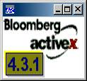

by Antti Korpela (Antti.Korpela@nordea.fi)
{ .byline }

This is a short “getting started by examples” description on how to get Bloomberg data directly into APL arrays.

**What is Bloomberg?** The following quote is copy-pasted directly from the Bloomberg home page:

> <b>About Bloomberg</b>  
> *Bloomberg is the leading global provider of data, news and analytics. The BLOOMBERG TERMINAL and Bloomberg’s media services provide real-time and archived financial and market data, pricing, trading, news and communications tools in a single, integrated package to corporations, news organizations, financial and legal professionals and individuals around the world.*
>
> (source: www.bloomberg.com)

## Background

About two years ago I needed to do some investment portfolio analysis at work and I happened to have (among other things) Bloomberg and Dyalog APL in my workstation. Almost immediately I got the feeling that it would be practical if I could get the data directly into APL-arrays. After a quick look at the documentation I realised that there are plenty of examples on how to get the data into Excel. The obvious conclusion was that then it shouldn’t be much more difficult to get the data into APL either. So I decided to try it out.

## Requirements:

- Bloomberg Terminal
- Any APL supporting Windows OCX-Controls

## Example function to connect the Bloomberg Data Control

OK. Let’s get started. The OCX is a graphical object. The following function takes an object name, position and size as arguments and returns a name for the created instance. If the data control does not exist, the result is empty character vector.

```
      ∇ bloom←{bb}LoadBloomberg arg;ob;p;s;v
 [1]
 [2]   ⍝| Loads the Bloomberg Data Control
 [3]   ⍝| ob ≡ parent object
 [4]   ⍝| p  ≡ position
 [5]   ⍝| s  ≡ size
 [6]
 [7]
 [8]   ⍝| bloom ← name for the created instance
 [9]   ⍝| bloom ← '' if Bloomberg not available
 [10]
 [11]   (ob p s)←arg
 [12]
 [13]
 [14]   :If 2≠⎕NC'bb'
 [15]       bb←'#.bbdatacontrol'
 [16]   :End
 [17]
 [18]   :Trap 11
 [19]       bb ⎕WC'OCXClass' 'Bloomberg Data Control'
 [20]       bloom←ob
 [21]   :Else
 [22]       bloom←''
 [23]   :End
 [24]
 [25]   :If ''≢bloom
 [26]       bloom ⎕WC bb
 [27]       bloom ⎕WS('Posn'p)('Size's)
 [28]   :End
      ∇
```

The next step is to try it out:

```
 'f' ⎕WC 'Form'('Size' 10 10)
       ''≢#.gBLOOMOB←LoadBloomberg ('f.bbexample')(0 0)(100 100)
 1
```

If everything worked out, we’ll get the GUI:

{ width="123" height="114" }

Now we should be ready to access the data.

## Example Function to Load Historical Price Data

The following function loads daily price data for given securities. The result is a three dimensional data cube for which the dimensions are number of days, number of securities and two for date and price.

```
     ∇ rslt←bloom BloomHistory arg;tickers;fields;start;curr;end
 [1]
 [2]   ⍝| bloom ≡ name for an instance of Bloomberg data control
 [3]
 [4]    (tickers fields start curr)←arg
 [5]
 [6]    :With bloom
 [7]        ActivateRealtime←0
 [8]        Periodicity←bbDaily
 [9]        DisplayNonTradingDays←AllCalendar
 [10]       NonTradingDayValue←PreviousDays
 [11]       rslt←BLPGetHistoricalData2(tickers fields start curr)
 [12]   :End
      ∇
```

Time to test the function – for example Nokia’s price from last 12 days in euro currency:

```
     arg←('NOK1V FH Equity' 'PX_LAST' '20060331' 'EUR')

      M←#.gBLOOMOB BloomHistory arg

      ⍴M
 12 1 2     display ¯3 1 2↑M              
 ┌┌→──────────────────────────┐
 ↓↓ ┌→───────────────┐        │
 ││ │2006 4 9 0 0 0 0│  17.02 │
 ││ └~───────────────┘        │
 ││                           │
 ││ ┌→────────────────┐       │
 ││ │2006 4 10 0 0 0 0│ 16.97 │
 ││ └~────────────────┘       │
 ││                           │
 ││ ┌→────────────────┐       │
 ││ │2006 4 11 0 0 0 0│ 16.81 │
 ││ └~────────────────┘       │
 └└∊──────────────────────────┘
```

The output is very convenient for an APL programmer – a simple cube of data, time in <span class="aplu">⎕TS</span> format and no garbage to filter away. And as we can see from the example function, Bloomberg provides many useful options on the data content.

## Another Example – the Subscribe Function

In addition to price data, the Bloomberg database contains huge amounts of all kind of information. For example, the following small cover function might be useful:

```
      ∇ rslt←bloom BloomSubscribe arg;tickers;fields
 [1]
 [2]   ⍝| bloom ≡ name for an instance of Bloomberg data control
 [3]
 [4]    (tickers fields)←arg
 [5]
 [6]    :With bloom
 [7]        rslt←BLPSubscribe arg
 [8]    :End
      ∇
```

Let’s try that out as well:

```
      mybonds←'RFGB 2.75 07/06 Govt' 'SPGB 3.0 07/07 Govt'
      fields←'NAME' 'CPN' 'MATURITY'
      display M←#.gBLOOMOB BloomSubscribe mybonds fields
 ┌→─────────────────────────────────────────────┐
 ↓ ┌→─────────────────┐            ┌→─────────┐ │
 │ │FINNISH GOVERNMENT│       2.75 │07/04/2006│ │
 │ └──────────────────┘            └──────────┘ │
 │ ┌→───────────────────────┐      ┌→─────────┐ │
 │ │BONOS Y OBLIG DEL ESTADO│ 3    │07/30/2007│ │
 │ └────────────────────────┘      └──────────┘ │
 └∊─────────────────────────────────────────────┘
```

## Conclusion

Independent of what one is up to (descriptive information, prices, cash flows ...) it turns out that the output is always in a very practical shape from an array programmer’s perspective. The interface is easy to use and provides another example of that it’s quite often worthwhile examining what you already have on your workstation.

***
