by Ian Clark <span class="affil"></span> <span class="email"></span>
{ .byline }

### Introduction

When I sent away for the free Mathematica trial disk, version 5.2 hadn’t yet been released. When it came out I upgraded my system. As a rank beginner addressing other rank beginners where Mathematica is concerned, this is hardly a review of 5.2 so much as a review of Mathematica itself. But Mathematica needs no promotion from me – its user base is huge and extensive, far beyond the provenance of Mathematics, pure and applied, as a typical university department understands it. This article therefore is aimed at jobbing APLers like myself whose exposure to Mathematica may be slight.

I first came across Mathematica at an educational exhibition nearly 15 years ago. I remember thinking then that insofar as it was like APL – it was good, insofar as it wasn’t – it was bad. And I was averse to typing: Plot\[Sin\[Exp\[x\]\], \{x, 0, 4\}\]... as any APLer might be who had been forced to use C/C++.

How blinkered I was! Nobody criticises Dreamweaver because HTML is so ugly to type. For the six months I’ve had Mathematica to play with, I’ve scarcely typed a line of Mathematica language like the above. For nowadays the Mathematica engine has a top end!

I ought to have known better, of course. In 1973 at the Peterlee scientific centre I came across Salah Mandil and his symbolic differentiator. This was built on top of a macro-processor, not unlike the C preprocessor. I was awed by the power of the technique. As a mathematician I should have been suspicious of the Babbage school of computing which saw a mathematical formula as the (unwieldy) specification for a series of instructions to be performed in sequence on a numeric accumulator. The symbolic differentiator never handled a mathematical variable as a binary quantity at all – it certainly never performed finite difference, in circumstances fraught with rounding errors, and pretended it was doing calculus. But I had been retreaded as a computer programmer and I’d somehow got it into my head that this was how it had to be done.

I quickly got the idea and tried writing a symbolic Fourier analyser. Artificial Intelligence was then all the rage, at least among those of us short on the natural variety, and the idea appealed to me of applying a communications engineering technique of looking for a signal-in-noise in a system which actually had symbols for what it was looking for – in other words one that had “thoughts”. It never got very far, but I saw no barriers that couldn’t have been overcome if I’d had the time to spend on it that Salah had done on his differentiator. Glancing at the publications produced by the Mathematica team, judging by the titles alone it seems they’ve had the same idea, and I look forward to getting hold of Mathematica for keeps in order to wallow in their investigations.

### Everything is an Expression

## 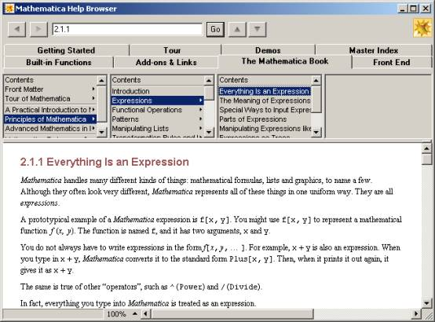

**Figure 1:** The Help Browser, showing "Everything is an expression".  
Note the tabs, which list the chief sources of information to learn about Mathematica.
{ .caption }

In Mathematica everything, but everything, is an “expression”. And an expression is a string of ASCII characters to be filtered (you can see the C/Unix world view coming through strongly here). An expression breaks down into function calls, like Sin\[...\] and Exp\[...\], and if at the end of the day you want the system to do something more than simply spit out a string of characters you have what used to be called “semantic”functions (although I haven’t seen the term used in the vendors literature) – functions like Plot\[...\] and Play\[...\], plus all the GUI furniture you’ll ever want. If you want the system to give you numbers, then at some stage a semantic function like N\[...\] must cut-in and start converting symbolic numerals to binary. Although one of the chief features of release 5.2 is full support for 64 bit computing, I imagine the binary stage is put off as late as possible. Indeed if you compute 1023<sup>1023</sup> or 1000!, what comes out is an extremely long integer, suggesting to me that it’s all done symbolically.

This contrasts strongly with the APL view of the world, where the whole time you’re conscious of handling vectors of binary “num”elements.

It’s refreshing to meet a product again with such a brutally logical backbone of design – something that was much sought-after in the Sixties and exemplified by systems like LISP and Prolog. Who nowadays would think to build a GUI on top of a string processing engine and aim to represent every meaningful GUI event as a semantic function processed by the engine? Certainly none of the Mac/Windows-bemused design teams I’ve worked with over the last 20 years, who thought it clever to chop your application up and stuff it into event handlers. But if you go the Mathematica route to software architecture you're no longer held hostage by your platform.

I recall many an experimental project which tried to encapsulate some classic APL interpreter being brought to its knees because the APL was built on the assumption that the user had a “break” key to press at any given moment. Or that the user was freely able to compose overstruck characters by multiple use of the forward and backspace key in any order which brought the golfball back over the same spot. This is what I mean by giving hostages to your platform. Having seen countless man-hours wasted in porting heritage systems across five generations of end-user interface, exemplified in APL by <span class="aplu"> ⎕, ⎕SM, ⎕SVO, ⎕WC/⎕WI </span> and <span class="aplu">⎕NC 9</span>, forgive me for being edgy about the ill-patrolled border between application and user-interface.

Mathematica seems to have sidestepped all that. It shows. I got the chance to put its much vaunted portability to the test, shuttling work-in-progress between Windows and Mac. It was unbreakable. Microsoft please copy with Office. Although, like getting to Tipperary, if they really wanted to do that, they wouldn’t start from where they are now.

### The Notebook (.NB)

The fundamental file format of Mathematica is the Notebook (.NB). It is common to the whole range of Wolfram products: a notebook created with one product can be used with another. There is no space here to do more than briefly touch on a few. For the whole range see the Wolfram Research website \[[3](#ref3)\].

**Publicon** \[[6](#ref6)\], aimed at the problems of typesetting mathematical documents. More elaborate pallettes like Figure 3, a library of templates for research papers, handouts and any form of document you can think of, import/export into a range of other formats. But Publicon does not evaluate expressions.

**webMathematica** \[[7](#ref7)\], billed as a “one-stop solution for putting interesting science on-line’. In passing let me note the existence of MathML, a proprietary HTML-extension standard to embed formulae into a web-page, which Wolfram products support.

If you drop a notebook onto MS Notepad you’ll see that it is nothing but a text file in Mathematica language (and in printable ASCII only). On the principle that everything is an expression, a notebook consists basically of the expression: “Notebook\[..\]”, plus a lot of comments. Some of those comments are cached data. Some are helpful instructions on how to edit the file by hand, including how to disable the cache (simply remove the comment: “(\*CacheID: nnn\*)”) and let Mathematica regenerate it. Mathematica users are treated like grown-ups.

When you import an item of miscellaneous data into Mathematica, such as a JPEG or a WAV, it is cached inside the notebook and is available even with MathReader, without the original JPEG or WAV needing to be accessible. You can even append the notebook to an email (it is after all printable ASCII only) and send it to a colleague. The notebook itself shows the necessary instructions to strip it off the email and use it effectively.

Without the magic password, which is essentially what Wolfram Research sells to you over the Web, Mathematica operates in a crippled mode called MathReader. You can also download MathReader for free \[[1](#ref1)\]. I recommend everybody to do so. With it you can view any notebook as it is meant to appear – this includes viewing the plots and playing the sounds. You thus have access to the whole knowledge-base \[[2](#ref2)\], which for me was like a ticket to a first-class technical library. I was tempted to send myself back to university and learn the subject properly this time.

More importantly, for an APLer with time to tinker, if you write an APL workspace to construct a notebook, you get a free viewer with many of the features of a web browser, able to portray mathematical notation. Plus hypertext and a range of pretty notebook formats. Figure 2 shows my favourite notebook format (a pleasant pinky-brown), but this is a matter of taste. It is not however the one used in examples below (the default) which is black/white only.

MathReader allows you to change format according to a meagre repertoire, but the notebook formats provided with Mathematica proper are much more varied.

## 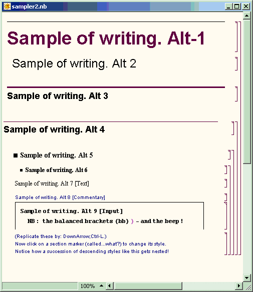

**Figure 2:** The various built-in paragraph styles, displayed for one of the many notebook formats.  
The template of a notebook can be changed with a key-click, even whilst composition is underway.  
The “Alt n”suffix shows which key-chord to hit to get the style in question.
{ .caption }

The vendors seem to recognise that it is possible, indeed easy, to write your own notebook-processor and don’t put blocks in your way. They reckon of course that they have already written tools to do whatever you may fancy doing. Suffice to say that I’ve abandoned my own little APL project to produce a mathematical display for pupils to tweak in order to do things like cross multiply, cancel out and collect terms.

All the instructional material, whether manuals or online help, comes in the form of notebooks. Nothing better demonstrates the vendors’ confidence in their own product, its flexibility and suitability as a vehicle for expository material. Which APL vendor would have the chutzpah to ship all the online help, sample output and instruction manuals as workspaces (or session-log dumps)? An extensive collection of notebooks come with the free CD or the downloadable product installer. See also \[[4](#ref4)\].

### Composing and executing expressions

You can write all your expressions in InputForm (as in Figure 10), which I suppose was the original way Mathematica was used. You can run the Mathematica engine, the “kernel”, on its own and interact with it like APL. But the top-end gives you better tools, notably a collection of palettes, the chief one being Figure 3.

## 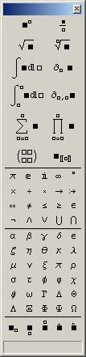

**Figure 3:** One of the palettes to help you compose classic mathematical expressions easily.
{ .caption }

When you run Mathematica, the above palette appears, as does a windoid across the top of the screen consisting of nothing but a menu (Figure 4). When using the palette, the little squares (“holes” I suppose you could call them) in the symbolic construct you’ve just pasted-in become accessible using the tab-key. You can then employ the whole of the palette to insert a nested formula. Thus, for an expression with a complicated numerator and denominator you’d click the symbol on the top-right, then tab to each hole in turn and compose a separate expression in each.

You’ll notice a matrix of four holes on the 6th row of symbols. You’re not limited to 2×2 of course – further holes and rows can be added by pressing various key-combinations.

When the windoid of Figure 4 is showing, you can click through onto the desktop to open any notebook. Or you can do it the boring old way and open the File menu. Mathematica provides an indexing service to locate all the notebooks on your machine, assuming that you’ll want to keep your lifetime’s work in extensive libraries, but I didn’t examine this. (But it seems something that APL vendors might usefully copy.)

## 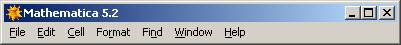

**Figure 4:** The Mathematica topbar.
{ .caption }

When I launched Mathematica for the very first time, I said to myself: “It’s an APL...”, so I promptly typed 1+1 and pressed Enter. Nothing happened! Good start, I thought... but I was being crass. That works with the kernel, but the user metaphor for a notebook is a word-processor. You just get a new line.

What I should have done was press Shift+Enter! But by now I decided I didn’t really know what I was doing, so instead of thrashing around I took the Ten Minute Tutorial – which Mathematica invites you to do in a hard-to-miss banner when it launches. I think the does its job splendidly. It’s so effortless and simple-stupid I suspect they spent a lot of time and effort getting it right.

## 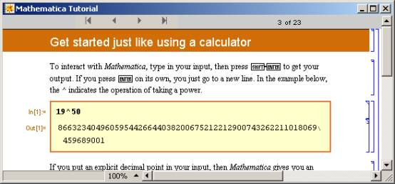

**Figure 5:** The super-efficient “Ten-Minute Tutorial”: the best introduction to Mathematica for a rank beginner.
{ .caption }

Note that this Tutorial is nothing special in the way of notebooks, but of a sort you can easily write yourself. From Figure 5 you’ll see (rather better than with the all-blank default notebook format which you get on startup) that a notebook consists of a series of cells. Each cell can be a paragraph (or some other construct like a link or a bullet item), but the cell to focus on is a nested pair of input/output cells. By default you start creating an input cell. When you press Shift+Enter, it completes the input cell and calls the engine to create an output cell just below it to hold your answer: a number, an expression, or a plotted figure. You can range up and down the notebook inserting, deleting and cloning cells in any order, and you can re-execute existing cells – whereupon the output cell recomputes. It seems a lot more orderly and flexible than a typical APL session, where you need a lot of experience to mix active and passive text confidently, but it’s no more cumbersome in use. Apart from remembering to hit Shift+Enter, you can build up a notebook as if it’s APL.

## 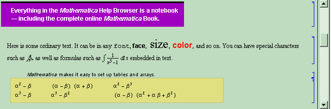

**Figure 6:** From the Help Browser: “Tour”.
{ .caption }

### Let’s play...

Mathematica is an APL in the modern sense of the word: an “array-processing language”. It happily applies its mathematical operations to data items like: z whether or not z is a single number, a list of numbers or a matrix. Below we assign z as a list:

## 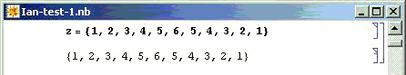

**Figure 7:** Inputting a list of numbers by hand.
{ .caption }

This is a little bit artificial: a practical applications will typically get its numbers from some data source like a database, a TXT, an XLS, a WAV, a BMP or a range of other formats.

Note the gubbins in the right hand side of the window. This delineates the scope of the input and output cells, and the cell which contains them both. Input and output cells often appears in different formats. The main formats used with a notebook (there are many others) are:

1. TraditionalForm: the one you see in Mathematics textbooks. It happens to be ambiguous (I didn’t know that!) – so Mathematica offers you:
2. StandardForm: a two-dimensional notation resembling TraditionalForm, but robust, unambiguous and a bit clunky-looking. You can compose it directly using the palette, or with modified keystrokes (Ctrl+, Alt+, etc.) if you prefer not to mouse around. Mathematica uses it by default for output cells.
3. InputForm: what you can type-in as visible keystrokes, if you’re so inclined.

There are quick ways of taking an output (or an input) cell and re-entering it as a consecutive input cell: a thing you’re always wanting do in a mathematical investigation, and you can switch a cell between forms by a simple keyclick. It’s instructive to do so: it shows you how Mathematica handles a conventional-looking expression internally.

To begin with I wondered if Mathematica kept all expressions in StandardForm and simply let the top-end reformat the cell appropriately. However the following examples show this is not so: the displayable data is kept in a form appropriate to how it is displayed, the kernel being relied upon to do any required string conversion when you change a cell’s format. Here is the text of a notebook I managed to whittle down to one (input) cell, expelling everything inessential:

```
Notebook[{
Cell[BoxData[
        FormBox[
          SuperscriptBox[
            RowBox[{"(",
              RowBox[{SubscriptBox[StyleBox["x", "TI"], "2"], "-",
                OverscriptBox[StyleBox["x", "TI"], "_"]}], ")"}], "2"],
StandardForm]], "Input"]
}]
```

and here is how Mathematica/MathReader displays it:

## 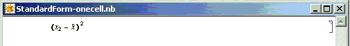

**Figure 8:** How Mathematica displays the one-cell hand-edited sample notebook: *StandardForm-onecell.nb*
{ .caption }

If you edit StandardForm-onecell.nb to change the word StandardForm to TraditionalForm, this is what you get: a more graceful font worthy of the Enlightenment from which modern Mathematics sprang:

## 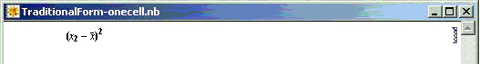

**Figure 9:** How Mathematica displays the one-cell hand-edited sample notebook: *TraditionalForm-onecell.nb*
{ .caption }

Here is an example of InputForm, a linearised notation which shows up in bold in the notebook format we have selected:

## 

**Figure 10:** An example of InputForm, as Mathematica displays it.  
(The connector: “/.”is to be read as: “such that”.  
You type-in the right-arrow as “hash/greater-than”)
{ .caption }

Note the way in which values are temporarily substituted for the “mathematician’s” variables: a, b and c, viz. not by “assignment” (=) as was done for z above. The variables only take these values for the scope of the expression whilst it is being executed. Mathematica is more hard-line in its InputForm syntax than APL, demanding commas between numbers, plus curly brackets round the lot to denote a list (but it’s amazing what can be listed). Its strong C/C++ accent betrays its background: “=” meaning assignment and “==”meaning “equals”, the one concession to a programmer’s view of notation rather than an algebraist’s.

The difference is an important one. Variable a, b, c, here are “mathematician’s” variables whereas z is like an APL global var – a “programmer’s” variable. The former are placeholders which take the same value throughout an expression – whatever you, the mathematician, decide they should take. The latter isn’t – it can take part in mathematically-absurd expressions like: z=z+1. It’s really just a label for a storage location.

Mathematician’s variables behave themselves when you save the notebook and reload it later. A programmer’s variable like z doesn’t – its value is not remembered between saves! Apart from this one silly little pitfall, you can reload a notebook and everything works – the plots re-plot, the sounds replay, the imported data is still there – it restores to the exact state in which you saved it. Better still: I moved my notebook from a Windows machine to a Mac – and not only did it look the same but everything worked the same – including the sounds! I was most impressed.

But not the “assigned”variables! They had to be re-evaluated by re-executing the last line which assigned them. This isn’t just sloppiness, or an uncharacteristic oversight: it’s an example of the rigorous logical thinking that informs the design of Mathematica throughout. You’ve got to imagine some nazi archangel up there saying: “You want a programmer’s variable? – you get a programmer’s variable! – and if you don’t like it, try learning some Mathematics!”

Incidentally, I like the way Mathematica structures its error messages. A series of Alert boxes would be just plain maddening, so mostly you just hear a beep. At your leisure you pull down the Help menu and select “Why the beep?... Shift+Ctrl+H”.

I must confess that as soon as I saw that menu item I selected it, hoping to get some idea how Mathematica structured its error information. I got the bald message: “Mathematica hasn’t beeped yet!” I could feel that nazi archangel frowning down on me, shaking its head in disappointment. (...So why not grey-out the menu item?)

Now that we’ve assigned a value (a list of numbers) to z, let’s do something with it:

## 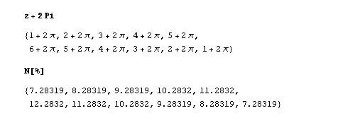

**Figure 11:** Adding a quantity to a list of quantities.
{ .caption }

This illustrates nicely the fact that Mathematica processes an expression symbolically until you force it to substitute figures and evaluate an instance of the expression. That’s quite different from a programming language in the Fortran line-of-descent, which translates a formula into a sequence of operations on storage locations containing numerals. It’s a powerful approach, which neatly sidesteps rounding errors in intermediate calculations. If you want decimal numerals, you apply the N\[...\] operator to the expression.

Note the use of “%” which stands for the expression you’ve last been working on. Or you can lift the whole expression for a new cell – let Mathematica do it, because OutputForm isn’t necessarily appropriate to just copy/paste into an input cell. But Mathematica will make the adjustments.

Next I thought I’d play about with the roots of a quadratic:

## 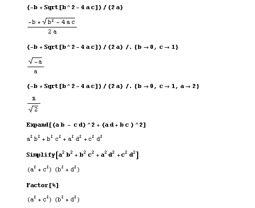

**Figure 12:** Investigating the roots of a quadratic equation.
{ .caption }

Notice the powerful functions: Expand\[...\], Simplify\[...\] and Factor\[...\] (the last two giving the same answer here). Other powerful functions are Solve\[...\] and Reduce\[...\]:

## 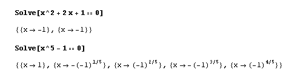

**Figure 13:** Playing with quadratic and quintic equations
{ .caption }

I tentatively tried to get Mathematica to solve Fermat’s Last Theorem, but I couldn’t pin it down with all the assumptions it expected me to clarify. (I rather think it was flannelling...! :-) )

## 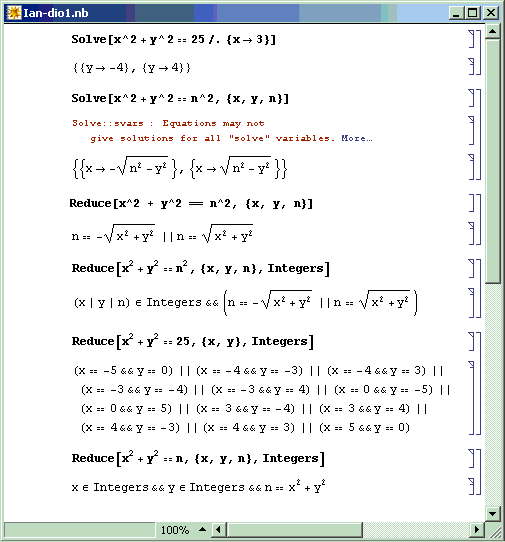

**Figure 14:** Playing with Diophantines
{ .caption }

Growing bolder, I thought I’d use the palette (Figure 3) instead of the boring old keyboard. Unlike APL, Mathematica has a robust notion of infinity – several in fact. It happily sums series to infinity and integrates over an infinite range. As it ought to, of course. (Amazing what you can do with symbolic processing...)

## 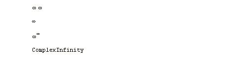

**Figure 15:** To Infinity - and beyond!
{ .caption }

...Yes, that is infinity times infinity (which is infinity of course). You can multiply variables, numbers or expressions by putting a space between them. And the second input cell is indeed infinity to the infinite power.

Now for a bit of lightweight statistics, I said to myself:

## 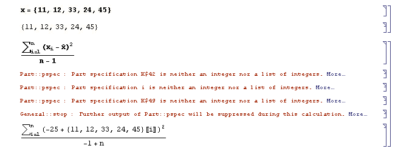

**Figure 16:** Trying to talk statistics to Mathematica (without loading the requisite pack).
{ .caption }

It wasn’t clever to sum to n without saying what n was. So the kernel groused at me. Notice that its grouses have clickable “More...” to explain its reasoning. But it still went on and did the best it could.

However one thing soon became apparent. I had defined x as a simple series, but that didn’t mean that Mathematica automatically knew what x-overbar and x<sub>i</sub> were. I had to tell it, which you do like this (Figure 17). The construct “:=” is a special case of a more general pattern-matching facility, enabling you to extend notation – or even design your own. Mathematica comes with a collection of add-ons called “packs”. These, like notebooks, are written as text files having the file extension: “.M”instead of “.NB”, but like notebooks they consist entirely of Mathematica expressions. They are mostly “:=”lines, plus flag assignments.

Note that the first two lines of Figure 17 are not both needed. They simply show equivalent ways of specifying what x-overbar is to mean.

## 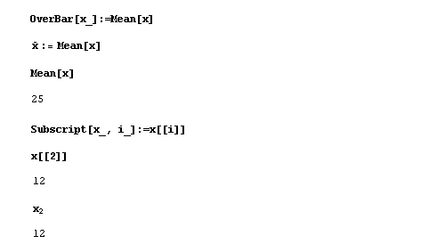

**Figure 17:** Extending the syntax which Mathematica recognises in a notebook.
{ .caption }

Of course all these standard notational definitions are done for you if you load the statistics package.

Integration and differentiation are there, and very powerful they are too. I used the palette to input each expressions in StandardForm, then converted to InputForm to show how Mathematica handles them as standard operations.

## 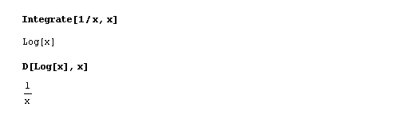

**Figure 18:** Elementary integration and differentiation.
{ .caption }

By now I was eager to see some functions plotted. Why start with something too easy? So I gave it the Topologist’s Sine Wave – guaranteed to break most people’s naive postulates about functions, and indeed about continua, limits, and so on, with its bizarre behaviour in the neighbourhood of zero. What would Plot\[...\] make of it? – I wondered.

## 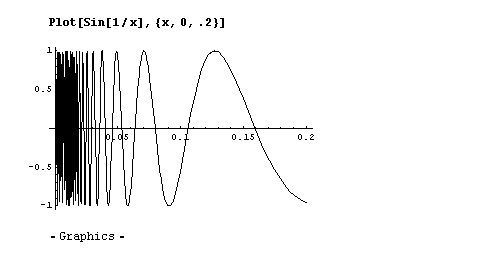

**Figure 19:** The Topologist’s Sine Wave – blows the mind of a non-topologist.
{ .caption }

...well, I had to say I was impressed. The pixels perished first – and it looks like Mathematica approached to the very brink of the black-hole at zero and didn’t fall in.

Now for something three-dimensional. How about an egg-box?

## 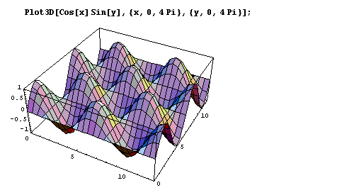

**Figure 20:** Plotting an egg-box.
{ .caption }

One of Mathematica’s party tricks is to treat a sound file as a continuous function. Or alternatively to treat a function (like the Riemann Zeta Function) as a sound to play (it sounds way-out, man!). Here is the author’s voice, supplying an error signal for a well-known product (which exhibited a touching faith in its customers’ intelligence):

## 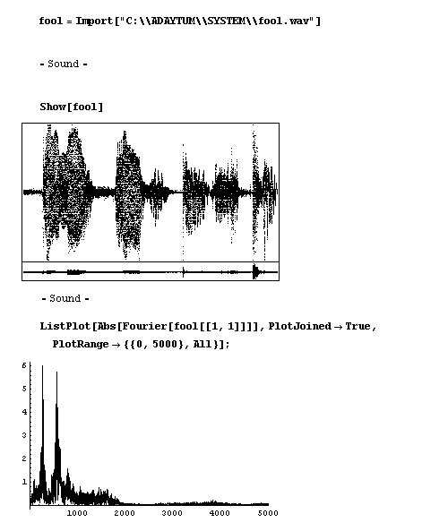

**Figure 21:** Signal analysis of the author uttering: “Only a fool would do that!”
{ .caption }

If you click the output cell (or select menu: Cell/Play sound), it plays the sound. (This works in MathReader too). Next I Fourier-analysed it. All this took a few brief moments to compute.

### What I didn’t like

My one big grouse – and it’s maybe something they can’t do a thing about – is that MathReader does not allow the contents of cells to be altered or re-executed in any way – except to redraw plots and replay sounds. You need the fully-functioning Mathematica to alter cells. Fair enough, you might think – but this simple fact prevents you placing a working calculator in the public domain – one containing a formula to which anybody can set their own numbers. I know this might be impossible to achieve with Mathematica as it is constructed: because the boundary between notebook composition and formula evaluation is such a hazy one. Even to contemplate such a possibility betrays my Babbage way of thinking – I’m assuming that there is some sub-engine inside the Mathematica kernel which can be disabled on its own, which substitutes values into variables and then mills the formula through a 64 bit arithmetic accumulator. One single accumulator? – then what about lists, what about vectors and matrices?

I still can’t escape the feeling however that were Wolfram Research to crack this problem and still not give away the Crown Jewels, they could corner the market in public domain calculators. They already have CalcCenter \[[5](#ref5)\] – a step along the way, and the webMathematica product \[[7](#ref7)\] can be seen as directed towards this issue. But to make it possible for anyone owning a Mathematica licence to publish a free working calculator would in my opinion have a tectonic effect on world education and the use of higher mathematics in all walks of life. It could make Excel as obsolete as the Abacus, which gives me, for one, a wicked sense of glee.

APLers are familiar with the problem as it concerns the Execute function. Can we give the passengers plastic knives and forks to cut up their rubber chickens, but not to slit the pilot’s throat? Or would it turn out to be easier to fund Wolfram Research as a UN agency and give its products away free to the world?

### Where does this leave APL?

As a committed APLer (still) – I want to know why I shouldn’t abandon APL in favour of Mathematica for all purposes. I think it’s unworthy of an intelligent person to bury my head in the sand over this, or dismiss the problem by saying “each to his own”. There are applications I could write easily in APL which I wouldn’t contemplate in Mathematica. Is this just because an old dog can’t be taught new tricks? Mathematica has more in common with J than a “classic” APL, insofar as the programmer’s work is embodied in a text file, a direct descendant of the humble session log of a 1960s interactive interpreter, rather than a black-hole workspace, so what I’m about to say applies even more to J.

Is Mathematica really the way to go to express our creative thoughts – viz back to a 17th century notation designed for parchment instead of forward to a twentieth-century one designed for computers? Or to slant it differently: a widely understood and internationally accepted notation, rather than a “starved palette” of terminally overloaded nouns, verbs and adverbs which will only ever really be understood by a few narrow specialists? For individuals and groups the issue may boil down not to quality and fitness for purpose, but to culture, training, background, job-protection, and ultimately elitism and even name-calling. This of course applies to the language of Mathematics itself every bit as much as to APL or J.

This is something I’d like to explore – and I invite others to explore – in a future article. What is it about APL that gives me an edge over somebody armed with Mathematica (or any of its rivals, like MAPLE) when it comes to programming a sophisticated application?

### Conclusion

Well – it’s a Weapon of Maths Instruction! Send in the inspectors!

### References

1. <a id="ref1"></a> [MathReader, free download: http://www.wolfram.com/products/mathreader/](http://www.wolfram.com/products/mathreader/)
2. <a id="ref2"></a> [Mathematica Information Center: http://library.wolfram.com/infocenter](http://library.wolfram.com/infocenter)
3. <a id="ref3"></a> [Wolfram Research: http://www.wolfram.com](http://www.wolfram.com)
4. <a id="ref4"></a> [Full documentation for Mathematica: http://documents.wolfram.com](http://documents.wolfram.co)
5. <a id="ref5"></a> [CalcCenter, calculators repository: http://documents.wolfram.com/calccenter/](http://documents.wolfram.com/calccenter/)
6. <a id="ref6"></a> [Publicon: http://www.wolfram.com/products/publicon/](http://www.wolfram.com/products/publicon/)
7. <a id="ref7"></a> [webMathematica: http://www.wolfram.com/products/webmathematica/](http://www.wolfram.com/products/webmathematica/)
