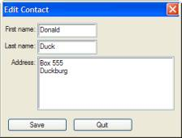
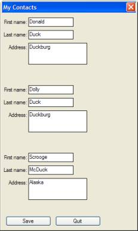
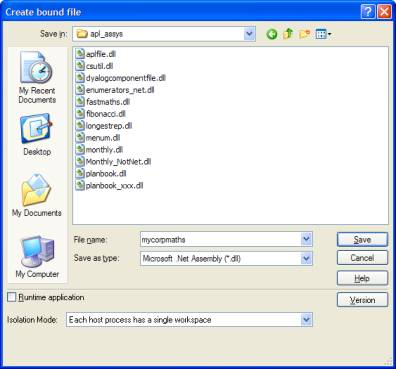
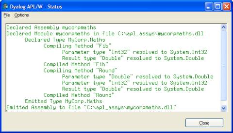

 

## Objects for APLers (Part 3 of 3)

*by Morten Kromberg*

## Editors Note on Sections 1 - 8

The first four chapters of the *Introduction to Object Oriented Programming For APL Programmers* were published in Vector 22.1, and the next 4 in Vector 22.2. As Dyalog Version 11 has matured though the pre-release phase, there have been plenty of minor revisions, and some significant new capabilities introduced. Please use the latest download of the full document from the Dyalog website as your reference material for the earlier sections.

This series now concludes with the final 4 chapters. These are fully in line with the released version of the software, and no revisions are expected.

## 9. Deriving from Dyalog GUI Classes

In addition to the classes which you can write in APL, version 11.0 allows you to work with:

- Dyalog GUI classes, including OLE Servers and and OLE Controls (ActiveX components)
- Microsoft.Net classes

In version 11.0, these classes can be used in exactly the same way as instances of classes which have been implemented in APL. You create instances of them with <span class="APLU">⎕NEW</span>, and you can manipulate the public properties, methods and events which they expose (but unlike APL classes, you cannot see or modify the implementation). For example:

```
      MyForm←⎕NEW 'Form' (('Caption' 'Hello World')('Size'(10 10)))

      XL←⎕NEW'OleClient' (⊂'ClassName' 'Excel.Application')
      XL.ActiveWorkbook.Sheets[⊂'Sheet2'].Index
2
```

```
      ⎕using←'' ⍝ Set the .Net search path
      now←System.DateTime.Parse ⊂'2006-06-06 06:06:06.666'
      ∪now.(Year Month Day Hour Minute Second Millisecond)
2006 6 666
```

Note that the class *name* for built-in GUI objects is provided as a string rather than as a reference to a name in the workspace. The above objects were all accessible in version 10.1 of Dyalog APL, using slightly different mechanisms (which are still available in 11.0, in order to allow existing applications to continue working). The big difference is that:

- Indexing of default properties is supported (see the Sheets example above)
- Most importantly: you can write APL classes which derive from built-in and external classes, which is what this chapter is about.

In version 11.0, it is not possible to create instances of OLEControl objects using <span class="APLU">⎕NEW</span> (or classes which derive from OLEControls). This limitation will be lifted in a subsequent release.

## A Standard Dialog Box

Dyalog GUI Classes provide basic building blocks for GUI applications. Each class, be it a Form, Button, List- or Combo-box, Edit, Grid, Treeview (etc.), is a very general component with a large number of properties which can be used to provide a variety of different behaviours depending on your application requirements. In any given application, you are likely to use certain behavioural patterns frequently. If you write an APL class which uses a GUI class as its base class, you can create “custom controls” which are easier to use in your particular application context, than the original Dyalog classes.

Imagine that your company has a corporate standard for the appearance of dialog boxes:

- The form will have standard dialog box look (EdgeStyle Dialog, Border 2)
- Each form will have a “Quit” and a “Save” button in the bottom left corner (“attached” to corner if the form is resized).
- The form cannot be closed except by clicking on one of these buttons
- The form Caption and its Size must always be provided when an instance is created.

We can create a suitable class which derives from <span class="APLU">'Form'</span>: (you can find this class in the workspace <span class="APLU">DerivedGui</span> in the <span class="APLU">OO4APL</span> folder):

```
:Class Dialog : 'Form'
⍝ Implement Company Standard Dialog Form

⍝ Has 'Save' and 'Quit' buttons at bottom left
⍝ Coord Pixel, Cannot be Closed except by pressing Quit or Save

⍝ Usage: ⎕NEW Dialog (Caption Size FormProps)
⍝ Set Save.onSelect to take control of Save button behaviour

    :Field Public Save
    :Field Public Quit

    ∇ Create(cap size formprops);z
      :Access Public
      z←('Coord' 'Pixel')('EdgeStyle' 'Dialog')('Border' 2)
      z←z,('Caption'cap)('Size'size),formprops
      :Implements Constructor :Base z

      onClose←¯1 ⍝ Disable Close event
      z←('Size'(22 100))('Attach'(4⍴'Bottom' 'Left'))

      Save←⎕NEW'Button'(('Caption' 'Save')('Posn'((Size[1]-30),10)),z)

      Quit←⎕NEW'Button'(('Caption' 'Quit')('Posn'((Size[1]-30),120)),z)
      Quit.onSelect←'doQuit'
    ∇

    ∇ doQuit args
      :Access Public
      Close
    ∇

:EndClass ⍝ Dialog
```

Which allows:

```
      f1←⎕NEW Dialog ('Hello World' (50 250) ⍬)
      f1.BCol←192 192 255 ⍝
Pale Blue
```

{ width="236" height="75" }

Note that the name of the GUI class is quoted when it is used as a base class, in the same way as it would be in the argument to <span class="APLU">⎕NEW</span>. Apart from that, all the principles we have discussed so far about the use of the public members of the base class apply in the same way as if the base class had been written in APL. For example, we can set the <span class="APLU">BCol</span> property to change the background colour.

In the class code, note that we can refer to the <span class="APLU">onClose</span> property of the form directly in our constructor: it is a public property exposed by our base class and thus immediately available to derived class code – and to any user of the derived class. Our <span class="APLU">doQuit</span> function can call the <span class="APLU">Close</span> method of the form directly to close the form.

With the above class in our arsenal, we can start each dialog from a slightly higher level than a raw Dyalog Form object.

### A Labelled Edit Field

One pattern which is often repeated in applications is an edit field with an attached label. It would be nice for application code to be able to treat such a pair as a unit, rather than have to position, size and track them separately. We can achieve this with a class which derives from the built-in Edit class and adds some right-justified text just to the left of the edit box:

```
:Class EditField : 'Edit'
⍝ An Edit field with an associated Label on the left
⍝ Usage example: ⎕NEW EditField
      ('Price:' '10.5' (10 30) (⍬ 50) (⊂'FieldType' 'Numeric'))

    :Field Private Label ⍝ Ref to a Text object

    ∇ Make(label text posn size editprops)
      :Access Public
      :Implements Constructor :Base ('Text' text)('Posn' posn)('Size' size),editprops

       Label←##.⎕NEW'Text'(('Text' label)('Points'(posn+3 ¯3))('Halign' 2)) ⍝ Created in container (##)
    ∇

:EndClass ⍝ EditField
```

Of course, a more sophisticated implementation might have options for the positioning and alignment of the label, but this class illustrates the principle. Creating “company standard” dialog boxes for data entry is now a bit easier than before:

```
      f1←⎕NEW Dialog ('Edit Contact'(200 300) ⍬)
      f1.First←f1.⎕NEW EditField ('First name:' '' (10 60) (⍬ 100) ⍬)
      f1.Last←f1.⎕NEW EditField ('Last name:' '' (38 60) (⍬ 100) ⍬)
      f1.Address←f1.⎕NEW EditField ('Address:' '' (66 60) (90 230)(⊂'Style' 'Multi'))
      f1.(First Last Address).Text←'D…' 'Duck' ('Box 555' 'Duckburg')
```

{ width="224" height="170" }

Our <span class="APLU">Dialog</span> class exposes the Save button as a public field, so we can collect the data by defining a function and assigning it to the <span class="APLU">Select</span> event:

```
     ∇ Update(button event);form

[1]    form←button.## ⍝ Find the form
[2]    ContactInfo←form.(First Last Address).Text
[3]    form.Close
     ∇
```

```
     f1.Save.onSelect←'Update'
```

Finally, we could collect our notes, tidy up and put the whole thing up into a little <span class="APLU">Contact</span> class with an <span class="APLU">Edit</span> method:

```
:Class Contact
    :Field Public FirstName←''
    :Field Public LastName←''
    :Field Public Address←0 ⍴⊂''

    ∇ Edit;f1
      ⍝ Uses #.Dialog and #.EditField
      :Access Public
      f1←⎕NEW #.Dialog('Edit Contact'(200 300)⍬)
      f1.First←f1.⎕NEW #.EditField('First name:' ''(10 60)(⍬ 100)⍬)
      f1.Last←f1.⎕NEW #.EditField('Last name:' ''(38 60)(⍬ 100)⍬)
      f1.Address←f1.⎕NEW #.EditField('Address:' ''(66 60)(90 230)(⊂'Style' 'Multi'))
      f1.(First Last Address).Text←FirstName LastName Address
      f1.Save.onSelect←'Update'
      ⎕DQ'f1'
    ∇
```

```
    ∇ Update(button event);form
      ⍝ Private method used by Edit as callback on Save button
      form←button.##
      FirstName LastName Address←form.(First Last Address).Text
      form.Close
    ∇

:EndClass ⍝ Contact
```

We have not created a constructor for this class, so new instances will have the values declared at the start of the class definition. Register your first three friends as follows:

```
      Friends←3↑⎕NEW Contact
      Friends.Edit
```

This pops us three modal dialog boxes in a row, one after the other – which is hardly ideal. We’ll improve on that in the next chapter.

## 10. Interfaces

As we have seen, a *base class* provides core functionality which other classes can build upon. The core functionality is available from each derived class, unless the derived class intentionally overrides all or part of it. This makes it possible for programs which “know about” the base class behaviour to use most, if not all, classes derived from the same base. If necessary, a user of a derived class can *cast* the instance to the base class using dyadic <span class="APLU">⎕CLASS</span>. The following expressions call the List method of <span class="APLU">ExcelWorkBook</span> via an instance of <span class="APLU">PlanBook</span>.

```
      w←⎕NEW PlanBook 'c:\temp\widgets.xls'
      (ExcelWorkBook ⎕CLASS w).List 'c:\temp'
```

There are situations where it is also useful for classes which do *not* derive from a common base class to expose common behaviour – an *interface*. In the same way as with classes which derive from a common base class, a program written to use a particular interface should be able to use any class which *implements* the interface.

For example, we can define an interface called <span class="APLU">iEditable</span> which requires an object to be able to:

- Paint itself inside a subform at a given location on a GUI Form and return a reference to the subform which it created for itself
- Pick up new values for its properties when asked to do so

We can then write an editor which was able to edit *any* instance of *any* class which supported this interface. By convention, the names of interfaces begin with a lowercase <span class="APLU">i</span>. Our <span class="APLU">iEditable</span> interface definition might look like this:

```
:Interface iEditable

   ∇ SubForm←Paint(Container Position)
   ⍝ Paint instance in Container at Posn, return ref to SubForm used
   ∇

   ∇ Update
   ⍝ Update properties of instance from Painted controls
   ∇

   ∇ UnPaint
   ⍝ Remove any references to resources created by Paint
   ∇

:EndInterface ⍝ iEditable
```

The interface definition contains no code, which will leave many APL programmers wondering what it is for! In most other languages, an interface definition would contain a little more: declarations of the types of all the arguments and results. APL interface definitions *can* also include type information, if we want to export them for other languages to use – see the final sections on Microsoft.Net for more about this. There *are* other reasons why an interface definition is useful, which we will investigate in a moment.

Let us modify the <span class="APLU">Contacts</span> class we created in the previous chapter, and replace the existing <span class="APLU">Edit</span> and <span class="APLU">Update</span> methods with an implementation of <span class="APLU">iEditable</span>:

```
:Class EditableContact : iEditable
    :Field Public FirstName←''
    :Field Public LastName←''
    :Field Public Address←0 ⍴⊂''
  ⍝ --- iEditable implementation
    :Field Private idSubForm ⍝ ref to subform is stored

    ∇ {SubForm}←Paint(container position)
      :Signature SubForm←iEditable.Paint Container,Position
      SubForm←idSubForm←container.⎕NEW'SubForm'(('Posn'position)('Size'(120 200))('BCol'container.BCol))
      SubForm.First←SubForm.⎕NEW #.EditField ('First name:'FirstName(10 60)(⍬ 100)⍬)
      SubForm.Last←SubForm.⎕NEW #.EditField ('Last name:'LastName(38 60)(⍬ 100)⍬)
      SubForm.Address←SubForm.⎕NEW #.EditField('Address:'Address(66 60)(48 130)(⊂'Style' 'Multi'))
    ∇
```

```
    ∇ Update
      :Signature iEditable.Update
      FirstName LastName Address←idSubForm.(First Last Address).Text
    ∇
```

```
    ∇ UnPaint
      :Signature iEditable.UnPaint
      idSubForm←⍬
    ∇
```

```
:EndClass ⍝ Contact
```

With this class defined, we can create a form and arrange our contacts on it. Note that, in order to access the interface, we have to cast each instance of <span class="APLU">EditableContact</span> to <span class="APLU">iEditable</span> , in the same way that we might cast to a base clase if we wanted to access that. This is in order to make it possible for a class to add an interface without the risk of name conflicts between interface member names and members of the class itself:

```
      contacts←3↑⎕NEW EditableContact
      e_contacts←iEditable ⎕CLASS¨contacts ⍝ Cast each to iEditable
      e_contacts[1].⎕nl -3 ⍝ Each one exposes 3 methods  Paint UnPaint Update

      f1←⎕NEW Dialog ('My Contacts' (480 300) ⍬)
      e_contacts[1].Paint f1 (0 0)
      e_contacts[2].Paint f1 (150 0)
      e_contacts[3].Paint f1 (300 0)
      ⍝ or:       e_contacts {⍺.Paint f1 ⍵}¨(0 0)(150 0)(300 0)
```

At this point, pause to fill in the form:

{ width="231" height="387" }

When we are ready, we run the update functions:

```
      e_contacts.Update ⍝ Runs iEditable.Update on each instance
      contacts.(FirstName LastName)
  Donald  Duck    Dolly  Duck   Scrooge  McDuck
```

We could also have defined a function to do the update and connected it to the Save button:

```
      upd←{e_contacts.Update}
      f1.Save.onSelect←'upd'
```

The reason we need an <span class="APLU">UnPaint</span> method can be illustrated by the following sequence. Note that the form does not disappear when expunged. This is due to the references (in the private fields called idSubForm) inside each contact:

```
      ⎕ex 'f1'
      e_contacts.UnPaint
```

Of course, if <span class="APLU">contacts</span> and <span class="APLU">e\_contacts</span> were local to the function doing the above work, or if we expunged these, the references would also disappear.

### Avoiding Name Conflicts

Through the ages, many APL developers have “independently discovered” the need for something like interfaces, and written code which (for example) checks the class of the name '<span class="APLU">Paint</span>', and if the function is present deduces that “the interface is available”. However, this is dangerous: A class might have a method called <span class="APLU">Paint</span> which has nothing to do with “being <span class="APLU">iEditable</span>”. Even if we are rigorous and check all the names in the interface, there is a risk of confusion with similar interfaces. In addition to this: What it if our class already has a method called <span class="APLU">Paint</span> and we want to add the interface to it?

The important reason for having an interface definition is the avoidance of these name conflicts between interfaces, or between an interface and names used by the class. In the <span class="APLU">EditableContact</span> class, each of the interface functions has a <span class="APLU">:Signature</span> statement, for example:

```
    ∇ {SubForm}←Paint(container position)

   ... stuff snipped ...

      :Signature SubForm←iEditable.Paint Container,Position
```

It is the name <span class="APLU">iEditable.Paint</span> in the <span class="APLU">:Signature</span> statement which declares that the function implements the <span class="APLU">Paint</span> method of the <span class="APLU">iEditable</span> interface. The name of the actual function is not actually used. It makes sense to use the same name as the interface function, but if we needed to avoid name conflicts we could call it <span class="APLU">ie\_Paint</span> or <span class="APLU">foo</span> – anything we like.

### Conclusion

The chapter on interfaces concludes the introduction to object oriented concepts as implemented in Dyalog APL version 11.0. The following chapters show how object orientation can be used to integrate APL with other tools which inhabit the Microsoft.Net Framework.

## 11. Using The Microsoft.Net Framework

Operating systems are designed to hide the details of the machine hardware from developers, making it possible to write applications without understanding the details of how the chips which manage memory, disk, keyboard, screen and other peripherals are controlled. As operating systems have evolved, they have tended to provided ever higher levels of abstraction. Environments like Microsoft.Net provide object-oriented encapsulations of everything from low level hardware interfaces to high level GUI and Databases.

If you are running Dyalog APL on a machine where the Microsoft.Net Framework is available, you have access to a vast collection of tools for application building, which are supplied by Microsoft. All of these classes, any classes you have acquired from third parties, plus the classes you write yourself in a language which supports .Net (Visual C#, Dyalog APL, and dozens of other languages), can be used in the same way as you would use the APL classes described in the preceding chapters.

All of the “.Net classes” mentioned above, whether they are something you have written yourself or they were provided by Microsoft, reside in files called *Assemblies*. Microsoft has decided to reuse the extension “.DLL” for these files, so they have the same extension as traditional Dynamic Link Libraries. There can be dozens, or hundreds of assemblies on your machine, so a mechanism is required to name the assemblies that an application would like to use.

<span class="APLU">⎕USING</span> contains a list of assembly names (see the Dyalog APL documentation for details). If one of the elements is an empty vector, this is taken to mean the Microsoft.Net Framework classes contained in the assembly called mscorlib.dll. This core library contains the most commonly used classes. To give an impression of the types of services provided by .Net, the remainder of this chapter will explore a (very) small selection.

## System.Environment

<span class="APLU">System.Environment</span> is a class which contains a number of useful shared properties and methods which provide information about the platform on which the application is running:

```
      ⎕USING←'' ⍝ This is interpreted as ⎕USING←,⊂''

      System.Environment.⎕nl -2
CommandLine  CurrentDirectory  ExitCode  HasShutdownStarted
    MachineName  NewLine  OSVersion  ProcessorCount  StackTrace
    SystemDirectory  TickCount  UserDomainName  UserInteractive
    UserName  Version  WorkingSet

      se←System.Environment
      se.(Version OSVersion MachineName)
 2.0.50727.42  Microsoft Windows NT 5.1.2600 Service Pack 2  GOLLUM

      se.SpecialFolder.⎕NL-2
 ApplicationData  CommonApplicationData  CommonProgramFiles  Cookies
    ... etc ...

      se.(GetFolderPath SpecialFolder.ProgramFiles)
C:\Program Files

      se.(↑{⍵ (GetFolderPath SpecialFolder⍎⍵)}¨SpecialFolder.⎕NL-2)

ApplicationData      C:\Documents and Settings\mkrom.INSIGHT\...
CommonApplicationData  C:\Documents and Settings\All Users\...
  ... etc ...

      ⎕av⍳se.NewLine
4 3
```

We could have named the System namespace in <span class="APLU">⎕USING</span>. This would have allowed us to leave the System prefix out of our references to classes:

```
      ⎕USING←'System' ⍝ Equivalent to ⎕USING←,⊂'System'
      Environment.Version
 2.0.50727.42
```

The author’s personal preference is still to use the fully qualified names – I suspect this may change as I (and the rest of the APL community) start using these classes more frequently, and start to recognize Environment as meaning System.Environment. **However:** note that APL will only search for .Net classes if the name which is used would give a VALUE ERROR in the APL workspace. The use of so-called “namespace prefixes” in <span class="APLU">⎕USING</span> increases the likelihood of a name conflict between your own names and those in an assembly which you are trying to use (for example, Version is more likely to conflict with a name in the workspace than is System.Version). We’ll return to this topic in the next chapter.

## System.Globalization.CultureInfo/DateTimeFormatInfo

The DateTimeFormatInfo class contains information about the date and time formats for a given culture. You can get hold of an instance of DateTimeFormatInfo for the current culture, or for a specific one:

```
      current←System.Globalization.CultureInfo.CurrentCulture
      current.(Name EnglishName)
  da-DK  Danish (Denmark)

      dtf←current.DateTimeFormat
      dtf.⎕nl -2

 AbbreviatedDayNames  AbbreviatedMonthGenitiveNames
    AbbreviatedMonthNames  AMDesignator  Calendar  CalendarWeekRule
    CurrentInfo  DateSeparator  DayNames  FirstDayOfWeek  ... etc ...

     dtf.MonthNames
 januar  februar  marts  april  maj  juni  juli  august  ...

     dtf.FullDateTimePattern
ddd, dd MMMM yyyy HH:mm:ss

     dtf.GetShortestDayName¨0 1 2 3 4 5 6
 sø  ma  ti  on  to  fr  lø

     dtf.NativeCalendarName   ⍝ SO much valuable information!
Den gregorianske kalender

     de←(⎕NEW System.Globalization.CultureInfo(⊂'de-DE')).DateTimeFormat
     de.DayNames
 Sonntag  Montag  Dienstag  Mittwoch  Donnerstag  Freitag  Samstag
```

<span class="APLU">de-DE</span> means German as spoken (or rather, written...) in Germany.

## System.DateTime and System.TimeSpan

DateTime and TimeSpan provide tools for working with timestamps, including doing arithmetic on them:

```
      ⎕←may29←⎕NEW System.DateTime (2006 5 29)
29-05-2006 00:00:00
      ⎕←aday←⎕new System.TimeSpan (24 0 0) ⍝ 24-hour timespan
1.00:00:00
      ⎕←may28←may29-aday
28-05-2006 00:00:00
      +\5⍴ aday
 1.00:00:00  2.00:00:00  3.00:00:00  4.00:00:00  5.00:00:00
      (+\5⍴aday).Days
1 2 3 4 5
```

```
      nextweek←may28++\5⍴ aday
      ,[1.5]nextweek
 29-05-2006 00:00:00
 30-05-2006 00:00:00
 31-05-2006 00:00:00
 01-06-2006 00:00:00
 02-06-2006 00:00:00
      nextweek.(Month Day)
 5 29  5 30  5 31  6 1  6 2
      nextweek>may29+aday
0 0 1 1 1
      (nextweek-System.DateTime.MinValue).Days
732459 732460 732461 732462 732463
```

## System.IO.DirectoryInfo

The DirectoryInfo class contains methods for inspecting the contents of file system folders:

```
     temp←⎕NEW System.IO.DirectoryInfo(⊂'c:\temp')
     temp.CreateSubdirectory⊂'subdir'
c:\temp\subdir

     ↑(temp.GetDirectories⊂'*.*').(Name CreationTime)
 DyalogWebSite  30-05-2006 15:35:40
 js             24-02-2006 22:30:06
 subdir         12-06-2006 14:17:14

(temp.GetDirectories⊂'subdir').Delete 1

      files←temp.GetFiles⊂'a*.dws'
      ↑files.(FullName CreationTime LastAccessTime)
 c:\temp\a.DWS         18-01-2006 17:17:01  05-06-2006 21:57:06
 c:\temp\ab.DWS        12-04-2006 15:54:36  05-06-2006 21:57:06
 c:\temp\ado.DWS       17-06-2005 13:22:08  05-06-2006 21:57:06

      ,[1.5] ⎕CLASS files[1]
  System.IO.FileInfo
  System.IO.FileSystemInfo    System.Runtime.Serialization.ISerializable
  System.MarshalByRefObject
  System.Object
```

The final result above shows that each element of the result is an instance of System.IO.FileInfo, which derives from System.IO.FileSystemInfo ,which implements the interface System.Runtime.Serialization.ISerializable derives from System.MarshalByRefObject. At the end of the day, everything derives from System.Object.

## System.IO.FileInfo

As we have seen above, the Getfiles method of DirectoryInfo returns instances of System.IO.FileInfo, which is a companion class for DirectoryInfo:

```
      (a←files[1]).⎕nl -2
 Attributes  CreationTime  CreationTimeUtc  Directory  DirectoryName
      Exists  Extension  FullName  IsReadOnly  LastAccessTime
      LastAccessTimeUtc  LastWriteTime  LastWriteTimeUtc  Length  Name

      a.(Name Exists IsReadOnly)
 a.DWS  1 0

      z←a.(CopyTo⊂'c:\temp\z.dws')
      z.(FullName CreationTime)
 c:\temp\z.dws  14-06-2006 16:28:30
      z.Delete
```

## Summary

The above examples represent a very small subset of the classes provided by the Microsoft.net framework. There are classes for handling web requests in HTTP and FTP format, for compressing files, sending and receiving e-mail, GUI, database access, graphics and printing, the list is almost endless. It is our intention that, following the release of version 11.0, Dyalog will produce sample code for many of the most useful classes, to demonstrate how applications written in version 11.0 can tap into this vast resource.

In addition to providing the framework itself, the .Net environment specifies calling conventions which mean that classes implemented in all .Net languages – including Dyalog APL version 11.0 – are fully interoperable. A class written in any language can use, derive from, be called, and be used as a base class by any other .Net language. This allows us to integrate APL with other languages and tools more easily than ever before.

## 12. Using APL Classes from .Net

In the workspace called <span class="APLU">DotNet</span> in the <span class="APLU">OO4APL</span> folder, there is a class with two “mathematical” methods in it:

```
      )copy DotNet
Dotnet saved   ... etc
      Maths.Round (○1) 2
3.14
      Maths.Fib 10
55
```

The definition of the class is:

```
:Class Maths

    ∇ r←Round(n decimals);base
      :Access Public Shared
      base←10*decimals
      r←(⌊0.5+n×base)÷base
    ∇

      fibonacci←{⍝ Tail-recursive Fibonacci from ws "dfns"
          ⍺←0 1
          ⍵=0:⍬⍴⍺
          (1↓⍺,+/⍺)∇ ⍵-1
      }

    ∇ r←Fib n
      :Access Public Shared
      r←fibonacci n
    ∇

:EndClass ⍝ Math
```

We can make this class available to all Microsoft.Net applications if we copy it into a workspace and subsequently export the workspace as as .Net *assembly*. As a service to users of typed languages like C#, we probably want to add type declarations of the .Net types of the parameters and results of the public methods before we do the export. This is not strictly necessary, but without it all types will default to System.Object. The result of this will be that most users have to cast data to or from System.Object in order to use it. Our assembly will be more pleasant to use if we can declare everything using the simplest or closest .Net type.

To make the declarations, we must first add a :Using statement which allows us to find .Net data types (this is usually done at the top of the class script):

```
:Using System
```

Next, we must add one line to each of our methods (a class containing these declarations exists in the workspace DotNet under the name <span class="APLU">MathsX</span>). Note that dynamic functions can not be used as public methods in a class, but must be “covered” by a traditional function which supports declarative statements.

```
    ∇ r←Round(n decimals);base
      :Signature Double←Round Double N, Int32 Decimals
    ∇ r←Fib n
      :Signature Double←Fib Int32 N
```

The first <span class="APLU">:Signature</span> declares that <span class="APLU">Round</span> returns a result of type <span class="APLU">Double</span> (which means a double-precision floating-point number), and takes two parameters. The first is a <span class="APLU">Double</span> which is called <span class="APLU">N</span> (most .Net development tools will make this name visible to a developer using our class), and the second parameter is a 32-bit integer called <span class="APLU">Decimals</span> .

After adding the signatures, we are ready to export our class:

```
      )clear
clear ws
      )NS MyCorp
#.MyCorp
      )CS MyCorp
#.MyCorp
      )copy dotnet Maths
... dotnet saved Mon Jun 19 14:01:18 2006
```

In the above example, we created a namespace <span class="APLU">MyCorp</span> and copied <span class="APLU">Maths</span> into it. This will export our class inside a .Net namespace called <span class="APLU">MyCorp</span>, so that the class can be referred to as <span class="APLU">MyCorp.Maths</span>. It is customary to embed classes within at least one level of namespaces – often two levels, typically a company name followed by a product name – in order to organize classes in applications which use classes from a number of different sources.

Select File|Export from the session menu, select “Microsoft .Net Assembly” as the file type and probably uncheck “Runtime Application”:

{ width="396" height="369" }

When you press Save, the following text should appear in the Status window:

{ width="480" height="275" }

The output allows us to check that the two methods Fib & Round were exported, with the expected parameter and result types. We can now write a C# programme which uses our class, for example:

```
public class Test
{
    static void Main()
    {
       System.Console.Write("Round(2/3,2) = ");
       System.Console.WriteLine(MyCorp.Maths.Round(0.6666,2));
       System.Console.Write("Fib(10) = ");
       System.Console.WriteLine(MyCorp.Maths.Fib(10));
    }
}
```

The workspace DotNet in the OO4APL folder contains a programme called CSC, which can be used to call the C# compiler. If we save the above programme in a file called c:\\apl\_assys\\testmaths.cs (or copy the file by this name from the OO4APL folder), we can compile it by calling:

```
    'winexe' CSC 'c:\apl_assys\testmaths' 'c:\apl_assys\mycorpmaths.dll'
0  Microsoft (R) Visual C# .NET Compiler version 7.10.6001.4
   for Microsoft (R) .NET Framework version 1.1.4322
   Copyright (C) Microsoft Corporation 2001-2002. All rights reserved.
```

The left argument of <span class="APLU">'winexe'</span> instructs the C# compiler to build a Windows Executable rather than an assembly. The right argument contains the name of the source file (without the .cs extension), optionally followed by any assemblies which it needs. The result is a file with the same name as the source file, but with an extension of .exe. We call it from APL using <span class="APLU">⎕CMD</span>:

```
      ⎕CMD 'c:\apl_assys\testmaths.exe'
Round(2/3,2) = 0,67
Fib(10) = 55
```

It is important to note that our assembly (mycorpmaths.dll) can be used from ANY language which can use Microsoft.Net. The list includes APL – see the web page *http://www.gotdotnet.com/team/lang/*. In fact, we can use the assembly from APL, in the same way that we would use any other .Net assembly:

```
      )clear
clear ws
       ⎕using←',c:\apl_assys\mycorpmaths.dll'
       MyCorp.Maths.Round (○1) 3
3.142
```

## 13. Inheriting from a .Net Base Class

In the same way that you can inherit from one of the built-in Dyalog GUI classes, you can write a class which derives from a .Net base class. You can derive from classes which you write yourself in a .Net language (including Dyalog APL J), classes purchased from a 3<sup>rd</sup> party tool vendor, or from Microsoft.Net Framework classes. Very many of the Framework classes are *sealed* for security and performance reasons, which means that they can not be used as base classes, but quite a few are intended for use as base classes.

We will now look at writing our own class in C#, as an optimization of our fibonacci function. The Fibonacci series is generated using a recursive algorithm which does a VERY small amount of processing for each level of recursion. Even though tail-recursive dynamic functions are highly efficient, a compiled, strongly typed language like C# is going to be able to execute this particular type of algorithm significantly faster than APL can do it.

If we build our Maths class on a base class written in C#, we can easily substitute some of the methods by methods written in C#. For example, we can write the following (ugly but fast) C# class:

```
using System;
namespace OO4APL

{ public class Maths
    { public static double Fib(int n)
      {   double n1 = 0, n2 = 1, r = 0;
          int i=1;
                  while (i<n)
                  {   i++; r = n1 + n2;
                      n1 = n2; n2 = r;   }
                  return n2;
      }
    }
}
```

If we save this code in a file called fibonacci.cs (which can be copied from the OO4APL folder), and compile this class using our CSC function:

```
      CSC 'c:\apl_assys\fibonacci'

0  Microsoft (R) Visual C# .NET Compiler version 7.10.6001.4
   for Microsoft (R) .NET Framework version 1.1.4322
   Copyright (C) Microsoft Corporation 2001-2002. All rights reserved.
```

We can now write a new class <span class="APLU">FastMaths</span> , which derives from <span class="APLU">OO4APL.Maths</span>. It contains the methods which are still written in APL, the rest will be inherited from the base class:

```
:Class FastMaths : OO4APL.Maths

:Using ,c:\apl_assys\fibonacci.dll

    ∇ r←Round(n decimals);base
      :Access Public Shared
      base←10*decimals
      r←(⌊0.5+n×base)÷base
    ∇

:EndClass ⍝ Math
```

In version 11.0, a class which derives from a .Net class must be exported as a .Net class before it can be used. This restriction may be relaxed in a future release. If you want to test the class quickly, without creating a .Net assembly as a .dll, it is sufficient to export the class to memory using the menu item *File|Export to memory*, after which it can be called:

```
      FastMaths.Round(○1)3
3.142
```

```
      FastMaths.Fib 10
55
```

The first method runs in APL, and the second in C#.

## Conclusion

This concludes the Introduction to Object Oriented Programming for APL Programmers. If you want to learn more, it is time to read the Release Notes and the Language Reference for Version 11.0, both of which contain a number of additional examples.
