by Cliff Reiter
{ .byline }

## Introduction

In recent years there has been an explosion in interest in packing of special tangent circles into circles. When three circles are tangent to each other in pairs, there are two circles that are tangent to those three (where lines may be thought of as circles of infinite radius). When a packing of circles includes those two tangent circles for every triple of tangent circles, the packing is called *Apollonian*. These tangent circles are also related to one another via a notion of circle inversion which goes back centuries, but the explosion of interest in Apollonian packings has occurred because of the beauty of the configurations and the rich structure that these configurations have recently been found to satisfy. We have no intention of attempting to recount the rich history or theory of these structures, but we do want to provide readers with enough background so that they could run some J experiments and see some of the beauty. Readers interested in further exposition on the recent developments and the underlying mathematics may want to start with [\[1\]](#footnote1). Some of the beautiful recent results may be found in [\[2-6\]](#footnote2).

## Descartes Configurations Give Others

Figure 1 shows an example of a basic configuration of four circles where each circle is tangent to the other three. This is known as a *Descartes* configuration. The curvature of a circle is the reciprocal of the radius and we have labelled those circles in the figure with their curvatures. If the curvatures are denoted <i>b</i><sub>1</sub>, <i>b</i><sub>2</sub>, <i>b</i><sub>3</sub> and <i>b</i><sub>4</sub>, then the Descartes Circle Theorem says that  
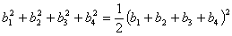 .  
Soddy published a poem recording his discovery of the theorem \[9\]. We check the theorem for the configuration in the figure as follows.

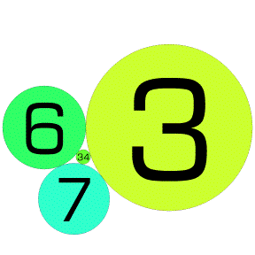  
**Figure 1. A Descartes configuration with curvatures 3, 6, 7, and 34.**

```
   bs=:3 6 7 34

   +/*:bs
1250

   -:*:+/bs
1250
```

If one curvature in the theorem is viewed as an unknown, say <i>b</i><sub>4</sub>, then the quadratic formula can be used on the Descartes Circle Theorem to find the fourth curvature from the other three, but there are two possibilities that arise from the quadratic formula. One recovers the curvature we had, <i>b</i><sub>4</sub>, and a new one appears. The new curvature <i>b'</i><sub>4</sub> may be expressed in terms of the original 4 curvatures as 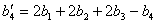 .

Notice that if the original curvatures were integer, then the new curvature also will be integer. For the example above, we see

```
   2 2 2 _1 +/ . * bs
_2
```

The negative radius may seem strange at first glance, but it corresponds to the fact that the tangencies are interior to that circle. Figure 2 shows the configuration that occurs with -2, 3, 6 and 7 as the curvatures.

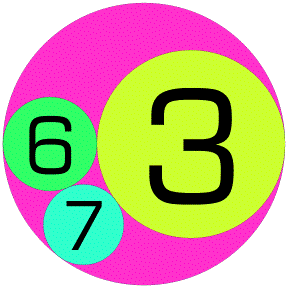  
**Figure 2. A Descartes configuration with curvatures -2, 3, 6, and 7.**

The interchange of the curvature 34 and -2 curvature circles can be described geometrically in terms of circle inversions. However, for us, the main point is that by varying which curvature is replaced, many Descartes curvature lists can be produced from an initial one. Of course, we have not said anything about the centres of the circle and it takes bit of work with the law of cosines to realize a configuration by brute force from the list of curvatures. However, it turns out that if <i>z</i><sub>1</sub>, <i>z</i><sub>2</sub>, <i>z</i><sub>3</sub> and <i>z</i><sub>4</sub> are complex numbers representing the centres of the circles, then Lagarias, Mallows and Wilks [\[6\]](#footnote6) showed that the product of the centres with the curvatures satisfies the same identity as the curvatures. This is known as the complex Descartes circle theorem.

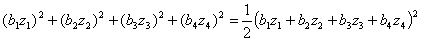

The quadratic formula again applies, and the centre corresponding to the new circle, <i>z'</i><sub>4</sub> , can be found from the following.

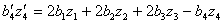

For example, this can be checked for the configuration in Figure 2.

```
   bz
_2                   0
 3            0.166667
 6           _0.333333
 7 _0.214286j_0.285714

   +/*:*/"1 bz
2.5j6

   -:*:+/*/"1 bz
2.5j6
```

It might seem natural to work with Descartes configurations by listing the curvatures and centres. However, the computations are uniform and can be done by matrix multiplication if we act on the curvature and the product of the curvature and centre which may be viewed as a pair of coordinates, rather than a complex number (these are curvature-centre coordinates). Moreover, round-off is something of a (persistent) problem, so we use exact rational representations. Below <span class="aplu">br</span> gives the curvature-centre coordinates in rational form. The matrix <span class="aplu">S1</span> produces an exchange of the type discussed, but distinguishing the first curvature rather than the last. Thus, the circle with curvature -2 from Figure 2 is replaced with the circle of curvature 34 in Figure 1.

```
   br
_2    0  0
 3  1r2  0
 6   _2  0
 7 _3r2 _2

   S1
_1 2 2 2
 0 1 0 0
 0 0 1 0
 0 0 0 1

   S1 +/ . * br
34   _6 _4
 3  1r2  0
 6   _2  0
 7 _3r2 _2
```

If we apply <span class="aplu">S1</span> again, we return to the original configuration <span class="aplu">br</span>. However, we can use analogous matrices <span class="aplu">S2</span>, <span class="aplu">S3</span>, <span class="aplu">S4</span> to modify other coordinates, leading to infinite chains of related Descartes configurations.

```
   S1 +/ . * S1 +/ . * br
_2    0  0
 3  1r2  0
 6   _2  0
 7 _3r2 _2
```

```
   S2 +/ . * br
_2     0  0
19 _15r2 _4
 6    _2  0
 7  _3r2 _2
```

In practice, we will put the Descartes configurations into a standard order so that we can avoid configurations that have already been checked and we will not pursue further variants when the sum of the curvatures is more than 2000. We define an array <span class="aplu">SS</span> that contains all four transforming matrices. We then implement a function, <span class="aplu">more\_desc</span>, that takes two lists as its argument: a “done” list of configurations and those remaining “todo”. The result is likewise a pair of “done” and “todo”lists created by applying all possible transformations, via <span class="aplu">SS</span>, to the “todo” list and organizing the results. If we apply the function until it converges, we see several thousand Descartes configurations are produced from <span class="aplu">br</span> (in less than a minute).

```
   <"2 SS
┌────────┬────────┬────────┬────────┐
│_1 2 2 2│1  0 0 0│1 0  0 0│1 0 0  0│
│ 0 1 0 0│2 _1 2 2│0 1  0 0│0 1 0  0│
│ 0 0 1 0│0  0 1 0│2 2 _1 2│0 0 1  0│
│ 0 0 0 1│0  0 0 1│0 0  0 1│2 2 2 _1│
└────────┴────────┴────────┴────────┘
```

```
   L=:+/@:|:*2
```

```
more_desc=:3 : 0
'done todo'=.y
smoutput #todo
k=.2000>L todo
$m0=.(/:~)"2,/SS&( +/ . *)"2 k#todo
done=.~.done,todo
todo=.~.m0-.done
done;todo
)

   md=:more_desc^:_ (i.0 4 3);,:br
1
4
12
36
108
324
804
1203
1059
651
...
6
3
0
```

```
   $&.> md
┌────────┬─────┐
│5276 4 3│0 4 3│
└────────┴─────┘
```

From the list of Descartes configurations we find and order the circles with curvature less than 2000. This results in about three thousand circles.

```
   $d=:/:~~.,/;md
5279 3

   #d=:d#~2000>{."1 d
3035
```

Once the circles have been converted back to a more usual centre-radius format, J’s graphics facilities may be used to draw the circles. We drew the circles using utilities derived from the *dwin2.ijs* script associated with the text Fractals, Visualization and J, 2nd edition [\[7\]](#footnote7). A stand alone script that contains the drawing functions we used may be obtained from [\[8\]](#footnote8) and used to create these Apollonian packings. The default palette in that script uses 15 colours and selects the colour according to the residue of the curvature modulo 15. Figure 3 shows the result of the plotting those thousands of circles.

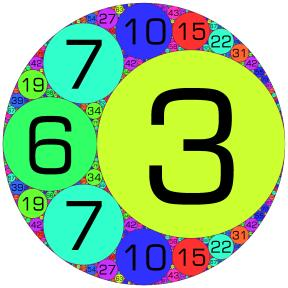{ width="288" height="288" }  
**Figure 3. Apollonian packing with curvatures -2, 3, 6, 7.**

Figure 4 illustrates an Apollonian configuration based upon curvatures -8, 13, 21 and 24 and Figure 5 shows one with -1, 2, 2, and 3.

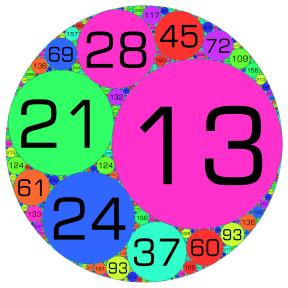{ width="288" height="288" }  
**Figure 4. Apollonian packing with curvatures -8, 13, 21, 28.**

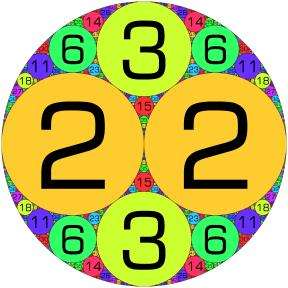{ width="288" height="288" }  
**Figure 5. Apollonian packing with curvatures -1, 2, 2, 3.**

## A Special Configuration

There is a special configuration with curvatures 0, 0, 1, 1. The curvature of 0 corresponds to a straight line (a circle with infinite radius) and these lines are tangent to two circles of radius 1 (and each other at infinity) in an initial Descartes configuration. If we use 0 for the curvature and a unit vector perpendicular to the line in the positions for the curvature times the centre, then we will obtain an initial configuration that allows matrix multiplication to correspond to Descartes swapping.

```
   ]r0011=: 0 1,0 _1 0,1 0 1,:1 0 _1x
0  1  0
0 _1  0
1  0  1
1  0 _1

   S2 +/ . * r0011
0 1  0
4 3  0
1 0  1
1 0 _1
```

However, we also need to modify <span class="aplu">more\_desc</span> to limit the range of imaginary coordinates since this configuration is unbounded and has infinitely many repetitions of the circles of curvature 1. Figure 6 shows this configuration with three of the repetitions visible.

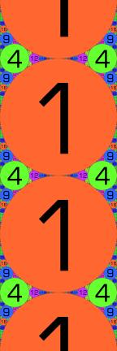{ width="144" height="432" }  
**Figure 6. Apollonian packing with curvatures 0,0,1,1.**

## Initial Configurations

We have seen that obtaining the packing from a single Descartes configuration is possible once the details of the initial configuration are known. There is a theory that allows for canonical minimal Descartes configurations of curvatures, called root quadruples, to be identified. These configurations may be found by solving a simple Diophantine equation with some inequalities holding \[1\]. In particular, (*a,b,c,d*) is a root quadruple if 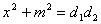 where 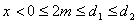 and 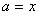, 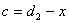, and 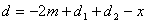. For example, if , then we can look for other suitable parameters.

```
   <@q:"0(*:m=:i.4)+*:x=:_7
┌───┬─────┬──┬────┐
│7 7│2 5 5│53│2 29│
└───┴─────┴──┴────┘
```

So, for example seeing the relatively large factors of 5 and 10 available in the second box, we could take 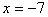, 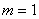, 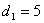, and 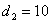 giving 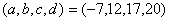. We can obtain the rational curvature-centre coordinates we have used for Descartes configurations using function <span class="aplu">to\_rcf</span> defined in the script *ac3.ijs* in order to obtain an initial configuration.

```
   to_rcf _7 12 17 20
_7      0    0
12    5r7    0
17 _48r35  2r5
20 _33r35 _8r5
```

The resulting Apollonian packing may be viewed at [\[8\]](#footnote8). The simplicity of the process for swapping Descartes configurations via matrix multiplication allows us to explore and see some of the wonders of integer Apollonian packings of circles.

## References

<a id="footnote1"></a>\[1\] D. Austin, When Kissing Involves Trigonometry, *http://www.ams.org/featurecolumn/archive/kissing.html*.

<a id="footnote2"></a>\[2\] R.L. Graham, J.C. Lagarias, C.L. Mallows, A. Wilks, and C. Yan, Apollonian circle packings: number theory, *Journal of Number Theory*, 100 (2003), 1-45.

<a id="footnote3"></a>\[3\] R.L. Graham, J.C. Lagarias, C.L. Mallows, A. Wilks, and C. Yan, Apollonian circle packings: geometry and group theory I, the Apollonian group, *http://www.arxiv.org/abs/math?papernum=0010298*.

<a id="footnote4"></a>\[4\] R.L. Graham, J.C. Lagarias, C.L. Mallows, A. Wilks, and C. Yan, Apollonian circle packings: geometry and group theory II, Super-Apollonian group and integral packings, *http://www.arxiv.org/abs/math?papernum=0010302*.

<a id="footnote5"></a>\[5\] R.L. Graham, J.C. Lagarias, C.L. Mallows, A. Wilks, and C. Yan, Apollonian circle packings: geometry and group theory III, higher dimensions, *http://www.arxiv.org/abs/math?papernum=0010324*.

<a id="footnote6"></a>\[6\] J.C. Lagarias, C.L. Mallows, and A. Wilks, Beyond the Descartes Circle Theorem, *American Mathematical Monthly*, 109 (2002), 338-361.

<a id="footnote7"></a>\[7\] C. Reiter, *Fractals, Visualization and J, 2nd ed.* Jsoftware, Inc., 2000, *http:/www.lafayette.edu/~reiterc/j/fvj2/index.html*.

<a id="footnote8"></a>\[8\] C. Reiter, Some integer Apollonian circle packings in J, *http:/www.lafayette.edu/~reiterc/mvq/acp/index.html*.

<a id="footnote9"></a>\[9\] F. Soddy, The Kiss Precise, Nature 137 (1936), 1021. *http://pballew.net/soddy.html*.

Contact:  
Cliff Reiter  
Department of Mathematics  
<p>Lafayette College, Easton, PA, 18042 USA</p> http://www.lafayette.edu/~reiterc
