### xn+1=kxn(1-xn) where k is less than or equal to 4 and x is between 0 and 1

by Sylvia Camacho

Any publication which includes a discussion of chaos theory is almost certain to include, as a simple introduction to its concepts, a description of the logistic equation. In 1987 James Gleick [\[1\]](#ref1) wrote an enthusiastic history which credits James Yorke with giving the field its name in his 1975 paper *Period Three Implies Chaos*. However it was a physicist turned biologist, Robert May [\[2\]](#ref2), who devoted his time to a close investigation of the behaviour of the equation. It is not possible to appreciate why they found the output of the equation so intriguing without some sort of pictorial representation and when they started, computer graphics were not easy to access, but nowadays the necessary software is cheap and common. As a modest desktop computer makes it an easy matter to reproduce the graphs which are so regularly used to illustrate logistic chaos, it ought to be well-trodden, and by now arid, ground in which to sow seeds of doubt. Nevertheless Gérard Langlet planted some teasing questions during the 1990s in a few not very well known journals. Here, for example, is what he says in Vector 11/2 of 1994 p.83 [\[3\]](#ref3):

### The True Origin of Chaos for Iterated Applications

> Successive iterations of the logistic equation are ALWAYS computed … with computers.  
> In all computers, precision is limited. (on paper, with a slide rule or a calculator, precision is also limited.)  
> . . . with the usual IEEE standard, only 64 bits are available to code:  
>      a) the sign of the constant (1 bit)  
>      b) the exponent (11 bits, hence the maximum value 10<b>308</b> because 308 is 2<b>10</b>  
>           (i.e. 1024) divided by Log<b>2</b> 10, then floored – rounded to the inferior integer  
>           knowing that one bit is also reserved for the sign of the exponent)  
>       c) the *mantissa* in **52 bits**.  
> <b>. . .  
> </b>One may consider that “proofs of chaotic behaviour”, based on iterated formulas or numeric integration should not be accepted as scientific results, unless the authors can prove that their calculations have been performed at least with B+N bits for the mantissa of the floating point representation, given B as the number of necessary bits for the “accurate” binary encoding of the initial value(s), and N as the number of performed iterations:

In issue 11/4 of the same journal Donald McIntyre [\[4\]](#ref4) relates the embarrassing story of an attempt to demonstrate the computation of p using Archimedes iteration for calculating the periphery of an inscribed polygon of increasingly many sides. The computer iteration continued to produce more accurate estimates until it reached 3.14159 but the following eleven iterations fluctuated erratically until it halted at zero. McIntyre calls this cautionary tale *The Perils of Subtraction,* and repeats Langlet’s warning about the limitations of computer architecture. In consequence of this limited precision, Langlet advises that one should be very cautious about any results after the 51st iteration. His paper is a demonstration of the anomalies consequent upon a mind-set which looks for the characteristics of continuous functions despite using fundamentally discrete data, procedures and calculating equipment.

Historically the logistic equation was connected with Malthus’ population studies and thus adopted the methods of statistics and probability. In these disciplines proportions of populations are normalised to be within the interval zero to one. Theoretically this allows infinite discrimination for infinite populations, but in practice limits will be set by the calculation techniques used, and mathematicians are notoriously uninformed about computer science. So, in order to get a feel for the equation, it is instructive to run it and look at some real computer output.

For k=2 the value stays constant after 6 iterations:  
0.75 0.375 0.46875 0.498046875 0.49999237060546875 0.49999999988358468  
0.49999999999999997 0.49999999999999997 0.49999999999999997

<table cellpadding="0" cellspacing="0">
  <tr>
   <td width="8" height="0"></td>
  </tr>
  <tr>
   <td></td>
   <td>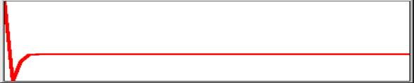</td>
  </tr>
 </table>

   1                                                             recursions                                                                 100

For k=3 the value never falls below 0.5625 and settles to a cycle of two, gradually converging, values. In this case no two values are precisely the same:  
0.75 0.5625 0.73828125 0.5796661376953125 0.73095991951413452 0.58997254673407348 0.72571482250255487 0.59715845670792045 0.72168070287040541

 

<table cellpadding="0" cellspacing="0">
  <tr>
   <td width="8" height="0"></td>
  </tr>
  <tr>
   <td></td>
   <td>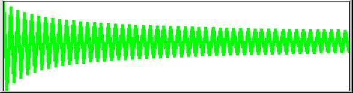</td>
  </tr>
 </table>

    1                                                           recursions                                                          100

 

For k=3.5 the first 51 values are unique but thereafter 4 values cycle and these 4 repeat identically.  
0.75 0.65625 0.78955078125 0.58156120777130127 0.85171719285410319 0.4420325568779035 0.86323921438260276 0.41320045597148339 0.8486304370475456 

and so on to 51st ..……………………………………………………………………………..

0.38281968301732014 0.82694070659143533 0.50088421030722548 0.87499726360246408

<table cellpadding="0" cellspacing="0" align="left">
  <tr>
   <td width="8" height="0"></td>
  </tr>
  <tr>
   <td></td>
   <td>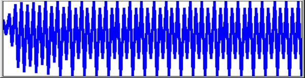</td>
  </tr>
 </table>

      1                                                           recursion                                                                100    

It is found that the values of the constant k for which the results have an apparently chaotic distribution lie between 3.57 and 4 but for k=4 there is, of course, a solution if the initial value is 0.75: 

for k=4 and xn=0.75  
1-xn = 0.25  
therefore xn+1 = 4 × 0.75 × 0.25  
                           &#61; 4 × 0.1875 = 0.75  
and so does not change with recursion but:  
for k=4 and xn=0.751  
1-xn = 0.249  
therefore xn+1 = 4 × 0.751 × 0.249  
                           &#61; 4 × 0.186999 = 0.747996  
and changes with each recursion for example thus:  
0.75100000000000000 0.74799600000000000 0.75399193593600000 0.74195238591793144  
0.76583617179448144 0.71732451906261979 0.81108021365680400 0.61291640268494868  
0.94899954401876202 0.19359763788377514 0.62447036995839122 0.93802850800968485

As shown, after 3 recursions the limit of 17 significant decimal places has been reached. Thereafter the reliability of the results will depend upon the detailed working out of the IEEE standard. For a large ‘amplifier’ like k=4, this will be sensitive at about recursion 50 as explained above. Here are the 44th to 55th and the 98th to 100th recursions:

0.99041787292736083 0.03796123965361185 0.14608073575029160 0.49896461757178029  
0.99999571193290932 0.00001715219481266 0.00006860760245951 0.00027441158182557  
0.00109734512043731 0.00438456381649586 0.01746135766653972 0.06862583461992357

0.12871194109343472 0.44858070925357962 0.98942422615654030

It is interesting to see what is changed by rounding to 17 significant places between each recursion? It makes 44 to 55 and 98 to 100 look like this:

0.99041787287054966 0.03796123987650155 0.14608073657416103 0.49896461990444635  
0.99999571195223092 0.00001715211752693 0.00006860729332718 0.00027441034546593  
0.00109734017771292 0.00438454408898919 0.01746127944848360 0.06862553267402224

0.32725176800851702 0.88063219337526710 0.42047653346533304

So by the 100th recursion all similarity between the two sets of results has been lost. Of course, we need not round; we could merely truncate. In which case recursions 98 to 100 for each of the three trials are respectively:

0.12871194109343472 0.44858070925357962 0.98942422615654030   (IEEE)

0.32725176800851702 0.88063219337526710 0.42047653346533304   (rounded to 17)

0.11041312655125879 0.39288827214573794 0.95410831102429791   (truncated at 17)

Viewed graphically with IEEE=red over rounded=green over truncated=blue:

 

<table cellpadding="0" cellspacing="0">
  <tr>
   <td width="18" height="0"></td>
  </tr>
  <tr>
   <td></td>
   <td>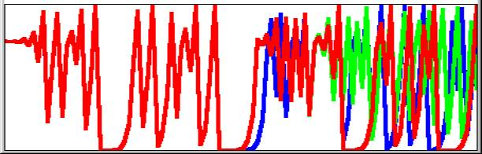</td>
  </tr>
 </table>

   1                                                            recursions                                                        100

Langlet’s warning about the 50th recursion is borne out by the picture. There is obvious divergence after 50 but the poor definition of the graph obscures the fact that none of the 3 sets of values is the same, even within the first 50. Nevertheless the way that these numbers jump around certainly looks chaotic and where there is no discernible pattern can we maintain that precise values are important? As a mathematical recreation and a demonstration of the opposing power and limitations of computers, there may be no reason to quibble but, as Langlet says, the literature has many examples of these researches being accepted uncritically as science.

It seems to have become traditional to present the graphs in this form as connected points as though imitating continuous differential equations, for which setting some intermediate value would enter the same curve. However difference equations do not smooth or average and we have known since the discovery of primes that some of the characteristics of numbers are unpredictable. The graph below shows that starting value 0.751 (red) is entirely dissimilar from starting value 0.7505 (black).

<table cellpadding="0" cellspacing="0">
  <tr>
   <td width="8" height="0"></td>
  </tr>
  <tr>
   <td></td>
   <td>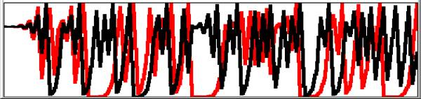</td>
  </tr>
 </table>

    1                                                           recursions                                                   100

 

What then is the significance of setting the starting value as a fraction of one? What is this ‘one’? Robert May [\[2\]](#ref2) is completely clear. For his example of goldfish, ‘one’is the maximum population supportable by the pond. The feedback xn(1-xn) represents the factors preventing the population reaching this ‘extinction’ value (except of course for k=4 and start population 0.5 which goes to zero!), the constant is a characteristic rate of growth for the given environment. The conclusion reached from the graphs is that if the rate of growth is less than 3 the population settles, after some fluctuation, to a single value. Between 3 and 3.57 the fluctuations seem to become a regular cycle. Beyond 3.57 there is no discernible pattern. May uses 0.01 as his initial value but what is the population? It could lie anywhere between one and infinity but we are imagining goldfish and, as we have seen, standard computing techniques set a limit of about 1017 significant places. A population of 100,000,000,000,000,000 fish is some shoal! However, let us look at the result of computing 100 generations using May’s three examples.

1\. Initial value 0.01 with constant 2.4 produces a graph rising for the first 44 values to settle at 0.5833… recurring.

<table cellpadding="0" cellspacing="0">
  <tr>
   <td width="8" height="0"></td>
  </tr>
  <tr>
   <td></td>
   <td>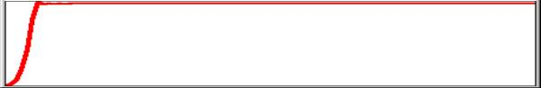</td>
  </tr>
 </table>

   1                                                            recursions                                                  100

2\.  Initial value 0.01 with constant 3.4 produces a graph rising, then fluctuating before settling to a cycle of two. If examined recording only 4 significant places, the first part of the curve extends over 49 different values followed by a cycle with apparent values 0.8422 and 0.452. If examined for the maximum of 17 significant places there is no repetition among the hundred values.

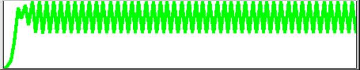{ width="612" height="120" }  
    1                                                           recursion                                                 100 

3\.  Initial value 0.01 with constant 3.99 has no apparent pattern.

<table cellpadding="0" cellspacing="0">
  <tr>
   <td width="8" height="0"></td>
  </tr>
  <tr>
   <td></td>
   <td>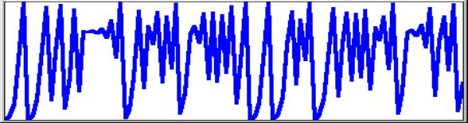</td>
  </tr>
 </table>

    1                                                           recursion                                                 100 

What then is the effect of assuming a maximum population of 100 and correcting to the nearest integer, on the reasonable grounds that fractional goldfish do not reproduce? If the algorithm is run using initial value 1 and constants as above, the results are as follows.

2.4 gives values 1 2 4 9 19 36 55 59 58 . . . 58

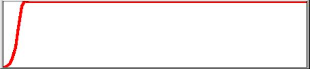{ width="608" height="136" }

  1                                                             recursion                                                    100

3.4 gives values 1 3 9 27 67 75 63 79 56 83 47 84 45 84 45 . . . 84 45

<table cellpadding="0" cellspacing="0">
  <tr>
   <td width="8" height="0"></td>
  </tr>
  <tr>
   <td></td>
   <td>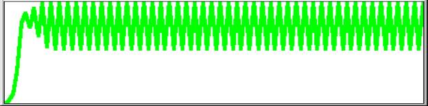</td>
  </tr>
 </table>

    1                                                           recursion                                                        100

3.99 gives values 1 \[3 11 39 94 22 68 86 48 99\]  cycle in brackets repeats.

<table cellpadding="0" cellspacing="0">
  <tr>
   <td width="8" height="0"></td>
  </tr>
  <tr>
   <td></td>
   <td>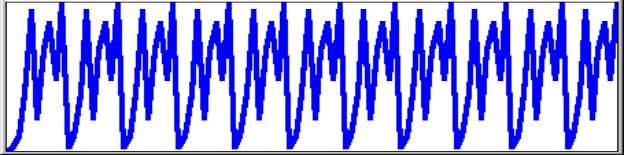</td>
  </tr>
 </table>

   1                                                            recursion                                                         100  
  
So the value of the constant that was supposed to yield chaos gives a cycle of nine  among the hundred possible values. What then do we get for a population of one thousand? We get 1 3 11 43 164 547 988 47 178 583 970 116 409 964 138 474 994 23 89 323 which looks quite nicely chaotic but what follows is 872 445 985 58 217 677, a cycle of 6 repeating for the next 980 generations (1-100 illustrated below).

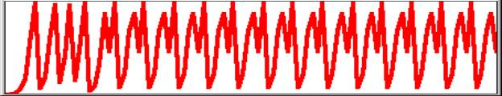{ width="624" height="120" }

The next two graphs complete the investigation. They refer to a set of 10,000 recursions of a logistic equation look-alike using only integer values. The constant k was set to 4, with initial value 7512. The first 108 iterations are apparently chaotic, that is to say they do not repeat. The remaining iterations up to 10,000 fall into a repeating sequence of 15 values, in no way chaotic. 

<table cellpadding="0" cellspacing="0">
  <tr>
   <td width="8" height="0"></td>
  </tr>
  <tr>
   <td></td>
   <td>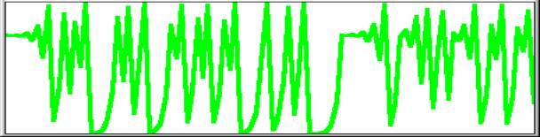</td>
  </tr>
 </table>

  1                                                            recursion                                                      100

<table cellpadding="0" cellspacing="0">
  <tr>
   <td width="8" height="0"></td>
  </tr>
  <tr>
   <td></td>
   <td>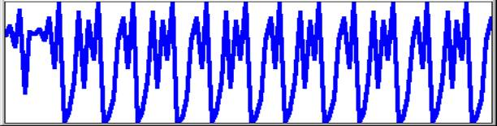</td>
  </tr>
 </table>

   101   108                                                recursion                                                     200

The conclusion which these investigations support is that values of k>3 which show cyclic patterns when graphed are deceptively simple, as the numbers on which they are based are mostly sets of slightly differing fractions which the display cannot resolve. The experiment with integers shows that the larger the population the greater the number of iterations before a cycle is established. This suggests that interpretation based on low resolution graphs of only a few hundred iterations may give a false impression of chaos. On a standard computer integral equivalents for the logistic equation with a discrimination of 1017 are not possible but it seems reasonable to suggest that cycles would be established and that they would be small by comparison with the population size. While both fractional and integral algorithms are mathematically legitimate, care must be taken in their application to real-world systems. Ilya Prigogine [\[5\]](#ref5) noted that real populations fluctuate but not so wildly as to be called ‘chaotic’. The chaos is an artifact of iterated irrational numbers which require a continuum for their realisation but continuum is a mathematical concept for which there is no real-world warranty. It may still be true that the mathematical approximations provide insights into the working of physical systems with massive numbers of interacting entities but we must never lose sight of the primacy of the system being modelled: it is in no way constrained by the mathematical formalism and therefore no conclusions can be drawn unless independent evidence of applicability is available.

## Summary

The Chaos is in the Continuum  
The Continuum is in the Imagination of the Mathematician  
The Continuum is never in the Computer  
No Computer Generated Lines are Continuous.

> We see a body moving and we know that it came from the position A to the position B, but we cannot understand how that happened. As soon as we think of *two* positions, we have left out an infinity of intermediate positions and yet we know that the body moved ‘*continuously’* from A to B, and we understand this term intuitively. But if we try to rationalise it we can only think of sharp positions, and that means *discrete* positions, which by its very nature contradicts the nature of a continuous change. As soon as we try to rationalise the concept of continuity, it evaporates into nothing.

Cornelius Lanczos [\[6\]](#ref6)

 

<table cellpadding="0" cellspacing="0">
  <tr>
   <td width="8" height="0"></td>
  </tr>
  <tr>
   <td></td>
   <td>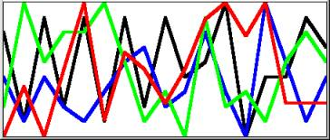</td>
  </tr>
 </table>

  1                    digits of mantissa                           17  
  
where red is p; green is 1 radian; blue is Ö2 ; black is the base of natural log, <b><i>e</i></b> 

 

I have created this picture in response to the following quote from David Miller, who teaches philosophy at Warwick. In *Critical Rationalism* \[[7](#ref7) p155\] he refers to a ‘recipe’ that Ian Stewart gives for a function that will ‘go chaotic’<b>:</b> the recipe is *stretch and fold*. Miller suggests a process ‘even more primitive than the logistic function’:

> Start with the decimal expansion of any real number, repeatedly multiply it by 10 (stretch), and take as the value of the operation the first digit after the decimal point (fold). Rational starting points will generate stable limit cycles, but irrational starting points will never do this. Yet every irrational number is as close as you like to a rational number and conversely.

Miller seems to suggest that this is a surprising consequence of the number system although its significance was known to Archimedes. I cannot do better than quote Cornelius Lanczos who, in the course of a chapter called *Evolution of the Number Field*, points out that there can be no exact representation of one-third as a decimal fraction and then goes on to explain the concept of a limit \[[6](#ref6) p110\]:

> There will always remain a hair’s breadth of space between the upper and the lower bounds. But we are satified with the fact that this hair’s breadth can be made so terribly small that it becomes *smaller than any conceivable number.* Then we say that our sequence has a ‘limit’, and that our sequence defines a *definite number*, although in fact we never obtained that number. Of course, in our case we know what the limit is, namely 1/3, which we can define without our sequence. . . .

> There are two kinds of limit processes. In some processes, as in the one we have considered, the limit is *predictable,* in some others *not.* But this is immaterial because even a preditable limit, i.e. a number which can be exhibited by some finite means, without the infinite sequence, is completely replaceable by the infinite sequence which constitutes the limit process.. . .

> It was the towering genius of Archimedes (287–212 BC) which pointed out the flaw in this argument. . . .

Archimedes pointed out that the proof required a *postulate*: ‘Let A and D be two points of a straight line and B an arbitrary point to the right from D. Then it is always possible to lay off the distance AD to the right a sufficient number of times to come eventually beyond the point B.’ In arithmetical terms this can be stated as: ‘Let e be a positive number which may be chosen as small as we wish. Then we can always find a sufficiently large integer N such that N times e shall become larger than 1.’ This encapsulates the difference between mathematics and physics. Planck discovered an absolute value for a ‘least action’ but it is only recognizable because mathematics can postulate an arbitrarily smaller value. Computers, as part of the physical world, are subject to much coarser graining than this. All the ‘irrational’ numbers used to generate the picture above were necessarily defined to the computer as ‘rational’ numbers, that is to say a large integer divided by 10<b>17</b>, some number of one-hundred-million-billionths. The sequence of values produced by the logistic equation is analogous to the digits comprising the fractional part of p or any other such number but in this case they represent not tenths but 1017ths. If any sequence of numbers repeats without becoming recurrent, the result is rational. If the numbers do not repeat the result is irrational, that is to say, chaotic. Numbers like 1/3 can always be expressed exactly in a place notation by a suitable choice of base but that leaves an infinite number of other rational numbers not expressible exactly in that base.

That values of k=4 and n=0.75 should lead to a consistent value of 0.75 seems unremarkable, indeed satisfactory for those who feel equations should have tidy solutions. However, the precipitate reduction to zero when k=4 and n=0.5 makes an interpretation in terms of population dynamics somewhat strained. If a large population of 0.75 does not succumb what is so fatal about a population of half the carrying capacity of the environment? It is this sort of anomaly that reinforces the message that such mathematical rigmaroles can carry scant weight as models of the real world however realistic they may look in some of their manifestations.

## References

\[1\]  James Gleick, *Chaos*, Heinemann, London, 1988, ISBN 0-436-29554-x

\[2\]  Robert May, *The Best Possible Time to be Alive*, in Graham Farmelo Ed., *It Must be Beautiful*, Granta Books, 2002

\[3\]  Gérard Langlet, *Chaotic Behaviour Revisited*, Vector Vol.11 No.2

\[4\]  Donald McIntyre, *The Perils of Subtraction*, Vector Vol.11 No.4

\[5\]  Ilya Prigogine & Isabelle Stengers, *Order out of Chaos*, Fontana Paperbacks, London, 1985, ISBN 0-00-654115-1

\[6\]  Cornelius Lanczos, *Numbers Without End*, Oliver & Boyd, Edinburgh, 1968

\[7\]  David Miller, *Critical Rationalism*, Open Court, U.S., 1994, ISBN 0-6126-9198-9
