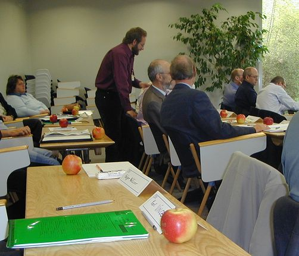
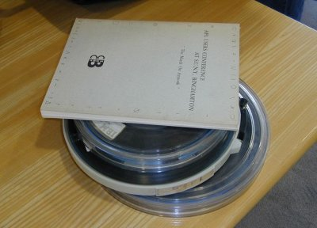
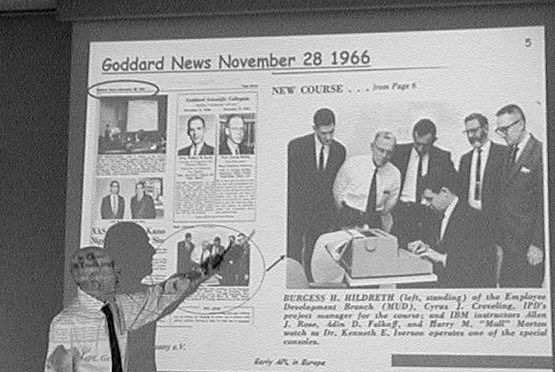
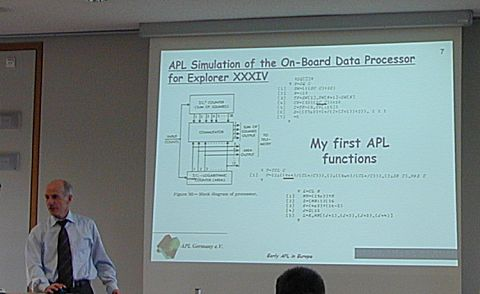
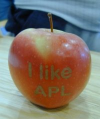
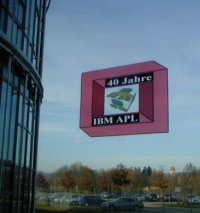

Adrian Smith  
[adrian@apl385.com](mailto:adrian@apl385.com)
{ .byline }

Everything has an official birthday, and in APL’s case the first witnessed success of `)LOAD 1 CLEANSPACE` seems to be accepted as the moment. Which is why we joined APL Germany and the GSE APL working group at the IBM Germany office in Ehningen for a splendid celebration and party on November 27th 2006. Thanks are definitely due to IBM for hosting the excellent meal and party, and to APL Germany for organising some really interesting material. And for printing the apples! The T-shirts were pretty spectacular too, although very little of the APL code would have executed in 1966.

<figure markdown="1">

<figcaption markdown="span">Apples, Quoted, Printable</figcaption>
</figure>

## Historical 40th APL Anniversary

The two great survivors from the early days of the modern era are FORTRAN (just past 50) and APL which is some 10 years younger – indeed the first practical implementation was submitted in batch as a bunch of FORTRAN cards. The meeting was enhanced by several exhibits of early APL material, with keyboards, installation tapes and even the odd card-deck on show. Much of the early literature is still as relevant today as when it was first written, and it was good to see so much collected in one place.

The talks given at the afternoon meeting was a mix of pessimism (the decline in APL as measured by the delegate-count at the annual conferences) and optimism (the power of APL as illustrated by its achievements in the past and its continued substantial revenues for IBM). Dieter Lattermann apologised that his involvement with APL only stretched back 39 years to 1968, when he worked on the original *Complementary Functions*. Remarkably, this was immediately classified IBM Confidential and apparently it still is, as no-one alive today can work out how to remove the tag! Dieter represented IBM on the language group of the international standards committee, and organised what may have been the most successful APL gathering ever – at Heidelberg in 1982 where 800 participants made enough profit for the organisers to found the APL Club Germany, and to continue to fund it to this day.

Reiner Nussbaum brought us up to date with a very neat APL2/PC system that interfaced with his GPS and MapQuest (used very effectively to create the instructions for finding the meeting) and Morten Kromberg reviewed his own long history with IP Sharp (where he worked for 10 years) and more recently with Dyalog. A major theme in Morten’s talk was the power users gained from the early open designs (just leave the user at the 6-space prompt with a bunch of handy keywords) – much of which was lost when AP124 pushed us all down the menu-driven route, and then lost again as everything morphed into clicks and grunts and we spent all our time designing icons for toolbars rather than delivering power to the user.

One contribution in particular stood out as a fascinating record of success in the very early days, so I am going to skip by the pessimistic stuff and just tell you about Yves le Borgne and “Early APL in Europe”.

<figure markdown="1">

<figcaption markdown="span">An original APL\\360 and the March on Armonk</figcaption>
</figure>

### NASA and the First Steps in Europe

Yves covered the very early days of APL at the NASA Goddard space-flight center which used the APL notation as early as 1965 to document the design of satellite experiments. By 1969:

<q>People who were normally playing pétanque at lunchtime were staying 
					inside to learn APL.</q>

The first release of APL\\360 was the turning-point in 1968-70 and the marketing of APL began in earnest in Europe in the early 1970s. The rise of APLSV in the period 1973-76 was the beginning of the period which was recognised by many of the other speakers as ‘the high point of APL’ around the world.

<figure markdown="1">

<figcaption markdown="span">First steps in APL at Goddard</figcaption>
</figure>

The thing that Yves’s talk brought home was just how much of the power of APL was available in the very early days, and how much really useful work was done with it over 10cps tele-typewriters with flak y 300 baud connections to distant mainframes. Here is one example:

<figure markdown="1">

<figcaption markdown="span">APL in Satellite Design</figcaption>
</figure>

### 1973: The Battle for APLSV = the Rimini Plot

APLSV was ready to go out by the end of 1972, but IBM politics began to slow things down as the strategists wanted to wait for the ‘main line’ products to be ready. SEAS APL meetings in Heidelberg and Rimini helped to build sufficient pressure to allow APLSV to be announced in May 1973 and demonstrated during the APL Congress at Copenhagen in August. Things were looking up, and the APL community grew quickly, until…

### 1976-1986: the environment gets too complex

By now VS APL had become the IBM APL horse, but the road ahead was much less smooth. There were some serious flops which began to damage APL’s image, as the 5100, APL\\DPPX and APL\\CICS failed badly. VSPC was pushed (in place of VM/CMS) as the preferred environment but it was complex, buggy and badly-performing by comparison. The PC era was just around the corner…

## Onward to the Party and Blossom Time Sing-song

There was time for Jim Brown to entertain us with more stories from the early days of APL2, and for Dave Liebtag to re-assure us (backed up by a tele-conference with IBM’s VP of enterprise software) that APL was still a big time revenue earner and productivity enhancer for IBM. Then it was on to the excellent buffet supper provided for us by IBM Germany, and back in time to celebrate the moment (in the US timezone, of course) when the first workspace announced itself to the world. The ceremonial singing of APL Blossom Time may one day be available for download as a very tacky video, but for now let’s draw a decent veil over the evening and enjoy one last APL apple and the visiting Vogon spaceship…

					<table>
						<tr align="center" valign="bottom">
							<td>
								 
								Yes, you can print on an Apple!
							</td>
							<td>
								 
								As it says in the book, they fly 
								just the way bricks don’t
							</td>
						</tr>
					</table>
				

Incidentally I kept one of the apples well into 2007, and the motto remained visible until the last. We will have to plan something pretty special for 2016 if we can wait that long. Maybe we should mark 42 years of APL next autumn instead!
