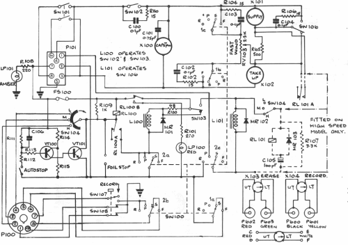
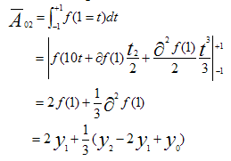
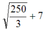
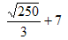
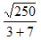
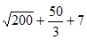
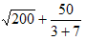
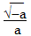
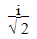

Sylvia Camacho  
[sylviac@blueyonder.co.uk](mailto:sylviac@blueyonder.co.uk)
{ .byline }

> Is Mathematica really the way to go to express our creative thoughts – viz. back to a 17th-century notation designed for parchment instead of forward to a twentieth century one designed for computers? Or to slant it differently: a widely understood and internationally accepted notation, rather than a “starved palette” of terminally overloaded nouns, verbs and adverbs which will only ever really be understood by a few narrow specialists? \[…\]
>
> This is something I’d like to explore – and I invite others to explore – in a future article. What is it about APL that gives me an edge over somebody armed with Mathematica (or any of its rivals, like MAPLE) when it comes to programming a sophisticated application?
>
> Ian Clark

It happened that Ian’s challenge \[[1](#ref1)\] dropped at my feet when I was already in the Lists, jousting in a different arena with those nouns, verbs and adverbs, which Ian suggests are unfit for the mathematical service into which Ken Iverson recruited them. I was doing some research into the origins of and relationships between various natural languages; a matter, as we know, very close to Ken’s heart. I had just found out, too late to thank him again, why it was he had given us a copy of The American Heritage Dictionary – with the stern inscription “Aug. 1990 for Sylvia and Anthony, the RIGHT version”. I guess he had seen that we had only the concise edition, lacking the extensive commentary on the history of language and etymological roots that was his delight \[[2](#ref2)\]. Even as I was discovering its virtues, I was also using an encyclopaedia of language by David Crystal \[[3](#ref3)\] and had reached his brief entry on “The language of science” in which he says:

> The knowledge base of a subject upon which all scientists depend, is accessible only if previous generations have managed to express their findings in a precise and unambiguous manner. Similarly, present day scientists, hoping to make their own contributions to this knowledge base, must satisfy the same linguistic constraints if their work is to be correctly interpreted and accepted by their peers. \[…\]
>
> The mathematical expression of relationships promotes an extensive use of numerals, operators, letters and other special symbols, which are frequently used in word-like and sentence-like combinations (as formulae, equations, etc.). Lengthy sequences of text can be written in logographic form, thus giving the language of science its highly valued status as a universal medium of expression.

Or, as Ian Clark put it, ‘a widely understood and internationally accepted notation’. As Crystal points out, mathematics has that in common with other types of scientific expression; models, charts, pictures, maps and diagrams, but these are almost never totally independent of verbal material to amplify the usage and meaning of non-verbal representations. What is more, comparison of statistics for natural languages shows that the same motivation which has made the various scientific symbolisms increasingly widespread, is making English the favoured worldwide *lingua franca* and the alphabet which it inherited via Rome from the Phoenicians, a universally acknowledged written medium, even for the transliterated version of its language that the Chinese government is promoting. So what is so special about mathematical notation that it should resist this linguistic tide?

A comparison between APL/J and conventional mathematical notation is interesting. Standard APL uses about 50 symbols which are not represented on the normal keyboard. J has 120 entries in its vocabulary of primitives, all of course comprising one or two ASCII characters. In my great tome called *Mathematics from the Birth of Number* \[[4](#ref4)\], I find an index of mathematical “Symbols in Common Use” of 180 entries, of which about 70 can be accessed directly from a normal keyboard, providing italic and boldface are allowed. So conventional mathematics uses rather more than 100 special symbols, that is less than the total of J primitives, to supplement the conventional literary fonts. Why then resist the conversion of all of them, like J, into sets of ASCII characters, thus reaping the same benefits that the Chinese expect from their use of the Roman alphabet? One possible answer is to be found among the types of scientific notation quoted by Crystal. For example:



Given an electronic circuit of this type it would be possible to provide a verbal description:

> …but it would be so long and complex as to be unintelligible. On the other hand, the verbal description of the elements of such circuits is an essential feature of training programmes in the subject.

Anyone who has watched an electronic engineer designing a piece of equipment will have seen such pictures being drawn. What then about mathematicians: do they use similar techniques? Of course they do. They draw geometric diagrams, they draw graphs, they arrange ideas as tables; but this is not what is meant by ‘conventional mathematical notation’. In the imagination of most people that looks more like this \[[5](#ref5)\]:

> 
> { .right }
>
> **Simpson’s Rule** The area under the approximating parabola can be obtained by integrating between the points x=0 and x=2

Yet all except two or three of these characters can be named by any literate person, so it is not the symbols alone that make this script mathematical: it is the way they are disposed on the page. Crystal makes this same point by his choice of a very simple example of a mathematical expression:



This simple mathematical expression is unambiguous in its non-verbal form, with all elements simultaneously present. But as soon as we attempt to read it aloud, in a serial way, complications arise. The verbal version would be: ‘the square root of two hundred and fifty divided by three plus seven’. But this written formulation could be interpreted in several ways such as:

{ style="vertical-align: middle" } or { style="vertical-align: middle" } or { style="vertical-align: middle" } or { style="vertical-align: middle" }

Crystal is right. It is not possible to express in a sentence what this picture means without referring to the spacial disposition of its symbols. However, Iverson has demonstrated that its meaning can be rendered unambiguously as character strings in either APL or J:

```
    7+(250÷3)*0.5  ⍝ APL
    7+%:250%3      NB. J
```

For that matter this can be done equally well in Mathematica; as is shown by Ian’s example of linear input for a quadratic expression. It looks like this:

```
(-b + Sqrt[b ^ 2 - 4ac])/(2a) /. (b=>0, c=>1)
```

which Mathematica simplifies, if given incomplete values, to:



or, if given all values thus:

```
(-b + Sqrt[b ^ 2 - 4ac])/(2a) /. (b#>0, c#>1, a#>2)
```

although it gives the result in <abbr title="conventional mathematical notation">CMN</abbr> unless a numeric result is specified:



An APLIWIN equivalent might look like this:

```
   ∇ r←quad coeffs;a;b;c;dsc;d
[1]   a←coeffs[3] ⋄ b←coeffs[2] ⋄ c←coeffs[1]
[2]   dsc←(b*2)-4×a×c  ⍝ discriminant
[3]   d←1 ¯1×dsc*0.5
[4]   r←(d-b)÷2×a
    ∇
      quad 1 0 2
0j0.7071067812 0j¯0.7071067812
```

While J looks like this:

```
   sel=:'a=:2&{'; 'b=:1&{'; 'c=:0&{' NB.values from argument
   dsc=: (b^2:) - 4:*a*c NB. dsc is discriminant
   r=:(-@b(+,-)%:@dsc)%+:@a
   r cba=:1 0 2 NB. argument assumes ascending polynomial
0j0.707107 0j_0.707107
```

These examples perfectly illustrate the nub of Iverson’s criticism of conventional mathematical notation. Although, just as with the electronic diagram, all of its components can be named, what CMN lacks is a grammar. Its – sometimes very elaborate – arrangement on the page is a substitute for the conventional sentence structure (the syntax of the nouns, verbs and adverbs) of a natural language but, as Crystal shows, this is not sufficient to allow its meaning to be put into words without circumlocution. In this respect, therefore, Mathematica must be subject to the same constraints as APL/J or any other mathematical programming language. Its own specification for computer operations, whether they are to be numeric or symbolic translations, must be unambiguous and complete. Those favourites of mathematicians ‘…’, rules of precedence for operators and so on, must be fully spelled out.

Ian says that, for Mathematica, everything is an ‘expression’ and an expression is ‘a string of ASCII characters to be filtered’, which it surely has in common with most programming languages, including J. APL uses an extended character set requiring a non-ASCII code, which we know to our cost has practical commercial disadvantages, but this is not enough to warrant Ian’s opinion that Mathematica, ‘contrasts strongly with the APL view of the world, where the whole time you’re conscious of handling vectors of binary “num” elements.’ Everyone knows I am a great admirer of Gérard Langlet and he famously championed vectors for most intermediate processing, but to suppose that this can be called ‘the APL view of the world’ seems perverse in the light of Iverson’s own stated ‘core ideas’ \[[6](#ref6)\]:

> - The adoption from Tensor Analysis of a systematic treatment of arrays, in which every entity is an array, and different *ranks* lead to *scalars*, *vectors* (or *lists*), *matrices* (or *tables*), and *higher dimensional arrays* (or *reports*).
> - Operators (in the sense introduced by Heaviside), which apply to functions to produce related functions.

What Mathematica does, which is outside the scope of APL/J, is to resolve algorithms in terms of the symbols themselves. So the result of the quadratic which Ian input in linear form is first displayed in CMN and then, if all values are specified, the result is displayed, simplified, but still as CMN symbols. If the numeric equivalent is wanted it must be specifically requested. As a tool for teaching and using CMN this must be invaluable but it is not needed for a general purpose programming language. Ian suggests that, by reformulating the symbolic algorithms, Mathematica bypasses some of the imprecision which may be introduced by numeric resolution of intermediate results, of the sort described by Donald McIntyre \[[7](#ref7)\]. Gérard Langlet \[[8](#ref8)\] cites Mathematica as a useful example of software which allows a wide range of user-defined precision.

Those of us who have grown up with computing since the 1950s can fully sympathise with Ian’s impatience with legacy systems, incorporating successive attempts by competing vendors to engineer a GUI interface for their APL products; but that Mathematica, dating from 1988 and from a single Vendor is less cumbersome, should scarcely be a surprise to him. The question at issue is whether Mathematica should now be his software of choice for programming a ‘sophisticated application’. I want to answer this with a question. “Is there anything about your application that requires more than simple arithmetic?” If nothing, then base your choice on purely commercial considerations – of price and support and availability of programmers and concentrate your attention on the computer/user interface irrespective of software. On the other hand, if there are subtleties of algorithms and/or it is the users who are mathematically sophisticated, one must consider their level of commitment to the conventional notation.

Ian is obviously very comfortable with CMN and wants to use it as a teaching medium. For this purpose Mathematica may be his ideal tool. The Chinese have no intention of abandoning their ideograms for use within their own community, although they are also intent on communicating with a world becoming technologically committed to the English language and the Roman alphabet. Analogously, if an application requires a fundamentally mathematical or, even more importantly logical, approach and the users are not committed to CMN; APL/J may well be the equivalent of English in the Roman alphabet, the new mathematical *lingua franca*.

As Ian explains it, there are aspects of input to Mathematica more like J than CMN. The ‘linearised format’ input displays in the standard keyboard typeface except that `#/>` gives right arrow. Alternatively, input can be by the graphics package device of selection from a palette of styles, which allow two-dimensional input, matching the CMN default output format. Unsurprisingly, the ‘behind the scenes’ text, which specifies the display of CMN on the screen, is as verbose and unfriendly as the Visual Basic controls set up by the GUI front-end to J.

Which brings us back to Ian’s question: is it only a matter of prejudice or does their ‘fitness for purpose’ have any bearing on a choice between APL/J and Mathematica and, by implication, the many other tools on the market? I think it does, but that he is thinking only in terms of programming bespoke computer applications. The implementation of J is already itself a ‘sophisticated application’, and it is written in C. I have the impression that one popular use for Mathematica is to facilitate publication in mathematical journals and that another is to provide teachers of mathematics with a versatile tool with which to interact with their pupils. Let us remember that Iverson was, above all, a teacher who attracted his pupils from all walks of life. I think of APL as a philosophical tool, and J even more so. Iverson understood mathematics to be a set of formalisms chosen to add brevity and precision to natural language, which then evolved to become an international dialect. Nevertheless, mathematics cannot stand alone: it is rooted in and dependent upon natural language. Consider the page from Lanczos’ *Applied Analysis* above. We can only understand the purpose of his CMN in the light of his verbal description of the relevance of Simpson’s Rule to the method called *quadrature*, which he illustrates with a graph. He might have welcomed Mathematica as a manuscript-preparation tool but that would probably have been the limit of his need for a computer.

However, computers need control languages, which must incorporate both mathematical and logical terms. Iverson’s notation supplied both and would have been a tool of choice, if the capacity of 1960s hardware had been up to the challenge. As it turned out, programming languages were devised using a ‘starved palette’ of words and abbreviations, somewhat reminiscent of English, each having its own exotic grammar, requiring a telephone directory-sized textbook for its exposition. Ken studied the etymology of the language of mathematics and logic and, in the spirit of Esperanto, devised APL and J to be a versatile language, with a simplified and rigorously consistent grammar, in which to talk about arrays whether alphabetic, numeric or logical.

Iverson’s greatest achievement was to extend the field of mathematics itself and an appreciation of this is very likely to be confined to a ‘narrow élite’. It cannot be expected to engage the attention of most mathematicians unless they need both computer power and the unique insights of APL/J. So my answer to Ian’s question would be that the market for applications requiring sophisticated mathematics will always be small and I guess that there will be little competition between APL/J and Mathematica on technical grounds. Like the languages we speak, the programming languages we learn will be decided by the communities we are born into or decide to join. There is no reason why we should not be bilingual in CMN and APL/J but we must recognise that the formal structures we set up by the use of either will always be embedded in some natural language, with English leading the field and already ahead by a good many lengths.

### References

1. Ian Clark, <a id="ref1"></a>[“Review of Mathematica 5.2”](trad/v224/v224-IAN/clark.htm) *Vector* 22.4, pp60-78
2. Roger Hui, <a id="ref2"></a>[“A Lifetime of Working with Ken”](trad/v223/hui222.htm) *Vector* 22.3, pp94-108
3. <a id="ref3"></a>David Crystal, *The Cambridge Encyclopedia of Language*, C.U.P., 1987, ISBN 0-521-42443-7
4. <a id="ref4"></a>Jan Gullberg, *Mathematics from the Birth of Number*, 1997, Norton & Co., ISBN 0-393-04002-X
5. <a id="ref5"></a>Cornelius Lanczos, *Applied Analysis*, Pitman, 1957, London.
6. Kenneth E. Iverson, <a id="ref6"></a>[“APL in the New Millenium”](trad/v223/newmill.htm) *Vector* 22.3, pp5-12
7. Donald McIntyre, “<a id="ref7"></a>The Perils of Subtraction” *Vector* 11.4
8. Gérard Langlet, <a id="ref8"></a>letter *Vector* 12.1
