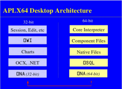
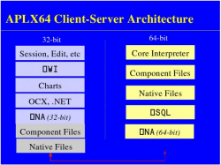
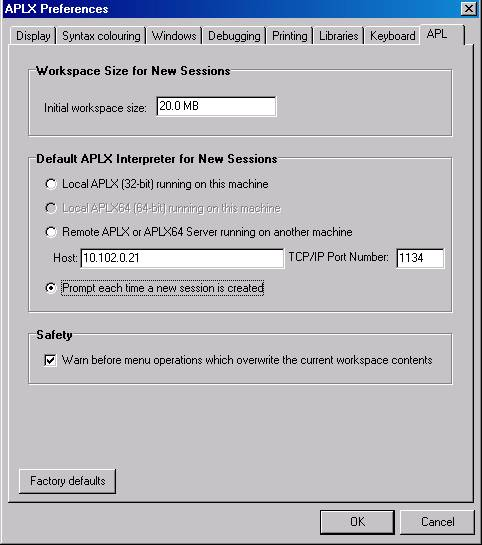

Richard Nabavi, MicroAPL Ltd  
[microapl@microapl.co.uk](mailto:microapl@microapl.co.uk)
{ .byline }

When MicroAPL launched its first APL microcomputer in 1980, the CPU was a Zilog Z80, which could address a maximum of 64 Kb. By squeezing the system and APL interpreter software down to an absolute minimum, we were able to offer a workspace size of ‍‍around 28Kb. Remarkably, users were able to write some quite sophisticated APL systems with this tiny resource, but it ‍‍was tight!

The big breakthrough came in 1983, when the MicroAPL Spectrum was launched, with a 68000 processor and a maximum of 16MB of RAM (24-bit addressing). For the first time, microcomputer users could enjoy a workspace size as big as, or much bigger than, what a mainframe could offer. Within a couple of years, MicroAPL was selling 68020-based systems with full 32-bit addressing.

At this time, IBM PC users were still largely limited to a total of 640Kb, but this was segmented into 64K chunks which ‍limited the maximum size of arrays. Eventually the PC world caught up, and unsegmented 32-bit systems, addressing up to a theoretical 4Gb of memory (of which 2Gb is the most that Windows applications can address), have been the norm for the last decade or more. Because they use (signed) 32 bit integers internally, most APL interpreters available today have a maximum workspace size of 2Gb, and the maximum number of elements in an array is at most 2,147,483,647 (`¯1+2*31`).

But now a new standard is emerging. First AMD, and subsequently Intel, have extended the original x86 architecture to a full 64 bits. Desktop computers now often contain a 64-bit processor (such as the Intel Core Duo or AMD Athlon), and Intel have now standardised on 64-bits for their entire range of desktop and server processors. Currently, nearly all of these are used in 32-bit mode, but the fact remains: low-cost 64-bit systems are here. And APL is one of the few software products which can make good use of the new power and enhanced memory addressing which is now available.

APLX64 is a fully 64-bit version of APLX, which is designed to take advantage of this new memory addressing capability. It is currently available for Linux and Windows.

## Representation and Conversion of Numbers

### Integer size

In designing APLX64, one of the first design decisions was: how big should integers be? Our starting point was that we did not want to impose any artificial restrictions on workspace size or array dimensions, so in APLX64 all array dimensions and all internal pointers are 64-bit. This means that, in theory, the maximum workspace size is 8,589,934,592 Gb, and the maximum size of an array is 9,223,372,036,854,775,807 elements (`¯1+2*63`). That should be enough for another decade or two, and takes us well beyond the current generation of 64-bit operating systems, which are typically limited to 128Gb of physical RAM.

In order to index these potentially massive arrays, we decided to implement full 64-bit integers. This was partly to avoid having to use floating-point numbers to index arrays, but also because 64-bit integers are needed in other contexts in 64-bit systems. These other uses include positions in native files, record numbers and IDs in SQL databases, and handles, pointers and other 64-bit values returned from external calls (`⎕NA`). In addition, we wanted the APL user to be able to do full-precision 64-bit integer arithmetic.

Booleans remain as one bit per element, making it possible to handle huge Boolean arrays without excessive memory requirements.

### Representation of floating-point numbers

In most 32-bit APLs, including APLX, floating-point numbers are represented in 64-bit IEEE format. This representation has 53 bits of precision, and a range of `¯1.797693135E308` to `+1.797693135E308`.

In APLX64, we decided to keep this same 64-bit format for floating-point numbers. The principal motivation for this decision was that current processors and compilers support 64-bit floats directly, whereas higher-precision representations (such as 80-bit or 128-bit) are not available on many platforms. It does not look as though this will change in the near future. A secondary motivation was to save space on large floating-point arrays.

### Conversion between integers and floats

The choice of 64-bit float types presents a potential problem. Up to 2\*53, integers can be represented exactly as 64-bit floats. Above 2\*53, the floats start to lose so much precision that a given float bit-pattern covers a range which includes more than one integer (maybe many thousands of integers). So what happens to the rules for converting integers to floats and vice versa in APL?

In APLX64 the Floor `⌊` and Ceiling `⌈` primitives have been modified so that, given a float number greater than or equal to `2*53`, the number is considered to have overflowed precision, and hence the primitives return the float value unchanged (as a 64-bit float). This is effectively the same behaviour as already happens in 32-bit APLs at `2*31`. The reasoning here is that it is wrong to appear to create a spurious precision by choosing one particular 64-bit integer to represent the floor or ceiling, when the interpreter could equally validly choose many other integers.

For the same reason, any float greater than `2*53` cannot be used in expressions which require an exact integer (for example, to index an array, or as a file pointer). A `DOMAIN ERROR` will be reported.

### Integer Tolerance

According to the *APL2 Programming Language Reference*:

> A number R is treated as integer if the difference between R and some integer is less than approximately `1E¯13×1⌈|R`

This definition would have strange consequences for large numbers. It would mean that ALL floating-point numbers greater than `1E13` (approx `2*43`), would be regarded as integers.

To avoid this problem, APLX64 applies the following rules:

- If the resulting integer would fit in a 32 bit integer, we adopt the existing APL2 rule.
- For larger integers, we use the a fixed distance, the same as that which we would use for `2*32`, i.e.  
    `1E¯13 ×`  biggest 32-bit integer => 0.0000488

This has the desirable consequence that 10,000,000,000,000.5 is *not* regarded as an integer.

### Comparison tolerance

In APLX64 the default value of `⎕CT` has been reduced from `1E¯13` to `3E¯15`. This is a compromise between a value which is small enough to distinguish `X` from `X+1` at high values of `X`, and not giving false negatives for true float comparisons because of calculation and representational inaccuracies. The new default value gives means that, for `X` up to `2*48`, the expression `X=X+1` always returns `0`, irrespective of the internal representation of `X`.

### Default display of numbers

In APLX64 the rules for the default display of numbers have been changed. Numbers represented internally as integers are displayed in full precision irrespective of `⎕PP` (this is also true in most 32-bit APLs, although it may not be obvious because of the limited allowed range of `⎕PP`). In addition, numbers internally represent as floats which are less than `2*53`, and which are ‘exact’ integers, are also displayed in full precision irrespective of `⎕PP`. The practical effect of this is that, at the point where the floats lose precision and cannot be converted back to integers, the default display switches into E format. Below that, true 64-bit integers, and floats which are close to or exactly integers, both display in the same way (full precision).

### Example

The following sequence illustrates how this all works:

```
      BIGINT←2*48
      BIGINT                       ⍝ 64-bit integer
281474976710656
      ⎕DR BIGINT
2                                  ⍝ Data representation 2 means Integer

      BIGFLOAT←1.0×BIGINT          ⍝ Multiply by float forces result to float
      BIGFLOAT
281474976710656                    ⍝ Looks the same as BIGINT, though.
                                   ⍝ It could be used as a file position,
                                   ⍝ array index, etc
      ⎕DR BIGFLOAT
3                                  ⍝ .. but Data Representation 3, i.e. float
      ⌊BIGFLOAT
281474976710656                    ⍝ Floor produces same whole number.  Good!

      ⎕DR ⌊ BIGFLOAT
2                                  ⍝ Internally converted to integer
      BIGINT = BIGINT+1
0
      BIGFLOAT = BIGFLOAT+1
0                                  ⍝ Distinct numbers at default ⎕CT

      VERYBIGINT←2*62              ⍝ A rather bigger 64-bit integer
      VERYBIGINT
4611686018427387904
      ⎕DR VERYBIGINT
2
      VERYBIGFLOAT←1.0×VERYBIGINT  ⍝ Force it to 64-bit float form
      ⎕DR VERYBIGFLOAT
3                                  ⍝ Data Representation 3, i.e. float
      VERYBIGFLOAT
4.611686018E18                     ⍝ Lost precision: displays in E format.
                                   ⍝ It can NOT be used as a file position,
                                   ⍝ array index, etc
      ⌊VERYBIGFLOAT
4.611686018E18                     ⍝ Floor cannot restore the lost precision

      ⎕DR ⌊VERYBIGFLOAT
3                                  ⍝ .. so it returns the same float number

      VERYBIGINT+1
4611686018427387905                ⍝ Great! We can add 1 to a 64-bit integer!
      VERYBIGINT = VERYBIGINT+1
0                                  ⍝ Integer comparison: They are distinct
      VERYBIGFLOAT=VERYBIGFLOAT+1
1                                  ⍝ Float comparison: Same (within ⎕CT)

      VERYBIGFLOAT+1
4.611686018E18                     ⍝ Actually, the addition does nothing.
                                   ⍝ We have only 53 bits of precision, so the
                                   ⍝ extra 1 is lost off the end for a number
                                   ⍝ of magnitude 2*62
```

### Summary of integer-float conversion issues

The practical effect of these design choices is that, for whole numbers below `2*48`, the APL programmer does not need to know or care whether the number is internally represented as a float or as a 64-bit integer; it will behave and display in the same way, and comparisons will always give the expected result. Any conversion between the two internal forms loses no precision, and hence is reversible (e.g. using Floor or Ceiling). Either representation can be used to index an array, or represent a position in a huge native file.

For numbers between `2*48` and `2*52`, the same is true, except that the APL programmer might need to reduce `⎕CT` to avoid comparison problems, or alternatively use Floor or Ceiling to force the numbers to integer before doing a compare.

Above `2*52`, if the APL programmer needs exact integers (for example, for doing high-precision arithmetic, or if the integers are 64-bit database record numbers), APLX64 can correctly handle this requirement. However, in this case the APL programmer needs to be careful to ensure that the integers do not accidentally get converted to float (for example, by mixing record numbers and float values in a single N×2 matrix, or by doing arithmetic operations which are intrinsically non-integer, such as divide). Fortunately, if this does happen, it should be obvious, because the display will flip into E format at the point where precision has been lost, and operations which require an integer will give `DOMAIN ERROR` rather than giving the wrong answer.

## The Client-Server Architecture

Internally, the APLX64 product comprises two separate programs. The 64-bit APL interpreter itself runs as a 64-bit application (called `aplx64_server` on Linux, or `aplx64_server.exe` on Windows). This is the *Server*. The front-end, which is the program you use to edit, run, and debug APL workspaces, and which implements all of the user-interface elements and `⎕WI`, is a 32-bit program (called `APLX.exe` on Windows). This is the *Client*. The Client and the Server can run on the same physical machine, or on separate machines connected by a TCP/IP network. Typically, the Client runs on a desktop Windows system, and the Server runs on a Windows or Linux server system, although other combinations are possible.

A given Server can support any number of Clients (each of which may be running more than one APL session on the Server), subject to having sufficient memory and CPU resources and the license agreement in force. Also, a given Client can connect to multiple Servers, so you can run several 64-bit sessions simultaneously on different servers.

As well as the 64-bit interpreter, APLX64 also includes a 32-bit version of the interpreter, which is part of the Client program. This allows you to develop and test 32-bit APLX applications as well as full 64-bit applications. A given Client can run both 32-bit and 64-bit APL sessions simultaneously.

### Communication between the Client and Server

The Client and the Server communicate with each other using the TCP/IP network protocol (this is true even if they are physically on the same machine). The official IANA port number allocated to APLX is 1134.

### Security and Firewalls

The network communication used by the APLX client-server architecture is not encrypted, and could in theory be snooped on, or used to run malicious APL code over the network. For this reason, we strongly recommend that the Server should be protected by a firewall so that it is not exposed to attacks from untrusted sites. The firewall should normally be set up to disallow all traffic on port 1134 except between the Server and authorised Client machines on an internal network.

It is possible to run the Client remotely from the Server (for example, for an employee to run the Client on a machine at his or her home, accessing the Server in the corporate data centre over the internet). However, the only safe way to do this is to use a secure VPN (Virtual Private Network), which has been correctly set up to fully protect traffic between the two machines.



### Running APLX64 on a 64-bit Windows Desktop system

In APLX64 Desktop Edition, the Client and the Server run on the same machine, usually under Windows XP64 or Vista. When you start the Client program, normally the Server program is started automatically, so the fact that there are two separate programs running is transparent to the user. When the last APL session ends and the Client program exits, the Server program will also terminate automatically.

Because most of the program is 32-bit, it installs by default in the `Program Files (x86)` directory. This is true even of the 64-bit interpreter itself. Also the Registry entries are 32-bit, sitting in the `WOW6432Node` area of the Registry.



### Running the Client and Server on separate machines

Alternatively, the Client and the Server can run on separate machines. The Client usually runs under Windows, whereas the Server can run under 64-bit versions of Windows or Linux. When you start the Client program, normally it will try to connect to the APLX Server program running on the server machine specified in your Preferences (see below).

The Server program must already be running when the Client tries to connect to it. The Server starts as a small ‘listener’ program which waits for a connection. When it receives a connection request from an APLX Client, it starts another process which is the actual APL interpreter associated with that connection.

## 32-bit and 64-bit APL Tasks

### Customizing the creation of new APL tasks created from the menus

Using the APL tab of the Tools->Preferences dialog, you can alter the way in which new APL sessions, including the initial session at start-up, are started:



The choices are:

- Use the 32-bit APL built-in to the Client program.
- Use the 64-bit APL Server running on the same machine as the client. If the Server is not already running, it will be started automatically. On a 32-bit Client system, or if you do not have the 64-bit interpreter installed on the same machine as the Client, this option is not available and will be greyed out.
- Connect to a remote APLX interpreter over the network, in which case you need to specify the host and port in the normal way (the default port is 1134). You can specify the host as either the IP address (for example, 10.102.0.21), or as the network name of the server machine (for example, `'server23@bigcorp.com'`), or as `'localhost'`, which always means the same machine as the client. Note that the APLX Server program must already be running and accepting connections on the specified system – it will not be started automatically.

You can also say you want to be prompted each time you start a new session. This applies even to the initial session which opens when the APLX Client starts up.

## Creating tasks under program control

You can also create new tasks under program control, using the `⎕WI` APL object in the same way as in standard 32-bit APLX. The default is that the new APL session starts in the same execution environment as its parent, so if you create a new APLX task from a 64-bit task, the child will also be a 64-bit APL on the same server.

However, you can tune this by setting the `host` (and optionally `port`) property of the APL object before calling the `Open` method. If the host property is an empty string, the task will be created a 32-bit APL on the Client system. If it is set to the string `'localhost'`, it will be a 64-bit APL on the client machine (assuming the Client is running on a 64-bit system), and the Server program will be started automatically if necessary. If it is anything else, the front-end will attempt to create the new APL task by connecting to the specified remote machine (which must already be running the APLX Server program).

This example will create a new 32-bit APL session:

```
      'Session32' ⎕WI 'New' 'APL' ('host' '')
      'Session32' ⎕WI 'Open'
```

This example will create a new 64-bit APL session running on the local machine (assuming it is a 64-bit machine with APLX64 installed):

```
      'Session64' ⎕WI 'New' 'APL' ('host' 'localhost')
      'Session64' ⎕WI 'Open'
```

This example will create a new 64-bit APL session running on a remote machine:

```
      'SessionRemote' ⎕WI 'New' 'APL' ('host'
      'server23@bigcorp.com')
      'SessionRemote' ⎕WI 'Open'
```

If you do create child APL tasks in this way using `⎕WI`, they can share APL data by using the `data` property of the `Child` object (in the parent task) and the `data` property of the `System` object in the child task, or by using property names beginning with delta. However, these are held as 32-bit objects, and (like all `⎕WI` properties) will be converted to 32-bit variables before they are sent from the 64-bit APL task to the front-end.

## Operations on Client and Server

Where the Client and the Server run on different machines, you can specify where you want certain operations to take place, by the file name or command string with either a `↑`, meaning the Client, or a `↓` meaning the Server. For example, you may want to `)SAVE` a workspace either on the Client machine, or on the Server machine.

The choice of where an operation occurs applies to:

- `)LOAD )SAVE` etc where a library number is used. In this case, the corresponding line of the `⎕MOUNT` table of library numbers is used to determine the library path, and the first character of this path can be either `↑` or `↓` to indicate which machine is being referenced.
- `)LOAD )SAVE` etc where you specify the full file name
- Native files
- Component files
- `⎕NA`
- `⎕HOST` and `)HOST`

This all makes no difference if you are running the Client and the Server programs on the same machine, except for `⎕NA`, which now allows you to call either a 32-bit or 64-bit DLL (see below).

## File accesses

Both component and native files can be accessed either on the Client, or on the Server. For example you might have saved some data from Excel on your desktop PC. The 64-bit APLX application, running on a remote server, can open this as a native file over the network completely transparently using `⎕NTIE`. It can then save the results of some large calculation based on this input as another native file, this time on the server. All that is necessary to make this work is to prefix the name of the file (when you open it or create it) with a `↑` or `↓`.

If you do not specify, the operation will take place on the Client. This may seem a bit surprising, but it means that file selector dialogs still work and give the expected result.

## The `⎕WI` sub-system

The `⎕WI` sub-system is part of the Client program, so it always runs as 32-bit code. When you make a call from a 64-bit interpreter, the request is converted to 32-bit form and sent over to the Client program for execution. Any `⎕WI` windows and dialogs, therefore, appear on the Client system – which is what you want! In addition, any references in `⎕WI` objects to files and directories are from the viewpoint of the Client system.

## `⎕HOST`

`⎕HOST` can be used to execute an operating-system command or run another program on either the Client or the Server. In this example, the Client is running under Windows, and the Server under Linux x86\_64:

```
      ⎕HOST '↑cmd /c vol c:' ⍝ Execute on Windows Client machine
Volume in drive C has no label.
Volume Serial Number is 07D0-0B11

      ⎕HOST '↓uname -nsp'    ⍝ Execute on Linux Server machine
Linux Server23 x86_64
```

## The `⎕NA` system function

In APLX64, `⎕NA` has been extended so that it allows you to call either a 32-bit DLL (from the Client program), or a 64-bit DLL (from the Server program). The implementation is as follows:

For clarity, we will assume that the 64-bit Server is running on one machine, and the 32-bit Client is running on a different machine. (In fact, they might be different operating systems, e.g. a Linux 64-bit server and a Windows 32-bit client).

When you use `⎕NA`, you might want to call a function on either end. For example, it would make sense to make a 32-bit call to Windows to discover something about the screen or registry on the Client. Equally, you might want to invoke an OS service or library on the Server, for example to call a Linux file-encryption API.

APLX64 use the same conventions as for file names to allow you to specify which you want. If you prefix the `⎕NA` specification (i.e. the right argument) with a `↑`, the call takes place on the Client. If you prefix it with a `↓`, it takes place on the Server. The default (if you do not specify either) is that it takes place on the Client. (This is for compatibility with existing 32-bit APLX Windows applications).

If you make the call on the Server side, the APL task directly calls the requested library. There is no special handling. Everything is 64-bit, and there are no extra tasks involved.

If you make the call on the Client side, the APL task bundles up the request and sends it over the network (which might be just an internal pseudo-network if the two are on the same machine). It then blocks and waits for a response. On the Client side, a 32-bit task picks up the request and makes the (32-bit) call. It returns the results over the network to the 64-bit Server, which wakes up and continues APL execution.

To support 64-bit calls, new data types for 64-bit integers have been added (I8 and U8 for signed and unsigned 64-bit integers).

As an example, suppose you are running the APLX64 Server on a twin-processor Xeon Linux 64-bit system, and running the 32-bit APLX client on a 32-bit Windows PC. In these circumstances, you can define two external functions, one which makes a call to get the Windows system directory (a 32-bit Windows call) on the Client machine, and another which makes a 64-bit Linux call to get the current working directory on the Server:

```
      'GetSystemDirectory' ⎕NA '↑U
kernel32|GetSystemDirectoryA >C[256] U'
      GetSystemDirectory '' 255
17 C:\WINNT\system32

      ⎕NA '↓/lib64/libc.so.6|getcwd >C[512] U8'
      getcwd '' 512
/home/david/aplx64
```

If you are running the Client and the Server on the same physical machine, the above all remains true. Under Windows XP64 or Vista 64-bit, 32-bit applications (such as the Client program) run within a virtual 32-bit environment, and access different versions of the operating-system libraries (confusingly, the 32-bit versions reside in `C:\WINDOWS\SysWOW64`, and the 64-bit versions in `C:\WINDOWS\system32`). You can therefore make either the 32-bit or 64-bit version of a system call or library access from within APLX64. This capability is very unusual – perhaps unique, since normally 32-bit programs can make only 32-bit calls, and 64-bit programs only 64-bit calls.

## Conclusion

APL makes an excellent partner to the new 64-bit hardware and operating systems, taking full advantage of the new power and memory addressing. This, combined with the Client-Server architecture, makes possible new kinds of distributed APL applications. It will be fun designing and implementing new types of APL applications in this new environment!
